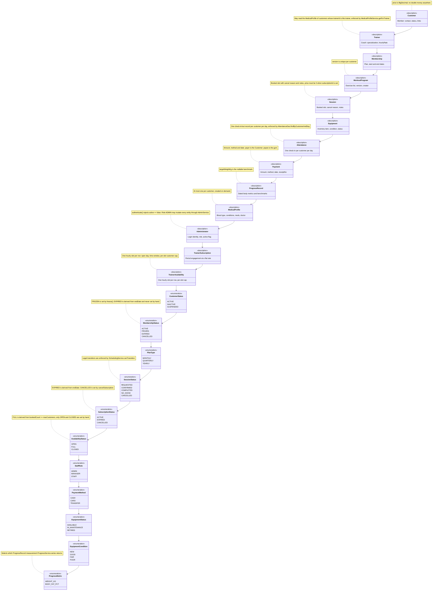
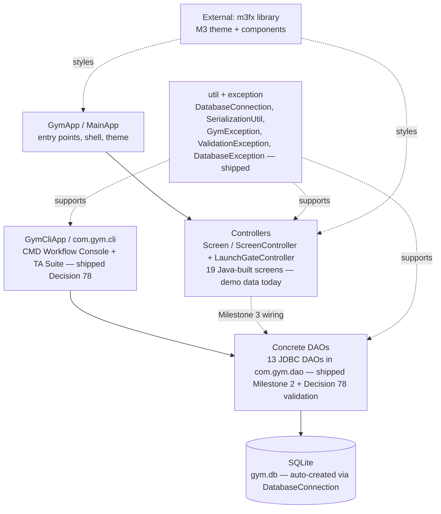
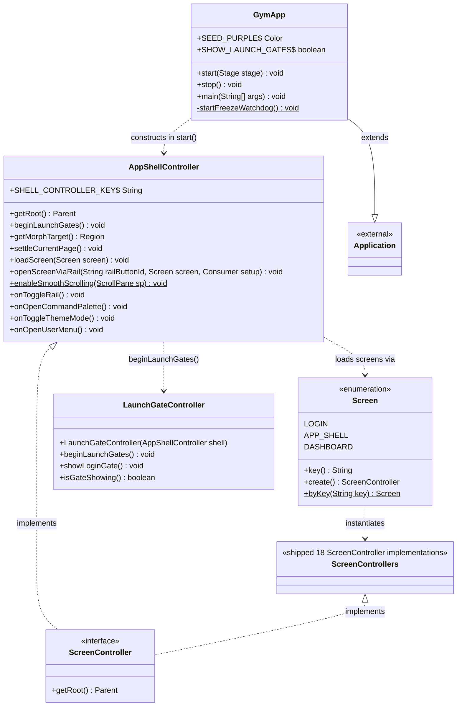
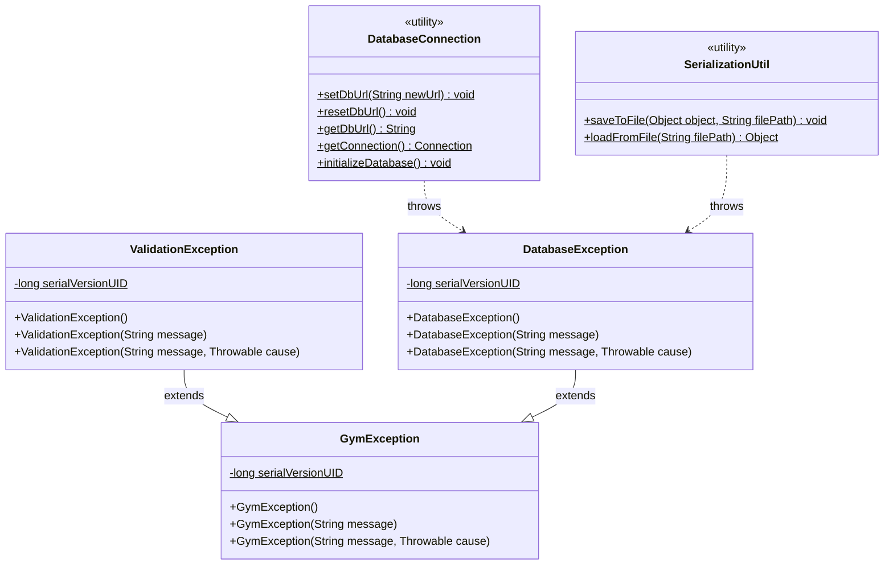
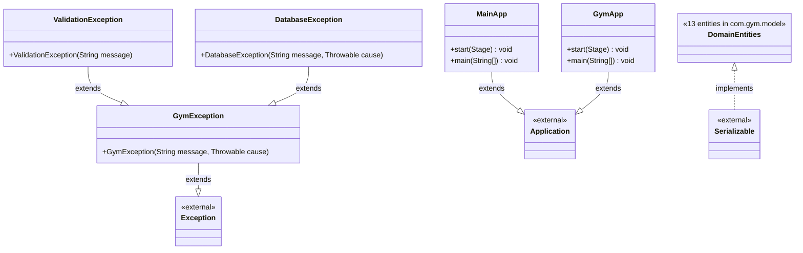

# UML — Gym Management System (JavaFX)

> **Status: Milestone 2 backend and UI runtime spine shipped; Milestone 3 DAO-to-UI wiring pending.**
> Shipped in code today:
> - **Domain model (`com.gym.model`)**: all **13 domain entities and 11 enums** (§1 and §1b), plain POJOs implementing `java.io.Serializable` (`serialVersionUID = 1L`) per COMP 301 Lecture 6.
> - **Data access (`com.gym.dao`)**: **13 concrete SQLite DAOs** (`CustomerDao`, `TrainerDao`, …) using plain JDBC `PreparedStatement` + `try-with-resources`.
> - **Utilities & exceptions (`com.gym.util`, `com.gym.exception`)**: `DatabaseConnection` (SQLite connection + 13-table `CREATE TABLE IF NOT EXISTS` DDL), `SerializationUtil` (binary object I/O), and checked exceptions `GymException -> ValidationException, DatabaseException`.
> - **Retired layers (`DECISIONS.md` 77)**: the 11-service tier (`com.gym.service`), abstract DAO interfaces, and redundant planned helpers were removed to keep the codebase aligned with COMP 301 Lectures 1–6.
> - **UI (`com.gym`, `com.gym.controller`)**: `MainApp` (m3fx gallery), `GymApp` (shell launcher), `Screen` + `ScreenController`, and 20 Java-built controllers running on demo data until Milestone 3 connects them to the DAOs.
>
> `docs/COVERAGE.md` tracks what exists. `docs/UML_TEAM.md` holds team ownership.
>
> **Two domain diagrams, then five per-layer zoom-ins** (architecture, data access, retired services note,
> controllers, utilities/exceptions). Each class is drawn in full exactly once; a later diagram repeats a
> class only where it participates in that diagram's wiring.
>
> **Structural diagrams carry no prose.** Mermaid lays `note for` blocks and unconnected classes out
> *beside* the graph rather than inside it, so descriptions widen a diagram instead of annotating it.
> Descriptive notes for §1 live in §1b (`classDiagram` notes).
>
> Notation:
> `-` private · `+` public · `#` protected · `~` package ·
> `-->` association · `o--` shared aggregation · `*--` composition ·
> `..>` dependency · `<|..` realization (drawn from the implementer side) ·
> `--|>` generalization (drawn from the subclass side).
>
> Diagram-wide conventions:
> - **Arrow direction:** the class that *holds the foreign key* is written on the **left**, and the
>   arrowhead lands on the referenced class on the right. `A --> B` draws the arrowhead at **B**.
>   So `Customer "0..*" --> "0..1" Trainer` means `Customer.trainerId` references `Trainer`.
> - **Label voice:** every association name is passive, read as "*{left}* *{label}* *{right}*".
>   `Membership --> Customer : is held by` reads "Membership is held by Customer".
> - **Boxed `Integer`/`Double`/`Boolean` marks a nullable field/column; primitives mark NOT NULL.**
> - **Money is `BigDecimal`** — never `double`.
> - **Dates are ISO-8601 strings**: `yyyy-MM-dd` for dates, `HH:mm` for times,
>   `yyyy-MM-dd HH:mm` for date-times. ISO-8601 sorts lexicographically in chronological order.
> - Entity getters and setters are omitted in §1 to keep the diagram readable — every private field
>   marked `«get/set»` has a public getter and setter. Enum `values()`/`valueOf(...)` are implicit in Java.
> - `m3fx` is an external library dependency (`io.m3fx.*`), not project domain code.
>
> **Rendering note — what Mermaid can and cannot draw.** Diagrams use Mermaid `direction TB`.
> Static members use `$` (`+getConnection()$`) in source; Mermaid `classDiagram` strips `$` at render time,
> so utility helpers are stereotyped `«utility»` to stay unambiguous. External platform classes (`Application`,
> `Exception`, `Serializable`) and our checked exception subclasses appear in §7.

## 1. Main diagram (domain model)

```mermaid
classDiagram
    direction TB
    class Customer {
        -int id «get/set»
        -String fullName «get/set»
        -String phone «get/set»
        -String email «get/set»
        -String address «get/set»
        -String dateOfBirth «get/set»
        -String gender «get/set»
        -String emergencyName «get/set»
        -String emergencyPhone «get/set»
        -CustomerStatus status «get/set»
        -String joinDate «get/set»
        -Integer trainerId «get/set»
        +Customer()
        +Customer(int, String, String, String, String, String, String, String, String, CustomerStatus, String, Integer)
        +toString() String
        +equals(Object) boolean
        +hashCode() int
    }
    class Trainer {
        -int id «get/set»
        -String fullName «get/set»
        -String phone «get/set»
        -String email «get/set»
        -String specialization «get/set»
        -int experienceYears «get/set»
        -String certifications «get/set»
        -String hireDate «get/set»
        -BigDecimal hourlyRate «get/set»
        +Trainer()
        +Trainer(int, String, String, String, String, int, String, String, BigDecimal)
        +toString() String
        +equals(Object) boolean
        +hashCode() int
    }
    class Membership {
        -int id «get/set»
        -int customerId «get/set»
        -PlanType plan «get/set»
        -BigDecimal price «get/set»
        -String startDate «get/set»
        -String endDate «get/set»
        -MembershipStatus status «get/set»
        -int frozenDays «get/set»
        +Membership()
        +Membership(int, int, PlanType, BigDecimal, String, String, MembershipStatus, int)
        +toString() String
        +equals(Object) boolean
        +hashCode() int
    }
    class WorkoutProgram {
        -int id «get/set»
        -int customerId «get/set»
        -int creatorTrainerId «get/set»
        -String name «get/set»
        -String exercises «get/set»
        -int version «get/set»
        -String createdDate «get/set»
        +WorkoutProgram()
        +WorkoutProgram(int, int, int, String, String, int, String)
        +toString() String
        +equals(Object) boolean
        +hashCode() int
    }
    class Session {
        -int id «get/set»
        -int customerId «get/set»
        -int trainerId «get/set»
        -String date «get/set»
        -String startTime «get/set»
        -int durationMin «get/set»
        -SessionStatus status «get/set»
        -Integer availabilityId «get/set»
        -Integer subscriptionId «get/set»
        -BigDecimal price «get/set»
        -String cancelReason «get/set»
        -String sessionNotes «get/set»
        +Session()
        +Session(int, int, int, String, String, int, SessionStatus, Integer, Integer, BigDecimal, String, String)
        +toString() String
        +equals(Object) boolean
        +hashCode() int
    }
    class Equipment {
        -int id «get/set»
        -String name «get/set»
        -String category «get/set»
        -String purchaseDate «get/set»
        -EquipmentCondition condition «get/set»
        -EquipmentStatus status «get/set»
        -String lastMaintenance «get/set»
        +Equipment()
        +Equipment(int, String, String, String, EquipmentCondition, EquipmentStatus, String)
        +toString() String
        +equals(Object) boolean
        +hashCode() int
    }
    class Attendance {
        -int id «get/set»
        -int customerId «get/set»
        -String date «get/set»
        -String checkIn «get/set»
        -String checkOut «get/set»
        +Attendance()
        +Attendance(int, int, String, String, String)
        +toString() String
        +equals(Object) boolean
        +hashCode() int
    }
    class Payment {
        -int id «get/set»
        -int customerId «get/set»
        -Integer membershipId «get/set»
        -Integer subscriptionId «get/set»
        -Integer sessionId «get/set»
        -BigDecimal amount «get/set»
        -PaymentMethod method «get/set»
        -String date «get/set»
        -String receiptNo «get/set»
        -boolean voided «get/set»
        -String voidReason «get/set»
        -String voidedDate «get/set»
        -BigDecimal previousAmount «get/set»
        +Payment()
        +Payment(int, int, Integer, Integer, Integer, BigDecimal, PaymentMethod, String, String, boolean)
        +forMembership(int customerId, int membershipId, BigDecimal amount, PaymentMethod method, String date, String receiptNo) Payment
        +forSubscription(int customerId, int subscriptionId, BigDecimal amount, PaymentMethod method, String date, String receiptNo) Payment
        +forSession(int customerId, int sessionId, BigDecimal amount, PaymentMethod method, String date, String receiptNo) Payment
        +toString() String
        +equals(Object) boolean
        +hashCode() int
    }
    class ProgressRecord {
        -int id «get/set»
        -int customerId «get/set»
        -String date «get/set»
        -double weightKg «get/set»
        -double bodyFatPct «get/set»
        -String measurements «get/set»
        -Double targetWeightKg «get/set»
        -String notes «get/set»
        +ProgressRecord()
        +ProgressRecord(int, int, String, double, double, String, Double, String)
        +toString() String
        +equals(Object) boolean
        +hashCode() int
    }
    class MedicalProfile {
        -int id «get/set»
        -int customerId «get/set»
        -String bloodType «get/set»
        -String conditions «get/set»
        -String allergies «get/set»
        -String medications «get/set»
        -String injuries «get/set»
        -String doctorName «get/set»
        -String doctorPhone «get/set»
        -String notes «get/set»
        -String updatedDate «get/set»
        +MedicalProfile()
        +MedicalProfile(int, int, String, String, String, String, String, String, String, String, String)
        +toString() String
        +equals(Object) boolean
        +hashCode() int
    }
    class Administrator {
        -int id «get/set»
        -String fullName «get/set»
        -String username «get/set»
        -String passwordHash «get/set»
        -StaffRole role «get/set»
        -String phone «get/set»
        -String email «get/set»
        -boolean active «get/set»
        -String createdDate «get/set»
        +Administrator()
        +Administrator(int, String, String, String, StaffRole, String, String, boolean, String)
        +toString() String
        +equals(Object) boolean
        +hashCode() int
    }
    class TrainerSubscription {
        -int id «get/set»
        -int customerId «get/set»
        -int trainerId «get/set»
        -String startDate «get/set»
        -String endDate «get/set»
        -BigDecimal ratePerPeriod «get/set»
        -SubscriptionStatus status «get/set»
        +TrainerSubscription()
        +TrainerSubscription(int, int, int, String, String, BigDecimal, SubscriptionStatus)
        +toString() String
        +equals(Object) boolean
        +hashCode() int
    }
    class TrainerAvailability {
        -int id «get/set»
        -int trainerId «get/set»
        -String date «get/set»
        -String startTime «get/set»
        -String endTime «get/set»
        -int maxCustomers «get/set»
        -AvailabilityStatus status «get/set»
        +TrainerAvailability()
        +TrainerAvailability(int, int, String, String, String, int, AvailabilityStatus)
        +toString() String
        +equals(Object) boolean
        +hashCode() int
    }
    class CustomerStatus {
        <<enumeration>>
        ACTIVE
        INACTIVE
        SUSPENDED
    }
    class MembershipStatus {
        <<enumeration>>
        ACTIVE
        FROZEN
        EXPIRED
        CANCELLED
    }
    class PlanType {
        <<enumeration>>
        MONTHLY
        QUARTERLY
        YEARLY
    }
    class SessionStatus {
        <<enumeration>>
        REQUESTED
        CONFIRMED
        COMPLETED
        NO_SHOW
        CANCELLED
    }
    class SubscriptionStatus {
        <<enumeration>>
        ACTIVE
        EXPIRED
        CANCELLED
    }
    class AvailabilityStatus {
        <<enumeration>>
        OPEN
        FULL
        CLOSED
    }
    class StaffRole {
        <<enumeration>>
        ADMIN
        MANAGER
        STAFF
    }
    class PaymentMethod {
        <<enumeration>>
        CASH
        CARD
        TRANSFER
    }
    class EquipmentStatus {
        <<enumeration>>
        AVAILABLE
        IN_MAINTENANCE
        RETIRED
    }
    class EquipmentCondition {
        <<enumeration>>
        NEW
        GOOD
        FAIR
        POOR
    }
    class ProgressMetric {
        <<enumeration>>
        WEIGHT_KG
        BODY_FAT_PCT
    }
    class MainApp {
        +start(Stage) void
        +main(String[]) void
    }
    Membership "0..*" --> "1" Customer : is held by
    WorkoutProgram "0..*" --> "1" Customer : is followed by
    Attendance "0..*" --> "1" Customer : is recorded by
    ProgressRecord "0..*" --> "1" Customer : is tracked by
    Session "0..*" --> "1" Customer : is booked by
    Customer "0..*" --> "0..1" Trainer : is assigned to
    Payment "0..*" --> "1" Customer : is paid by
    WorkoutProgram "0..*" --> "1" Trainer : is created by
    Session "0..*" --> "1" Trainer : is coached by
    TrainerAvailability "0..*" --> "1" Trainer : is published by
    Session "0..*" --> "0..1" TrainerAvailability : is fitted into
    TrainerSubscription "0..*" --> "1" Customer : is covered by
    TrainerSubscription "0..*" --> "1" Trainer : is engaged by
    Session "0..*" --> "0..1" TrainerSubscription : is covered by
    MedicalProfile "0..1" --> "1" Customer : is described by
    Payment "0..*" --> "0..1" Membership : pays for membership dues
    Payment "0..*" --> "0..1" TrainerSubscription : pays for trainer subscription
    Payment "0..*" --> "0..1" Session : pays for a single session
    %% Mermaid lays notes and unconnected classes out beside the graph, not inside it. Descriptions
    %% therefore widen this diagram dramatically -- all 26 notes made it 13193 units wide against
    %% 6303 without them. They now live in the "Class descriptions" diagram below; no note blocks
    %% remain here.
```

## 1b. Class descriptions (one row per entity and enumeration)

The prose for every class, kept out of §1 so the structural diagram stays vertical. Marked
`«enumeration»` where the row describes an enum.

## 2. Layered architecture

Layer rules (following COMP 301 beginner architecture, `DECISIONS.md` 77, 78):
- Controllers and `com.gym.cli` contain no SQL `INSERT`/`UPDATE` mutations — persistence goes through the 13 concrete DAOs in `com.gym.dao` (connected live today in `com.gym.cli`, and wired into `com.gym.controller` in Milestone 3).
- `com.gym.model`, `com.gym.dao`, `com.gym.util`, `com.gym.exception`, and `com.gym.cli` never import JavaFX (`Swing` / headless-portable).
- Checked exception contract: `ValidationException` reports bad input or rule breaches before writes run; `DatabaseException` wraps `SQLException` or `IOException`/`ClassNotFoundException` from `SerializationUtil`.

**Shipped runtime spine (`GymApp` / `MainApp`):**

1. `GymApp.start(Stage)` builds `M3Theme.fromSeed(SEED_PURPLE, TONAL_SPOT, dark)`, registers it with `M3Stylesheets.setLatestTheme(theme)`, constructs `new AppShellController()` (which builds the shell UI in Java — no FXML loaded), applies stylesheets to the maximized `1280×800` scene, and starts the daemon freeze watchdog (`DECISIONS.md` 70).
2. For normal runs (`main()` sets `SHOW_LAUNCH_GATES = true`), `AppShellController.beginLaunchGates()` hands off to `LaunchGateController`: splash → glass login card → shell morph. Demo auth accepts any email + 4+ character password until Milestone 3 connects `AdministratorDao`.
3. `AppShellController.loadScreen(Screen)` / `openScreenViaRail(String, Screen, Consumer)` swaps the 19 Java-built screens via `Screen.create()` and mounts `ScreenController.getRoot()` inside `contentArea`.

## 3. Data access layer

> **Shipped (Milestone 2) as 13 Concrete DAOs.** To keep the backend readable at COMP 301 beginner level
> (`DECISIONS.md` 77), each entity in §1 has one concrete DAO class in `com.gym.dao` using standard JDBC
> `PreparedStatement` + `try-with-resources` against SQLite `gym.db` via `DatabaseConnection`.

```mermaid
classDiagram
    direction TB
    class DatabaseConnection {
        <<utility>>
        +setDbUrl(String) void$
        +resetDbUrl() void$
        +getDbUrl() String$
        +getConnection() Connection$
        +initializeDatabase() void$
    }
    class CustomerDao {
        +insert(Customer) Customer
        +update(Customer) void
        +delete(int) void
        +findById(int) Customer
        +findAll() List~Customer~
    }
    class TrainerDao {
        +insert(Trainer) Trainer
        +update(Trainer) void
        +delete(int) void
        +findById(int) Trainer
        +findAll() List~Trainer~
    }
    class MembershipDao {
        +insert(Membership) Membership
        +update(Membership) void
        +delete(int) void
        +findById(int) Membership
        +findByCustomerId(int) List~Membership~
        +findAll() List~Membership~
    }
    class WorkoutProgramDao {
        +insert(WorkoutProgram) WorkoutProgram
        +update(WorkoutProgram) void
        +delete(int) void
        +findById(int) WorkoutProgram
        +findByCustomerId(int) List~WorkoutProgram~
        +findAll() List~WorkoutProgram~
    }
    class SessionDao {
        +insert(Session) Session
        +update(Session) void
        +delete(int) void
        +findById(int) Session
        +findByTrainerId(int) List~Session~
        +findAll() List~Session~
    }
    class EquipmentDao {
        +insert(Equipment) Equipment
        +update(Equipment) void
        +delete(int) void
        +findById(int) Equipment
        +findAll() List~Equipment~
    }
    class AttendanceDao {
        +insert(Attendance) Attendance
        +update(Attendance) void
        +delete(int) void
        +findById(int) Attendance
        +findByCustomerId(int) List~Attendance~
        +findAll() List~Attendance~
    }
    class PaymentDao {
        +insert(Payment) Payment
        +update(Payment) void
        +delete(int) void
        +findById(int) Payment
        +findByReceiptNo(String) Payment
        +findByCustomerId(int) List~Payment~
        +findAll() List~Payment~
    }
    class ProgressRecordDao {
        +insert(ProgressRecord) ProgressRecord
        +update(ProgressRecord) void
        +delete(int) void
        +findById(int) ProgressRecord
        +findByCustomerId(int) List~ProgressRecord~
        +findAll() List~ProgressRecord~
    }
    class MedicalProfileDao {
        +insert(MedicalProfile) MedicalProfile
        +update(MedicalProfile) void
        +delete(int) void
        +findById(int) MedicalProfile
        +findByCustomerId(int) MedicalProfile
        +findAll() List~MedicalProfile~
    }
    class AdministratorDao {
        +insert(Administrator) Administrator
        +update(Administrator) void
        +delete(int) void
        +findById(int) Administrator
        +findByUsername(String) Administrator
        +findAll() List~Administrator~
    }
    class TrainerSubscriptionDao {
        +insert(TrainerSubscription) TrainerSubscription
        +update(TrainerSubscription) void
        +delete(int) void
        +findById(int) TrainerSubscription
        +findByCustomerId(int) List~TrainerSubscription~
        +findAll() List~TrainerSubscription~
    }
    class TrainerAvailabilityDao {
        +insert(TrainerAvailability) TrainerAvailability
        +update(TrainerAvailability) void
        +delete(int) void
        +findById(int) TrainerAvailability
        +findByTrainerId(int) List~TrainerAvailability~
        +findAll() List~TrainerAvailability~
    }
    CustomerDao ..> DatabaseConnection : uses
    TrainerDao ..> DatabaseConnection : uses
    MembershipDao ..> DatabaseConnection : uses
    WorkoutProgramDao ..> DatabaseConnection : uses
    SessionDao ..> DatabaseConnection : uses
    EquipmentDao ..> DatabaseConnection : uses
    AttendanceDao ..> DatabaseConnection : uses
    PaymentDao ..> DatabaseConnection : uses
    ProgressRecordDao ..> DatabaseConnection : uses
    MedicalProfileDao ..> DatabaseConnection : uses
    AdministratorDao ..> DatabaseConnection : uses
    TrainerSubscriptionDao ..> DatabaseConnection : uses
    TrainerAvailabilityDao ..> DatabaseConnection : uses
```

## 4. Service layer — Retired (Decision 77)

> **Retired in Milestone 2 (`DECISIONS.md` 77).** The previously planned 11-service abstraction tier
> (`CustomerService`, `TrainerService`, `MembershipService`, `WorkoutService`, `SchedulingService`,
> `EquipmentService`, `AttendanceService`, `PaymentService`, `ProgressService`, `MedicalProfileService`,
> `AdminService`) was removed to avoid multi-tier boilerplate for a beginner team.
>
> - **Where validation went:** basic required-field checks live inside each concrete DAO's private
>   `validate(...)` helper, throwing `ValidationException`.
> - **Where UI workflows live:** Milestone 3 connects UI controllers in `com.gym.controller` directly to
>   the 13 DAOs and `SerializationUtil`.
> - **Package status:** `src/main/java/com/gym/service/` contains no Java source files (only its `README.md` explaining this consolidation).

## 5. Controllers (Java-built UI screens + shell)

**Shipped today:** 20 controller classes plus the `Screen` enum registry and `ScreenController`
interface in `com.gym.controller` — 18 app screens + `AppShellController` + `LaunchGateController`.
Per commit `fb3486d`, every screen builds its node tree directly in Java in its constructor
(`buildView()` -> `getRoot()`); no `FXMLLoader` runs at runtime (legacy `.fxml` files remain in
`src/main/resources/fxml/` for reference only). Controllers run on **in-memory demo data** today;
Milestone 3 will wire them to the concrete DAOs in `com.gym.dao` and `SerializationUtil`.

### 5a. The shipped runtime spine (real signatures)

Notes on the shipped spine: `GymApp.stop()` calls `Platform.exit()` — never `System.exit` (so
`MainApp` can co-host a `GymApp` window inside the same JVM). `SHOW_LAUNCH_GATES` defaults to
`false` and is flipped to `true` in `GymApp.main(String[])`. `LaunchGateController` and
`LoginController` currently use demo authentication (any email + 4+ char password) until Milestone 3
connects `AdministratorDao`.

### 5b. Screen controllers and planned Milestone 3 DAO wiring

In the diagram below, controllers already exist and run with demo data. Dashed `..>` edges to concrete
DAOs show the planned Milestone 3 wiring (replacing the retired service tier from `DECISIONS.md` 77).

```mermaid
classDiagram
    direction TB
    class LoginController {
        +getRoot() Parent
        +onLogin() void
        +onForgotPassword() void
    }
    class DashboardController {
        +getRoot() Parent
        +refreshData() void
        +onLogout() void
    }
    class CustomerListController {
        +getRoot() Parent
        +onSearch() void
        +onAdd() void
        +onOpenSelectedProfile() void
        +onDeleteSelectedCustomer() void
    }
    class CustomerProfileController {
        +getRoot() Parent
        +showCustomer(int customerId) void
        +onSave() void
    }
    class TrainerListController {
        +getRoot() Parent
        +onAdd() void
        +onOpenProfile(int trainerId) void
        +onDelete(int trainerId) void
    }
    class TrainerProfileController {
        +getRoot() Parent
        +showTrainer(TrainerSnapshot trainer) void
        +onSave() void
        +showMedicalProfile(int customerId) void
    }
    class MembershipController {
        +getRoot() Parent
        +onSell() void
        +onRenew() void
        +onFreeze() void
        +onUnfreeze() void
        +onCancel() void
    }
    class WorkoutController {
        +getRoot() Parent
        +onBuild() void
        +onReassign() void
        +onNewVersion() void
        +onDelete() void
    }
    class ScheduleController {
        +getRoot() Parent
        +onBook() void
        +onRequest() void
        +onConfirm(int sessionId) void
        +onComplete(int sessionId) void
        +onNoShow(int sessionId) void
        +onReserve() void
        +onCancel() void
        +onSubscribe() void
        +onRenewSubscription() void
        +onCancelSubscription() void
    }
    class AvailabilityController {
        +getRoot() Parent
        +setCalendar(int trainerId, String date) void
        +setSlots(int trainerId, String date, String startTime) void
        +setSlotCap(int availabilityId, int maxCustomers) void
    }
    class EquipmentController {
        +getRoot() Parent
        +onAdd() void
        +onStatusChange(int equipmentId, EquipmentStatus status) void
        +onConditionChange(int equipmentId, EquipmentCondition condition) void
        +onLogMaintenance(int equipmentId, String date) void
        +onDelete(int equipmentId) void
    }
    class AttendanceController {
        +getRoot() Parent
        +onCheckIn(int customerId) void
        +onCheckOut(int customerId) void
        +showDailyReport(String date) void
        +onCorrectRecord(int attendanceId) void
    }
    class PaymentController {
        +getRoot() Parent
        +onRecord() void
        +onVoid(int paymentId) void
        +showReceipt(String receiptNo) void
    }
    class ProgressController {
        +getRoot() Parent
        +showProgress(int customerId) void
        +onSaveRecord() void
        +onDeleteRecord(int recordId) void
    }
    class MedicalProfileController {
        +getRoot() Parent
        +showProfile(int customerId) void
        +onSave() void
        +onDelete() void
    }
    class StaffController {
        +getRoot() Parent
        +onAddStaff() void
        +onEditStaff(int adminId) void
        +onDeleteStaff(int adminId) void
        +onResetPassword(int adminId) void
        +onReassign() void
        +onAdjustPayment(int paymentId) void
    }
    LoginController ..> AdministratorDao : Milestone 3 auth
    DashboardController ..> CustomerDao : Milestone 3 metrics
    DashboardController ..> PaymentDao : Milestone 3 revenue
    DashboardController ..> SessionDao : Milestone 3 sessions
    DashboardController ..> EquipmentDao : Milestone 3 inventory
    CustomerListController ..> CustomerDao : Milestone 3 CRUD
    CustomerProfileController ..> CustomerDao : Milestone 3 CRUD
    CustomerProfileController ..> MembershipDao : Milestone 3 plans
    CustomerProfileController ..> MedicalProfileDao : Milestone 3 profile
    TrainerListController ..> TrainerDao : Milestone 3 CRUD
    TrainerProfileController ..> TrainerDao : Milestone 3 CRUD
    TrainerProfileController ..> CustomerDao : Milestone 3 roster
    TrainerProfileController ..> MedicalProfileDao : Milestone 3 medical view
    MembershipController ..> MembershipDao : Milestone 3 CRUD
    WorkoutController ..> WorkoutProgramDao : Milestone 3 CRUD
    ScheduleController ..> SessionDao : Milestone 3 CRUD
    ScheduleController ..> TrainerAvailabilityDao : Milestone 3 slots
    ScheduleController ..> TrainerSubscriptionDao : Milestone 3 subscriptions
    AvailabilityController ..> TrainerAvailabilityDao : Milestone 3 CRUD
    EquipmentController ..> EquipmentDao : Milestone 3 CRUD
    AttendanceController ..> AttendanceDao : Milestone 3 CRUD
    PaymentController ..> PaymentDao : Milestone 3 CRUD
    ProgressController ..> ProgressRecordDao : Milestone 3 CRUD
    MedicalProfileController ..> MedicalProfileDao : Milestone 3 CRUD
    StaffController ..> AdministratorDao : Milestone 3 CRUD
```

## 6. Utilities and exceptions

> **Shipped (Milestone 2):** Core persistence, binary serialization, and checked exceptions live in
> `com.gym.util` and `com.gym.exception`, built with COMP 301 Lectures 1–6 patterns (`DECISIONS.md` 77).
> Earlier speculative helpers (`Validators`, `DateUtils`, `PasswordUtils`, `ChartUtils`,
> `GuardService`, `SessionContext`, `FxUtils`) were retired from the Milestone 2 scope.

---

## 7. Generalization to external types and interfaces

Java platform superclasses (`Application`, `Exception`) and marker interfaces (`Serializable`) are
shown here with our shipped hierarchy (`«external»` marks JDK or JavaFX platform types).

Design notes on flatness vs inheritance (`DECISIONS.md` 36, 77):

| Candidate | Verdict | Why |
|---|---|---|
| 13 concrete DAOs → `AbstractJdbcDao<T>` | stay flat | Each DAO varies in table columns, SQL, and validation rules; flat concrete classes keep JDBC code explicit for COMP 301 students without hidden generic reflection. |
| 11 services → `BaseService` | retired | Entire service tier retired in `DECISIONS.md` 77 to avoid beginner boilerplate. |
| 20 controllers → `ScreenController` | interface only | Screens implement `ScreenController` (`getRoot()`) instead of extending a base class; UI layout stays self-contained per screen. |
| `GymException` hierarchy | 2-level checked hierarchy | Follows Lecture 6 slides 27–29 (`extends Exception`), letting callers handle validation bugs (`ValidationException`) separately from storage I/O failures (`DatabaseException`). |

---

## Class descriptions

### Entities (`com.gym.model`)

> **Shipped (Milestone 2).** All 13 classes exist, implement `java.io.Serializable` (`serialVersionUID = 1L`),
> and match §1 field names, types, and constructors.

| Class | Description |
|---|---|
| `Customer` | Gym member; fields: id, fullName, phone, email, address, dateOfBirth, gender, emergencyName, emergencyPhone, status (enum), joinDate, trainerId (nullable) |
| `Trainer` | Coach; fields: id, fullName, phone, email, specialization, experienceYears, certifications, hireDate, hourlyRate |
| `Membership` | Plan; fields: id, customerId, plan (`PlanType`), price, startDate, endDate, status (`MembershipStatus`), frozenDays |
| `WorkoutProgram` | Exercise list; fields: id, customerId, creatorTrainerId, name, exercises, version, createdDate |
| `Session` | Training slot; fields: id, customerId, trainerId, date, startTime, durationMin, status, availabilityId (nullable), subscriptionId (nullable), price, cancelReason, sessionNotes |
| `Equipment` | Standalone inventory item; fields: id, name, category, purchaseDate, condition (`EquipmentCondition`), status (`EquipmentStatus`), lastMaintenance |
| `Attendance` | Check-in/out record; fields: id, customerId, date, checkIn, checkOut |
| `Payment` | Transaction record; fields: id, customerId, membershipId (nullable), subscriptionId (nullable), sessionId (nullable), amount, method, date, receiptNo, voided, voidReason, voidedDate, previousAmount; includes `forMembership`/`forSubscription`/`forSession` factory methods |
| `ProgressRecord` | Body metrics record; fields: id, customerId, date, weightKg, bodyFatPct, measurements, targetWeightKg (nullable), notes |
| `MedicalProfile` | Member health record; bloodType, conditions, allergies, medications, injuries, doctorName, doctorPhone, notes, updatedDate |
| `Administrator` | Staff/admin account with username, passwordHash, role (`StaffRole`), phone, email, active, createdDate |
| `TrainerSubscription` | Period trainer engagement; id, customerId, trainerId, startDate, endDate, ratePerPeriod, status (`SubscriptionStatus`) |
| `TrainerAvailability` | Bookable coach slot; id, trainerId, date, startTime, endTime, maxCustomers, status (`AvailabilityStatus`) |

### Enumerations (`com.gym.model`)

> **Shipped (Milestone 2).** All 11 enums exist in `com.gym.model`.

| Enum | Literals |
|---|---|
| `CustomerStatus` | ACTIVE, INACTIVE, SUSPENDED |
| `MembershipStatus` | ACTIVE, FROZEN, EXPIRED, CANCELLED |
| `PlanType` | MONTHLY, QUARTERLY, YEARLY |
| `SessionStatus` | REQUESTED, CONFIRMED, COMPLETED, NO_SHOW, CANCELLED |
| `SubscriptionStatus` | ACTIVE, EXPIRED, CANCELLED |
| `AvailabilityStatus` | OPEN, FULL, CLOSED |
| `StaffRole` | ADMIN, MANAGER, STAFF |
| `PaymentMethod` | CASH, CARD, TRANSFER |
| `EquipmentStatus` | AVAILABLE, IN_MAINTENANCE, RETIRED |
| `EquipmentCondition` | NEW, GOOD, FAIR, POOR |
| `ProgressMetric` | WEIGHT_KG, BODY_FAT_PCT |

### Data access (`com.gym.dao`)

> **Shipped (Milestone 2).** 13 concrete JDBC classes using `DatabaseConnection`, `DatabaseException`, and `ValidationException`.

| Class | Description |
|---|---|
| `CustomerDao` | `insert`, `update`, `delete`, `findById`, `findAll` on `customers` |
| `TrainerDao` | `insert`, `update`, `delete`, `findById`, `findAll` on `trainers` |
| `MembershipDao` | `insert`, `update`, `delete`, `findById`, `findByCustomerId`, `findAll` on `memberships` |
| `WorkoutProgramDao` | `insert`, `update`, `delete`, `findById`, `findByCustomerId`, `findAll` on `workout_programs` |
| `SessionDao` | `insert`, `update`, `delete`, `findById`, `findByTrainerId`, `findAll` on `sessions` |
| `EquipmentDao` | `insert`, `update`, `delete`, `findById`, `findAll` on `equipment` |
| `AttendanceDao` | `insert`, `update`, `delete`, `findById`, `findByCustomerId`, `findAll` on `attendance` |
| `PaymentDao` | `insert`, `update`, `delete`, `findById`, `findByReceiptNo`, `findByCustomerId`, `findAll` on `payments` |
| `ProgressRecordDao` | `insert`, `update`, `delete`, `findById`, `findByCustomerId`, `findAll` on `progress_records` |
| `MedicalProfileDao` | `insert`, `update`, `delete`, `findById`, `findByCustomerId`, `findAll` on `medical_profiles` |
| `AdministratorDao` | `insert`, `update`, `delete`, `findById`, `findByUsername`, `findAll` on `administrators` |
| `TrainerSubscriptionDao` | `insert`, `update`, `delete`, `findById`, `findByCustomerId`, `findAll` on `trainer_subscriptions` |
| `TrainerAvailabilityDao` | `insert`, `update`, `delete`, `findById`, `findByTrainerId`, `findAll` on `trainer_availability` |

### Services — Retired

> **Retired in Milestone 2 (`DECISIONS.md` 77).** No classes exist in `com.gym.service`. Basic field
> validation lives in DAO `validate(...)` helpers; workflow orchestration belongs to Milestone 3
> controller wiring.

### UI (`com.gym`, `com.gym.controller`)

> **Shipped (UI + Demo Mode).** All 20 controllers, `Screen`, `ScreenController`, `GymApp`, `MainApp`,
> and `M3Samples` are shipped as Java-built screens. Today they display demo data; Milestone 3 will connect
> them to the Milestone 2 DAOs.

| Class | Description |
|---|---|
| `MainApp` | Entry point of the m3fx showcase gallery and 19-screen interactive viewer (`gradlew run`) |
| `GymApp` | Entry point of the standalone desktop shell (`gradlew runGym`): themes scene, freeze watchdog, launch gates |
| `M3Samples` | Launcher alias forwarding to `MainApp.main` |
| `Screen` | Enum mapping screen keys (`"dashboard"`, etc.) to `ScreenController` factories |
| `ScreenController` | Interface returning the Java-built `Parent getRoot()` node |
| `AppShellController` | Persistent navigation rail, top app bar, workspace host, command palette, global snackbar |
| `LaunchGateController` | Code-built splash → liquid glass login card → shell morph; demo auth today |
| `LoginController` | Sign-in screen; demo auth today, Milestone 3 `AdministratorDao` lookup |
| `DashboardController` | KPI cards, facility summary, agenda snapshot |
| `CustomerListController` | Searchable/filterable member roster |
| `CustomerProfileController` | Member profile: details, membership, trainer, program, schedule, progress |
| `TrainerListController` | Coach roster and workload overview |
| `TrainerProfileController` | Coach details, assigned roster, certifications, schedule |
| `MembershipController` | Plan tiers, renewal, freeze/unfreeze, cancellation UI |
| `WorkoutController` | Routine builder and assignment UI |
| `ScheduleController` | Weekly agenda, booking dialog, trainer subscription UI |
| `AvailabilityController` | Trainer calendar and slot management UI |
| `EquipmentController` | Inventory list, condition/status tracking, 3D viewer |
| `AttendanceController` | Fast-lane check-in/out UI and peak-hours view |
| `PaymentController` | POS billing, receipts, voiding UI |
| `ProgressController` | Body-metric trend charts per member |
| `MedicalProfileController` | Medical clearance and allergy editor |
| `StaffController` | Staff roster and admin controls |
| `LiveWorkoutController` | Live workout HUD telemetry cockpit |
| `GymFloorMapController` | Facility floorplan and equipment occupancy map |

### Terminal Workflow Console (`com.gym.cli`, Decision 78)

> **Shipped.** Interactive 80-column ASCII terminal UI + automated 22-scenario TA verification suite
> driving all 13 DAOs, rules 1–19, `ValidationException`/`DatabaseException`, and `.ser` object snapshots.

| Class | Description |
|---|---|
| `GymCliApp` | Entry point (`gradlew runCli` / `run-cli.bat`), SQLite Login Gate (`AdministratorDao`), live KPIs, main router |
| `CliTheme`, `CliInput`, `CliSession` | Pure 7-bit ASCII formatting, EOF-safe `Scanner` input parsers, navigation flags |
| `GymBackupSnapshot`, `SampleDataSeeder`, `GymRulesHelper` | 13-table `Serializable` `.ser` container, startup sample seed/reset, cross-entity rules 1–19 engine |
| `MemberCliMenu`, `TrainerCliMenu`, `MembershipBillingCliMenu`, `ScheduleWorkoutCliMenu`, `FacilityAdminCliMenu` | Modules `[1]`–`[10]` (Member 360, Medical, Progress, Coaches, Slots, Memberships, Sessions, Live HUD, Attendance, Payments, Floor Map, Staff RBAC, Backup/DB Tools) |
| `TaShowcaseRunner` | `[T]` automated 22-scenario sandbox runner + individual scenario picker `#1–#11` (`gym_ta_showcase.db`) |

### Utilities & Exceptions (`com.gym.util`, `com.gym.exception`)

> **Shipped (Milestone 2).** Five classes total, written strictly with COMP 301 Lectures 1–6 patterns.

| Class | Package | Description |
|---|---|---|
| `DatabaseConnection` | `com.gym.util` | `«utility»` managing `jdbc:sqlite:gym.db`, custom test/override URLs, and 13-table `initializeDatabase()` DDL |
| `SerializationUtil` | `com.gym.util` | `«utility»` writing and reading `Serializable` objects/lists via `ObjectOutputStream`/`ObjectInputStream` (`Object` return with caller cast) |
| `GymException` | `com.gym.exception` | Base checked exception extending `Exception` (`serialVersionUID = 1L`) |
| `ValidationException` | `com.gym.exception` | Checked exception extending `GymException` for invalid/missing input data |
| `DatabaseException` | `com.gym.exception` | Checked exception extending `GymException` wrapping SQLite JDBC and file serialization errors |

---

## Business rules

Domain rules 1–19 stay intact as the product contract across milestones:
- **Enforced in Milestone 2 & Terminal Console (`com.gym.dao` + `com.gym.cli`, `DECISIONS.md` 78):** all 13 DAOs validate required fields, email/phone/ISO-8601 formats, FK existence, unique constraints (`administrators.username`, `payments.receipt_no`, `(workout_programs.customer_id, version)`, single `medical_profiles` per customer per rule 3), rule 5 active check-in checks, rule 7 `CANCELLED` membership reactivation blocks, rule 8 slot time order/`maxCustomers > 0`, rule 11 subscription trainer match & `price == 0`, rule 12 payment XOR + customer match, and rule 18 `SessionStatus` transitions. `GymRulesHelper` (`com.gym.cli`) enforces cross-entity workflows (rules 1–19) interactively via `./gradlew runCli` / `run-cli.bat` and `TaShowcaseRunner`.
- **Milestone 3 (Controller-to-DAO integration):** wires the 20 JavaFX controllers (`com.gym.controller`) to call the same concrete DAOs and `SerializationUtil` directly (note that legacy service/util names mentioned in the table below like `SchedulingService`, `AdminService`, `GuardService`, `DateUtils` represent where those checks execute once controllers connect).

| # | Rule |
|---|---|
| 1 | `bookOpenSlot` = customer books a published `OPEN` slot → `CONFIRMED`. `requestOutsideSlots` = requested outside published slots → `REQUESTED`, trainer confirms. `adminReserve` = admin override that ignores slot rules. Default `durationMin` = 60. |
| 2 | `SessionStatus.NO_SHOW` exists and matters for trainer statistics; `markNoShow` sets it. |
| 3 | A customer may have **zero or one** medical profile; it is created on demand, not at registration. |
| 4 | "Delete" for `Customer`/`Trainer` means set `INACTIVE` / end active records. Hard `delete(int)` is admin-only and refuses while references exist. |
| 5 | `checkIn` requires `CustomerStatus.ACTIVE` and a `Membership` with status `ACTIVE` and `endDate >= today`. A second check-in on the same day reuses/updates the existing row instead of inserting a duplicate. |
| 6 | Outstanding balance = sum of unpaid items: memberships sold without a matching non-voided payment, plus subscription and ad-hoc session prices without payments. Voided payments never count. |
| 7 | `freeze` stores `frozenDays`; `unfreeze` shifts `endDate` forward by that period and clears the counter. Only an `ACTIVE` membership may be frozen; renewing an `EXPIRED` one extends `endDate`, renewing a `CANCELLED` one is refused. |
| 8 | A trainer may publish several hourly `TrainerAvailability` slots per day. `maxCustomers` is the cap **per slot**. Start time must precede end time. |
| 9 | Dates are `yyyy-MM-dd`, `Session` times are `HH:mm`. ISO-8601 strings compare chronologically in SQLite text columns. |
| 10 | Cancelling a session up to 2h before start is free; later cancellations are still marked `CANCELLED` with the reason recorded. |
| 11 | A session covered by a subscription must have `price == 0` to prevent double billing. `TrainerSubscription.trainerId` must match the customer's assigned `trainerId`. |
| 12 | Exactly one of `membershipId`, `subscriptionId`, `sessionId` should be linked on a `Payment` (`Payment.forMembership` / `forSubscription` / `forSession`). `Payment.customerId` must equal the linked object's customer. |
| 13 | `AvailabilityStatus.FULL` and both `EXPIRED` literals represent derived state rather than manual flags. Only `OPEN`/`CLOSED` and `CANCELLED` are set explicitly. |
| 14 | A `SUSPENDED` customer implies their memberships are frozen. |
| 15 | `Customer.trainerId` is the assigned trainer and is authoritative for the trainer's roster and medical access. `TrainerSubscription` records the paid engagement period. Reassigning a trainer moves medical access with it. |
| 16 | `StaffRole.ADMIN` is required for admin overrides and staff management. Inactive accounts (`active == false`) cannot log in. |
| 17 | Slot occupancy counts `CONFIRMED` sessions only, so cancelling or completing a session frees capacity in its slot. |
| 18 | Only `CONFIRMED` sessions may become `COMPLETED`, `NO_SHOW` or `CANCELLED`; only `REQUESTED` may become `CONFIRMED`. |
| 19 | `Attendance` and `Payment` records are never hard-deleted in normal workflow. Billing corrections use void fields (`voided`, `voidReason`, `voidedDate`, `previousAmount`) plus a replacement payment so receipts reconcile. |

---

## Notes on scope

- **`Equipment` is a standalone aggregate.** It takes no foreign key and no other entity joins to it.
- **Enumerations are leaf types.** They appear as attribute types in `com.gym.model` and are stored in SQLite via `.name()` and loaded with `.valueOf(...)`.
- **Simple beginner architecture (`DECISIONS.md` 77).** Following COMP 301 Lectures 1–6, the project keeps 13 flat POJO entities, 13 flat concrete DAOs, `DatabaseConnection`, `SerializationUtil`, and a small checked exception hierarchy — avoiding ORM frameworks, generic base DAOs, multi-tier service passthroughs, streams, or lambdas in the backend.
- **`m3fx` provides the theme and components.** `M3Stylesheets.applyTo(scene, theme)` and `M3Overlay` are exported public APIs used by the showcase gallery and app shell.
