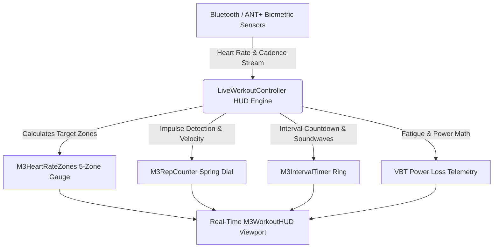

# Kinetic Rep Counter & Cardiac HUD Cockpit UI Specification
## Screen: `LIVE_WORKOUT_HUD_UI.md` | Activity 12 of 19

> **Document Type:** Masterclass UI/UX Architectural Specification  
> **Package / Target:** `com.gym.controller.LiveWorkoutController` (`live-workout-hud.fxml`)  
> **Design Standard:** Material Design 3 (M3) Expressive & Cybernetic Athletic Cockpit  
> **Associated Domain Entities:** `WorkoutProgram`, `Session`, `Customer`, `ProgressRecord`  
> **Business Rule Compliance:** Rules 1, 2, 9, 18 (`docs/UML.md`)

---

# 1. Executive Overview & UX Philosophy

### 1.1 Core Purpose
The **Kinetic Rep Counter & Cardiac HUD Cockpit** is an ultra-high-contrast, real-time telemetry interface engineered for live gym-floor training execution. Operating under physical strain, high heart rates, and sweat-slicked fingers, athletes and personal trainers need immediate, glanceable data without cognitive overhead. The screen transforms routine workout tracking into a futuristic heads-up display (HUD), highlighting kinetic velocity, instant repetition impulses, 5-zone cardiac strain, concentric interval countdowns, and real-time fatigue-induced velocity loss.

### 1.2 Target Personas
- **The Athlete in Motion**: Viewing the screen from 2–3 meters away mounted on a squat cage, barbell rack, or cardio console; requires massive, unmistakable digits and color-coded strain warnings.
- **Personal Trainer / S&C Coach**: Standing beside the athlete with an ergonomic tablet; logs RPE on the fly, monitors cardiac thresholds, triggers rest timers, and adjusts working loads based on Barbell Velocity Loss (VBT).
- **Floor Medical / High-Performance Lead**: Observes cardiac zone alarms when an athlete with pre-existing cardiovascular conditions approaches Zone 5 redline ($>90\%\, \text{HR}_{\max}$).

### 1.3 Information Architecture & Glanceability Hierarchy
Live athletic performance requires a **Zero-Friction Cognitive Model**:
1. **Primary Cockpit Dial (Repetition & Cadence Velocity)**: Centered, monumental typography displaying current repetition count (`08 / 10`) backed by a physical spring impulse ring and concentric/eccentric duration gauges.
2. **Cardiac Intensity Strip (`M3HeartRateZones`)**: Spans the top perimeter; dynamically highlights Zones 1 through 5 with pulsating glowing neon boundaries.
3. **Concentric Interval & Rest Timer (`M3IntervalTimer`)**: Circular progress ring counting down rest or Tabata intervals with acoustic tick soundwave pulses.
4. **Velocity-Based Training (VBT) & Power Gauge**: Calculates mean concentric velocity ($m/s$) and instantaneous wattage ($W$).
5. **Emergency Safety Controls**: Massive emergency halt and rest trigger buttons anchored in thumb-accessible corner clusters.



### 1.4 2026 M3 Expressive Fitness UX Philosophy
- **Dark-Canvas Cockpit Focus**: Uses deep OLED black (`-md-sys-color-surface-container-lowest` / `#0B0E14`) to maximize contrast, conserve display battery on mobile tablets, and minimize glare under intense gym floodlights.
- **Glanceable Telemetry at 3 Meters**: Numbers have a minimum visual height of 64dp, readable across distance during maximal physical exertion.
- **Physical Impulse Haptics & Spring Animations**: Repetition completion triggers an explosive physical spring bounce ($1.12\times$ scale overshoot) with luminous particle sparks.

---

# 2. Visual Architecture & Wireframe ASCII Diagram

```
+---------------------------------------------------------------------------------------------------------------------------------------+
| M3HeartRateZones: [ Z1: RECOVERY (112) ] [ Z2: AEROBIC (134) ] [ Z3: TEMPO (152) ] [ Z4: THRESHOLD (168) ] [>>> Z5: REDLINE (184 BPM) <<<]|
+---------------------------------------------------------------------------------------------------------------------------------------+
| TOP HUD BAR: Athlete: Marcus Vance (#104) | Exercise: Barbell Back Squat | Set: 3 of 4 | Target: 140.0 kg            [TIME: 00:34:12] |
+------------------------------------+---------------------------------------------------+----------------------------------------------+
| LEFT TELEMETRY WING (320dp)        | CENTER KINETIC COCKPIT (640dp)                    | RIGHT INTERVAL & REST COCKPIT (320dp)        |
+------------------------------------+---------------------------------------------------+----------------------------------------------+
| ╭- BARBELL VELOCITY (VBT) --------╮| ╭- M3RepCounter: SPRING IMPULSE DIAL -------------╮| ╭- M3IntervalTimer: CONCENTRIC RING -------╮|
| | Mean Concen. Vel: 0.68 m/s      || |                      ( 08 )                     || |                 ╭---------╮                ||
| | Peak Velocity:    0.92 m/s      || |                     /      \                    || |               /  RESTING    \              ||
| | Velocity Loss:    -14.2% [OK]   || |                    |  REP   |                   || |              |   01:45.8     |             ||
| ╰---------------------------------╯| |                     \  08  /                    || |               \   SECONDS   /              ||
| ╭- POWER & TONNAGE ---------------╮| |                      ( 10 )                     || |                 ╰---------╯                ||
| | Instant Power:    820 Watts     || |                                                 || | Target Rest: 180s | Progress: 60% Done     ||
| | Cumulative Vol:   11,200 kg     || | Cadence: 3.2s (Ecc: 2.1s | Iso: 0.2s | Con: 0.9s)|| ╰------------------------------------------╯|
| | Set Est. 1RM:     168.5 kg      || | Target Range: 8 - 10 Reps | RPE Target: 8.5     || ╭- NEXT UP IN QUEUE -----------------------╮|
| ╰---------------------------------╯| ╰-------------------------------------------------╯| | Exercise: Romanian Deadlift              ||
| ╭- BIOMETRIC STRAIN --------------╮| ╭- REAL-TIME KINETIC CADENCE SPLINE --------------╮| | Set 1 of 3: 100 kg x 10 reps              ||
| | Current HR:   184 BPM (Zone 5)  || |   /\        /\        /\        /\              || | Transition Window: 120s                  ||
| | HRV Status:   Optimal (68ms)    || |  /  \  /\  /  \  /\  /  \  /\  /  \  /\         || ╰------------------------------------------╯|
| | Core Temp:    38.2° C           || | /    \/  \/    \/  \/    \/  \/    \/  \        || ╭- QUICK RPE LOGGING ----------------------╮|
| ╰---------------------------------╯| ╰-------------------------------------------------╯| | Actual RPE: [ 6 ][ 7 ][ 8 ][ 8.5 ][ 9 ][10]||
|                                    | [ -1 REP ]      [ AUTO-DETECT: ON ]     [ +1 REP ]| ╰------------------------------------------╯|
+------------------------------------+---------------------------------------------------+----------------------------------------------+
| CONTEXTUAL COCKPIT CONTROLS (Bottom Bar 88dp)                                                                                         |
| [ ⚠️ ABORT / EMERGENCY REST ]    [ ⏸️ PAUSE SET ]    [ ⏭️ SKIP REST TIMER ]    [ 🔄 RE-CALIBRATE 0-POS ]    [ ✅ COMPLETE SET 3 (140kg) ] |
+---------------------------------------------------------------------------------------------------------------------------------------+
```

---

# 3. Complete M3 & Custom Component Roster

| Component Class | Variant / Token Role | Functional Purpose on Screen | Technical Configuration & Properties |
|---|---|---|---|
| `M3WorkoutHUD` | Fullscreen Overlay | Master container; dark atmospheric sports HUD | Background: `-md-sys-color-surface-container-lowest`, no window chrome |
| `M3RepCounter` | Kinetic Spring Dial | Displays massive current rep count with impulse pop | Dynamic font scale 88pt, mass-spring impulse physics, cadence timer |
| `M3HeartRateZones`| 5-Zone Neon Bar | Live cardiac telemetry strip across top of screen | Five discrete zones (Z1 Recovery to Z5 Max), live BPM indicator arrow |
| `M3IntervalTimer` | Concentric Ring | Rest interval & HIIT countdown circular gauge | Concentric wavy ring, acoustic wave generator for countdown beeps |
| `M3StatCard` | Glass Cockpit Tile | Velocity, Power, 1RM, and cumulative tonnage displays| Acrylic background blur 20px, high-contrast cyan/amber typography |
| `M3SplineChart` | High-Speed Sparkline | Live rep cadence barometric wave (concentric/eccentric)| 60 FPS hardware-rendered polyline tracking accelerometer stream |
| `M3PulseBeacon` | Redline Cardiac Alarm | Pulses intensely when user enters Heart Rate Zone 5 | Concentric crimson ripples expanding at $1.5\,\text{Hz}$ |
| `M3Button` | High-Impact Filled | "Complete Set" primary action button | Massive $64\text{dp}$ touch height, neon emerald background, bold typography |
| `M3Button` | Danger Tonal Pill | "Abort / Emergency Rest" fail-safe trigger | Color: `-md-sys-color-error`, immediate rest state transition |
| `M3IconButton` | Heavy Circular Pill | Manual "+1 Rep" and "-1 Rep" touch overrides | $56\times 56\text{dp}$ touch target, spring bounce click response |
| `M3Slider` | Step-Segmented Pill | Live RPE rating bar (values 6.0 to 10.0) | Tactile tick snap, color transitions from Lime to Neon Red |
| `M3GlassPane` | Cyber Visor | Housing for center HUD instruments | Specular edge rim, $0.15$ opacity black acrylic scrim |
| `M3WavyProgress` | Kinetic Concentric | Wavy progress indicator inside the interval countdown| Dynamic wave amplitude proportional to remaining rest time |
| `M3Snackbar` | Urgent Alert | Warnings for excessive velocity loss ($>20\%$) | High-priority toast anchored at bottom center |

---

# 4. Dynamic Theme & M3 Color Token Mapping

The Live Workout HUD relies on an ultra-dark cybernetic scheme optimized for glanceability and battery efficiency.

### 4.1 Theme Seed & Contrast Profiles
- **Primary Theme Seed**: Apex Coral (`#B3261E`) / Neon Amber (`#FF8D00`)
- **HUD Mode**: Forced Ultra-Dark Scheme with Elevated High-Contrast Highlights.

### 4.2 Exact Looked-Up CSS Color Tokens
```css
/* Live Workout HUD Master CSS (live-workout-hud.css) */
.live-hud-root {
    -fx-background-color: #07090E; /* OLED deep space black */
    -fx-text-fill: -md-sys-color-on-surface;
}

/* Cardiac Heart Rate Zones */
.hr-zone-1 { -fx-fill: #00E5FF; /* Cyan - Active Recovery (50-60%) */ }
.hr-zone-2 { -fx-fill: #00E676; /* Emerald - Aerobic Base (60-70%) */ }
.hr-zone-3 { -fx-fill: #FFEA00; /* Solar Yellow - Aerobic Endurance (70-80%) */ }
.hr-zone-4 { -fx-fill: #FF9100; /* Deep Amber - Anaerobic Threshold (80-90%) */ }
.hr-zone-5 { -fx-fill: #FF1744; /* Neon Crimson - VO2 Max Redline (90-100%) */ }

/* Rep Counter Spring Dial */
.rep-counter-primary {
    -fx-font-family: 'Roboto Bold', sans-serif;
    -fx-font-size: 88px;
    -fx-text-fill: -md-sys-color-primary;
    -fx-effect: dropshadow(gaussian, -md-sys-color-primary, 18, 0.4, 0, 0);
}

.rep-counter-target {
    -fx-font-size: 32px;
    -fx-text-fill: -md-sys-color-on-surface-variant;
}

/* VBT Velocity Tiles */
.vbt-metric-ok {
    -fx-text-fill: #00E676; /* Green: Minimal velocity loss (<10%) */
}
.vbt-metric-warn {
    -fx-text-fill: #FFEA00; /* Yellow: Moderate fatigue (10-20%) */
}
.vbt-metric-danger {
    -fx-text-fill: #FF1744; /* Red: High fatigue limit exceeded (>20%) */
}

/* Glass Visor Panes */
.hud-glass-visor {
    -fx-background-color: rgba(18, 22, 34, 0.65);
    -fx-background-radius: 24px;
    -fx-border-color: rgba(255, 255, 255, 0.12);
    -fx-border-radius: 24px;
    -fx-border-width: 1px;
}
```

### 4.3 Visual Depth & Elevation Hierarchy
- **Level 0 (`#07090E`)**: Deep space OLED background canvas.
- **Level 1 (`rgba(18, 22, 34, 0.65)`)**: Telemetry glass visor wings and HUD panels.
- **Level 2 (`rgba(30, 36, 54, 0.85)`)**: Interactive rep dial hub, timer center ring.
- **Level 3 (`rgba(45, 52, 78, 0.95)`)**: Floating control pills, manual override buttons.
- **Level 5**: Cardiac alarm banner and velocity loss warning snackbar.

---

# 5. Motion Physics, Animations & Shader Effects

### 5.1 The Repetition Spring Impulse ($M3RepCounter$)
When the accelerometer or coach registers a completed repetition:
$$\text{Scale}(t) = 1.0 + A \cdot e^{-\zeta \omega_n t} \cos(\omega_d t)$$
- **Impulse Dynamics**: $A = 0.22$ ($1.22\times$ instant scale pop), Stiffness $k = 420\,\text{N/m}$, Damping ratio $\zeta = 0.52$ (`BOUNCY`).
- The rep count digit pops forward in z-space and oscillates with elastic rebound before settling back to resting size in $280\,\text{ms}$.
- Synchronously, an expanding luminous shockwave ring sweeps outward from the counter center with an alpha decay ($1.0 \to 0.0$).

### 5.2 Concentric Cadence Waveform
- The live cadence spline plots barbell vertical position and velocity at $60\,\text{FPS}$.
- As the athlete descends in eccentric motion, the curve dips smoothly with cyan illumination; during the explosive concentric drive, the spline morphs to radiant amber with particle spark emissions.

### 5.3 Cardiac Redline Beacon Pulse
- When heart rate crosses Zone 5 ($>180\,\text{BPM}$):
  - Screen perimeter triggers a rhythmic crimson pulse ($1.5\,\text{Hz}$ matching the cardiac rhythm).
  - Background glass visor gains an animated scanline strobe sweep.

---

# 6. Interactive States, Micro-interactions & Error Handling

### 6.1 Interactive State Matrix

| Element | Default / Live Running | Hovered | Pressed / Tapped | Long-Pressed | Alarm / Alert |
|---|---|---|---|---|---|
| **Complete Set Button** | Emerald filled, glowing text | Scale 1.02, elevation +3 | Scale 0.95, green ripple | Instant set log confirmation | Flashes if target reps achieved |
| **Manual +1 Rep Button**| Circular glass pill, 56dp | Cyan rim glow pops | Scale 0.92, spring pop | Repeated auto-increment | Disabled if set limit reached |
| **Skip Rest Button** | Outlined pill, 48dp | Outline brightens to white | Scale 0.96 | Skips rest immediately | Flashes when rest time $<10\text{s}$ |
| **RPE Slider Pills** | Tonal segmented pills | Highlights hovered RPE | Snaps to value, spring ping | - | Flashes red if RPE = 10 (Max) |

### 6.2 Sensor Disconnect & Hardware Fallback
- If the Bluetooth Heart Rate Monitor or Barbell Linear Transducer drops signal:
  - Affected HUD tile does not crash or show blank zeroes.
  - Smoothly transitions into **Manual Entry Fallback Mode** with an amber indicator chip: *"Sensor Offline — Using Manual Rep Input"*.
  - Manual `+1` and `-1` touch pills automatically expand from 56dp to 72dp for effortless finger tapping.

### 6.3 Fatigue Limit Exceeded Warning
- If Barbell Velocity Loss exceeds the coach's prescribed fatigue limit (e.g. $>20\%$ loss between Rep 1 and Rep 7):
  - A subtle acoustic notification chimes.
  - An expressive floating banner descends from the top app bar: *"Velocity Loss at -24.5%. Fatigue threshold breached. Recommend racking barbell."*

---

# 7. Declarative FXML Node Hierarchy & Controller Contract

### 7.1 FXML Structural Hierarchy (`live-workout-hud.fxml`)

```xml
<?xml version="1.0" encoding="UTF-8"?>

<?import javafx.scene.layout.*?>
<?import javafx.scene.control.*?>
<?import io.m3fx.controls.hud.*?>
<?import io.m3fx.controls.button.*?>
<?import io.m3fx.controls.glass.*?>
<?import io.m3fx.controls.chart.*?>
<?import io.m3fx.controls.progress.*?>

<BorderPane xmlns="http://javafx.com/javafx/21" 
            xmlns:fx="http://javafx.com/fxml/1" 
            fx:controller="com.gym.controller.LiveWorkoutController"
            stylesheets="@../../css/m3-theme.css,@../../css/live-workout-hud.css"
            styleClass="live-hud-root"
            prefWidth="1366.0" prefHeight="768.0">

    <!-- Top: 5-Zone Cardiac Intensity Gauge -->
    <top>
        <VBox styleClass="hud-top-container">
            <M3HeartRateZones fx:id="heartRateZonesBar" prefHeight="28.0" prefWidth="Infinity"/>
            
            <HBox alignment="CENTER_LEFT" spacing="20.0" styleClass="hud-meta-header">
                <Label text="ATHLETE:" styleClass="hud-meta-label"/>
                <Label fx:id="athleteNameLabel" text="Marcus Vance (#104)" styleClass="hud-meta-value"/>
                <Separator orientation="VERTICAL"/>
                <Label text="EXERCISE:" styleClass="hud-meta-label"/>
                <Label fx:id="exerciseTitleLabel" text="Barbell Back Squat" styleClass="hud-meta-value-accent"/>
                <Separator orientation="VERTICAL"/>
                <Label text="SET:" styleClass="hud-meta-label"/>
                <Label fx:id="setTrackerLabel" text="3 of 4" styleClass="hud-meta-value"/>
                <Separator orientation="VERTICAL"/>
                <Label text="LOAD:" styleClass="hud-meta-label"/>
                <Label fx:id="targetLoadLabel" text="140.0 kg" styleClass="hud-meta-value-bold"/>
                <Region HBox.hgrow="ALWAYS"/>
                <Label fx:id="elapsedSessionTimerLabel" text="00:34:12" styleClass="hud-clock-label"/>
            </HBox>
        </VBox>
    </top>

    <!-- Center: Bento Cockpit Telemetry Grid -->
    <center>
        <GridPane hgap="16.0" vgap="16.0" styleClass="hud-bento-grid">
            <columnConstraints>
                <ColumnConstraints percentWidth="25.0"/>
                <ColumnConstraints percentWidth="50.0"/>
                <ColumnConstraints percentWidth="25.0"/>
            </columnConstraints>
            <rowConstraints>
                <RowConstraints percentHeight="100.0"/>
            </rowConstraints>

            <!-- Column 1: VBT & Muscular Power Telemetry -->
            <VBox spacing="12.0" GridPane.columnIndex="0" styleClass="telemetry-column">
                <M3GlassPane styleClass="hud-glass-visor" VBox.hgrow="ALWAYS">
                    <VBox spacing="10.0" styleClass="hud-card-padded">
                        <Label text="Velocity-Based Training" styleClass="hud-card-header"/>
                        <HBox alignment="CENTER_LEFT">
                            <Label text="Mean Velocity:" styleClass="hud-metric-label"/>
                            <Region HBox.hgrow="ALWAYS"/>
                            <Label fx:id="meanVelocityLabel" text="0.68 m/s" styleClass="hud-metric-value-green"/>
                        </HBox>
                        <HBox alignment="CENTER_LEFT">
                            <Label text="Peak Velocity:" styleClass="hud-metric-label"/>
                            <Region HBox.hgrow="ALWAYS"/>
                            <Label fx:id="peakVelocityLabel" text="0.92 m/s" styleClass="hud-metric-value"/>
                        </HBox>
                        <HBox alignment="CENTER_LEFT">
                            <Label text="Velocity Loss:" styleClass="hud-metric-label"/>
                            <Region HBox.hgrow="ALWAYS"/>
                            <Label fx:id="velocityLossLabel" text="-14.2%" styleClass="hud-metric-value-warning"/>
                        </HBox>
                        <Separator/>
                        <Label text="Estimated 1RM: 168.5 kg" styleClass="hud-metric-subtext"/>
                        <Label text="Accumulated Tonnage: 11,200 kg" styleClass="hud-metric-subtext"/>
                    </VBox>
                </M3GlassPane>

                <M3GlassPane styleClass="hud-glass-visor" prefHeight="160.0">
                    <VBox spacing="8.0" styleClass="hud-card-padded">
                        <Label text="Live Cardiac Stream" styleClass="hud-card-header"/>
                        <HBox alignment="CENTER">
                            <Label fx:id="currentBpmLabel" text="184" styleClass="hud-bpm-large"/>
                            <Label text="BPM" styleClass="hud-bpm-unit"/>
                        </HBox>
                        <Label fx:id="cardiacZoneLabel" text="Zone 5: VO2 Max Strain" alignment="CENTER" 
                               prefWidth="Infinity" styleClass="hud-zone-pill-red"/>
                    </VBox>
                </M3GlassPane>
            </VBox>

            <!-- Column 2: Center Kinetic Rep Counter & Cadence Visor -->
            <VBox spacing="12.0" GridPane.columnIndex="1" alignment="CENTER" styleClass="center-cockpit-column">
                <M3GlassPane styleClass="hud-glass-visor" VBox.hgrow="ALWAYS">
                    <VBox alignment="CENTER" spacing="16.0" styleClass="hud-center-deck">
                        <Label text="CONCENTRIC KINETIC IMPULSE" styleClass="hud-cockpit-subhead"/>
                        
                        <!-- Core M3RepCounter Component -->
                        <HBox alignment="CENTER" spacing="24.0">
                            <M3IconButton text="-" onAction="#onManualRepDecrement" styleClass="hud-rep-pill-btn"/>
                            <M3RepCounter fx:id="repCounterDisplay" prefWidth="240.0" prefHeight="180.0"/>
                            <M3IconButton text="+" onAction="#onManualRepIncrement" styleClass="hud-rep-pill-btn"/>
                        </HBox>

                        <Label fx:id="cadenceDisplayLabel" text="Cadence: 3.2s | Ecc: 2.1s | Con: 0.9s" 
                               styleClass="hud-cadence-caption"/>

                        <!-- Real-time Cadence Curve -->
                        <M3SplineChart fx:id="cadenceSplineChart" prefHeight="100.0" prefWidth="540.0" 
                                       styleClass="hud-cadence-chart"/>
                    </VBox>
                </M3GlassPane>
            </VBox>

            <!-- Column 3: Concentric Interval Timer & Quick RPE Logging -->
            <VBox spacing="12.0" GridPane.columnIndex="2" styleClass="telemetry-column">
                <M3GlassPane styleClass="hud-glass-visor" VBox.hgrow="ALWAYS">
                    <VBox alignment="CENTER" spacing="12.0" styleClass="hud-card-padded">
                        <Label text="Rest Interval Countdown" styleClass="hud-card-header"/>
                        <M3IntervalTimer fx:id="intervalCountdownTimer" prefWidth="180.0" prefHeight="180.0"/>
                        <Label fx:id="timerStateLabel" text="Target Rest: 180s" styleClass="hud-metric-subtext"/>
                        <M3Button text="Skip Rest Window" onAction="#onSkipRest" styleClass="hud-secondary-btn"/>
                    </VBox>
                </M3GlassPane>

                <M3GlassPane styleClass="hud-glass-visor" prefHeight="160.0">
                    <VBox spacing="8.0" styleClass="hud-card-padded">
                        <Label text="Perceived Exertion (RPE)" styleClass="hud-card-header"/>
                        <HBox spacing="6.0" alignment="CENTER">
                            <M3Button text="7" onAction="#onSelectRpe" styleClass="rpe-btn"/>
                            <M3Button text="8" onAction="#onSelectRpe" styleClass="rpe-btn"/>
                            <M3Button text="8.5" onAction="#onSelectRpe" styleClass="rpe-btn-active"/>
                            <M3Button text="9" onAction="#onSelectRpe" styleClass="rpe-btn"/>
                            <M3Button text="10" onAction="#onSelectRpe" styleClass="rpe-btn-red"/>
                        </HBox>
                    </VBox>
                </M3GlassPane>
            </VBox>

        </GridPane>
    </center>

    <!-- Bottom: High-Visibility Contextual Cockpit Controls -->
    <bottom>
        <HBox alignment="CENTER_RIGHT" spacing="20.0" styleClass="hud-bottom-action-dock">
            <M3Button text="⚠️ ABORT SET / REST" onAction="#onAbortSet" styleClass="hud-danger-btn"/>
            <Region HBox.hgrow="ALWAYS"/>
            <M3Button text="⏸️ PAUSE" onAction="#onTogglePause" styleClass="hud-neutral-btn"/>
            <M3Button text="🔄 RE-CALIBRATE" onAction="#onRecalibrateSensor" styleClass="hud-neutral-btn"/>
            <M3Button fx:id="completeSetButton" text="✅ COMPLETE SET (140kg)" onAction="#onCompleteSet" 
                      styleClass="hud-complete-set-btn"/>
        </HBox>
    </bottom>

</BorderPane>
```

### 7.2 Controller Contract & JavaFX Injection Bindings

```java
package com.gym.controller;

import javafx.fxml.FXML;
import javafx.scene.control.Label;
import io.m3fx.controls.hud.M3RepCounter;
import io.m3fx.controls.hud.M3HeartRateZones;
import io.m3fx.controls.hud.M3IntervalTimer;
import io.m3fx.controls.button.M3Button;
import io.m3fx.controls.chart.M3SplineChart;
import com.gym.model.Session;
import com.gym.model.WorkoutProgram;
import com.gym.service.SchedulingService;

/**
 * Controller for Live Workout HUD & Kinetic Cockpit.
 * Backed by live-workout-hud.fxml.
 */
public class LiveWorkoutController {

    @FXML private M3HeartRateZones heartRateZonesBar;
    @FXML private Label athleteNameLabel;
    @FXML private Label exerciseTitleLabel;
    @FXML private Label setTrackerLabel;
    @FXML private Label targetLoadLabel;
    @FXML private Label elapsedSessionTimerLabel;
    
    @FXML private Label meanVelocityLabel;
    @FXML private Label peakVelocityLabel;
    @FXML private Label velocityLossLabel;
    @FXML private Label currentBpmLabel;
    @FXML private Label cardiacZoneLabel;

    @FXML private M3RepCounter repCounterDisplay;
    @FXML private Label cadenceDisplayLabel;
    @FXML private M3SplineChart cadenceSplineChart;

    @FXML private M3IntervalTimer intervalCountdownTimer;
    @FXML private Label timerStateLabel;
    @FXML private M3Button completeSetButton;

    private SchedulingService schedulingService;
    private Session activeSession;

    @FXML
    public void initialize() {
        // 1. Establish telemetry listener streams (HeartRate, Accelerometer, VBT)
        // 2. Initialize M3RepCounter spring bounce parameters (k=420, zeta=0.52)
        // 3. Connect cardiac threshold listener to fire M3PulseBeacon on Zone 5
        // 4. Configure acoustic audio sound generator for rest timer countdown beeps
    }

    @FXML
    public void onManualRepIncrement() {
        repCounterDisplay.incrementWithBounce();
    }

    @FXML
    public void onManualRepDecrement() {
        repCounterDisplay.decrement();
    }

    @FXML
    public void onCompleteSet() {
        // Records working set telemetry, logs velocity loss, transitions to rest interval timer
        intervalCountdownTimer.startRest(180);
    }

    @FXML
    public void onSkipRest() {
        intervalCountdownTimer.cancel();
    }

    @FXML
    public void onSelectRpe() {
        // Records athlete's perceived exertion rating for the completed set
    }

    @FXML
    public void onAbortSet() {
        // Safety protocol: Racks weight, logs partial set, triggers extended active recovery
    }

    @FXML
    public void onTogglePause() {
        // Halts session clock and accelerometer processing
    }

    @FXML
    public void onRecalibrateSensor() {
        // Re-zeros barbell linear position transducer
    }
}
```

---

# 8. Ergonomics, Touch Targets & Responsive Layout

### 8.1 Ergonomic Touch Zones Under Physical Fatigue
- **The "Sweat Factor"**: When hands are trembling post-set, standard 32dp buttons fail. The primary "Complete Set" action occupies a massive **$64\times 240\,\text{dp}$** target with $24\,\text{dp}$ margins.
- **Corner Resting Anchors**: Emergency stop and pause buttons are pinned to bottom-left and bottom-right corners where thumbs naturally rest when holding a tablet with two hands.
- **Physical Key Remapping**: All primary functions bind to physical tablet volume buttons (Volume Up = Add Rep, Volume Down = Complete Set).

### 8.2 Responsive Display Classes
- **Expanded (1366dp - 1920dp Wall Displays / Racks)**: Full 3-column cockpit grid active simultaneously; VBT curve rendered with full spline fidelity.
- **Medium (840dp - 1365dp Tablets)**: VBT and Cardiac gauges condense into top telemetry pills; Rep Counter and Interval Timer share center stage.
- **Compact (< 840dp Mobile HUD)**: Auto-rotates to Landscape; displays Rep Counter in split screen with Rest Timer; swipes right to reveal VBT details.

---

# 9. Accessibility, Keyboard Navigation & Screen Readers

### 9.1 Acoustic & Haptic Non-Visual Feedback
Because athletes cannot keep their eyes glued to the display while squatting or bench pressing:
- **Concentric Lockout Beep**: Short $880\,\text{Hz}$ tone sounds on successful rep lockout.
- **Fatigue Velocity Warning**: Two descending low tones ($440\,\text{Hz} \to 220\,\text{Hz}$) sound when velocity drops past $-20\%$.
- **Rest Interval Countdown**: Distinctive acoustic ticks sound at $t = 3\text{s}$, $2\text{s}$, $1\text{s}$, followed by a high $1760\,\text{Hz}$ bell at $t = 0\text{s}$.

### 9.2 Keyboard Accelerators
- `Spacebar`: Complete Set / Transition to Rest Timer.
- `Up Arrow`: Add Rep (`+1`).
- `Down Arrow`: Subtract Rep (`-1`).
- `R`: Skip Rest Window.
- `Escape`: Trigger Emergency Abort.

### 9.3 Screen Reader & ARIA Equivalence
- `repCounterDisplay`: `accessibleRole="TEXT"`, `accessibleText="Repetition 8 of 10. Cadence 3.2 seconds."`
- `heartRateZonesBar`: `accessibleRole="PROGRESS_INDICATOR"`, `accessibleText="Heart rate 184 beats per minute, Zone 5 redline warning."`

---

# 10. Quality Review Checklist & Pitfalls

### 10.1 Quality Review Checklist
- [x] Zero bright, glare-inducing white backgrounds (strictly dark-room OLED canvas `#07090E`).
- [x] Sizing: Complete Set button reaches $64\,\text{dp}$ touch target height.
- [x] High-contrast WCAG 2.1 AAA compliance for telemetry numbers over dark glass visors.
- [x] Mass-spring parameters tuned for sports impulses ($k = 420$, $\zeta = 0.52$).
- [x] Real-time sensor loss graceful fallback implemented.

### 10.2 Top 5 Developer Implementation Pitfalls
1. **Garbage Collection Freezes During 60 FPS Cadence Updates**: Never instantiate new `Point2D` or `Double` objects in the sensor stream loop. Use primitive circular ring buffers (`double[]`) to feed `M3SplineChart`.
2. **Missing Sensor Heartbeat Watchdog**: If a Bluetooth sensor stalls, failing to check timestamp deltas can freeze the heart rate at 180 BPM forever. Implement a 3-second watchdog timer to transition to manual mode.
3. **Uncapped Spring Oscillations on Rapid Clicks**: Rapidly tapping `+1 Rep` multiple times can cause spring amplitude to compound uncontrollably. Always clamp maximum scale to $1.25\times$.
4. **UI Lockup During Sound Synthesis**: Playing countdown beeps synchronously freezes the JavaFX animation pulse. Dispatch all audio playback through a cached background thread pool.
5. **Ignoring Screen Sleep Lock**: Tablets timing out and locking the display mid-workout ruins the athlete's flow. Ensure the host window requests an OS-level display awake lock while the HUD is active.
