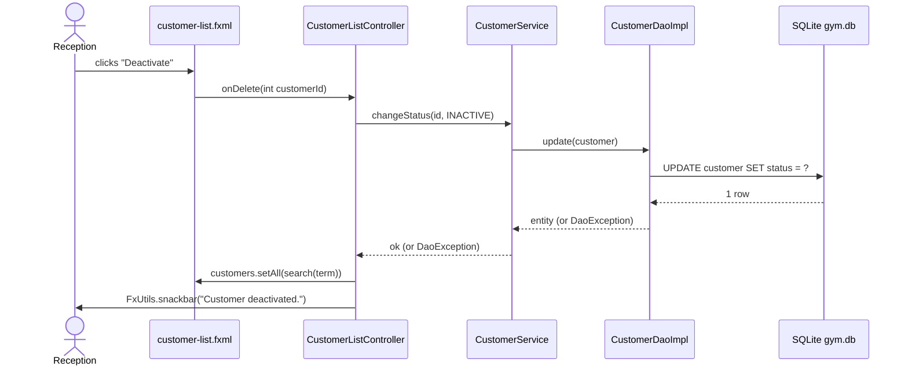

# `controller` — JavaFX UI Controllers (JavaFX branch)

> **Signature authority:** `docs/UML.md` §5 owns every name, type and signature in this folder.
> This README explains *why* each one exists and *how* to write it. Code here is an illustrative
> sketch, not the specification — if a sketch and `UML.md` disagree, `UML.md` wins.
>
> Two neighbours own the parts this folder does not: `docs/UML.md` §1 owns `MainApp` (it is declared
> there, and in `../README.md`, because it is the entry point rather than a screen), `docs/UML.md` §2
> owns the startup and session flow, `docs/UML.md` → "Business rules" owns the 19 rules the screens
> must not re-implement, and `docs/DECISIONS.md` 34/35 own the two boundary exceptions this folder
> depends on (`SessionContext`, the m3fx overlay entry point).

## 1. Purpose — the problem this layer solves

The `controller` package is the only place in the app that knows a *screen* exists. One class per
screen: it lets `FXMLLoader` build the node tree from an FXML file, receives the nodes JavaFX injects
into its `@FXML` fields, asks a service for the data, puts that data into a control, and translates
one user gesture into one service call. It is the translation layer between "a person clicked
Reserve" and `SchedulingService.adminReserve(customerId, trainerId, date, startTime)`.

Sixteen screens are planned (`docs/UML.md` §5). Each one is a triple of files:

| Piece | File | Owns |
|---|---|---|
| View | `src/main/resources/fxml/<name>.fxml` | Layout, control choice, `fx:id`, `onAction="#..."` wiring, styling classes |
| Controller | `src/main/java/com/gym/controller/<Name>Controller.java` | Event handling, list binding, dialog calls, error display |
| Model + rules | `com.gym.model` + `com.gym.service` | The entity being shown and the rules that decide what is legal |

### What breaks if this layer is missing

Without controllers, every FXML file would have to hold its own logic, and FXML holds *no* logic —
it can only name a handler. Squeezing the logic into `main` or into the FXML's `fx:controller`
target without a thin handler has three concrete consequences, all of which the team has already
seen in small JavaFX exercises:

1. **The rules end up in the UI.** A "freeze only an ACTIVE membership" check written inside a button
   handler exists once per screen. The second screen that offers the button gets its own copy, and
   the two copies disagree within a week. Rules belong to `MembershipService.freeze(int)` (rule 7).
2. **SQL leaks upward.** The moment a controller opens a `Connection` to answer a question, the
   screen holds a connection string, the query can never be reused, and `gym.db`'s single file lock
   turns a slow report into a frozen window.
3. **Nothing is testable and nothing is replaceable.** A screen that builds its own `Payment` and
   writes it with hand-written JDBC cannot be pointed at a fake, and the `swing` branch cannot reuse
   a single line of it.

### What this layer deliberately does not do

- **No SQL, no JDBC, no DAO.** A controller names services only. If you need a new query, it goes on
  a DAO, behind a service method, before the screen may call it.
- **No business rules.** "Only `CONFIRMED` may become `COMPLETED`" lives in
  `SchedulingService.canTransition` (rule 18). The screen decides *whether to show* the Complete
  button; the service decides whether the transition is legal.
- **No money arithmetic and no date arithmetic.** `PaymentService.balance` returns a `BigDecimal`;
  `DateUtils` owns every parse and format (rule 9). A controller renders those values, it does not
  compute them.
- **No m3fx internals.** The screens consume public API only: `M3Stylesheets.applyTo(scene, theme)`,
  the `M3*` controls, and `-md-sys-color-*` lookups. How a skin paints a state layer is the
  library's own documentation.
- **No formatting the user cannot read.** A `DaoException` never reaches a label or a dialog; a stack
  trace never reaches a user (root `README.md` §11).

## 2. What you learn here (OOP concepts)

Concept names match `docs/LEARNING_GUIDE.md` → "OOP concept index", so the two documents can be read
side by side.

| Concept | Where in this folder | Why the project needs it | How to apply it (one line) |
|---|---|---|---|
| MVC in JavaFX | Every triple: FXML = View, `com.gym.model` = Model, controller + service = Controller | A designer edits layout without recompiling Java; a rule is testable without a window | Before writing a handler, name which of the three files the change belongs in |
| Encapsulation / information hiding | `@FXML private` node fields; service field is `private` | The FXML contract (`fx:id`) is the public part; the nodes are nobody else's business | Never make an `@FXML` field `public`, and never hand a node to a service |
| Single responsibility | One controller per screen; `FxUtils` does the dialogs; the service does the rules | A change to the freeze rule must not require touching FXML | If a handler grows past ~15 lines, the extra lines belong in a service or a private helper |
| Abstraction | The controller talks to `CustomerService`, never to `CustomerDao` | The screen knows *what* is stored, not *how* | Declare the service field with the class type from `UML.md` §4; never construct a DAO here |
| Composition | A controller *has* services and nodes; it extends nothing (see `UML.md` §7) | "We could have a `BaseController`" is not a reason; `initialize()` differs per screen | Hold collaborators as fields; do not inherit to share code |
| Interfaces | `Initializable` (JavaFX), the `..>` service edges in `UML.md` §5 | `initialize()` is a contract `FXMLLoader` looks for by name | Implement the method exactly as §5 declares it: `public void initialize()` |
| Enums as types | `StaffRole.ADMIN`, `SessionStatus`, `EquipmentStatus` in `ComboBox`/table columns | `MembershipStatus.ACTVE` does not compile; a `String` typo does | Populate a choice control with `Status.values()`, never with hand-written `String`s |
| Lambda / functional interface | `setOnAction(e -> onSave())`, cell value factories | The UI is event-driven; a lambda is the shortest honest way to pass behaviour | One lambda, one call, no logic inside it |
| Collections / generics | `ObservableList<Customer>` bound to a `TableView` | The table and the search result list must be the same list, not a copy | Keep one `ObservableList` field and `setAll(...)` into it; never `setItems(newList)` per refresh |
| Value objects | `BigDecimal` for money, ISO-8601 `String` for dates | The controller must not re-derive what the service already decided | Display `amount.toPlainString()`; pass the service's date string through unchanged |
| Exception design | `catch (DaoException e)` → `FxUtils.error(e.getMessage())` | A user can act on a sentence, not on a stack trace | Catch at the handler boundary; let the message come from the service/DAO |
| Static vs instance | `SessionContext` (static, deliberate — `DECISIONS.md` 34) vs controller instance state | The signed-in account must be reachable from every screen; a screen's list must not be | Read `SessionContext.getAdministrator()`; never store the administrator in a controller field |
| Dependency inversion | The controller depends on the service class, the service on DAO *interfaces* | The volatile parts (database, UI toolkit) sit behind stable types | Accept services as fields; do not `new` a `*DaoImpl` in this package |
| Threading | All handler code runs on the FX application thread | A scene-graph node touched from another thread throws or corrupts the scene | Keep handlers short; move a slow query into a `javafx.concurrent.Task` (see §2.1) |

### 2.1 The JavaFX mechanics you must know (this is the part that is not OOP)

Everything below is standard JavaFX 21 behaviour, not project invention. Learn it here once, then use
it in all sixteen screens. The FXML in this README is minimal on purpose: it shows the wiring, not
the styling.

#### a. The `Application` lifecycle, and why `MainApp` is not a screen

`com.gym.MainApp extends javafx.application.Application` — the only such class in the app
(`UML.md` §7). JavaFX calls it on the FX thread in a fixed order:

| Hook | Who calls it | What this project puts there | Notes |
|---|---|---|---|
| `launch(args)` | `MainApp.main` | Starts the JavaFX runtime | Present in the current placeholder `../MainApp.java` |
| `init()` | JavaFX, *before* the window exists | Nothing today | Optional override; runs on the **launcher** thread, so it must not touch nodes. This is the only sensible place for a slow, UI-free bootstrap (schema check) |
| `start(Stage)` | JavaFX | Apply the theme, build the nav shell, install the overlay layer, open `LoginController` (`UML.md` §2 step 1) | `Stage` = the OS window; `Scene` = the node tree inside it |
| `stop()` | JavaFX, on exit | `SessionContext.clear()` — the safety net in `UML.md` §2 step 4 | Optional override; runs on the FX thread |

`MainApp` is not a screen because it has no FXML, no `fx:controller` and no user gesture to handle: it
is the thing that *creates windows and installs services for screens*. The existing placeholder shows
exactly what it currently is and what is still missing:

```java
// Current src/main/java/com/gym/MainApp.java — placeholder, kept verbatim in spirit.
public class MainApp extends Application {
    @Override
    public void start(Stage primaryStage) throws Exception {
        FXMLLoader loader = new FXMLLoader(getClass().getResource("/fxml/main.fxml"));
        Parent root = loader.load();
        primaryStage.setTitle("JavaFX Application");
        primaryStage.setScene(new Scene(root, 600, 400));
        primaryStage.show();
    }
    public static void main(String[] args) { launch(args); }
}
```

It loads `main.fxml`, which today is the **m3fx component showcase with no `fx:controller`** — see
`src/main/resources/README.md`. The real shell replaces it: theme first, then the shell, then the
first screen. Two details of that shell are genuinely undecided (see §5, "Open details"): which m3fx
control forms the shell, and which `Stage`/`Scene` call sizes the window. `MainApp` also needs a
public m3fx overlay entry point before dialogs and snackbars can be installed (`DECISIONS.md` 35).

#### b. `FXMLLoader` and the classpath path

```java
FXMLLoader loader = new FXMLLoader(getClass().getResource("/fxml/login.fxml"));
Parent root = loader.load();          // builds the node tree AND constructs + injects the controller
LoginController controller = loader.getController();   // available only after load()
```

- **The leading `/` means "classpath root".** Gradle copies `src/main/resources/**` to the classpath
  root, so `/fxml/login.fxml` is the file `src/main/resources/fxml/login.fxml`. Written *without* the
  slash, the path is resolved **relative to `com/gym/controller/`** and resolves to nothing — the
  classic `NullPointerException` inside `FXMLLoader`.
- **A missing resource is `null`, not an exception, at `getResource` time.** `loader.load()` then
  throws `NullPointerException`/`LoadException`. If the message does not name your file, print
  `getClass().getResource("/fxml/login.fxml")` first — a `null` there is a path bug, not an FXML bug.
- **The FXML file name mirrors the controller class name**, so the triple is greppable and
  `FxUtils.switchScene` can be handed one name. Which spelling to use for the sixteen files is an
  **Open detail (decide + log in `DECISIONS.md`)**; this README uses `/fxml/login.fxml` for
  `LoginController`.
- `loader.getController()` returns the controller instance *the loader* built. Use it to pass the
  first parameter into a screen (`controller.showCustomer(id)`) — never to stash the controller
  somewhere else for later reuse.

#### c. `fx:controller`, `@FXML` injection and `initialize()`

```xml
<!-- src/main/resources/fxml/login.fxml  (file-name spelling: OD-5) -->
<?import io.m3fx.controls.button.M3Button?>
<?import io.m3fx.controls.textfield.M3TextField?>
<?import javafx.scene.control.PasswordField?>
<VBox xmlns="http://javafx.com/javafx/21" xmlns:fx="http://javafx.com/fxml/1"
      fx:controller="com.gym.controller.LoginController">
  <M3TextField fx:id="usernameField" labelText="Username"/>
  <PasswordField fx:id="passwordField" promptText="Password"/>
  <M3Button text="Sign in" onAction="#onLogin"/>
</VBox>
```

```java
package com.gym.controller;
import com.gym.service.AdminService;
import javafx.fxml.FXML;
import javafx.scene.control.PasswordField;   // the masked field itself is a stock JavaFX control

public class LoginController {
    @FXML private M3TextField usernameField;    // injected by fx:id match, after the tree is built
    @FXML private PasswordField passwordField;  // masked; m3fx has no password control (OD-8)
    private AdminService adminService;         // how this arrives is an open detail — see §5

    @Override public void initialize() {       // public no-arg: UML.md §5 and DECISIONS.md 36
        // runs ONCE per load(), after all @FXML fields are set; fill combo boxes and set defaults here
    }

    @FXML private void onLogin() { /* event handler — see (d) */ }
}
```

**Why the password field is a stock `PasswordField` and not an `M3*` control.** `m3fx-controls` ships
exactly one text input — `io.m3fx.controls.textfield.M3TextField` — and no masked variant, so the login
form masks the secret with JavaFX's own `PasswordField` while everything visible stays `M3*`. A stock
control does not inherit the M3 look on its own (`DECISIONS.md` 24: modena's defaults leak until a
control is styled explicitly), so it is styled through the same `-md-sys-color-*` lookups as the rest
of the form. Whether the app themes that stock field or the library grows a password variant is
**OD‑8** — one decision, logged once, not re-answered per screen.

- `fx:controller="com.gym.controller.LoginController"` is a **fully qualified class name**. A typo
  here fails at load time with `ClassNotFoundException`, not at compile time.
- `@FXML private M3TextField usernameField;` is filled from the node whose `fx:id="usernameField"`.
  An id with no matching field is silently ignored; a field with no matching id stays `null` and
  throws `NullPointerException` on first use.
- `initialize()` is looked up **by name, on the controller instance, with no arguments** — that is
  why `UML.md` §5 declares it `+initialize() void` and why `DECISIONS.md` 36 refuses a `BaseController`
  whose hook would differ per screen. JavaFX also accepts `@FXML private void initialize()` and
  `initialize(URL, ResourceBundle)`; this project uses the public no-arg form so the diagram and the
  code agree. **Never give it parameters** (the loader cannot guess them) and **never do long work in
  it** — the FX thread is blocked while the scene loads.

#### d. Event handlers: `onAction="#onSave"` in FXML, `setOnAction` in code

Both forms call the same method; choose by whether the handler is fixed by the layout or decided at
runtime:

| Situation | Use | Why |
|---|---|---|
| A button that always does the same thing | FXML `onAction="#onSave"` | The wiring is visible in the layout file, next to the button |
| A row action inside a `TableCell` ("Void", "Open profile") | Code: `button.setOnAction(e -> onVoid(row.getPaymentId()))` | The row is created per item; no FXML node exists to name |
| A handler that needs the current selection and is shared by two buttons | Code, with a guard | One place to check "nothing selected" |

Conventions the team follows: the handler name starts with `on`, matches the `UML.md` §5 method list
exactly (`#onLogin`, `#onOpenProfile`, `#onSave`), and takes **no arguments** when FXML calls it.
`UML.md` §5 methods that carry a parameter (`onOpenProfile(int customerId)`, `onVoid(int paymentId)`,
`onStatusChange(int equipmentId, EquipmentStatus status)`) are *programmatic* handlers: FXML cannot
supply those arguments, so the row/cell calls them in code. That split is deliberate — it is how a
row knows which entity it belongs to.

#### e. Passing data between screens by parameter

The screens do not share state, and they do not keep references to each other's controllers. The
selection travels as a method parameter, exactly as `UML.md` §5 declares it:

```java
// CustomerListController — a row action, not an FXML onAction
private void openProfile(Customer customer) {
    CustomerProfileController profile = FxUtils.switchScene("/fxml/customer-profile.fxml");
    profile.showCustomer(customer.getId());   // the id travels; the object does not
}
```

Three rules make this safe, and each one prevents a specific bug:

1. **Pass the id, not the object.** The profile screen re-reads the row through its service, so it
   always shows committed data. Passing the object shows a stale copy after the next save.
2. **Never share a controller instance between screens.** Two live screens holding the same
   controller means two `ObservableList`s fighting over one table, and a logout that leaves the other
   screen's data on the FX thread.
3. **Never stash the selection in a static field.** `SessionContext` is the single documented piece of
   static mutable state (`DECISIONS.md` 34); a second one silently breaks the `swing` port's
   assumption that only the account is global.

#### f. `ObservableList`, `TableView`/`ListView` and cell value factories *(illustrative)*

The sketch below is the standard JavaFX pattern, marked illustrative: the column names and the
`status` cell come from `Customer`'s fields in `UML.md` §1, and the service call is the
`CustomerListController ..> CustomerService` edge from §5.

```java
// Sketch — illustrative JavaFX mechanics, not the specification. Field list: docs/UML.md §1.
@FXML private TableView<Customer> customerTable;
@FXML private TableColumn<Customer, String> nameColumn;
@FXML private TableColumn<Customer, String> statusColumn;
private final ObservableList<Customer> customers = FXCollections.observableArrayList();

@Override public void initialize() {
    nameColumn.setCellValueFactory(cd -> new SimpleStringProperty(cd.getValue().getFullName()));
    statusColumn.setCellValueFactory(cd -> new SimpleStringProperty(
            cd.getValue().getStatus().name()));      // enum -> text for the cell only
    customerTable.setItems(customers);               // bind ONCE; refresh by setAll(...)
}

@FXML private void onSearch() {
    try {
        customers.setAll(customerService.search(searchField.getText()));  // one list, replaced in place
    } catch (DaoException e) {
        FxUtils.error(e.getMessage());               // never a stack trace
    }
}
```

- **`setItems(customers)` once, in `initialize()`.** Rebinding a new list per refresh loses the
  selection and the scroll position; `setAll(...)` keeps both.
- **A cell value factory returns an observable property per cell**, evaluated lazily. It must not
  query the database and must not throw: a cell that talks to a service freezes the table.
- **`ListView<Customer>`/`M3ListItem` follow the same shape** (`ListCell`/custom cell instead of
  `TableColumn`). `ComboBox` uses `setItems(...)` plus `setConverter(...)` for display, because
  `Customer.toString()` is a debug string, not a UI label.
- **Sorting is view state, not model state.** Let the `TableView` sort the bound list; do not re-query
  the database in a different order to "sort" a column.

#### g. Validation feedback: service return value or exception, then `FxUtils.error(...)`

Two shapes exist in this project, and they map to two UI behaviours:

| Service shape | Example | UI behaviour |
|---|---|---|
| `List<String>` of messages (field-level) | `CustomerService.validate(Customer)` | Put the messages next to the inputs (supporting text / inline label); do not open a dialog per field |
| Thrown `IllegalArgumentException` / `IllegalStateException` with a displayable message (action-level) | membership sell/renew/freeze, booking, payment record, check-in | One `FxUtils.error(e.getMessage())` and leave the form filled so the user can correct it |

```java
@FXML private void onSave() {
    Customer form = readForm();                       // form -> entity, the controller's job
    List<String> problems = customerService.validate(form);
    if (!problems.isEmpty()) {
        FxUtils.error(String.join("\n", problems));   // field messages, no stack trace
        return;                                       // never call save() with invalid input
    }
    try {
        customerService.update(form);                 // rules + SQL live behind this call
        FxUtils.snackbar("Saved.");                   // success also gets a visible answer
    } catch (DaoException e) {
        FxUtils.error(e.getMessage());                // message was made display-safe upstream
    }
}
```

The controller never decides *what* is valid; it decides *where to show* the answer. If a rule is
missing from the list above, the fix is in the service (`service/README.md` → "Error handling"),
not an `if` in the handler.

#### h. The FX application thread — and `Task` for a slow query

All scene-graph work happens on the FX application thread. Touching a control from another thread
throws `IllegalStateException` at best and corrupts the scene at worst; SQLite also holds a file lock,
so a slow query on the FX thread freezes the whole window with no spinner and no way out.

- **Handlers stay short.** `SchedulingService.bookOpenSlot(...)` is a handful of indexed SQLite
  queries — fast enough to call inline. An unseen full-table report is not.
- **If a call can be slow, wrap it in `javafx.concurrent.Task`** (a JDK JavaFX class, not a project
  class):

```java
// Sketch — illustrative. The project has no Task wrapper class, and none should be invented
// without a DECISIONS.md entry.
Task<List<Attendance>> job = new Task<>() {
    @Override protected List<Attendance> call() {          // runs OFF the FX thread
        return attendanceService.dailyReport(date);
    }
};
job.setOnSucceeded(e -> rows.setAll(job.getValue()));      // back ON the FX thread
job.setOnFailed(e -> FxUtils.error("Could not load the report."));
progressIndicator.visibleProperty().bind(job.runningProperty());
new Thread(job, "attendance-report").start();
```

- **Never `Thread.sleep` and never `Platform.runLater` around a service call** "to be safe". Both hide
  the real problem: a query that should have been a `Task`.

#### i. Scene switching via `FxUtils.switchScene`

`FxUtils.switchScene(String fxml)` (UML.md §6) is the only sanctioned navigation call: it loads the
named FXML, puts it on the existing `Scene`, and returns the new controller so the caller can pass the
first parameter (see (e)). The controller therefore never sees a `Stage` and never builds a `Scene`.

- The exact **argument convention** (classpath path `/fxml/x.fxml` versus bare name `x`) and whether
  `switchScene` re-applies the theme after the swap are both unspecified — mark them
  **Open detail (decide + log in `DECISIONS.md`)** and use one form consistently.
- The current `MainApp` builds its own `Scene`; that is placeholder code, not the pattern for screens.
- Logout is a scene switch plus `SessionContext.clear()` — in that order in the handler, so the next
  screen cannot read a half-cleared session.

#### j. Styling only through theme lookups

`MainApp` applies the theme once with `M3Stylesheets.applyTo(scene, theme)` (`DECISIONS.md` 4: one
call writes the `-md-sys-color-*` stylesheet in front of `m3fx.css`). After that, FXML/CSS references
**looked-up colours only**:

```xml
<!-- Right: the token resolves per theme, light or dark. -->
<HBox style="-fx-background-color: -md-sys-color-surface-container;">
<!-- Wrong: a literal dies the moment the theme flips, and dark mode becomes unreadable. -->
<HBox style="-fx-background-color: #FEF7FF;">
```

`M3*` controls already read the roles internally — most screens need **no** inline style at all. Use
the token form only to place a surface or a divider, and never a hex literal, an RGB triple or a
named JavaFX colour (`Color.LIGHTGRAY` is the same mistake in code). Theme is applied at the `Scene`
level, so a screen never sets colours on itself; if a screen looks wrong in dark mode, the bug is a
literal or a stock control that is not M3-styled (the gallery's own history: `DECISIONS.md` 21/24).

#### k. Accessibility and keyboard expectations

These are graded as "real company quality", not as extras. They are also cheap if you write them
while writing the FXML:

- **Every input has a visible label**, and the label is the control's `labelText`/`text`, not a
  floating placeholder that disappears when typing.
- **Tab order follows visual order.** Do not `setFocusTraversable(false)` to "fix" a jump; fix the
  node order instead.
- **Enter submits, Escape cancels.** A form's primary button is the default button; a dialog is
  dismissible with Escape (`FxUtils.confirm` owns its own dialog behaviour; an inline form is yours).
- **Every action is reachable without a mouse.** If a row action only exists as a button inside a
  cell, it must be focusable and have text (not an icon alone) or a tooltip plus accessible text.
- **Never communicate by colour alone.** A frozen membership shows the word `FROZEN`, not only a
  different fill.
- **48×48 minimum touch target** for the primary actions (`AGENTS.md` §5.8 is the library rule; the
  screens inherit it by using `M3Button`/`M3IconButton`).
- **Say what a destructive action will do** in the confirmation text, and put the verb in the button
  label ("Void payment", not "OK").

### 2.2 Fat controller vs thin controller — the same screen, twice

**Before (what to avoid).** One handler that validates with `if`s, computes money, writes SQL, and
prints a stack trace to the user:

```java
// FAT — every line here is a bug waiting for a second copy on another screen.
@FXML private void onFreeze() {
    try (Connection c = DriverManager.getConnection("jdbc:sqlite:gym.db")) {
        Membership m = null;
        try (PreparedStatement ps = c.prepareStatement("SELECT * FROM membership WHERE id = ?")) {
            ps.setInt(1, selectedId);
            ResultSet rs = ps.executeQuery();
            if (rs.next()) { m = new Membership(); /* ... 12 setters ... */ }
        }
        if (m == null) { FxUtils.error("Not found"); return; }
        if (m.getStatus() != MembershipStatus.ACTIVE) { FxUtils.error("Cannot freeze"); return; }
        double price = m.getPrice().doubleValue() * 0.5;         // double money — DECISIONS.md 31
        m.setFrozenDays((int) ChronoUnit.DAYS.between(                       // date math in the UI
                LocalDate.parse(m.getStartDate()), LocalDate.now()));
        try (PreparedStatement up = c.prepareStatement("UPDATE membership SET status='FROZEN' ...")) {
            up.executeUpdate();
        }
        FxUtils.info("Frozen, refund " + price);                 // rule 7 has no refund
    } catch (SQLException e) {
        e.printStackTrace();                                     // stack trace to the console...
        FxUtils.error(e.toString());                             // ...and to the user
    }
}
```

Symptoms: the freeze rule exists in this screen only; a refund the business never agreed to; a
connection opened per click; `gym.db` locked while the handler runs; the same block copy-pasted into
`CustomerProfileController` and `StaffController`.

**After (thin).** The handler reads the form, calls one service method, and reports the outcome:

```java
// THIN — the rule lives in MembershipService.freeze (rule 7), the SQL in MembershipDaoImpl.
@FXML private void onFreeze() {
    if (membershipTable.getSelectionModel().getSelectedItem() == null) {
        FxUtils.error("Select a membership first.");     // UI-level precondition, nothing more
        return;
    }
    int id = membershipTable.getSelectionModel().getSelectedItem().getId();
    try {
        membershipService.freeze(id);                    // ACTIVE check + frozenDays + SQL, all inside
        FxUtils.snackbar("Membership frozen.");
        refresh();                                       // re-read through the service, not a local edit
    } catch (IllegalStateException e) {
        FxUtils.error(e.getMessage());                   // service's display-safe sentence
    } catch (DaoException e) {
        FxUtils.error(e.getMessage());                   // storage failure, already human-readable
    }
}
```

What the "after" version bought: one place to fix the rule, no connection in the UI, no `double` money,
no stack trace, a screen that works unchanged on the `swing` branch's service layer, and a handler a
reviewer can read in five seconds. **The test for "thin" is: could this handler be unit-tested with a
fake service and no window?** If yes, it is thin enough.

## 3. Design patterns in this layer

| Pattern | Where | Why this pattern | What goes wrong if used carelessly |
|---|---|---|---|
| **MVC** (Model–View–Controller) | Every screen: `/fxml/x.fxml` + `XxxController` + the `com.gym.model` entity it shows | Three people can work at once (layout, rules, storage) and each file changes for one reason | Putting a rule in the controller makes the model optional; two screens then disagree |
| **Facade** | `FxUtils` (`info`/`confirm`/`error`/`switchScene`/`snackbar`) | Controllers ask one class for dialogs and navigation instead of building `Alert`s and `Stage`s everywhere | Bypassing it re-introduces raw `Alert`s and stage juggling; the dialog stops matching the theme and the exit path |
| **Observer** (JavaFX binding) | `ObservableList` → `TableView`/`ListView`; property bindings for labels | The table *is* the data: one `setAll(...)` updates the view, no manual refresh loops | Rebinding `setItems` per refresh loses selection/scroll; mutating the entity directly leaves the view stale |
| **Command / callback parameter** | `onOpenProfile(int customerId)`, `showCustomer(int customerId)`, `onVoid(int paymentId)` | The selection travels as data, so screens stay independent and reloadable | Sharing controller instances or static fields instead couples the screens and breaks on the second open |
| **Dependency injection** (constructor/field wiring at startup) | Each controller holds its services; the concrete DAO impl is named once at bootstrap (`util/README.md`, `DECISIONS.md` 33) | The screen depends on a stable service type; the database can change underneath it | Constructing a `*DaoImpl` inside a controller makes the screen untestable and duplicates connection setup |
| **Enum as the UI's vocabulary** | `Status.values()` into a `ComboBox`; `StaffRole.ADMIN` in a role check | The compiler rejects a wrong literal; the UI cannot invent a status the model does not have | Hand-written `String` statuses drift from the enum and reach the database unchecked |
| **Template Method — rejected** | No `BaseController` (`UML.md` §7, `DECISIONS.md` 36) | `initialize()` is a JavaFX convention whose body differs in every screen; a base class would be empty or forced | A "shared" base silently becomes the place business rules hide, and `swing` cannot reuse it |
| **Singleton — avoided** | Services are plain objects created at startup; only `SessionContext` is static, and it is the documented exception (`DECISIONS.md` 34) | Static service locators hide dependencies and cannot be faked in a test | A `getInstance()` service makes the dependency invisible and the FX-thread confinement unprovable |
| **Layered architecture / MVC boundary** | `controller → service → dao → SQLite` (`UML.md` §2) | Each layer changes for one reason: look, rule, storage | A skipped layer (controller → DAO) puts SQL in the UI and duplicates the rule |

## 4. Rules you must follow (and the bug each rule prevents)

Numbered so a review comment can cite them. **These local rules are cited as `§4 rule N`** (or
"controller rule N"); a bare `rule N` anywhere in this file always means the canonical business rule
N of `docs/UML.md` → "Business rules" — 19 of them, and never one of the numbers below. Rules 1–5 are
the ones the original folder README stated; they are kept, with the consequence each one prevents made
explicit.

1. **Controllers never contain SQL and never touch a DAO.** Always go through a service. A DAO in the
   UI means every screen holds its own connection setup, `gym.db`'s single file lock turns one slow
   report into a frozen window, and no query can be reused or faked (`UML.md` §2 layer rules).
2. **Catch `DaoException` and show it with `FxUtils.error(e.getMessage())`.** Never let a stack trace
   reach the user (root `README.md` §11): a user cannot act on `SQLITE_BUSY` and the message leaks the
   schema. `FxUtils` takes plain strings, so pass the message, never the exception object.
3. **Styling only through theme tokens.** Call `M3Stylesheets.applyTo(scene, theme)` once in `MainApp`
   and reference `-md-sys-color-*` looked-up colours in FXML/CSS — no hardcoded colours. One hex
   literal makes that control unreadable in dark mode and defeats the single-call theme swap
   (`DECISIONS.md` 4).
4. **Capability checks go through `SessionContext.requireRole(StaffRole.ADMIN)`** — see §4 rule 7 below
   for who needs it. A screen that hides a button but leaves the service callable has a UI
   preference, not a permission; rule 16 requires ADMIN for every `AdminService` operation and every
   override, `SchedulingService.adminReserve` included.
5. **`MainApp` is the entry point, not a screen.** It builds the window, nav shell, theme and overlay
   layer, then opens `LoginController` (`UML.md` §2 step 1). Adding a screen means adding an FXML and
   a controller, not editing the shell's logic.
6. **One controller per screen, and the FXML file name mirrors the controller class name.** Keep the
   `XxxController` ↔ `x.fxml` pairing greppable so navigation, documentation and review stay in sync
   (the spelling convention for the sixteen files is an open detail — see §5).
7. **`StaffController` is ADMIN-only, and so is the reserve override on `ScheduleController`.** Rule
   16 makes both a service-level requirement; the screen adds
   `SessionContext.requireRole(StaffRole.ADMIN)` before it even builds, so a non-admin never sees the
   controls and cannot be tricked into a call the service will refuse.
8. **`initialize()` stays a `public void` no-arg method.** `FXMLLoader` finds it by name and calls it
   with no arguments (`DECISIONS.md` 36); changing its signature or moving the work into a
   parameterised constructor leaves `@FXML` fields null and the screen broken at load time.
9. **Every `@FXML` field is `private`.** Nothing outside the controller may touch a node; FXML
   injection works on private fields, so `public` buys nothing and lets another class mutate the
   screen.
10. **Handlers named by FXML (`onAction="#onSave"`) take no arguments.** Parameterised operations from
    `UML.md` §5 (`onOpenProfile(int)`, `onVoid(int)`, `onStatusChange(int, EquipmentStatus)`) are
    called from code by the row/cell that owns the entity. Trying to pass an argument from FXML is a
    load-time failure, not a compile error.
11. **Pass the id, never the object, when opening another screen.** `showCustomer(int customerId)` —
    the target screen re-reads committed data through its own service, so it cannot display a stale
    copy and does not hold a reference into the previous screen's list.
12. **Never share controller instances and never store screen state statically.** `SessionContext` is
    the only documented static mutable state (`DECISIONS.md` 34); a second one breaks the FX-thread
    confinement, survives logout, and is not portable to the `swing` branch.
13. **No business rules here.** Legal states, caps, windows, money math and derived literals live in
    the services: transitions in `canTransition` (rule 18), slot occupancy in `bookedCount` (rule 17),
    the 2-hour cancel window in `DateUtils.hoursUntil` + `SchedulingService` (rule 10), fee-free
    covered sessions in `coveredBySubscription` (rule 11), the payment XOR in `validLink` (rule 12),
    balances in `PaymentService.balance` (rule 6). The screen decides what to *offer*, never what is
    *legal*.
14. **No date or time arithmetic in a controller.** Dates are `yyyy-MM-dd`, times `HH:mm`, and
    `DateUtils` owns every parse and format (rule 9). Building a date string in a handler is how
    `findByDay` starts missing rows. (How a screen obtains "today" is an open detail — see §5.)
15. **Money is `BigDecimal` and is never formatted by hand math.** Render `toPlainString()`; never
    `getPrice().doubleValue()`, never `+` on currency, never `double` (`DECISIONS.md` 31).
16. **All UI work runs on the FX application thread.** `initialize()` and every handler already do. A
    slow query belongs in a `javafx.concurrent.Task` (see §2.1 h); starting a bare `Thread` that
    touches a node throws or corrupts the scene.
17. **Never re-query to "sort" or to "filter" what is already loaded unless the service offers it.**
    `CustomerService.search(String)` is the filter the design provides; sorting a column is
    `TableView` view state (`UML.md` §4 is the full service surface — do not invent a method for it).
18. **Refresh from the service after a mutation, do not patch the list locally.** After a save or a
    status change, re-read through the same service method that filled the table. A locally patched
    row shows a value the database does not have (and hides a failing update).
19. **A screen never mutates an entity it received from a service and never calls a DAO-shaped
    shortcut.** Set the fields from the form, then hand the object to the service; the service
    validates then persists.
20. **Every new controller method that calls a new service must add the matching `..>` edge to
    `docs/UML.md` §5.** The diagram is the design; if the code calls a service the diagram does not
    draw, the design has silently changed — update `UML.md` first (`DOCS_STANDARD.md` §1).
21. **Never invent a method, field or screen.** If a screen needs an operation that `UML.md` §5 does
    not list, the change goes into `UML.md` (and `DECISIONS.md` when it is a real choice) *before*
    it goes into Java (`DOCS_STANDARD.md` §1 consequence 1).
22. **`main.fxml` is not a screen.** It is the m3fx component showcase with **no `fx:controller`** and
    no `onAction` handlers; it is loaded by the placeholder `MainApp` purely to eyeball components. Do
    not attach a controller to it and do not treat it as the app shell.
23. **One visible answer per gesture.** Success gets `FxUtils.snackbar(...)` or `FxUtils.info(...)`,
    failure gets `FxUtils.error(...)`, a destructive action asks `FxUtils.confirm(...)` first. Silence
    after a click is the bug report that costs the most time to reproduce.
24. **Confirmation text names the object and the verb** ("Void payment #1042?"), because rule 19 makes
    money irreversible and `FxUtils.confirm` returns the user's only veto.
25. **`com.gym.controller` imports JavaFX and its own services — nothing else.** No `java.sql`, no
    `com.gym.dao`, no `com.gym.util.DbConnection`, no `io.m3fx.controls.internal` (`DECISIONS.md` 35).
    A service import that is not an edge in `UML.md` §5 is §4 rule 20's problem.
    **Approved exception (DECISIONS.md 69):** `AppShellController` may import
    `io.m3fx.controls.internal` (`MotionUtil`, `SpringAnimation`) for the shell's page-transition
    and nav-pill motion — the shell is the app's one motion owner, exactly as `MainApp` already
    is for overlay/spring use. Screen controllers still consume public API only.
    **Also excepted (DECISIONS.md 71):** `LaunchGateController` — the code-built splash + login
    gate overlay owned by the shell (no FXML, no fx:ids, shown only when `GymApp.SHOW_LAUNCH_GATES`
    is set by `main()`). It imports the same internals for the splash→login→shell morph
    choreography and sign-out flow.

## 5. The files in this folder

**Reading order.** The entries below follow the order a new teammate should *write* them, which is
also the order they should read them: the login shell first (it proves the loading, injection,
session and navigation mechanics with the simplest screen), the dashboard second (it proves the
read-only, multi-service, list-binding pattern), then the rest grouped by area exactly as the
screens are used day to day — customers, trainers, then the operational screens, then the record
screens, then administration.

**Status of the whole folder:** every controller below is **planned**. As of this revision
`src/main/java/com/gym/` contains only `MainApp.java`; this package holds no `.java` file yet
(`docs/COVERAGE.md` → "Gym Management System"). The FXML files do not exist either — only
`main.fxml`.

**What `UML.md` does and does not own here.** §5 owns the class names, the **method list** and the
`..>` service edges. It does **not** own `fx:id` values, `@FXML` field names, private helpers or node
names; the ids used in the sketches below are suggestions — keep them consistent with the FXML you
write. Adding a *method* to a controller is a `UML.md` change (§4 rule 21); renaming `nameColumn` is not.

### Screen inventory (controller ↔ FXML) and owners

| Controller (↔ FXML) | Screen | Owner |
|---------------------|--------|-------|
| `LoginController` | Login screen (authenticates via `AdminService`, stores user in `SessionContext`) | Abdelrhman |
| `DashboardController` | Main dashboard + navigation + logout | Abdel Raouf |
| `CustomerListController` | Searchable customer list. `onOpenProfile(customerId)` is what carries the selected row into the profile screen. | Abdelrhman |
| `CustomerProfileController` | Full member profile, editable medical section | Abdelrhman |
| `MedicalProfileController` | Medical profile view/edit/delete per customer | Abdelrhman |
| `TrainerListController` | Trainer roster + availability; `onOpenProfile(trainerId)` likewise | Ziad |
| `TrainerProfileController` | Trainer profile, assigned customers, and `showMedicalProfile(customerId)` — the read-only medical section | Ziad |
| `AvailabilityController` | Trainer calendar, per-slot caps, hourly slot publishing | Ziad |
| `MembershipController` | Plans, sell/renew/freeze/unfreeze/cancel | Ziad |
| `WorkoutController` | Program builder, reassignment, new version, delete | Yousef |
| `ScheduleController` | Agenda, booking dialog, request, **confirm / complete / no-show**, reserve (ADMIN only), cancel with reason, subscribe and subscription renew/cancel | Yousef |
| `EquipmentController` | Inventory add/edit + status + condition + maintenance date + delete | Yousef |
| `AttendanceController` | Check-in/out + daily report + correcting a mis-keyed record | Abdel Raouf |
| `PaymentController` | Payments, voiding, receipts | Abdel Raouf |
| `ProgressController` | Metrics + charts + deleting a record | Abdel Raouf |
| `StaffController` | Staff management and admin overrides (ADMIN only) | Abdelrhman |

Sixteen screens. `main.fxml` currently holds a component showcase with **no `fx:controller`** — it is
the m3fx gallery, not one of these screens, and it will be replaced by the real shell.

Every controller is a `FxUtils` client: it shows dialogs through `FxUtils.info/confirm/error/snackbar`
and never renders a `DaoException` itself — it catches one and passes `e.getMessage()` as a string.
Each controller also declares the `..>` edges to the services it uses; see `docs/UML.md` §5. If you
add a controller method that calls a new service, add the matching edge, or the diagram stops being
the design.

### Open details — decisions this README deliberately does not invent

Each row is genuinely unspecified today. Decide it, then log it in `docs/DECISIONS.md` (the
`DOCS_STANDARD.md` §1 rule: the design changes first, the code second). Every row is marked
**Open detail (decide + log in `DECISIONS.md`)** where it is also mentioned inline.

| # | Open detail | Why it is open | Suggested decider |
|---|---|---|---|
| OD‑1 | The **nav shell** structure: which m3fx control hosts the sixteen screens (`M3AdaptiveScaffold` bar↔rail↔drawer, `M3Tabs`, or a drawer + content `StackPane`), and what replaces `main.fxml`. **Open detail (decide + log in `DECISIONS.md`)** | `UML.md` §2 says "MainApp builds the nav shell" but never names it; `DECISIONS.md` 35 blocks installing the m3fx overlay layer until m3fx exports a public facade | Abdelrhman |
| OD‑2 | Which `Stage`/`Scene` call **sizes the window** (`sizeToScene()`, `setMaximized`, or the placeholder's `new Scene(root, 600, 400)`). **Open detail (decide + log in `DECISIONS.md`)** | The current `MainApp` hardcodes 600×400; nothing in `UML.md` states the real window policy | Abdelrhman |
| OD‑3 | **How a controller receives its service instances** (a bootstrap/factory built once at startup, `FXMLLoader.setControllerFactory(...)`, or field assignment in `initialize()`). **Open detail (decide + log in `DECISIONS.md`)** | `UML.md` §5 draws `..>` edges but never says who constructs `CustomerService`/`CustomerDaoImpl`, and `DbConnection` must be named in exactly one place (`DECISIONS.md` 33) | Abdelrhman |
| OD‑4 | `FxUtils.switchScene(String fxml)`'s **argument convention** (classpath path `/fxml/x.fxml` vs bare name `x`) and whether it **re-applies the theme** after the swap. **Open detail (decide + log in `DECISIONS.md`)** | `UML.md` §6 gives the signature only; `M3Stylesheets.applyTo` is applied to a `Scene`, so a swap policy must be stated once (`DECISIONS.md` 4) | Abdelrhman |
| OD‑5 | The **FXML file-name spelling** for the sixteen screens (`login.fxml` vs `LoginController.fxml`). **Open detail (decide + log in `DECISIONS.md`)** | `resources/README.md` says "matching names" without a spelling; this README uses `/fxml/login.fxml` in its examples | Abdelrhman |
| OD‑6 | **How a screen obtains "today"** (rule 9 forbids building a date string, and `UML.md` §6 lists no `DateUtils` member that returns the current date). **Open detail (decide + log in `DECISIONS.md`)** | Rule 9 says `DateUtils` owns every parse/format, but the current `DateUtils` surface is `addMonths`/`formatDate`/`isBeforeNow`/`hoursUntil` | Yousef |
| OD‑7 | **How `M3DatePicker`/`M3TimePicker` values become ISO-8601 strings** (which `DateUtils` member converts the picker's value, and where it is called). **Open detail (decide + log in `DECISIONS.md`)** | Rule 9 again; the pickers are m3fx controls and their value types are the library's business, not `UML.md`'s | Yousef |
| OD‑8 | The **password input control** on the login screen: theme the stock `PasswordField`, or add a password variant to m3fx. **Open detail (decide + log in `DECISIONS.md`)** | The m3fx gallery demonstrates no password field (`docs/COVERAGE.md` T1/T2 lists none); the app needs one for `LoginController` | Abdelrhman |
| OD‑9 | The **source of the dashboard's "today's sessions" tile**: `UML.md` §4 has no day-wide session query (`SchedulingService` offers only `getCustomerSessions`/`getTrainerSessions`/`getAvailableSlots`). **Open detail (decide + log in `DECISIONS.md`)** | Adding `findByDay` to the service is a `UML.md` change, not a controller workaround (§4 rule 21) | Abdel Raouf |
| OD‑10 | **What `TrainerListController.onDelete(int trainerId)` does.** `Trainer` has no status field, `TrainerService` exposes no delete/end method, and rule 4 keeps hard delete on `AdminService.deleteTrainer`. **Open detail (decide + log in `DECISIONS.md`)** | Rule 4's "end active records" has no matching service operation for a trainer, and this controller has no `AdminService` edge | Ziad |
| OD‑11 | **How "Add" opens a create screen** when §5 only provides `showCustomer(int)` / `showTrainer(int)`. **Open detail (decide + log in `DECISIONS.md`)** | A new entity has no id yet; either a new mode/method is added to `UML.md` or "Add" is dropped from the screen | area owner |
| OD‑12 | Whether the **booking dialog** in `ScheduleController` is a separate FXML/controller or an in-place overlay dialog. **Open detail (decide + log in `DECISIONS.md`)** | `UML.md` §5 lists `onBook`/`onRequest`/`showTrainerSlots` on one controller and calls the screen "Agenda, booking dialog" without splitting the files | Yousef |
| OD‑13 | **Where live theme state lives** (the gallery has a dark toggle; the app has no settings screen in §5) and who calls the theme switch. **Open detail (decide + log in `DECISIONS.md`)** | `DECISIONS.md` 4 says switching theme is one call, but not who may make it from inside the app | Abdelrhman |
| OD‑14 | The **program / schedule / progress sections of `CustomerProfileController`**: §5's one-line description lists them, but §5 draws no edges from that controller to `WorkoutService`, `SchedulingService` or `ProgressService`. **Open detail (decide + log in `DECISIONS.md`)** | Either the sections are summaries read through an allowed service, or `UML.md` §5 gains the three edges — importing them silently is §4 rule 20 | Abdelrhman |
| OD‑15 | What **reports slot occupancy (and CLOSED slots) to `AvailabilityController`**: its only edge is `TrainerService.findOpenSlots(int, String)`, while `bookedCount`/`isSlotFull` and rule 13's derived `FULL` live on `SchedulingService`. **Open detail (decide + log in `DECISIONS.md`)** | The screen's "per-slot caps" view cannot show derived fullness without either a new edge or a new service method | Ziad |
| OD‑16 | **How hourly publishing computes the end time** (`startTime` + 1 hour) and which `DateUtils` member does it. **Open detail (decide + log in `DECISIONS.md`)** | Rule 9 forbids building time strings in a controller, and `UML.md` §6 lists no add-hours member | Yousef |
| OD‑17 | **`TrainerService.setDailyCap(int, String, int)` has no caller**: §5 gives `AvailabilityController` no method that invokes it, although rule 8 makes the daily cap part of this screen. **Open detail (decide + log in `DECISIONS.md`)** | Feature-without-a-handler: either a method joins `UML.md` §5 or the daily cap is cut from the screen | Ziad |
| OD‑18 | **How `MembershipController` refreshes when the customer selection changes** (no such method is listed; the five actions assume a customer is already chosen). **Open detail (decide + log in `DECISIONS.md`)** | A fifth handler (or a `showMemberships(int)`) is an invented method until `UML.md` has it | Ziad |
| OD‑19 | **Where `WorkoutController`'s customer and trainer pickers get their data**: `WorkoutService` exposes no list query and neither `CustomerService` nor `TrainerService` is an edge. **Open detail (decide + log in `DECISIONS.md`)** | `buildProgram` needs both ids and `reassign` needs a target customer; the screen may instead be opened from a customer context | Yousef |
| OD‑20 | **Where `ScheduleController.showAvailableTrainers()` gets the trainer list**: `SchedulingService` has no trainer query and `TrainerService` is not an edge. **Open detail (decide + log in `DECISIONS.md`)** | The booking dialog cannot be filled from the documented surface, and `UML.md` §5 must change first | Yousef |
| OD‑21 | **Which method persists an edit to an equipment row**: `EquipmentService.update(Equipment)` exists but §5 lists only `onAdd`/`onStatusChange`/`onConditionChange`/`onLogMaintenance`/`onDelete`. **Open detail (decide + log in `DECISIONS.md`)** | The screen's description says "add/edit"; today there is no sanctioned edit path | Yousef |
| OD‑22 | **The admin-only hard deletes have no screen method**: `AdminService.deleteCustomer(int)` / `deleteTrainer(int)` implement rule 4, and `StaffController` is the ADMIN screen, but §5 lists no method for them. **Open detail (decide + log in `DECISIONS.md`)** | Either two methods join `UML.md` §5 or rule 4's hard delete is documented as having no UI | Abdelrhman |

**What you may add without touching `UML.md`.** `fx:id`s and `@FXML` field names, private helpers that
only re-run a service call the controller's `..>` edge already allows (the `reload()` pattern in the
sketches below), cell factories and cell classes, dialog wording, and CSS classes. **What you may not
add:** a handler FXML names, a public method another screen calls, a call to a service the `..>` edges
do not draw, or a new business rule. Those are `UML.md`/`DECISIONS.md` changes first (§4 rules 20 and 21).

---

### Read this first: `MainApp.java` — the entry point, not a screen (owner: Abdelrhman)

`MainApp` lives one package up in `com.gym`, not in `controller`. It is documented here because every
entry below assumes it has already done its three jobs, and because §2.1 (a) is the lifecycle in
question. Its own README is [`../README.md`](../README.md); its declaration is `docs/UML.md` §1 and
§7 (`MainApp --|> Application : extends`), and its start-up duties are `docs/UML.md` §2 steps 1 and 4.

**What it is.** The only `javafx.application.Application` subclass in the app (`UML.md` §7). JavaFX
creates it, then calls `start(Stage)`. It applies the M3 theme to the scene
(`M3Stylesheets.applyTo(scene, theme)`, `DECISIONS.md` 4), builds the nav shell (OD‑1), installs the
overlay layer that `FxUtils` dialogs and snackbars need (`DECISIONS.md` 35), opens
`LoginController`, and clears `SessionContext` on exit.

**Why it is not a screen.** No FXML, no `fx:controller`, no handler: it creates the window and the
navigation, it does not appear in it. `UML.md` §1 declares it in the domain diagram for exactly that
reason, and §5 repeats it "only as the edge that opens the first screen".

**How to write it (order).**

1. `public class MainApp extends Application` in `com.gym`; keep `package com.gym;`.
2. Override `start(Stage stage)`: load the shell/`login.fxml` → build the `Scene` → apply the theme →
   install the overlay layer → size the window (OD‑2) → `stage.show()`.
3. Override `stop()` to call `SessionContext.clear()` — the safety net of `UML.md` §2 step 4, so an
   abandoned session cannot survive the process in a demo or on a shared machine.
4. Keep `main(String[] args) { launch(args); }` unchanged.
5. Use `init()` only for UI-free, slow bootstrap; it runs off the FX thread and must not touch nodes.

**Sketch.**

```java
// Sketch — MainApp's real shell is OD-1/OD-2; the load path and the two session duties are fixed.
public class MainApp extends Application {
    @Override public void start(Stage stage) throws Exception {
        FXMLLoader loader = new FXMLLoader(getClass().getResource("/fxml/login.fxml"));
        Parent root = loader.load();                     // builds the tree + the LoginController

        Scene scene = new Scene(root);                   // theme is applied to the SCENE
        M3Stylesheets.applyTo(scene, M3Theme.fromSeed(...));   // DECISIONS.md 4: one call, all controls
        // installOverlayLayer(scene);  // blocked: needs the public m3fx entry point (DECISIONS.md 35)
        stage.setTitle("Gym Management System");
        stage.sizeToScene();                             // OD-2: window policy not decided yet
        stage.show();
    }

    @Override public void stop() { SessionContext.clear(); }   // UML.md §2 step 4 safety net
    public static void main(String[] args) { launch(args); }
}
```

**How to know it is right.** `gradlew run` opens a themed window whose controls are M3-styled in both
light and dark; the login screen is the first thing shown; closing the window leaves `SessionContext`
empty; no screen class is referenced from here except `LoginController` (the shell's own nav wiring
is OD‑1).

**Common mistakes.** (1) Doing screen logic in `MainApp` — it grows into a second controller and the
"not a screen" rule dies. (2) Applying the theme to a `Parent` instead of the `Scene`
(`M3Stylesheets.applyTo(scene, theme)`) and then wondering why lookups do not resolve. (3) Forgetting
`stop()`'s `SessionContext.clear()`, so the next launch in the same JVM demo starts signed in.
(4) Naming the concrete `SqliteDbConnection` in several places instead of one bootstrap
(`DECISIONS.md` 33). (5) Touching nodes in `init()`, which runs off the FX thread.

---

### `LoginController.java` — the sign-in screen (owner: Abdelrhman)

**Status:** planned.
**Canonical:** `docs/UML.md` §5 (methods + `..> AdminService`, `..> SessionContext`,
`..> DashboardController` edges), §2 steps 1–3, rule 16.
**Screen and FXML:** one form — username, password, "Sign in", "Forgot password" → `/fxml/login.fxml`
(OD‑5 for the spelling).
**Services it may call:** `AdminService` only. It must not call `CustomerService` or any other service;
the dashboard is what loads data after login.
**`SessionContext`:** **writes** on success (`setAdministrator(admin)`). It must not read a session
here — there is none yet.
**Role gate:** none. This is the screen that establishes the role.

| Method | Trigger | What it does | Service call |
|---|---|---|---|
| `initialize()` | `FXMLLoader`, once | Sets sensible defaults (focus the username field, disable "Sign in" while either field is empty) | — |
| `onLogin()` | `Sign in` button, and Enter in either field | Reads the two fields, asks the service, and either stores the administrator and opens the dashboard or shows one error | `AdminService.authenticate(String, String)` |
| `onForgotPassword()` | `Forgot password` link | Explains how a password is reset (an administrator does it) | — (see below) |

**The authentication contract.** `AdminService.authenticate(username, password)` returns the
`Administrator` on success and **`null`** for all three failure cases — unknown username, wrong
password, or `Administrator.active == false` (rule 16, `UML.md` §2 step 2). The screen must therefore
test for `null` and show **one** message. Do not try to distinguish the cases: the collapse is
deliberate, and a screen that says "no such user" tells an attacker which usernames exist.

**`onForgotPassword` has no self-service path.** `AdminService.resetPassword(int, String)` exists,
but it is an ADMIN operation (rule 16) and this screen has no session to authorise it. The honest
implementation is `FxUtils.info(...)` pointing at an administrator. A real self-service reset is a new
business rule: it goes into `UML.md` first and gets a `DECISIONS.md` entry (security-relevant), not a
clever handler here.

**Sketch.**

```java
// Sketch — method list is authoritative in docs/UML.md §5. How adminService arrives is OD-3.
public class LoginController {
    @FXML private M3TextField usernameField;
    @FXML private PasswordField passwordField;      // OD-8: m3fx has no password control yet
    @FXML private M3Button signInButton;
    private AdminService adminService;

    @Override public void initialize() {            // public no-arg — DECISIONS.md 36
        signInButton.disableProperty().bind(
                usernameField.textProperty().isEmpty().or(passwordField.textProperty().isEmpty()));
        Platform.runLater(usernameField::requestFocus);   // after the scene is on screen
    }

    @FXML private void onLogin() {
        Administrator admin;
        try {
            admin = adminService.authenticate(usernameField.getText(), passwordField.getText());
        } catch (DaoException e) {
            FxUtils.error(e.getMessage());          // storage failure: readable sentence, no trace
            return;
        }
        if (admin == null) {                        // unknown user OR bad password OR inactive
            FxUtils.error("Sign-in failed. Check your username and password.");
            passwordField.clear();
            return;
        }
        SessionContext.setAdministrator(admin);     // the ONE place the session is written
        FxUtils.switchScene("/fxml/dashboard.fxml");   // OD-4 for the path convention
    }

    @FXML private void onForgotPassword() {
        FxUtils.info("Ask an administrator to reset your password (Staff screen).");
    }
}
```

**How to verify by hand** (after `schema.sql` + a seeded administrator exist):

1. `gradlew run` → the login screen appears themed (light and dark) with the username field focused.
2. Submit with both fields empty → the button is disabled, so nothing happens; remove the binding
   temporarily and confirm you still cannot reach the service with empty input.
3. Wrong password → one error dialog, no navigation, password field cleared, and **no stack trace**
   (check the console too: the expected output is the friendly line only, root `README.md` §11).
4. An administrator whose `active` column is `0` → the same single error, no navigation (rule 16).
5. Correct credentials → the dashboard appears, and `SessionContext.getAdministrator().getUsername()`
   printed from the dashboard matches the row in the database.
6. The password column in `gym.db` is a PBKDF2 hash, never the typed password
   (`util/PasswordUtils`, `util/README.md`).

**Common mistakes.** (1) Comparing passwords in the controller
(`passwordField.getText().equals(admin.getPasswordHash())`) — that throws away
`PasswordUtils.verify` and puts credential logic in the UI. (2) Treating `authenticate`'s result as
non-null and hitting an `NullPointerException` on `admin.getRole()`. (3) Storing the `Administrator`
in a controller field or a second static holder instead of `SessionContext` (`DECISIONS.md` 34) — the
dashboard then cannot see it and logout cannot clear it. (4) Switching to the dashboard *before*
`SessionContext.setAdministrator(...)`, so the dashboard's role check reads `null`.
(5) Calling `resetPassword` from this screen, which is exactly the ADMIN bypass rule 16 forbids.

---

### `DashboardController.java` — the landing screen after sign-in (owner: Abdel Raouf)

**Status:** planned.
**Canonical:** `docs/UML.md` §5 (methods + `..> SessionContext`, `..> CustomerService`,
`..> PaymentService`, `..> SchedulingService`, `..> EquipmentService` edges), §2 step 4.
**Screen and FXML:** read-only summary tiles (active members, today's sessions, revenue snapshot,
equipment needing attention) plus the navigation entry points and "Log out" →
`/fxml/dashboard.fxml`.
**Services it may call:** `CustomerService`, `PaymentService`, `SchedulingService`, `EquipmentService`.
That is the widest service list in the folder — and it is still read-only.
**`SessionContext`:** **reads** (`getAdministrator()` for the greeting); **clears** on logout.
**Role gate:** none. Every signed-in role may see the dashboard; the navigation is where the ADMIN
gate on `StaffController` bites.

| Method | Trigger | What it does | Service calls |
|---|---|---|---|
| `initialize()` | `FXMLLoader`, once | Binds the tile labels and the small tables to their observable lists, then calls `refreshData()` | — |
| `refreshData()` | `initialize()`, a "Refresh" action, and after returning to the screen | Re-reads every tile through its service and reports the four results | `CustomerService.findByStatus(ACTIVE)`, `PaymentService.revenueBetween(from, to)`, `SchedulingService.*` (OD‑9), `EquipmentService.findByStatus(IN_MAINTENANCE)` |
| `onLogout()` | the "Log out" action | Confirms, clears the session, and returns to the login screen | `SessionContext.clear()` |

**Why `refreshData()` exists as its own method.** It is the screen's only data path, so `initialize()`
stays two lines and the same refresh can be reused when the user navigates back. It is also the
method that proves the dashboard is read-only: it never mutates an entity.

**The revenue tile is a `BigDecimal` end to end.** `PaymentService.revenueBetween(from, to)` returns
`BigDecimal` and already excludes voided payments (rule 6's sibling rule for revenue, `UML.md` §3
`revenueBetween`). The controller formats it with `toPlainString()` — it does not sum the rows it
displays, and it never converts to `double` (`DECISIONS.md` 31). The date range comes from the range
the tile shows; how "today"/"this month" is produced is OD‑6.

**Sketch.**

```java
// Sketch — read-only tiles. Method list: docs/UML.md §5. Wiring of services: OD-3.
public class DashboardController {
    @FXML private Label greetingLabel, activeMembersLabel, sessionCountLabel, revenueLabel, maintenanceLabel;
    private final ObservableList<Session> todaysSessions = FXCollections.observableArrayList();
    @FXML private TableView<Session> todayTable;

    @Override public void initialize() {
        todayTable.setItems(todaysSessions);        // bind once; refresh with setAll(...)
        Administrator admin = SessionContext.getAdministrator();
        greetingLabel.setText(admin == null ? "Signed out" : "Signed in as " + admin.getFullName());
        refreshData();
    }

    @Override public void refreshData() {
        try {
            activeMembersLabel.setText(String.valueOf(
                    customerService.findByStatus(CustomerStatus.ACTIVE).size()));
            BigDecimal revenue = paymentService.revenueBetween(monthStart, today);   // OD-6 supplies both
            revenueLabel.setText(revenue.toPlainString());   // BigDecimal -> text, never double
            maintenanceLabel.setText(String.valueOf(
                    equipmentService.findByStatus(EquipmentStatus.IN_MAINTENANCE).size()));
            // OD-9: no day-wide session query exists in UML.md §4 — the call that fills this list is
            // the open decision, so no call is written here. Do not invent one (§4 rule 21).
            todaysSessions.setAll(List.of());
        } catch (DaoException e) {
            FxUtils.error(e.getMessage());               // one message per refresh, not per tile
        }
    }

    @FXML private void onLogout() {
        if (!FxUtils.confirm("Log out of the gym management system?")) return;
        SessionContext.clear();                      // clear FIRST, so the next screen sees no session
        FxUtils.switchScene("/fxml/login.fxml");
    }
}
```

**How to verify by hand.**

1. Sign in → the greeting names the signed-in administrator; every tile has a value, none reads
   `null`.
2. Change a row in the database (or use another screen) and press Refresh → the tile changes, which
   proves `refreshData()` re-reads rather than caching.
3. Record a payment, then void it (`PaymentController`) and refresh → the revenue tile drops by that
   amount (rule 19 + voided excluded).
4. Press Log out and cancel → nothing changes. Press it again and confirm → the login screen appears
   and a second sign-in works.
5. After logout, open the dashboard's own `initialize()` path in a debugger (or add a temporary
   print) and confirm `SessionContext.getAdministrator()` is `null` — the safety property of §2 step 4.

**Common mistakes.** (1) Summing the payments that the tile displays instead of calling
`revenueBetween` — the visible list is one page, the revenue is the range. (2) Doing the arithmetic in
`double`. (3) Navigating to the login screen *before* `SessionContext.clear()`, leaving the dashboard's
`initialize()` able to read the old user. (4) Calling `Platform.exit()` for logout, which kills the
demo instead of ending the session. (5) Reaching for a DAO or writing a day-wide SQL query because
"the service has no method for it" — that is OD‑9, a `UML.md` change. (6) Reading
`SessionContext.getAdministrator().getFullName()` without a null check, which is exactly the state
`MainApp.stop()` creates.

### `CustomerListController.java` — the searchable member list (owner: Abdelrhman)

**Status:** planned.
**Canonical:** `docs/UML.md` §5 (methods + `..> CustomerService`, `..> CustomerProfileController`
edges), rules 4 and 14.
**Screen and FXML:** a search field, a customer table (name, phone, status, join date, trainer), and
row actions Open / Deactivate → `/fxml/customer-list.fxml`.
**Services it may call:** `CustomerService`. Note what is **not** an edge: `AdminService`, so this
screen cannot hard-delete (`AdminService.deleteCustomer` is the admin-only hard delete of rule 4).
**`SessionContext`:** not used. No role gate.
**Opens:** `CustomerProfileController` (the only screen-to-screen edge here).

| Method | Trigger | What it does | Service call |
|---|---|---|---|
| `initialize()` | `FXMLLoader`, once | Sets the three cell value factories, binds the list, and loads the first page | `CustomerService.findAll()` |
| `onSearch()` | the search field (Enter or the search action) | Filters by the typed term | `CustomerService.search(String)` |
| `onAdd()` | the "Add customer" action | Opens the profile screen for a **new** customer — see OD‑11 | opens `CustomerProfileController` |
| `onOpenProfile(int customerId)` | a row action | Switches to the profile screen and hands it the id | opens `CustomerProfileController` |
| `onDelete(int customerId)` | a row action | Confirms, then marks the member inactive | `CustomerService.changeStatus(int, CustomerStatus.INACTIVE)` |

**"Delete" does not delete (rule 4).** For a customer, delete means *deactivate*:
`changeStatus(customerId, CustomerStatus.INACTIVE)`, because memberships, sessions, payments,
attendance, progress and programs reference the row and `schema.sql` uses no FK cascades. The hard
`deleteCustomer` lives on `AdminService`, asks `GuardService.countReferences` first and refuses while
references exist — it is `StaffController`'s action, not this screen's. Never "fix" a delete that
refuses to work by adding a `DELETE` statement here.

**Suspension is a different status, and the service does the cascade.** If the screen offers
`SUSPENDED`, `CustomerService.changeStatus(SUSPENDED)` also freezes the customer's ACTIVE memberships
(rule 14, `MembershipService.freezeForSuspended`). The screen picks the status; it never freezes a
membership itself.

**Sketch.**

```java
// Sketch — method list and the service edge are authoritative in docs/UML.md §5. Service wiring: OD-3.
public class CustomerListController {
    @FXML private M3TextField searchField;      // M3* control; a stock TextField also works (styled)
    @FXML private TableView<Customer> customerTable;
    @FXML private TableColumn<Customer, String> nameColumn, phoneColumn, statusColumn;
    private final ObservableList<Customer> customers = FXCollections.observableArrayList();
    private CustomerService customerService;

    @Override public void initialize() {
        nameColumn.setCellValueFactory(cd -> new SimpleStringProperty(cd.getValue().getFullName()));
        phoneColumn.setCellValueFactory(cd -> new SimpleStringProperty(cd.getValue().getPhone()));
        statusColumn.setCellValueFactory(cd -> new SimpleStringProperty(cd.getValue().getStatus().name()));
        customerTable.setItems(customers);       // bind ONCE — refresh with setAll(...)
        try {
            customers.setAll(customerService.findAll());
        } catch (DaoException e) {
            FxUtils.error(e.getMessage());
        }
    }

    @FXML private void onSearch() {
        try {
            customers.setAll(customerService.search(searchField.getText()));   // "" means "no filter"
        } catch (DaoException e) {
            FxUtils.error(e.getMessage());
        }
    }

    @FXML private void onDelete() {                      // row action -> onDelete(int customerId)
        Customer selected = customerTable.getSelectionModel().getSelectedItem();
        if (selected == null) { FxUtils.error("Select a customer first."); return; }
        if (!FxUtils.confirm("Deactivate " + selected.getFullName() + "? Their history stays.")) return;
        try {
            customerService.changeStatus(selected.getId(), CustomerStatus.INACTIVE);  // rule 4
            customers.setAll(customerService.search(searchBar.getText()));            // re-read
            FxUtils.snackbar("Customer deactivated.");
        } catch (DaoException e) {
            FxUtils.error(e.getMessage());
        }
    }
    // onOpenProfile(int customerId): FxUtils.switchScene("/fxml/customer-profile.fxml")
    //   .showCustomer(customerId);  — the id travels, never the Customer object (rule 11)
}
```

**How to verify by hand.**

1. Open the screen → the table lists every customer with a non-empty name and phone.
2. Type two letters of a surname → only matching rows remain; clear the field and search again →
   the full list returns (an empty term must not return nothing — decide with `search`'s contract in
   `CustomerService`).
3. Search for a phone fragment → the row appears, which proves the search covers more than the name
   if the service says so; if it does not, that is a service/DAO question, not a screen fix.
4. Deactivate a member who has a membership → the status changes to `INACTIVE`, the row is still
   there, and the membership rows are untouched (rule 4).
5. Try to find a delete that physically removes the row → there is none on this screen; confirm
   `StaffController`'s delete refuses while references exist (`GuardService.countReferences`).
6. Double-click / Open a row → the profile screen shows *that* customer's data, and going back
   re-loads the list (no stale copy).

**Common mistakes.** (1) Calling `CustomerDao.search` directly from the handler — the DAO has the
method, which makes the mistake easy and fatal for the layer rules. (2) Implementing "delete" as a
hard delete, breaking rule 4 and every referencing row. (3) Passing the `Customer` object to the
profile screen, so the profile shows data the database no longer has. (4) Rebinding with
`customerTable.setItems(newList)` on every search, which loses selection and scroll and leaks the old
list. (5) Doing the filtering in Java over `findAll()` because it is "the same thing" — the service's
`search` is the documented query, and a client-side filter silently stops matching what SQLite would
return once the table grows. (6) Forgetting the "nothing selected" guard, so the button throws an
`NullPointerException` instead of a sentence.

---

### `CustomerProfileController.java` — the full member profile (owner: Abdelrhman)

**Status:** planned.
**Canonical:** `docs/UML.md` §5 (methods + `..> CustomerService`, `..> MembershipService`,
`..> MedicalProfileService` edges), rules 3, 9, 15.
**Screen and FXML:** the member's details (editable), their membership/plan summary, their assigned
trainer, and a medical section → `/fxml/customer-profile.fxml`.
**Services it may call:** `CustomerService` (save/update), `MembershipService` (read the plans),
`MedicalProfileService` (read the medical summary). It may **not** call `WorkoutService`,
`SchedulingService` or `ProgressService`: §5 draws no such edges from this controller, even though the
screen's one-line description mentions "program, schedule, progress". That gap is real and is recorded
as OD‑14 — do not close it by importing a service the diagram does not draw (§4 rule 20).
**`SessionContext`:** not used. No role gate.
**Opened by:** `CustomerListController.onOpenProfile(int customerId)`.

| Method | Trigger | What it does | Service calls |
|---|---|---|---|
| `initialize()` | `FXMLLoader`, once | Fills the choice controls from the enums, disables the form until data arrives | — |
| `showCustomer(int customerId)` | the list screen, after the switch | Loads the member, their memberships and their medical summary, then populates the fields | `CustomerService.findById(int)`, `MembershipService.findByCustomer(int)`, `MedicalProfileService.getByCustomer(int)` |
| `onSave()` | the "Save" action | Validates the form through the service and persists only when it is clean | `CustomerService.validate(Customer)`, `CustomerService.update(Customer)` |

**Why `showCustomer(int)` is public and takes an id.** It is the parameter-passing contract of §2.1
(e): the caller has an id, not an object. It also means this screen can be opened from anywhere later
without a new wiring path, and that it always displays committed data.

**The medical section is optional data (rule 3).** A customer has **zero or one** `MedicalProfile`,
created on demand — so `MedicalProfileService.getByCustomer(int)` may legitimately return `null`. The
screen must render an empty section with a "No medical profile yet" state, not crash and not create
an empty row. Creating the profile is an explicit save (that is `MedicalProfileController`'s screen;
here the section is the summary).

**Enum vocabulary, not strings.** Populate the status control with `CustomerStatus.values()` and the
plan control with `PlanType.values()`. A hand-written `"Monthly"` list drifts from the enum the moment
a literal is added, and the value that reaches the service would be a `String` where `UML.md` declares
`PlanType`.

**Sketch.**

```java
// Sketch — method list is authoritative in docs/UML.md §5; service wiring is OD-3.
public class CustomerProfileController {
    @FXML private M3TextField nameField, phoneField, emailField, addressField, dobField;
    @FXML private M3Select<CustomerStatus> statusSelect;
    @FXML private Label trainerLabel, medicalSummaryLabel;
    private int customerId;                       // the id this screen is showing — never a Customer
    private CustomerService customerService;
    private MembershipService membershipService;
    private MedicalProfileService medicalProfileService;

    @Override public void initialize() {
        statusSelect.getItems().setAll(CustomerStatus.values());   // enum as the UI vocabulary
    }

    public void showCustomer(int customerId) {                    // called by the list controller
        this.customerId = customerId;
        try {
            Customer c = customerService.findById(customerId);
            if (c == null) { FxUtils.error("That customer no longer exists."); return; }
            nameField.setText(c.getFullName());     // null-safe: M3TextField.setText(null) clears it
            phoneField.setText(c.getPhone());
            dobField.setText(c.getDateOfBirth());   // already yyyy-MM-dd (rule 9) — do not re-format
            statusSelect.setValue(c.getStatus());

            Membership latest = membershipService.findByCustomer(customerId).stream()
                    .findFirst().orElse(null);      // which membership is "the" one is a service question
            trainerLabel.setText(latest == null ? "No membership on file" : latest.getPlan().name());

            MedicalProfile medical = medicalProfileService.getByCustomer(customerId);  // may be null
            medicalSummaryLabel.setText(medical == null
                    ? "No medical profile yet."                 // rule 3: 0..1, created on demand
                    : medical.getBloodType() + " · " + medical.getConditions());
        } catch (DaoException e) {
            FxUtils.error(e.getMessage());
        }
    }

    @FXML private void onSave() {
        Customer form = new Customer();
        form.setId(customerId);                     // the id is the screen's, never typed by the user
        form.setFullName(nameField.getText());
        form.setPhone(phoneField.getText());
        form.setDateOfBirth(dobField.getText());
        form.setStatus(statusSelect.getValue());
        List<String> problems = customerService.validate(form);      // field-level messages
        if (!problems.isEmpty()) { FxUtils.error(String.join("\n", problems)); return; }
        try {
            customerService.update(form);           // rules + SQL behind this call
            FxUtils.snackbar("Saved.");
        } catch (DaoException e) {
            FxUtils.error(e.getMessage());
        }
    }
}
```

**How to verify by hand.**

1. Open a member from the list → every field shows that member's stored values, and the title/ids are
   not the previous member's (open two members in a row to catch a forgotten field).
2. Save with an empty name and an invalid phone → field-level messages, and no row changed in
   `gym.db` (check with a query before and after).
3. Save a valid change → the snackbar appears and re-opening the screen shows the new value.
4. Open a member with no medical profile → "No medical profile yet." and no exception; open one with
   a profile → the summary appears.
5. Open a member who is `SUSPENDED` → the status control shows `SUSPENDED` and their membership reads
   `FROZEN` (rule 14 is a service cascade, so it must already be true in the data).
6. Re-enter the profile after switching to another screen → the form repopulates; nothing is cached
   from the previous visit.

**Common mistakes.** (1) Parsing dates in the controller (`LocalDate.parse(...)`, hand-built
`yyyy/MM/dd`) despite rule 9 — the stored string is already ISO, and `DateUtils` is the only parser. (2) Assuming the medical profile exists and calling `medical.getBloodType()` on `null`
(rule 3). (3) Populating the plan/status controls with hand-written labels instead of the enum
literals, then sending a `String` to a service that wants `PlanType`/`CustomerStatus`.
(4) Calling `update` without `validate`, so the rule "the service validates at the boundary" moves
into the UI and the two callers disagree. (5) Holding the `Customer` object returned by `findById`
and mutating it in place as the user types — the object is then dirty even if the user cancels, and a
later local refresh can paint those edits as if they were saved. (6) Adding a `WorkoutService` call
for the "program" part of the screen without adding the `..>` edge — OD‑14 first (§4 rule 20).

---

### `TrainerListController.java` — the coach roster (owner: Ziad)

**Status:** planned.
**Canonical:** `docs/UML.md` §5 (methods + `..> TrainerService`, `..> TrainerProfileController`
edges), rule 4 for the delete question (OD‑10), rule 8 for availability.
**Screen and FXML:** a trainer table (name, specialization, experience, rate, open slots) and row
actions Open / Delete → `/fxml/trainer-list.fxml`.
**Services it may call:** `TrainerService`.
**`SessionContext`:** not used. No role gate.
**Opens:** `TrainerProfileController`.

| Method | Trigger | What it does | Service call |
|---|---|---|---|
| `initialize()` | `FXMLLoader`, once | Sets the cell value factories, binds the roster, loads it | `TrainerService.findAll()` |
| `onAdd()` | the "Add trainer" action | Opens the profile screen for a new trainer — OD‑11 | opens `TrainerProfileController` |
| `onOpenProfile(int trainerId)` | a row action | Switches to the profile and hands it the id | opens `TrainerProfileController` |
| `onDelete(int trainerId)` | a row action | **Undecided** — see OD‑10 | none available today |

**There is no `onSearch` on this screen, and that is deliberate.** §5 lists exactly four methods plus
`initialize()`. A search box whose handler is `onSearch` would be an invented method (§4 rule 21) and a
fifth behaviour the diagram does not show. If the team wants a filter, the method goes into `UML.md`
§5 (and the `CustomerListController` pattern is the model) before it goes into Java.

**Availability is per trainer *and per date*.** `TrainerService.findOpenSlots(int trainerId,
String date)` needs a date, so the "open slots" column is only meaningful against the screen's current
date — which is OD‑6/OD‑7 territory (the app has no sanctioned way to make a date string in a
controller yet). Two safe shapes: (a) refresh the roster together with one date and cache the counts in
a small map for the cells, or (b) drop the column until the date question is decided. What is **not**
safe is calling the service from inside a cell value factory: it runs per cell, per render, on the FX
thread.

**Sketch.**

```java
// Sketch — four methods plus initialize(), exactly as docs/UML.md §5 lists them. Service wiring: OD-3.
public class TrainerListController {
    @FXML private TableView<Trainer> trainerTable;
    @FXML private TableColumn<Trainer, String> nameColumn, specializationColumn, rateColumn;
    private final ObservableList<Trainer> trainers = FXCollections.observableArrayList();
    private TrainerService trainerService;

    @Override public void initialize() {
        nameColumn.setCellValueFactory(td -> new SimpleStringProperty(td.getValue().getFullName()));
        specializationColumn.setCellValueFactory(
                td -> new SimpleStringProperty(td.getValue().getSpecialization()));
        rateColumn.setCellValueFactory(td -> new SimpleStringProperty(
                td.getValue().getHourlyRate() == null
                        ? "-" : td.getValue().getHourlyRate().toPlainString()));  // BigDecimal -> text
        trainerTable.setItems(trainers);
        try {
            trainers.setAll(trainerService.findAll());     // one read per refresh, never per cell
        } catch (DaoException e) {
            FxUtils.error(e.getMessage());
        }
    }

    @FXML private void onOpenProfile() {                   // row action -> onOpenProfile(int trainerId)
        Trainer selected = trainerTable.getSelectionModel().getSelectedItem();
        if (selected == null) { FxUtils.error("Select a trainer first."); return; }
        TrainerProfileController profile = FxUtils.switchScene("/fxml/trainer-profile.fxml");
        profile.showTrainer(selected.getId());             // the id travels (rule 11)
    }

    // onAdd(): OD-11 — a trainer that does not exist yet has no id for showTrainer(int).
    // onDelete(int trainerId): OD-10 — Trainer has no status field and TrainerService exposes no
    // delete or "end" operation, while rule 4 keeps hard delete on AdminService (no edge here).
}
```

**How to verify by hand.**

1. Open the screen → every trainer appears; the rate column shows a decimal string, never `4.5E1` or
   `45.0` artefacts from `double` rounding.
2. A trainer whose `hourlyRate` is `NULL` shows a dash rather than crashing (nullable `BigDecimal`).
3. Open a trainer → the profile shows that trainer; go back and open another → no field is carried
   over from the first.
4. Press Delete → observe whatever OD‑10 decided, and confirm no row and no referencing row is lost.
5. Confirm the roster re-reads after a change made on the profile screen (rule 18: refresh from the
   service, do not patch locally).

**Common mistakes.** (1) Adding a search handler because the customer screen has one — invented method,
§4 rule 21. (2) Calling `getHourlyRate().doubleValue()` for display, which reintroduces the binary-float
error `DECISIONS.md` 31 exists to prevent. (3) Calling `trainerService.findOpenSlots(...)` inside
`setCellValueFactory` — one query per cell per repaint. (4) Implementing "delete" as
`trainerService.delete(...)` (no such method) or by inventing a status field on `Trainer` (a `UML.md`
change), instead of resolving OD‑10. (5) Passing the `Trainer` object to the profile screen.

---

### `TrainerProfileController.java` — trainer details, roster and the read-only medical view (owner: Ziad)

**Status:** planned.
**Canonical:** `docs/UML.md` §5 (methods + `..> TrainerService`, `..> CustomerService`,
`..> MedicalProfileService` edges), rules 15 and 3, and `MedicalProfileService.getForTrainer` as the
only sanctioned trainer read path.
**Screen and FXML:** the trainer's own fields (editable), the list of customers assigned to them, and
a read-only medical section for the selected customer → `/fxml/trainer-profile.fxml`.
**Services it may call:** `TrainerService` (save the trainer), `CustomerService` (read the roster),
`MedicalProfileService` (read the medical section).
**`SessionContext`:** not used. No role gate: the access control here is the **ownership check inside
the service**, not a role.

| Method | Trigger | What it does | Service call |
|---|---|---|---|
| `initialize()` | `FXMLLoader`, once | Binds the roster table and clears the medical section | — |
| `showTrainer(int trainerId)` | the list screen, after the switch | Loads the trainer and their assigned customers | `TrainerService.findById(int)`, `CustomerService.findByTrainer(int)` |
| `onSave()` | the "Save" action | Persists the trainer form | `TrainerService.update(Trainer)` |
| `showMedicalProfile(int customerId)` | a roster row action | Shows the selected customer's medical profile **through the ownership check** | `MedicalProfileService.getForTrainer(int, int)` |

**The one rule this screen cannot bend (rule 15).** `Customer.trainerId` is the assigned trainer and is
authoritative for the roster *and* for medical access. `MedicalProfileService.getForTrainer(customerId,
trainerId)` is the read that enforces it. So `showMedicalProfile(int customerId)` must pass
**this screen's** `trainerId` — the trainer whose profile is open — and must never call
`getByCustomer(customerId)`, which skips the check entirely. This is why the method exists on this
screen with that parameter: the caller knows the customer, the screen knows the trainer.

**Trainers do not sign in.** The login identity is `Administrator` (`StaffRole.ADMIN/MANAGER/STAFF`);
`Trainer` is a separate entity with no credentials. So "the trainer's own view" is a *staff* screen
showing a trainer's data, and the ownership rule is enforced in the service rather than by "am I this
trainer?". Do not add a login for trainers without a `UML.md` change.

**Sketch.**

```java
// Sketch — method list is authoritative in docs/UML.md §5. Service wiring: OD-3.
public class TrainerProfileController {
    @FXML private M3TextField nameField, phoneField, specializationField, rateField;
    @FXML private TableView<Customer> rosterTable;
    @FXML private Label medicalLabel;                 // read-only by design
    private final ObservableList<Customer> roster = FXCollections.observableArrayList();
    private int trainerId;                            // the trainer being VIEWED, not a signed-in user
    private TrainerService trainerService;
    private CustomerService customerService;
    private MedicalProfileService medicalProfileService;

    @Override public void initialize() { rosterTable.setItems(roster); }

    public void showTrainer(int trainerId) {
        this.trainerId = trainerId;
        try {
            Trainer t = trainerService.findById(trainerId);
            if (t == null) { FxUtils.error("That trainer no longer exists."); return; }
            nameField.setText(t.getFullName());
            specializationField.setText(t.getSpecialization());
            rateField.setText(t.getHourlyRate() == null ? "" : t.getHourlyRate().toPlainString());
            roster.setAll(customerService.findByTrainer(trainerId));   // the roster comes from the FK
            medicalLabel.setText("Select a customer to view their medical profile.");
        } catch (DaoException e) {
            FxUtils.error(e.getMessage());
        }
    }

    public void showMedicalProfile(int customerId) {           // roster row action
        try {
            MedicalProfile p = medicalProfileService.getForTrainer(customerId, trainerId);  // rule 15
            medicalLabel.setText(p == null
                    ? "No medical profile on file for this customer."
                    : p.getBloodType() + " · " + p.getConditions() + " · " + p.getAllergies());
        } catch (IllegalStateException e) {
            medicalLabel.setText("Not available.");            // e.g. not this trainer's customer
            FxUtils.error(e.getMessage());
        } catch (DaoException e) {
            FxUtils.error(e.getMessage());
        }
    }

    @FXML private void onSave() { /* read fields into a Trainer, then trainerService.update(...) */ }
}
```

**How to verify by hand.**

1. Open a trainer → the roster lists exactly the customers whose `trainerId` is that trainer (compare
   with a query on `customer.trainerId`).
2. Open a second trainer → the roster replaces the first; nothing carries over (the classic bug is a
   forgotten `roster.setAll(...)`).
3. Select a roster customer → the medical section appears, read-only (no editable control, no Save
   path that writes medical data from this screen).
4. Reassign a customer to another trainer (`TrainerService.assignCustomer` via the admin path), then
   reopen this trainer → the customer is gone from the roster and their medical profile is no longer
   readable here (rule 15: access moved with the assignment).
5. Try `getForTrainer` with a customer id that is not this trainer's → the service refuses; the screen
   shows a sentence, not a stack trace.
6. Save a trainer with an invalid phone/email → the service's validation message appears and nothing
   is written.

**Common mistakes.** (1) Using `MedicalProfileService.getByCustomer(customerId)` "because it works" —
it bypasses the ownership check that is the whole point of rule 15. (2) Passing the roster customer's
`trainerId` (or a hard-coded one) instead of the screen's `trainerId`. (3) Leaving `trainerId` stale
when `showTrainer` is called twice, so row actions read the first trainer. (4) Rendering the medical
section with editable fields and a Save that calls `MedicalProfileService.update` — the screen's
description says "read-only medical section"; writing it is `MedicalProfileController`'s job.
(5) Calling `TrainerService.setRate(int, BigDecimal)` with a value parsed from a partially filled form
instead of `update(Trainer)` for the whole form. (6) Formatting the rate through `double`.

---

### `AvailabilityController.java` — the trainer calendar, slots and caps (owner: Ziad)

**Status:** planned.
**Canonical:** `docs/UML.md` §5 (methods + `..> TrainerService` edge), rule 8 (several hourly slots
per day, `maxCustomers` is per slot, `setDailyCap` wins regardless of call order), rule 13 (`FULL` is
derived), rule 9 (dates/times).
**Screen and FXML:** a trainer + date picker, a calendar/day view of published hourly slots, a
publish action, and cap controls → `/fxml/availability.fxml`.
**Services it may call:** `TrainerService` — and only `TrainerService`. Note that
`SchedulingService.bookedCount(int)` (rule 17) is **not** an edge from this screen, which is why the
occupancy question is open (OD‑15).
**`SessionContext`:** not used. No role gate (rule 16's ADMIN requirement covers `AdminService`
operations and the reserve override, not slot publishing).

| Method | Trigger | What it does | Service call |
|---|---|---|---|
| `initialize()` | `FXMLLoader`, once | Sets the date picker to the screen's current date (OD‑6/OD‑7) and loads nothing yet | — |
| `setCalendar(int trainerId, String date)` | picking a trainer or a date | Shows that day's slots for that trainer | `TrainerService.findOpenSlots(int, String)` (OD‑15: CLOSED/FULL slots have no service method) |
| `setSlots(int trainerId, String date, String startTime)` | the "Publish slot" action | Publishes one hourly slot; the end time is the start plus one hour (OD‑16) | `TrainerService.publishSlot(int, String, String, String, int)` |
| `setSlotCap(int availabilityId, int maxCustomers)` | editing a slot's cap | Overrides the cap of a single slot | `TrainerService.setSlotCap(int, int)` |

**Rule 8 is the whole screen.** A trainer may publish **several** hourly slots per day
(`findByTrainerAndDate` returns a list), `maxCustomers` is the cap **per slot**, `publishSlot` rejects
`startTime >= endTime` through `Validators.validTimeRange`, and `setSlotCap` overrides one slot after
the fact. `TrainerService.setDailyCap(int, String, int)` also exists and applies one value across a
day's slots — but §5 gives this controller **no method that calls it**, so the daily-cap feature cannot
be triggered from this screen without a `UML.md` change (OD‑17). Do not smuggle it into `setSlots`.

**Never set derived state (rule 13).** `AvailabilityStatus.FULL` is recomputed on read from
`bookedCount >= maxCustomers`; only `OPEN` and `CLOSED` are set by hand. If the screen shows "full",
it is displaying a computed value — it must not write `FULL` and must not compute occupancy itself
from a list it happens to hold.

**Sketch.**

```java
// Sketch — method list is authoritative in docs/UML.md §5. Service wiring: OD-3; time math: OD-16.
public class AvailabilityController {
    @FXML private M3Select<Trainer> trainerSelect;
    @FXML private M3DatePicker datePicker;
    @FXML private M3TimePicker startPicker;
    @FXML private M3TextField capField;
    private final ObservableList<TrainerAvailability> slots = FXCollections.observableArrayList();
    @FXML private ListView<TrainerAvailability> slotList;
    private TrainerService trainerService;

    @Override public void initialize() {
        slotList.setItems(slots);
        try {
            trainerSelect.getItems().setAll(trainerService.findAll());   // enum-free, entity list
        } catch (DaoException e) {
            FxUtils.error(e.getMessage());
        }
    }

    public void setCalendar(int trainerId, String date) {   // called when trainer/date changes
        try {
            slots.setAll(trainerService.findOpenSlots(trainerId, date));   // rule 8: a LIST, not one row
        } catch (DaoException e) {
            FxUtils.error(e.getMessage());
        }
    }

    @FXML private void onPublish() {                        // drives setSlots(trainerId, date, startTime)
        String date  = /* ISO date from datePicker — OD-7 */ null;
        String start = /* HH:mm from startPicker — OD-7 */ null;
        if (date == null || start == null) { FxUtils.error("Pick a date and a start time."); return; }
        int cap;
        try {
            cap = Integer.parseInt(capField.getText().trim());   // cheap UI parse; range is the rule's
        } catch (NumberFormatException e) {
            FxUtils.error("Cap must be a whole number.");
            return;
        }
        try {
            // OD-16: the end time (start + 1 hour) needs a DateUtils member that does not exist yet.
            // Until it does, this call cannot be written honestly — resolve OD-16 first (rule 9/21).
            trainerService.publishSlot(trainerSelect.getValue().getId(), date, start, null, cap);
            setCalendar(trainerSelect.getValue().getId(), date);   // re-read, never patch the list
            FxUtils.snackbar("Slot published.");
        } catch (IllegalArgumentException e) {
            FxUtils.error(e.getMessage());       // e.g. start >= end, from Validators.validTimeRange
        } catch (DaoException e) {
            FxUtils.error(e.getMessage());
        }
    }

    public void setSlotCap(int availabilityId, int maxCustomers) {   // per-slot override (rule 8)
        try {
            trainerService.setSlotCap(availabilityId, maxCustomers);
            FxUtils.snackbar("Cap updated.");
        } catch (DaoException e) {
            FxUtils.error(e.getMessage());
        }
    }
}
```

**How to verify by hand.**

1. Pick a trainer and a date → the returned slots are that trainer's and that day's only; two slots on
   the same day both appear (rule 8).
2. Publish 09:00–10:00, then 10:00–11:00 → two rows; the day view shows both.
3. Try to publish a slot whose end is before its start → the service refuses via
   `Validators.validTimeRange`; the dialog shows the service's sentence.
4. Set a slot's cap to 1 → book that slot twice from `ScheduleController`; the second booking is
   refused by the cap, and the slot then reads as full **because it is derived** (rules 8, 13, 17).
5. Cancel the booking (`ScheduleController.onCancel`) → capacity frees up again, because `bookedCount`
   counts `CONFIRMED` only (rule 17).
6. Confirm no screen sets an `AvailabilityStatus` other than `OPEN`/`CLOSED` (rule 13).

**Common mistakes.** (1) Computing times by string concatenation (`hour + 1`) — that is exactly what
rule 9 forbids; OD‑16 must decide the `DateUtils` member first. (2) Treating the day as a single slot
because `findByTrainerAndDate` "sounds like one row" — it returns a list (rule 8). (3) Setting
`AvailabilityStatus.FULL` by hand (rule 13) or computing occupancy in the controller when
`bookedCount`/`isSlotFull` are the documented authorities (rules 13, 17). (4) Calling a DAO to get
CLOSED slots because the service only exposes `findOpenSlots` — OD‑15 is the honest route. (5) Adding a
daily-cap button backed by `TrainerService.setDailyCap` without a `UML.md` method (OD‑17, §4 rule 21).
(6) Re-publishing into the same slot and ending up with duplicates because nobody checked
`Validators.validTimeRange`/conflicts — conflict detection is `SchedulingService`'s job for sessions,
and the service refuses what it must refuse; the screen only reports it.

### `MembershipController.java` — plans and the membership lifecycle (owner: Ziad)

**Status:** planned.
**Canonical:** `docs/UML.md` §5 (methods + `..> MembershipService` edge), rules 7, 13, 14, 9, and
`DECISIONS.md` 31 for money.
**Screen and FXML:** a customer picker, the customer's memberships with their plan, price, dates and
status, and the five lifecycle actions → `/fxml/membership.fxml`.
**Services it may call:** `MembershipService` only. That single edge has a visible consequence: this
screen has **no `PaymentService` edge**, so "sell" creates the membership and does **not** take money
here — recording the payment is `PaymentController`'s job, and the payment carries the `membershipId`
that links the two (rule 12). Do not "helpfully" collect an amount in this dialog.
**`SessionContext`:** not used. No role gate.

| Method | Trigger | What it does | Service call |
|---|---|---|---|
| `initialize()` | `FXMLLoader`, once | Fills the plan control from the enum and binds the membership table | `MembershipService.findAll()` |
| `onSell()` | the "Sell" action | Validates the form, then sells the chosen plan to the chosen customer | `MembershipService.sell(int, PlanType)` |
| `onRenew()` | a row action | Extends a membership period | `MembershipService.renew(int)` |
| `onFreeze()` | a row action | Freezes an ACTIVE membership and records the frozen period | `MembershipService.freeze(int)` |
| `onUnfreeze()` | a row action | Shifts `endDate` forward by the frozen period and clears the counter | `MembershipService.unfreeze(int)` |
| `onCancel()` | a row action | Cancels the membership after a confirmation | `MembershipService.cancel(int)` |

**Rule 7 is the lifecycle, and the screen only triggers it.** `freeze(int)` stores `frozenDays`;
`unfreeze(int)` shifts `endDate` forward by that period and clears the counter; **only an `ACTIVE`
membership may be frozen**; renewing an `EXPIRED` membership extends `endDate`; renewing a
`CANCELLED` one is refused. All four sentences are service behaviour — the screen's job is to make the
illegal ones *look* illegal (disable Freeze unless the row is `ACTIVE`) and to show the refusal when a
race slips through.

**Derived status stays derived (rule 13).** `MembershipStatus.EXPIRED` is computed from `endDate` and
is **never set by hand**; `FROZEN` is set by `freeze()`. A screen that writes `setStatus(EXPIRED)`
"because the date has passed" is the exact bug the enum table warns about.

**Rule 14 arrives through the customer, not through this screen.** When a customer is `SUSPENDED`,
`CustomerService.changeStatus` freezes their ACTIVE memberships. This screen may therefore *show* a
`FROZEN` membership it never froze — that is correct, not a bug.

**One method this screen does not have.** §5 lists no "customer selection changed" method, so how the
table filters to the picked customer is genuinely undecided (OD‑18). Until it is decided, the safe
reading is: load `findAll()` and use the picker only to supply `customerId` to `onSell`, or add a
method to `UML.md` (§4 rule 21).

**Sketch.**

```java
// Sketch — method list is authoritative in docs/UML.md §5. Service wiring: OD-3; filtering: OD-18.
public class MembershipController {
    @FXML private TableView<Membership> membershipTable;
    @FXML private TableColumn<Membership, String> planColumn, priceColumn, statusColumn, endColumn;
    @FXML private M3Select<PlanType> planSelect;
    private final ObservableList<Membership> memberships = FXCollections.observableArrayList();
    private MembershipService membershipService;

    @Override public void initialize() {
        planSelect.getItems().setAll(PlanType.values());          // PlanType.MONTHLY, not "Monthly"
        planColumn.setCellValueFactory(md -> new SimpleStringProperty(md.getValue().getPlan().name()));
        priceColumn.setCellValueFactory(md -> new SimpleStringProperty(
                md.getValue().getPrice().toPlainString()));        // BigDecimal -> text
        statusColumn.setCellValueFactory(md -> new SimpleStringProperty(md.getValue().getStatus().name()));
        membershipTable.setItems(memberships);                     // bind once
        try {
            memberships.setAll(membershipService.findAll());
        } catch (DaoException e) {
            FxUtils.error(e.getMessage());
        }
    }

    @FXML private void onSell() {
        Membership selectedCustomerMembership = membershipTable.getSelectionModel().getSelectedItem();
        if (planSelect.getValue() == null || selectedCustomerMembership == null) {
            FxUtils.error("Pick a customer and a plan first.");
            return;
        }
        try {
            Membership sold = membershipService.sell(            // price and endDate come back set
                    selectedCustomerMembership.getCustomerId(), planSelect.getValue());
            memberships.setAll(membershipService.findAll());      // re-read; never patch locally
            FxUtils.snackbar("Sold: " + sold.getPlan() + " until " + sold.getEndDate());
        } catch (IllegalStateException e) {
            FxUtils.error(e.getMessage());                        // e.g. renewing a CANCELLED plan
        } catch (DaoException e) {
            FxUtils.error(e.getMessage());
        }
    }

    @FXML private void onFreeze() {                                // same shape as onRenew/onUnfreeze
        Membership row = membershipTable.getSelectionModel().getSelectedItem();
        if (row == null) { FxUtils.error("Select a membership first."); return; }
        if (row.getStatus() != MembershipStatus.ACTIVE) {          // UI affordance; the rule is rule 7
            FxUtils.error("Only an active membership can be frozen.");
            return;
        }
        try {
            membershipService.freeze(row.getId());                  // stores frozenDays, sets FROZEN
            memberships.setAll(membershipService.findAll());
            FxUtils.snackbar("Membership frozen.");
        } catch (IllegalStateException | DaoException e) {
            FxUtils.error(e.getMessage());
        }
    }
    // onCancel(): always FxUtils.confirm("Cancel this membership? ...") first — rule 7 makes the
    // resulting CANCELLED state refuse a later renew, so the confirmation is the user's only veto.
}
```

**How to verify by hand.**

1. Sell a `MONTHLY` plan to a member → the new row's `endDate` is one month after `startDate`
   (`DateUtils.addMonths`, rule 9) and its `price` is a decimal string, not a rounded float.
2. Sell, then record the matching payment in `PaymentController` with the new `membershipId` → the
   database now has both rows and the receipt reconciles (rules 12, 19).
3. Freeze an `ACTIVE` membership, wait/simulate a period, then Unfreeze → `frozenDays` was stored and
   `endDate` moved forward by exactly that many days; the counter is cleared (rule 7).
4. Try to freeze an `EXPIRED` membership → refused with a sentence, no row change.
5. Renew an `EXPIRED` membership → allowed, `endDate` extended. Cancel a membership, then try to renew
   it → refused (rule 7).
6. Suspend the customer in `CustomerListController` → their memberships read `FROZEN` (rule 14), and
   this screen never wrote `FROZEN` itself.
7. Inspect the table for a membership whose `endDate` has passed → its status is `EXPIRED` **without**
   anybody having set it (rule 13).

**Common mistakes.** (1) Computing `endDate` in the controller with `LocalDate.now().plusMonths(1)`
— rule 9 puts every date computation in `DateUtils`, and `sell` already returns the persisted row.
(2) Setting `MembershipStatus.FROZEN`/`EXPIRED` directly on the entity and calling `update`, bypassing
the `frozenDays` bookkeeping (rules 7, 13). (3) Treating "freeze" as "pause for an unknown time" and
not passing a period — the design stores the days and shifts the end date on unfreeze.
(4) Collecting money here (no `PaymentService` edge; rule 12's link belongs on the payment).
(5) Using `double` for the price display. (6) Freezing twice without checking the status, so
`frozenDays` accumulates and the end date jumps on the second unfreeze.

---

### `WorkoutController.java` — program builder and versioning (owner: Yousef)

**Status:** planned.
**Canonical:** `docs/UML.md` §5 (methods + `..> WorkoutService` edge), the `WorkoutProgram` note
("`version` is unique per customer", `UML.md` §1b), rule 9, §4 rule 21.
**Screen and FXML:** a customer picker, the customer's programs (name, version, created date,
exercise list), and the four actions Build / Reassign / New version / Delete →
`/fxml/workout.fxml`.
**Services it may call:** `WorkoutService` only — and that edge is narrower than the screen looks, see
OD‑19.
**`SessionContext`:** not used. No role gate.

| Method | Trigger | What it does | Service call |
|---|---|---|---|
| `initialize()` | `FXMLLoader`, once | Binds the program list and clears the exercise editor | — |
| `onBuild()` | the "Build" action | Creates version 1 of a new program for the chosen customer and creator trainer | `WorkoutService.buildProgram(int, int, String, String)` |
| `onReassign()` | a row action | Moves an existing program to another customer | `WorkoutService.reassign(int, int)` |
| `onNewVersion()` | a row action | Supersedes the selected program with a new version | `WorkoutService.newVersion(int)` |
| `onDelete()` | a row action | Deletes the selected program after a confirmation | `WorkoutService.delete(int)` |

**Why versioning is not optional.** A program that has been issued is never edited in place: the
service README says it plainly — `newVersion(programId)` supersedes the issued program, and
`update`/`delete` exist to correct mistakes **before** issue. The screen therefore offers New version
as a first-class action and must not present the exercise editor as a free-form "edit this program"
for an issued row. The returned `WorkoutProgram` from `buildProgram`/`newVersion` is what tells the
screen which version now exists — do not compute the next version number in the controller (that is
`WorkoutProgramDao.findLatestVersion` behind the service).

**OD‑19 — the pickers need data this edge cannot supply.** `buildProgram` needs `customerId` **and**
`trainerId` (the creator), `reassign` needs a target `customerId`, and the list needs
`findByCustomer(customerId)` — but `WorkoutService` has no "list customers" or "list trainers" query,
and neither `CustomerService` nor `TrainerService` is an edge of this controller. So the customer and
trainer pickers have **no sanctioned data source today**: either the screen is opened *from* a customer
context (as `CustomerListController` → profile does) or `UML.md` §5 gains the edges/methods first.
**Open detail (decide + log in `DECISIONS.md`)** — do not import `CustomerService` quietly (§4 rule 20).

**Sketch.**

```java
// Sketch — method list is authoritative in docs/UML.md §5. Picker data source: OD-19; wiring: OD-3.
public class WorkoutController {
    @FXML private ListView<WorkoutProgram> programList;
    @FXML private TextArea exercisesArea;
    @FXML private M3TextField programNameField;
    private final ObservableList<WorkoutProgram> programs = FXCollections.observableArrayList();
    private WorkoutService workoutService;

    @Override public void initialize() {
        programList.setItems(programs);
        programList.setCellFactory(lv -> new ListCell<>() {           // show name + version in one row
            @Override protected void updateItem(WorkoutProgram item, boolean empty) {
                super.updateItem(item, empty);
                setText(empty || item == null
                        ? null
                        : item.getName() + "  v" + item.getVersion());  // version is per customer
            }
        });
    }

    public void showForCustomer(int customerId) {     // see OD-19 for how this is reached
        try {
            programs.setAll(workoutService.findByCustomer(customerId));   // newest first, per service
        } catch (DaoException e) {
            FxUtils.error(e.getMessage());
        }
    }

    @FXML private void onNewVersion() {               // row action -> keeps history, bumps version
        WorkoutProgram selected = programList.getSelectionModel().getSelectedItem();
        if (selected == null) { FxUtils.error("Select a program first."); return; }
        if (!FxUtils.confirm("Create a new version of \"" + selected.getName() + "\"?")) return;
        try {
            WorkoutProgram next = workoutService.newVersion(selected.getId());   // version computed inside
            programs.setAll(workoutService.findByCustomer(next.getCustomerId()));  // re-read (rule 18)
            FxUtils.snackbar("Created version " + next.getVersion() + ".");
        } catch (IllegalStateException | DaoException e) {
            FxUtils.error(e.getMessage());
        }
    }

    @FXML private void onDelete() {                   // correct-before-issue path, not a tidy-up tool
        WorkoutProgram selected = programList.getSelectionModel().getSelectedItem();
        if (selected == null) { FxUtils.error("Select a program first."); return; }
        if (!FxUtils.confirm("Delete \"" + selected.getName() + "\" v" + selected.getVersion() + "?")) return;
        try {
            workoutService.delete(selected.getId());
            programs.setAll(workoutService.findByCustomer(selected.getCustomerId()));
            FxUtils.snackbar("Program deleted.");
        } catch (DaoException e) {
            FxUtils.error(e.getMessage());
        }
    }
}
```

**How to verify by hand.**

1. Build a program for a customer → one row, `version` 1, `createdDate` filled by the service in
   `yyyy-MM-dd` form, `creatorTrainerId` the trainer you picked.
2. Build a second program for the *same* customer → its version continues that customer's sequence,
   not the global one (the note on `WorkoutProgram` in §1b).
3. New version on the first program → a new row with the next version; the old row is still there.
4. Reassign a program to another customer → the row moves; reopening the original customer no longer
   lists it (`WorkoutService ..> CustomerDao : validates assignment with`).
5. Delete a program → the row disappears and no other entity is affected (programs are referenced by
   nothing else).
6. Try to build with an empty name or empty exercise list → the service refuses and the dialog shows
   its sentence.

**Common mistakes.** (1) Editing an issued program's exercises and calling `update` instead of creating
a new version — the version number then lies about the content the customer is following.
(2) Computing the next version in the controller (`selected.getVersion() + 1`), which duplicates
`findLatestVersion` and races with a second window. (3) Importing `CustomerService`/`TrainerService` to
fill the pickers without a `UML.md` change (OD‑19, §4 rule 20). (4) Storing the selected customer only in
the picker control, so `onBuild` has an id but `onReassign` has none. (5) Using `update` to "clean up"
the exercise text as the user types — every keystroke would need a service call, and the semantics of
`update` are "correct before issue". (6) Building the `createdDate` string in Java (`LocalDate.now()`)
instead of letting the service set it (rule 9).

---

### `ScheduleController.java` — the agenda, booking and the session state machine (owner: Yousef)

**Status:** planned.
**Canonical:** `docs/UML.md` §5 (methods + `..> SchedulingService`, `..> SessionContext : requires
ADMIN for reserve` edges), rules 1, 2, 8, 9, 10, 11, 13, 17, 18; `DECISIONS.md` 31 for money.
**Screen and FXML:** the day's agenda (sessions with customer, trainer, time, status, price), a booking
dialog, a request action, the reserve override, cancel-with-reason, and the subscription actions →
`/fxml/schedule.fxml`. Whether the booking flow is a separate FXML or an in-place dialog is OD‑12.
**Services it may call:** `SchedulingService`. Plus `SessionContext` for the ADMIN check on reserve.
**`SessionContext`:** **reads** (`requireRole(StaffRole.ADMIN)` for the reserve override). It never
writes the session.
**Role gate:** **`onReserve()` requires ADMIN** (rule 16 and the §5 edge
`ScheduleController ..> SessionContext : requires ADMIN for reserve`). The service enforces it too, so
the screen's check is the *affordance*, not the permission.

| Method | Trigger | What it does | Service call |
|---|---|---|---|
| `initialize()` | `FXMLLoader`, once | Binds the agenda table, sets the status column, disables the transition buttons | — |
| `onBook()` | the booking dialog's confirm | Books a published OPEN slot → `CONFIRMED` | `SchedulingService.bookOpenSlot(int, int, String, String)` |
| `onRequest()` | the "Request" action | Requests a time outside published slots → `REQUESTED` | `SchedulingService.requestOutsideSlots(int, int, String, String)` |
| `onConfirm(int sessionId)` | a row action | Confirms a requested session | `SchedulingService.confirmSession(int)` |
| `onComplete(int sessionId)` | a row action | Completes a confirmed session and records notes | `SchedulingService.completeSession(int, String)` |
| `onNoShow(int sessionId)` | a row action | Marks a confirmed session as a no-show | `SchedulingService.markNoShow(int)` |
| `onReserve()` | the "Reserve (admin)" action | **ADMIN only** override that ignores slot rules | `SessionContext.requireRole(ADMIN)`, `SchedulingService.adminReserve(int, int, String, String)` |
| `onCancel()` | a row action | Cancels with a reason | `SchedulingService.cancelSession(int, String)` |
| `onSubscribe()` | the "Subscribe to trainer" action | Creates a period engagement at the trainer's rate | `SchedulingService.subscribe(int, int, String, String)` |
| `onRenewSubscription()` | a subscription row action | Extends the engagement period | `SchedulingService.renewSubscription(int, String)` |
| `onCancelSubscription()` | a subscription row action | Cancels the engagement | `SchedulingService.cancelSubscription(int)` |
| `showAvailableTrainers()` | opening the booking dialog | Lists the trainers who can be booked — data source OD‑20 | — (see OD‑20) |
| `showTrainerSlots(int trainerId)` | choosing a trainer | Lists that trainer's open slots for the chosen date | `SchedulingService.getAvailableSlots(int, String)` |

**Rule 18 is a service method, not an `if`.** Only `CONFIRMED` may become `COMPLETED`, `NO_SHOW` or
`CANCELLED`; only `REQUESTED` may become `CONFIRMED`; `canTransition(from, to)` is the single
authority. The screen uses it to **enable** the row buttons:

```java
// Enable per row instead of duplicating rule 18 in the UI.
completeButton.setDisable(!schedulingService.canTransition(row.getStatus(), SessionStatus.COMPLETED));
```

That is a *read* of the rule, not a second copy of it: the service still refuses an illegal call.

**Rule 1 in one table — three ways to get a session.**

| Action | Precondition | Resulting status | Slot link | Who may call it |
|---|---|---|---|---|
| `onBook` → `bookOpenSlot` | a published `OPEN` slot with free capacity (rules 8, 17), no trainer/customer conflict | `CONFIRMED` | `availabilityId` set | any signed-in role |
| `onRequest` → `requestOutsideSlots` | the requested time is outside published slots | `REQUESTED`, trainer confirms | `availabilityId` null | any signed-in role |
| `onReserve` → `adminReserve` | none — it is an override | (as the service decides) | service decides | **ADMIN only** (rule 16) |

Default `durationMin` is 60 (rule 1). The screen never sets it by hand unless the design says the user
may — and §5 lists no such control, so leave the default to the service.

**Covered sessions are free, and subscriptions are not memberships (rule 11).** A session covered by
`TrainerSubscription` must have `price == 0`; `coveredBySubscription(session)` is the guard that
prevents double billing, and `activeSubscription(customerId, trainerId)` is what the screen checks
before it lets a user pick "covered" vs "pay per session". Also: `TrainerSubscription.trainerId` must
equal the customer's assigned `trainerId` (rule 15 + 11), so the subscribe dialog must not offer a
trainer the customer is not assigned to.

**Prices are `BigDecimal`.** `subscriptionPrice(trainerId)` returns the trainer's rate; display it with
`toPlainString()` and never compute a period total in the controller (rule: no money math here;
`DECISIONS.md` 31).

**Sketch.**

```java
// Sketch — method list is authoritative in docs/UML.md §5. Booking-dialog shape: OD-12; wiring: OD-3.
public class ScheduleController {
    @FXML private TableView<Session> agendaTable;
    @FXML private TableColumn<Session, String> timeColumn, customerColumn, statusColumn, priceColumn;
    @FXML private ComboBox<Trainer> trainerBox;          // filled by showAvailableTrainers() — OD-20
    @FXML private ListView<TrainerAvailability> slotList;
    @FXML private M3TextField cancelReasonField;
    private final ObservableList<Session> agenda = FXCollections.observableArrayList();
    private SchedulingService schedulingService;

    @Override public void initialize() {
        statusColumn.setCellValueFactory(sd -> new SimpleStringProperty(sd.getValue().getStatus().name()));
        priceColumn.setCellValueFactory(sd -> new SimpleStringProperty(
                sd.getValue().getPrice().toPlainString()));               // BigDecimal, DECISIONS.md 31
        agendaTable.setItems(agenda);
    }

    public void showTrainerSlots(int trainerId) {                         // rule 8: a list, rule 13: FULL
        String date = /* ISO date from the screen's picker — OD-7 */ null;
        try {
            slotList.getItems().setAll(schedulingService.getAvailableSlots(trainerId, date));
        } catch (DaoException e) {
            FxUtils.error(e.getMessage());
        }
    }

    @FXML private void onBook() {
        TrainerAvailability slot = slotList.getSelectionModel().getSelectedItem();
        Session selectedCustomer = agendaTable.getSelectionModel().getSelectedItem();
        if (slot == null || selectedCustomer == null) {
            FxUtils.error("Pick a customer and a slot first."); return;
        }
        try {
            schedulingService.bookOpenSlot(selectedCustomer.getCustomerId(), slot.getId(),
                    slot.getDate(), slot.getStartTime());     // OPEN + capacity + conflicts checked inside
            refreshAgenda();
            FxUtils.snackbar("Booked " + slot.getDate() + " " + slot.getStartTime() + ".");
        } catch (IllegalStateException e) {
            FxUtils.error(e.getMessage());        // "slot is full" / "conflict" — never a stack trace
        } catch (DaoException e) {
            FxUtils.error(e.getMessage());
        }
    }

    @FXML private void onReserve() {              // ADMIN override — rule 16, both layers
        try {
            SessionContext.requireRole(StaffRole.ADMIN);     // affordance + fail-fast
        } catch (IllegalStateException e) {
            FxUtils.error("Only an administrator can reserve outside the rules.");
            return;
        }
        try {
            schedulingService.adminReserve(/* customer */ 0, /* trainer */ 0,
                    /* date */ null, /* startTime */ null);   // arguments come from the dialog inputs
            refreshAgenda();
        } catch (IllegalStateException | DaoException e) {
            FxUtils.error(e.getMessage());
        }
    }

    @FXML private void onCancel() {               // rule 10: reason always, refund logic never here
        Session row = agendaTable.getSelectionModel().getSelectedItem();
        if (row == null) { FxUtils.error("Select a session first."); return; }
        if (cancelReasonField.getText().isBlank()) {
            FxUtils.error("A cancellation reason is required.");    // rule 10 records the reason
            return;
        }
        try {
            schedulingService.cancelSession(row.getId(), cancelReasonField.getText());
            refreshAgenda();                      // cancelling frees slot capacity (rule 17)
        } catch (IllegalStateException e) {
            FxUtils.error(e.getMessage());        // rule 18 refusal, e.g. already COMPLETED
        } catch (DaoException e) {
            FxUtils.error(e.getMessage());
        }
    }
}
```

**How to verify by hand.**

1. Book an open slot → the row is `CONFIRMED` and `availabilityId` is set; book the same slot until
   the cap is reached → the extra booking is refused (rule 17's `bookedCount` counts `CONFIRMED`).
2. Cancel a `CONFIRMED` booking → capacity frees in `AvailabilityController`'s view of the slot
   (rule 17), and the cancel reason is stored (rule 10).
3. Request a time outside slots → `REQUESTED`; press Confirm → `CONFIRMED`; press Confirm again or
   press Complete on a `REQUESTED` row → refused by rule 18.
4. Complete a `CONFIRMED` session with notes → `COMPLETED`, notes stored. Mark another one `NO_SHOW`
   (rule 2 exists for trainer statistics).
5. Cancel a session that starts in less than two hours → still cancelled, reason recorded; the free
   window is `DateUtils.hoursUntil` inside the service (rule 10), not a screen `if`.
6. Sign in as `MANAGER` or `STAFF` → the reserve action is refused before any service call; sign in as
   `ADMIN` → it succeeds even for a full slot (rule 1).
7. Subscribe a customer to their assigned trainer, then book a covered session → `price` is `0`
   (rule 11); try to subscribe them to a different trainer → refused.
8. Renew a subscription → `endDate` moves; cancel one → `CANCELLED`; a subscription past its end date
   reads `EXPIRED` without anyone setting it (rule 13).

**Common mistakes.** (1) Writing the transition rules in the screen (`if (status == REQUESTED) ...`)
instead of asking `canTransition` — the second copy drifts and rule 18 stops being "the single
authority". (2) Setting `session.setStatus(...)` and calling `update` instead of the named operations
(`confirmSession`, `completeSession`, `markNoShow`, `cancelSession`), which skips the transition check
and the notes/reason bookkeeping. (3) Booking through `adminReserve` because it "always works" — that
is the rule-16 override and it needs ADMIN. (4) Computing the 2-hour window or the price in the
controller (rules 10, 11, `DECISIONS.md` 31). (5) Building the date/time strings for the dialog
(rule 9; OD‑7). (6) Forgetting that a covered session must stay at `price == 0`, so a "pay per session"
default silently double-bills (rule 11). (7) Adding a trainer query to `SchedulingService` to fill the
booking dialog instead of resolving OD‑20 through `UML.md` (§4 rule 20).

---

### `EquipmentController.java` — inventory, status, condition and maintenance (owner: Yousef)

**Status:** planned.
**Canonical:** `docs/UML.md` §5 (methods + `..> EquipmentService` edge), the `Equipment` note
("Standalone inventory item … No foreign key to any other entity"), `DECISIONS.md` 30, rule 9.
**Screen and FXML:** the equipment table (name, category, purchase date, condition, status, last
maintenance) with inline status/condition editors and the add / log-maintenance / delete actions →
`/fxml/equipment.fxml`.
**Services it may call:** `EquipmentService`.
**`SessionContext`:** not used. No role gate.

| Method | Trigger | What it does | Service call |
|---|---|---|---|
| `initialize()` | `FXMLLoader`, once | Binds the table and its enum columns, then loads the inventory | `EquipmentService.findAll()` |
| `onAdd()` | the "Add equipment" action | Creates one inventory row | `EquipmentService.save(Equipment)` |
| `onStatusChange(int equipmentId, EquipmentStatus status)` | an inline status editor | Changes the operational status | `EquipmentService.changeStatus(int, EquipmentStatus)` |
| `onConditionChange(int equipmentId, EquipmentCondition condition)` | an inline condition editor | Changes the physical condition | `EquipmentService.changeCondition(int, EquipmentCondition)` |
| `onLogMaintenance(int equipmentId, String date)` | the "Log maintenance" action | Records the last-maintenance date | `EquipmentService.logMaintenance(int, String)` |
| `onDelete(int equipmentId)` | a row action | Removes the row after a confirmation | `EquipmentService.delete(int)` |

**Why the two parameterised methods exist.** FXML cannot pass an `EquipmentStatus` to a handler
(§2.1 d). The inline editors are therefore built in code — a `ComboBox<EquipmentStatus>` (or an
`M3Select`) inside the cell, or a small dialog — and the row calls
`onStatusChange(row.getId(), chosen)` directly. That is why §5 gives these methods parameters while
`onAdd`/`onDelete` appear in both forms.

**"Add/edit" versus the method list.** The screen description says "Inventory add/edit", but §5 lists
no `onSave`/`onEdit` method for this controller, while `EquipmentService.update(Equipment)` exists.
Which listed method persists an edit is therefore undecided: **Open detail (decide + log in
`DECISIONS.md`)** (OD‑21). Do not open a code path that calls `update` from a handler nobody
specified.

**Delete is genuinely safe here (and only here).** `Equipment` is a root aggregate with no foreign
keys and no dependants (`DECISIONS.md` 30), so `EquipmentService.delete(int)` needs no
`GuardService.countReferences` check — unlike rule 4's customer/trainer deletes. Note that there is
deliberately **no per-item maintenance history** entity: `logMaintenance` overwrites
`lastMaintenance`, so delete removes only one row.

**Enum vocabulary in the cells.** Both columns render enum literals from `values()`. `RETIRED` is a
status, `POOR` is a condition — they are different types on purpose, and a screen that lets the user
pick a "condition" from the status list has invented a value the model does not have.

**Sketch.**

```java
// Sketch — method list is authoritative in docs/UML.md §5. Persisting an edit: OD-21; wiring: OD-3.
public class EquipmentController {
    @FXML private TableView<Equipment> equipmentTable;
    @FXML private TableColumn<Equipment, String> nameColumn, statusColumn, conditionColumn, maintColumn;
    private final ObservableList<Equipment> equipment = FXCollections.observableArrayList();
    private EquipmentService equipmentService;

    @Override public void initialize() {
        nameColumn.setCellValueFactory(ed -> new SimpleStringProperty(ed.getValue().getName()));
        statusColumn.setCellValueFactory(ed -> new SimpleStringProperty(ed.getValue().getStatus().name()));
        conditionColumn.setCellValueFactory(
                ed -> new SimpleStringProperty(ed.getValue().getCondition().name()));
        maintColumn.setCellValueFactory(ed -> new SimpleStringProperty(
                ed.getValue().getLastMaintenance() == null ? "never" : ed.getValue().getLastMaintenance()));
        equipmentTable.setItems(equipment);
        reload();
    }

    private void reload() {                     // one refresh path for every action (rule 18)
        try {
            equipment.setAll(equipmentService.findAll());
        } catch (DaoException e) {
            FxUtils.error(e.getMessage());
        }
    }

    public void onStatusChange(int equipmentId, EquipmentStatus status) {   // called by the cell editor
        try {
            equipmentService.changeStatus(equipmentId, status);             // transitions live here
            reload();
            FxUtils.snackbar("Status set to " + status + ".");
        } catch (IllegalStateException | DaoException e) {
            FxUtils.error(e.getMessage());
            reload();                           // put the cell back to the stored value, not the click
        }
    }

    public void onLogMaintenance(int equipmentId, String date) {            // date is an ISO string
        try {
            equipmentService.logMaintenance(equipmentId, date);             // rule 9: DateUtils produced it
            reload();
            FxUtils.snackbar("Maintenance logged for " + date + ".");
        } catch (DaoException e) {
            FxUtils.error(e.getMessage());
        }
    }

    public void onDelete(int equipmentId) {                                 // safe: no foreign keys (30)
        if (!FxUtils.confirm("Delete this equipment row? The maintenance date goes with it.")) return;
        try {
            equipmentService.delete(equipmentId);
            reload();
        } catch (DaoException e) {
            FxUtils.error(e.getMessage());
        }
    }
}
```

**How to verify by hand.**

1. Add an item → it appears with the status and condition the form supplied, both from `values()`.
2. Change the status to `IN_MAINTENANCE` → the cell shows the new value, and the dashboard's
   "equipment needing attention" tile (`EquipmentService.findByStatus(IN_MAINTENANCE)`) changes.
3. Change the condition to `POOR` → the status is untouched: two independent enums.
4. Log maintenance with an ISO date → `lastMaintenance` shows it; logging again overwrites it (there is
   no history table, `DECISIONS.md` 30).
5. Delete a row → no other table loses anything (verify with a query on any table that could have
   referenced it: none does).
6. Force a refusal (e.g. a service-level transition check) and confirm the cell snaps back to the
   stored value instead of showing the rejected click.

**Common mistakes.** (1) Storing status/condition as `String` in the form and converting later, so the
compile-time enum safety is lost. (2) Editing `lastMaintenance` on the entity and calling `update`
instead of `logMaintenance` (the service owns that transition, and OD‑21 has not even decided which
method persists edits). (3) Patching the `ObservableList` row locally instead of re-reading, so a
failed update leaves a wrong value on screen. (4) Treating delete as dangerous-by-default and adding a
`GuardService` check in the screen — the reference guard is a *service* concern for a *different*
entity (rule 4). (5) Building the maintenance date string in the controller (rule 9). (6) Rendering
`RETIRED` and `POOR` in the same column.

### `AttendanceController.java` — check-in, check-out and the daily report (owner: Abdel Raouf)

**Status:** planned.
**Canonical:** `docs/UML.md` §5 (methods + `..> AttendanceService` edge), rules 5, 9, 19.
**Screen and FXML:** a customer picker with Check in / Check out, an editable time for corrections, and
the day's attendance table → `/fxml/attendance.fxml`.
**Services it may call:** `AttendanceService`.
**`SessionContext`:** not used. No role gate.

| Method | Trigger | What it does | Service call |
|---|---|---|---|
| `initialize()` | `FXMLLoader`, once | Binds the report table and fills the date control (OD‑6/OD‑7) | — |
| `onCheckIn(int customerId)` | a row/customer action | Records today's check-in for that member | `AttendanceService.checkIn(int, String, String)` |
| `onCheckOut(int customerId)` | a row/customer action | Records the check-out time on the existing row | `AttendanceService.checkOut(int, String, String)` |
| `showDailyReport(String date)` | opening the screen, changing the date, a Refresh action | Lists the day's rows | `AttendanceService.dailyReport(String)` |
| `onCorrectRecord(int attendanceId)` | a row action, "Correct" | Fixes a mis-keyed time after confirmation | `AttendanceService.correctRecord(int, String, String)` |

**Rule 5 decides what a check-in is.** `checkIn` requires a `CustomerStatus.ACTIVE` customer **and** a
`Membership` whose status is `ACTIVE` with `endDate >= today`; a **second check-in on the same day
returns the existing row instead of inserting** (`AttendanceDao.findByCustomerAndDay`). So the screen
must not treat "already checked in" as an error to shout about — it may show the existing record and
move on, because the service already made that call.

**The `int customerId`-only signatures hide two more arguments.** `AttendanceService.checkIn(int,
String date, String time)` needs a date and an `HH:mm` time, and rule 9 says the controller must not
build either string. Where they come from is OD‑6/OD‑7; until that is decided, the honest shape is a
date/time control on the screen whose value is converted by the decided `DateUtils` member. Do not
compensate with `LocalTime.now().format(...)` in the handler.

**Records are never deleted (rule 19).** There is no `onDelete` in §5 and no `delete`/`update` on
`AttendanceService`: a wrong time is fixed with `correctRecord`, which is why the screen's row action
is "Correct" and not "Edit" or "Delete". Deleting a row to fix a typo destroys the attendance history
the gym reports on.

**Sketch.**

```java
// Sketch — method list is authoritative in docs/UML.md §5. Clock/format source: OD-6/OD-7; wiring: OD-3.
public class AttendanceController {
    @FXML private TableView<Attendance> attendanceTable;
    @FXML private TableColumn<Attendance, String> customerColumn, inColumn, outColumn;
    @FXML private M3TextField dateField;                     // ISO date; its source is OD-6/OD-7
    private final ObservableList<Attendance> rows = FXCollections.observableArrayList();
    private AttendanceService attendanceService;

    @Override public void initialize() {
        inColumn.setCellValueFactory(ad -> new SimpleStringProperty(ad.getValue().getCheckIn()));
        outColumn.setCellValueFactory(ad -> new SimpleStringProperty(
                ad.getValue().getCheckOut() == null ? "-" : ad.getValue().getCheckOut()));
        attendanceTable.setItems(rows);
        showDailyReport(dateField.getText());
    }

    public void showDailyReport(String date) {
        try {
            rows.setAll(attendanceService.dailyReport(date));      // one row per member per day
        } catch (DaoException e) {
            FxUtils.error(e.getMessage());
        }
    }

    public void onCheckIn(int customerId) {                        // parameterised: called from a row/cell
        String date = dateField.getText();                         // ISO string, not built here (rule 9)
        String time = /* HH:mm from the time control — OD-7 */ null;
        try {
            Attendance record = attendanceService.checkIn(customerId, date, time);  // rule 5 checks inside
            showDailyReport(date);                                 // re-read; the row may already exist
            FxUtils.snackbar("Checked in at " + record.getCheckIn() + ".");
        } catch (IllegalStateException e) {
            FxUtils.error(e.getMessage());     // "membership expired" / "customer not active"
        } catch (DaoException e) {
            FxUtils.error(e.getMessage());
        }
    }

    public void onCorrectRecord(int attendanceId) {                // rule 19: fix, never delete
        // Prefill a small dialog with the row's current checkIn/checkOut, then:
        try {
            attendanceService.correctRecord(attendanceId, correctedIn, correctedOut);   // ISO HH:mm
            showDailyReport(dateField.getText());
            FxUtils.snackbar("Record corrected.");
        } catch (IllegalArgumentException | DaoException e) {
            FxUtils.error(e.getMessage());
        }
    }
    // onCheckOut(int customerId): attendanceService.checkOut(customerId, date, time) — same shape.
}
```

**How to verify by hand.**

1. Check in an ACTIVE member with a valid membership → their row appears in the report with the
   check-in time and a blank check-out.
2. Check the same member in again → no second row is created (rule 5); the snackbar/report still shows
   one record.
3. Check in a `SUSPENDED`/`INACTIVE` member → refused by the service with a readable sentence.
4. Check in a member whose membership expired yesterday → refused (rule 5 needs `endDate >= today`).
5. Check out → the check-out time is written on the same row.
6. Correct a mis-keyed check-in time → the row's value changes, the row id does not (no delete +
   insert), and nothing in the table disappears (rule 19).
7. Change the report date → exactly that day's rows; check the boundary days (yesterday/tomorrow) to
   prove the ISO string comparison (rule 9).

**Common mistakes.** (1) Inserting a new `Attendance` for a second check-in, creating duplicate
rows-per-day that rule 5 exists to prevent. (2) Building the date/time with `LocalDate.now()` /
`LocalTime.now().format(...)` instead of the decided `DateUtils` path (rule 9; OD‑6/OD‑7).
(3) Implementing "fix the time" as a delete + insert, or calling a `save`/`update` that
`AttendanceService` does not have (rule 19). (4) Re-validating eligibility in the controller and
*allowing* a check-in the service would refuse — the service is the authority. (5) Showing the member's
whole row as the selection key without carrying the `customerId` into the parameterised method, so the
wrong member is checked in. (6) Forgetting to re-read the report after a mutation, leaving the table
showing the state before the click.

---

### `PaymentController.java` — recording money, voiding, receipts (owner: Abdel Raouf)

**Status:** planned.
**Canonical:** `docs/UML.md` §5 (methods + `..> PaymentService` edge), rules 6, 12, 19, `DECISIONS.md`
31 (money) and 4 (display only).
**Screen and FXML:** a payment form (customer, amount, method, date, and the one thing it pays for), a
payments table with a Void action, a receipt view, and the customer's outstanding balance →
`/fxml/payment.fxml`.
**Services it may call:** `PaymentService`.
**`SessionContext`:** not used. No role gate — `AdminService.adjustPayment` is the ADMIN-only money
correction and lives on `StaffController`.

| Method | Trigger | What it does | Service call |
|---|---|---|---|
| `initialize()` | `FXMLLoader`, once | Binds the table, fills the method control from the enum, shows the balance panel | `PaymentService.findByCustomer(int)` / `PaymentService.balance(int)` |
| `onRecord()` | the "Record payment" action | Builds the one-target payment the form describes and records it | `PaymentService.record(Payment)` → `validLink(Payment)` |
| `onVoid(int paymentId)` | a row action | Asks for a reason, then voids the payment | `PaymentService.voidPayment(int, String)` |
| `showReceipt(String receiptNo)` | a row action, "Receipt" | Finds and displays the receipt for that number | `PaymentService.findByReceipt(String)` |

**Rule 12 is the XOR, and the factories express it.** A `Payment` must set **exactly one** of
`membershipId`, `subscriptionId`, `sessionId`; `PaymentService.record` calls the public
`validLink(Payment)` and rejects anything else. `Payment.customerId` must equal the linked object's
customer. The three factory methods on the entity (`Payment.forMembership(...)`,
`Payment.forSubscription(...)`, `Payment.forSession(...)` — `UML.md` §1) are how the screen builds the
object: the form's "what does this pay for?" choice selects the factory, so two ids can never be set
by accident. Do not build a `Payment` with setters and then "remember" to null the other two.

**Money is `BigDecimal` from the text field to the database.** Parse with
`new BigDecimal(amountField.getText().trim())` — never `new BigDecimal(double)`, which copies the
binary-float error `DECISIONS.md` 31 exists to avoid — and format with `toPlainString()`. A
`NumberFormatException` from a typed `"45,00"` is a validation message, not a crash.

**Nothing here is deleted (rule 19).** A mistaken payment is **voided** (`voided = true`,
`voidReason`, `voidedDate` set) and, if money still changed hands, a **new** payment is recorded.
`AdminService.adjustPayment(paymentId, newAmount, reason)` stores `previousAmount` so a receipt can
always be reconciled — that is `StaffController`'s admin action, not a hidden edit here.

**Sketch.**

```java
// Sketch — method list is authoritative in docs/UML.md §5. Amount parsing is the real teaching point.
public class PaymentController {
    @FXML private TableView<Payment> paymentTable;
    @FXML private TableColumn<Payment, String> amountColumn, methodColumn, receiptColumn, voidedColumn;
    @FXML private M3Select<PaymentMethod> methodSelect;
    @FXML private M3TextField amountField, receiptField, targetIdField;
    @FXML private Label balanceLabel;
    private final ObservableList<Payment> payments = FXCollections.observableArrayList();
    private PaymentService paymentService;

    @Override public void initialize() {
        methodSelect.getItems().setAll(PaymentMethod.values());         // CASH / CARD / TRANSFER
        amountColumn.setCellValueFactory(pd -> new SimpleStringProperty(
                pd.getValue().getAmount().toPlainString()));            // BigDecimal -> text
        voidedColumn.setCellValueFactory(pd -> new SimpleStringProperty(
                pd.getValue().isVoided() ? "VOID" : ""));
        paymentTable.setItems(payments);
    }

    public void showReceipt(String receiptNo) {
        try {
            Payment p = paymentService.findByReceipt(receiptNo);        // null when not found
            if (p == null) { FxUtils.error("No payment with receipt " + receiptNo + "."); return; }
            FxUtils.info(p.getReceiptNo() + "\n" + p.getDate() + "\n"
                    + p.getAmount().toPlainString() + " " + p.getMethod());   // no printing pipeline yet
        } catch (DaoException e) {
            FxUtils.error(e.getMessage());
        }
    }

    @FXML private void onRecord() {
        BigDecimal amount;
        try {
            amount = new BigDecimal(amountField.getText().trim());      // String constructor (31)
        } catch (NumberFormatException e) {
            FxUtils.error("Amount must be a number like 45.00.");
            return;
        }
        int targetId = Integer.parseInt(targetIdField.getText().trim());
        // The form's target choice picks exactly ONE factory -> the XOR of rule 12 cannot be violated.
        Payment payment = switch (targetKindSelect.getValue()) {
            case MEMBERSHIP -> Payment.forMembership(customerId, targetId, amount,
                    methodSelect.getValue(), dateFromPicker, receiptField.getText());
            case SUBSCRIPTION -> Payment.forSubscription(customerId, targetId, amount,
                    methodSelect.getValue(), dateFromPicker, receiptField.getText());
            case SESSION -> Payment.forSession(customerId, targetId, amount,
                    methodSelect.getValue(), dateFromPicker, receiptField.getText());
        };
        try {
            paymentService.record(payment);          // validLink + customer match checked inside
            payments.setAll(paymentService.findByCustomer(customerId));
            balanceLabel.setText(paymentService.balance(customerId).toPlainString());   // rule 6
            FxUtils.snackbar("Payment recorded. Receipt " + payment.getReceiptNo() + ".");
        } catch (IllegalStateException e) {
            FxUtils.error(e.getMessage());           // e.g. "link the payment to exactly one item"
        } catch (DaoException e) {
            FxUtils.error(e.getMessage());
        }
    }

    public void onVoid(int paymentId) {              // row action — the only way to undo money (rule 19)
        String reason = /* small dialog: required text */ null;
        if (reason == null || reason.isBlank()) { FxUtils.error("A void reason is required."); return; }
        try {
            paymentService.voidPayment(paymentId, reason);
            payments.setAll(paymentService.findByCustomer(customerId));
            FxUtils.snackbar("Payment voided.");
        } catch (DaoException e) {
            FxUtils.error(e.getMessage());
        }
    }
}
```

**How to verify by hand.**

1. Record a membership payment → the row appears with a receipt number, and the balance panel drops by
   the amount (rule 6 counts unpaid items, voided payments never count).
2. Try to record with no target or with two targets → `validLink` refuses; the table does not change.
3. Try to record with `customerId` of member A and a `membershipId` belonging to member B → refused
   (rule 12's second half).
4. Void a payment with a reason → the row shows `VOID`, the reason is stored, and the balance and the
   revenue range both exclude it.
5. Record a replacement payment for the same item → the balance returns to zero; a receipt lookup for
   both receipt numbers works, so the history reconciles (rule 19).
6. Type `45,00` in the amount → a validation message, not a stack trace; type `45.00` → accepted and
   stored as `45.00`, not `44.999999`.
7. Ask `StaffController` (ADMIN) to adjust the amount → `previousAmount` is recorded on the row.

**Common mistakes.** (1) `new BigDecimal(45.00)` (the `double` constructor) or
`Double.parseDouble(...)` for the amount — both reintroduce the drift `DECISIONS.md` 31 forbids.
(2) Building a `Payment` with setters and leaving two link ids set, producing a row that `validLink`
would have rejected had it been called through `record`. (3) Summing the visible rows to show a
balance instead of calling `PaymentService.balance(int)` (rule 6). (4) Implementing "fix the amount" as
an in-place edit: money is corrected by void + new payment, or by the ADMIN `adjustPayment` (rule 19).
(5) Deleting a payment row (there is no such method, for good reason). (6) Formatting the amount with
`String.format("%.2f", amount.doubleValue())`, which both loses the exact type and can round the
receipt. (7) Forgetting that `findByReceipt` returns `null` when nothing matches.

---

### `ProgressController.java` — metrics, charts and record deletion (owner: Abdel Raouf)

**Status:** planned.
**Canonical:** `docs/UML.md` §5 (methods + `..> ProgressService` edge), rule 9, and
`ProgressService ..> ChartUtils : charts with` in §4.
**Screen and FXML:** a customer picker, a metric chooser (`ProgressMetric`), a chart of the series, the
records table, and the add/delete actions → `/fxml/progress.fxml`.
**Services it may call:** `ProgressService`. Note the subtlety: **`ChartUtils` is the *service's*
collaborator, not this screen's** (§4 draws `ProgressService ..> ChartUtils`; §5 draws no edge from
this controller). The screen receives a ready `List<Double>` from `series(...)` and plots it; it does
not call `ChartUtils` itself (§4 rule 20).
**`SessionContext`:** not used. No role gate.

| Method | Trigger | What it does | Service call |
|---|---|---|---|
| `initialize()` | `FXMLLoader`, once | Fills the metric control from the enum and binds the records table and the chart series | — |
| `showProgress(int customerId)` | the customer picker / screen open | Loads the records, the chosen metric's series and the target weight | `ProgressService.findByCustomer(int)`, `ProgressService.series(int, ProgressMetric)`, `ProgressService.targetWeight(int)` |
| `onSaveRecord()` | the "Add record" action | Adds one dated measurement row for the customer | `ProgressService.save(ProgressRecord)` |
| `onDeleteRecord(int recordId)` | a row action | Deletes one measurement row after a confirmation | `ProgressService.delete(int)` |

**Measurements are `double`, money is not.** `ProgressRecord.weightKg` and `bodyFatPct` are primitive
`double` by design (body metrics are physical quantities), while `targetWeightKg` is a **nullable
`Double`** — `null` means "no target set". The chart's target line therefore appears only when
`targetWeight(customerId)` returns non-null; unboxing it blindly is a `NullPointerException` on the
majority of customers.

**The metric chooser selects the series, it does not filter the table.** `series(customerId,
ProgressMetric.WEIGHT_KG)` and `series(customerId, ProgressMetric.BODY_FAT_PCT)` return different
lists from the same rows. Do not plot both on one axis "to save a control": the units differ, and the
enum exists so the caller says which measurement it wants.

**Deleting a measurement is allowed; deleting attendance or money is not (rule 19).** Progress rows are
the member's own history and `ProgressService.delete(int)` is a documented operation — but it is still
a destructive action, so it goes through `FxUtils.confirm` and re-reads the series afterwards.

**Sketch.**

```java
// Sketch — method list is authoritative in docs/UML.md §5. Charting uses stock JavaFX LineChart; wiring: OD-3.
public class ProgressController {
    @FXML private LineChart<Number, Number> progressChart;
    @FXML private M3Select<ProgressMetric> metricSelect;
    @FXML private TableView<ProgressRecord> recordTable;
    @FXML private TableColumn<ProgressRecord, String> dateColumn, weightColumn, fatColumn;
    private final ObservableList<ProgressRecord> records = FXCollections.observableArrayList();
    private final XYChart.Series<Number, Number> metricSeries = new XYChart.Series<>();
    private ProgressService progressService;
    private int customerId;

    @Override public void initialize() {
        metricSelect.getItems().setAll(ProgressMetric.values());      // WEIGHT_KG / BODY_FAT_PCT
        progressChart.getData().add(metricSeries);
        recordTable.setItems(records);
    }

    public void showProgress(int customerId) {                        // public, takes the id (§2.1 e)
        this.customerId = customerId;
        try {
            records.setAll(progressService.findByCustomer(customerId));      // the table's raw rows
            List<Double> values = progressService.series(customerId, metricSelect.getValue());
            metricSeries.getData().clear();
            for (int i = 0; i < values.size(); i++) {                        // x = index, y = value
                metricSeries.getData().add(new XYChart.Data<>(i + 1, values.get(i)));
            }
            Double target = progressService.targetWeight(customerId);        // nullable by design
            progressChart.setTitle(target == null
                    ? metricSelect.getValue().name()
                    : metricSelect.getValue().name() + " (target " + target + ")");
        } catch (DaoException e) {
            FxUtils.error(e.getMessage());
        }
    }

    @FXML private void onSaveRecord() {
        ProgressRecord record = new ProgressRecord();
        record.setCustomerId(customerId);
        record.setDate(/* ISO date from the picker — OD-6/OD-7 */ null);
        record.setWeightKg(Double.parseDouble(weightField.getText().trim()));   // measurement, not money
        record.setBodyFatPct(Double.parseDouble(fatField.getText().trim()));
        try {
            progressService.save(record);              // validation of the numbers lives in the service
            showProgress(customerId);                  // re-read both the table and the series (rule 18)
            FxUtils.snackbar("Record added.");
        } catch (NumberFormatException e) {
            FxUtils.error("Weight and body-fat must be numbers.");
        } catch (IllegalArgumentException | DaoException e) {
            FxUtils.error(e.getMessage());
        }
    }

    public void onDeleteRecord(int recordId) {         // row action -> destructive, so confirm
        if (!FxUtils.confirm("Delete this measurement? The chart will change.")) return;
        try {
            progressService.delete(recordId);
            showProgress(customerId);                  // the series is derived — always re-read
        } catch (DaoException e) {
            FxUtils.error(e.getMessage());
        }
    }
}
```

**How to verify by hand.**

1. Add two records for one customer with different dates → the chart has two points and the table two
   rows; add a third → three points.
2. Switch the metric from `WEIGHT_KG` to `BODY_FAT_PCT` → the plotted values change and the table does
   not (the table shows the records, the series shows one measurement).
3. Leave `targetWeightKg` unset on every record → `targetWeight` returns `null` and the screen shows a
   plain title with no crash.
4. Delete a record → the point disappears from the chart and the row from the table without restarting
   the screen (derived data re-read).
5. Enter `abc` as the weight → a validation message, no stack trace, no row created.
6. Check the order of plotted points against the dates in the table — the series order must match the
   service's order, which follows the ISO date strings (rule 9).

**Common mistakes.** (1) Calling `ChartUtils` from the controller (it belongs to `ProgressService`).
(2) Plotting `findByCustomer` rows in whatever order they arrive instead of using `series(...)`, then
"fixing" the axis labels. (3) Unboxing `targetWeight(...)` into a primitive `double` and crashing on
`null`. (4) Putting `weightKg` and `bodyFatPct` on one axis. (5) Patching the series by hand after a
save instead of re-reading it. (6) Building the record's date in the controller (rule 9).

---

### `MedicalProfileController.java` — the medical record for one customer (owner: Abdelrhman)

**Status:** planned.
**Canonical:** `docs/UML.md` §5 (methods + `..> MedicalProfileService` edge), rule 3 (at most one per
customer, created on demand), rule 15 (who may read it), `DECISIONS.md` 34 for the session rule.
**Screen and FXML:** blood type, conditions, allergies, medications, injuries, doctor name/phone,
notes, and the updated date → `/fxml/medical-profile.fxml`.
**Services it may call:** `MedicalProfileService`.
**`SessionContext`:** not used on this screen. Its *data* is sensitive: never echo medical text into a
log, a snackbar or a window title, and never leave it on screen after the customer changes.
**Role gate:** none in rule 16's sense (ADMIN is not required to view a profile). The access rule that
does apply is ownership: `MedicalProfileService.getForTrainer` guards the **trainer-facing** read
(`TrainerProfileController`), and this staff screen writes through the service's own validation.

| Method | Trigger | What it does | Service call |
|---|---|---|---|
| `initialize()` | `FXMLLoader`, once | Binds the fields and disables Save until a customer is known | — |
| `showProfile(int customerId)` | the caller, after the switch | Loads the profile, or shows an empty form when there is none | `MedicalProfileService.getByCustomer(int)` |
| `onSave()` | the "Save" action | Creates the profile on first save, updates it afterwards | `MedicalProfileService.save(MedicalProfile)` / `MedicalProfileService.update(MedicalProfile)` |
| `onDelete()` | the "Delete" action | Deletes the profile after a confirmation | `MedicalProfileService.delete(int)` |

**"Created on demand" is a rule, not a convenience (rule 3).** A customer has **zero or one**
`MedicalProfile`; it is *not* created at registration. So this screen must open happily on a customer
with no profile (empty form, a "no profile yet" hint), create the row on the first save, and delete it
without touching the customer. A handler that pre-creates a blank profile "so the form has something to
edit" breaks the rule and fills the table with empty rows.

**The screen owns no access rule.** `getByCustomer(int)` is the staff path; `getForTrainer(customerId,
trainerId)` is the trainer path and it enforces rule 15. This screen must not invent a third path (for
example "show any profile if the user is a MANAGER") — that is a new business rule and goes into
`UML.md` + `DECISIONS.md` first.

**Sensitive data handling (real-company expectation).** Keep the profile text out of `System.out`,
out of exception messages you build yourself, and out of `FxUtils.snackbar` (a snackbar is visible to
whoever walks past the reception desk). Confirmations say "Delete the medical profile for customer
#1042?" — an id, not a diagnosis.

**Sketch.**

```java
// Sketch — method list is authoritative in docs/UML.md §5. Service wiring: OD-3. Rule 3 drives the null path.
public class MedicalProfileController {
    @FXML private M3TextField bloodTypeField, doctorNameField, doctorPhoneField;
    @FXML private TextArea conditionsArea, allergiesArea, medicationsArea, injuriesArea, notesArea;
    @FXML private Label updatedLabel;
    private MedicalProfile current;      // null == no profile yet (rule 3), NOT an error
    private int customerId;
    private MedicalProfileService medicalProfileService;

    public void showProfile(int customerId) {
        this.customerId = customerId;
        try {
            current = medicalProfileService.getByCustomer(customerId);      // may be null by design
            boolean exists = current != null;
            bloodTypeField.setText(exists ? current.getBloodType() : "");
            conditionsArea.setText(exists ? current.getConditions() : "");
            allergiesArea.setText(exists ? current.getAllergies() : "");
            updatedLabel.setText(exists ? "Last updated " + current.getUpdatedDate()
                                        : "No medical profile yet.");       // rule 3: 0..1, on demand
        } catch (DaoException e) {
            FxUtils.error(e.getMessage());
        }
    }

    @FXML private void onSave() {
        MedicalProfile form = (current == null) ? new MedicalProfile() : current;   // create on demand
        form.setCustomerId(customerId);                 // the id comes from the screen, never typed
        form.setBloodType(bloodTypeField.getText());
        form.setConditions(conditionsArea.getText());
        form.setAllergies(allergiesArea.getText());
        form.setDoctorPhone(doctorPhoneField.getText());
        try {
            if (current == null) {
                medicalProfileService.save(form);       // first save creates the single row (rule 3)
            } else {
                medicalProfileService.update(form);     // later saves change it
            }
            showProfile(customerId);                    // re-read: updatedDate is service-owned
            FxUtils.snackbar(current == null ? "Medical profile created." : "Medical profile updated.");
        } catch (IllegalArgumentException | DaoException e) {
            FxUtils.error(e.getMessage());              // validation or storage — never a stack trace
        }
    }

    @FXML private void onDelete() {
        if (current == null) { FxUtils.error("There is no medical profile to delete."); return; }
        if (!FxUtils.confirm("Delete the medical profile for customer #" + customerId + "?")) return;
        try {
            medicalProfileService.delete(current.getId());
            current = null;                             // back to the legal "no profile" state (rule 3)
            showProfile(customerId);
        } catch (DaoException e) {
            FxUtils.error(e.getMessage());
        }
    }
    // initialize(): bind fields, disable Save until customerId is set — nothing else.
}
```

**How to verify by hand.**

1. Open a customer with no profile → an empty form and a "No medical profile yet." hint, no exception,
   and **no new row** in the table (rule 3).
2. Type data and save → exactly one row for that customer, `updatedDate` filled by the service.
3. Save again → still exactly one row (update, not insert) and the date moves.
4. Delete the profile → the row disappears, the customer row is untouched, and the screen returns to
   the empty state.
5. Delete twice in a row → a sentence, not an `NullPointerException`.
6. Switch to another customer and back → no data from the previous customer remains visible for even
   one frame (the empty state is rendered first).
7. From `TrainerProfileController`, the same data appears only for the assigned trainer (rule 15).

**Common mistakes.** (1) Creating the profile when the screen *opens*, which violates rule 3 and fills
the database with blank rows. (2) Assuming `getByCustomer` never returns `null` and dereferencing it.
(3) Inserting on every save (duplicate profiles for one customer — the "at most one" half of rule 3).
(4) Building a self-made access rule ("only ADMIN may open this") instead of using the documented
ownership path, or inventing a third read path beside `getByCustomer`/`getForTrainer`.
(5) Logging or snackbaring medical text. (6) Writing `updatedDate` from the controller instead of
letting the service set it (rule 9's spirit: one owner per value).

---

### `StaffController.java` — staff administration and the admin overrides (ADMIN only) (owner: Abdelrhman)

**Status:** planned.
**Canonical:** `docs/UML.md` §5 (methods + `..> AdminService`, `..> SessionContext : requires ADMIN
role` edges), rules 4, 15, 16, 19; `DECISIONS.md` 34 for the session, 39 for `GuardService`.
**Screen and FXML:** the staff list by role, add/edit/delete staff, reset password, reassign a
customer's trainer, and adjust a payment amount → `/fxml/staff.fxml`.
**Services it may call:** `AdminService` only, plus `SessionContext` for the role gate.
**`SessionContext`:** **reads** (`requireRole(StaffRole.ADMIN)`).
**Role gate:** **ADMIN only** (rule 16). The gate is checked when the screen opens *and* the service
re-checks every operation, so hiding the nav entry is not the security.

| Method | Trigger | What it does | Service call |
|---|---|---|---|
| `initialize()` | `FXMLLoader`, once | Checks the role, then lists the staff | `SessionContext.requireRole(StaffRole.ADMIN)`, `AdminService.findAllStaff()` |
| `onAddStaff()` | the "Add staff" action | Creates an operator account with a hashed password | `AdminService.saveStaff(Administrator)` |
| `onEditStaff(int adminId)` | a row action | Updates name/contact/role/active flag | `AdminService.updateStaff(Administrator)` |
| `onDeleteStaff(int adminId)` | a row action | Removes an operator account after a confirmation | `AdminService.deleteStaff(int)` |
| `onResetPassword(int adminId)` | a row action | Sets a new password for that operator | `AdminService.resetPassword(int, String)` |
| `onReassign()` | the "Reassign trainer" action | Moves a customer's assigned trainer | `AdminService.reassignTrainer(int, int)` |
| `onAdjustPayment(int paymentId)` | a row action | Corrects a payment amount with a reason | `AdminService.adjustPayment(int, BigDecimal, String)` |

**Why this screen exists at all: rule 16 and the overrides.** `AdminService` is the only place that may
hard-delete a customer or a trainer, vault the ownership check, or correct money after the fact. Rule 4
makes the hard deletes *refuse while references exist* — `deleteCustomer`/`deleteTrainer` ask
`GuardService.countReferences(table, id)` first (`DECISIONS.md` 39) — so this screen must surface the
refusal as a sentence and must not offer a "force" option. Rule 19 is why `adjustPayment` exists
instead of an editable amount: it stores `previousAmount` so any receipt can be reconciled.

**The password never passes through the controller's hands as a hash.** `AdminService.saveStaff` and
`resetPassword` hash with `PasswordUtils` (PBKDF2, per-user salt). The screen passes the **plain** text
the operator typed; the service hashes it, and nothing reads the hash back into a field. A screen that
hashes "so the service can stay simple" has moved a security rule out of its owner.

**Two operations have no §5 method.** `AdminService.deleteCustomer(int)` and
`AdminService.deleteTrainer(int)` implement rule 4's admin-only hard delete — and this is the ADMIN
screen — yet §5 lists no method for either. **Open detail (decide + log in `DECISIONS.md`)** (OD‑22):
either `UML.md` gains `onDeleteCustomer(int)`/`onDeleteTrainer(int)` here, or rule 4's hard delete has
no UI at all and must be documented as CLI/SQL-only. `AdminService.findByRole(StaffRole)` similarly has
no listed caller; using it *inside* `initialize()`/`onEditStaff` to filter the list is fine (same
service, same edge), adding a new handler for it is not (§4 rule 21).

**Sketch.**

```java
// Sketch — method list is authoritative in docs/UML.md §5. Service wiring: OD-3; hard deletes: OD-22.
public class StaffController {
    @FXML private TableView<Administrator> staffTable;
    @FXML private TableColumn<Administrator, String> nameColumn, usernameColumn, roleColumn, activeColumn;
    private final ObservableList<Administrator> staff = FXCollections.observableArrayList();
    private AdminService adminService;

    @Override public void initialize() {
        try {
            SessionContext.requireRole(StaffRole.ADMIN);      // rule 16: fail fast, before any data loads
        } catch (IllegalStateException e) {
            FxUtils.error("This screen is for administrators only.");
            FxUtils.switchScene("/fxml/dashboard.fxml");      // leave; do not load staff data
            return;
        }
        roleColumn.setCellValueFactory(ad -> new SimpleStringProperty(ad.getValue().getRole().name()));
        activeColumn.setCellValueFactory(ad -> new SimpleStringProperty(
                ad.getValue().isActive() ? "active" : "disabled"));
        staffTable.setItems(staff);
        reload();
    }

    private void reload() {                                   // one refresh path for every action
        try {
            staff.setAll(adminService.findAllStaff());         // never shows the password hash column
        } catch (DaoException e) {
            FxUtils.error(e.getMessage());
        }
    }

    public void onResetPassword(int adminId) {                 // plain text in, hash made by the service
        // The dialog's two inputs are masked (PasswordField — OD-8), never M3TextField, and the
        // typed value is never echoed back, logged, or put in a snackbar.
        String typed = /* password dialog, confirmed twice */ null;
        if (typed == null || typed.isBlank()) { FxUtils.error("Enter a new password."); return; }
        try {
            adminService.resetPassword(adminId, typed);        // PasswordUtils.hash inside (PBKDF2)
            FxUtils.snackbar("Password reset. Tell the operator to change it at next sign-in.");
        } catch (IllegalArgumentException | DaoException e) {
            FxUtils.error(e.getMessage());
        }
    }

    public void onAdjustPayment(int paymentId) {               // rule 19: adjust, never delete
        BigDecimal newAmount;
        String reason = /* required text from the dialog */ null;
        try {
            newAmount = new BigDecimal(amountField.getText().trim());   // String constructor (31)
        } catch (NumberFormatException e) {
            FxUtils.error("Amount must be a number like 45.00.");
            return;
        }
        if (reason == null || reason.isBlank()) { FxUtils.error("A reason is required."); return; }
        try {
            adminService.adjustPayment(paymentId, newAmount, reason);   // stores previousAmount
            FxUtils.snackbar("Payment adjusted.");
        } catch (DaoException e) {
            FxUtils.error(e.getMessage());
        }
    }

    @FXML private void onDeleteStaff() {                       // row action -> onDeleteStaff(int adminId)
        Administrator row = staffTable.getSelectionModel().getSelectedItem();
        if (row == null) { FxUtils.error("Select an account first."); return; }
        Administrator me = SessionContext.getAdministrator();
        if (me != null && me.getId() == row.getId()) {          // deleting yourself ends the session
            FxUtils.error("You cannot delete the account you are signed in with.");
            return;
        }
        if (!FxUtils.confirm("Delete the account \"" + row.getUsername() + "\"?")) return;
        try {
            adminService.deleteStaff(row.getId());
            reload();
        } catch (DaoException e) {
            FxUtils.error(e.getMessage());
        }
    }
    // onReassign(): adminService.reassignTrainer(customerId, trainerId) — rule 15 means medical
    // access moves with the customer; confirm before doing it.
}
```

**How to verify by hand.**

1. Sign in as `ADMIN` → the screen opens and lists the accounts. Sign in as `MANAGER` or `STAFF` → the
   screen refuses and returns to the dashboard before loading any staff data (rule 16).
2. Add an operator with a password → the stored column is a PBKDF2 hash with a salt, never the typed
   text; that operator can sign in (rules 16, `PasswordUtils`).
3. Disable an account (`active = false`) → that operator's next sign-in fails with the same single
   error `LoginController` shows (rule 16), and their existing session is not magically extended.
4. Reset a password → the new one works and the old one fails; nothing on screen displays either.
5. Try `deleteStaff` on the account you are signed in with → refused with a sentence (a soft UI guard,
   not a rule the service owns).
6. Adjust a payment with a reason → the amount changes, `previousAmount` keeps the old value, and the
   receipt still reconciles (rule 19).
7. Reassign a customer to a different trainer → the old trainer's roster loses them and their medical
   profile becomes unreadable from `TrainerProfileController` (rule 15).
8. If OD‑22 is resolved toward exposing the hard deletes: delete a customer who has memberships →
   refused by `GuardService.countReferences` (rule 4), and no `CASCADE` removes their history.

**Common mistakes.** (1) Skipping `requireRole(ADMIN)` because "the nav item is hidden" — the service
still refuses, but the screen should never load the data in the first place (rule 16).
(2) Hashing (or comparing) passwords here instead of passing plain text to `AdminService`.
(3) Showing the `passwordHash` column in the table, or loading it into an editable field.
(4) Implementing the hard delete as a plain `DELETE` because `GuardService` "is slow" — the reference
check is what keeps nine tables consistent (`DECISIONS.md` 39).
(5) Editing a payment amount in place instead of `adjustPayment` with a reason, destroying the
`previousAmount` audit trail (rule 19). (6) Resolving OD‑22 by inventing `onDeleteCustomer` in Java
without the `UML.md` change (§4 rule 21). (7) Using `double` for the adjusted amount.

## 6. How this layer connects to the others

### The call flow for one click, end to end

1. The user clicks a control whose FXML says `onAction="#onSave"` (or a cell whose Java code called
   `setOnAction`). JavaFX invokes the handler **on the FX application thread**.
2. The handler reads the controls into an entity, or reads the id of the selected row.
3. Validation-shaped work goes to the service first: `CustomerService.validate(customer)` returns a
   `List<String>`, or the operation throws a message that is safe to show.
4. The service applies its rules and calls its DAOs. A DAO builds a prepared statement, runs it
   against SQLite through the `DbConnection` interface, and maps the `ResultSet` back into an entity;
   `SQLException` is wrapped in `DaoException` (`DECISIONS.md` 40).
5. The entity or `List<...>` comes back. The controller puts it into the `ObservableList` bound to the
   `TableView`/`ListView`, and the view updates itself (no manual refresh loop).
6. Success → `FxUtils.snackbar(...)`/`info(...)`; failure → `FxUtils.error(e.getMessage())`. Nothing
   else reaches the user, and no stack trace reaches anyone.
7. Navigation repeats the cycle: `FxUtils.switchScene("/fxml/x.fxml")` returns the next controller and
   the caller passes the id it selected.



The two boundary paths that are **not** per-screen (both in `docs/UML.md` §2): **startup** — `MainApp`
applies the theme, builds the shell, installs the overlay, opens `LoginController`; and **logout** —
`DashboardController.onLogout` clears `SessionContext` and returns to the login screen, with
`MainApp.stop()` clearing it again as the safety net.

### Dependencies of this layer

| Depends on | Why | Is used by |
|---|---|---|
| `com.gym.service` (11 services, only the `..>` edges of `UML.md` §5) | Every decision, query and validation | — |
| `com.gym.model` (13 entities, 11 enums) | The thing on screen and the vocabulary of every control | — |
| `com.gym.util.FxUtils` | Dialogs and scene switching — the only JavaFX-aware utility | — |
| `com.gym.util.SessionContext` | `LoginController` writes it; `DashboardController`, `StaffController` and `ScheduleController.onReserve` read it | Written by `LoginController`, cleared by `DashboardController`/`MainApp` |
| `com.gym.util.DateUtils` (`UML.md` §2: "util supports controller") | Rule 9's single owner of parse/format — see OD‑6/OD‑7 for the exact calls | — |
| JavaFX (`javafx.controls`, `javafx.fxml`) | FXML loading, injection, controls, the FX thread | It is the layer's own toolkit |
| `io.m3fx` (`m3fx-controls`) | Theme application and the `M3*` controls used in FXML | — |
| — | — | `MainApp` opens `LoginController`/`DashboardController`; `CustomerListController` opens `CustomerProfileController`; `TrainerListController` opens `TrainerProfileController`; `LoginController` opens `DashboardController`; the FXML files name the handlers |

**The seam.** The interface that makes this layer swappable is negative and therefore easy to check:
the controllers name **service types only** — no DAO, no SQL, no `Connection`. That single boundary is
what lets the same `service`/`dao`/`model` layers back a Swing view on the `swing` branch. `FxUtils` is
*not* the seam: it is the part that must be reimplemented for the other toolkit, which is exactly why
it is the only JavaFX-aware utility and why nothing but a controller may call it.

## 7. Common mistakes and review checklist

### Mistakes we have actually seen (or expect to see)

| Symptom | What is really wrong | Fix |
|---|---|---|
| `NullPointerException` at load time, no dialog, window half-built | `getResource("fxml/x.fxml")` without the leading slash (or a renamed file) returned `null` | Use `/fxml/x.fxml`; print the URL once if unsure |
| A screen works once, then shows the previous customer's data | State kept in a static/field or a controller instance reused across screens | Pass the id; re-read in `showX(int)` (rules 11, 12) |
| A table's selection and scroll jump to the top on every refresh | `setItems(newList)` per refresh instead of `setAll(...)` on one bound list | Bind once in `initialize()`, refresh with `setAll` |
| The window freezes with no spinner on a busy day | A slow query on the FX thread inside a handler | Move it into a `javafx.concurrent.Task` (§2.1 h) |
| `SQLITE_BUSY` / "database is locked" dialogs | A connection opened in the UI (rule 1) or a handler that never closes one it opened | Remove the SQL from the controller; DAOs own `try`-with-resources |
| A rule is enforced on one screen and not on another | The rule was written in a handler instead of in the service | Move it to the owning service method; cite the rule number in the commit |
| Money shows `45.0` or `44.999999` | `double` crept in (`getPrice().doubleValue()`, `new BigDecimal(45.00)`) | `BigDecimal` end to end, String constructor, `toPlainString()` for display (`DECISIONS.md` 31) |
| A report misses rows on the first of the month | A date string built with `LocalDate.now().format(...)` in the handler (rule 9) | `DateUtils` owns the format; resolve OD‑6/OD‑7 |
| The user sees `DaoException: [SQLITE_CONSTRAINT] ...` | The exception was passed to the dialog, or `toString()` was used instead of `getMessage()` | `FxUtils.error(e.getMessage())` only (root `README.md` §11) |
| A `MANAGER` can reach an override | The gate was a hidden button rather than `requireRole(ADMIN)` plus the service check | Rule 16: gate on open, and let the service refuse too |
| Deleting a customer silently orphans rows | A hard `DELETE` was written in the UI | Rule 4: `AdminService` + `GuardService.countReferences` (OD‑22 for the UI method) |
| Dark mode makes one screen unreadable | A hex literal or a stock control with no M3 styling | Reference `-md-sys-color-*`; use `M3*` controls (`DECISIONS.md` 4, 21, 24) |
| The screen "worked" in the demo but the diagram no longer matches | A service call was added without the `..>` edge | Update `UML.md` §5 in the same change (§4 rule 20) |

### Review checklist (run this before approving a PR that touches `controller/`)

- [ ] No `java.sql`, no `com.gym.dao`, no `DbConnection` import anywhere in the package (§4 rule 25).
- [ ] Every service call in the diff matches a `..>` edge in `docs/UML.md` §5 (§4 rule 20).
- [ ] No method was added to a controller that `UML.md` §5 does not list; if one was needed, `UML.md`
      (and `DECISIONS.md`) changed first (§4 rules 20, 21).
- [ ] `initialize()` is `public void` with no parameters and does no long work (rule 8).
- [ ] Every `@FXML` field is `private`; every node used in code has an `fx:id` (rule 9 of §2.1 c).
- [ ] FXML handlers take no arguments; parameterised operations are called from code (§2.1 d).
- [ ] `DaoException` is caught and shown as `e.getMessage()`; no `printStackTrace` reached a dialog and
      no `toString()` of an exception is displayed (rule 2).
- [ ] Drag-and-drop/screen-to-screen data travels as an id parameter, not as a shared controller or a
      static field (rules 11, 12).
- [ ] `SessionContext` is only read where the design allows it, and `StaffController`/`onReserve`
      call `requireRole(StaffRole.ADMIN)` (rule 7 here, rule 16 in `UML.md`).
- [ ] Money is `BigDecimal` and formatted with `toPlainString()`; no `double` in the diff (rule 15).
- [ ] No date/time string is built in the layer; the value comes from the service/`DateUtils` path
      (rule 14).
- [ ] After every mutation the screen re-reads through the same service method that filled it
      (rule 18).
- [ ] Every gesture has one visible answer, and destructive actions go through `FxUtils.confirm`
      (§4 rules 23, 24).
- [ ] No hardcoded colour, radius or font: theme lookups only (rule 3).
- [ ] Keyboard and accessibility: labels, tab order, Enter/Escape, no colour-only meaning (§2.1 k).
- [ ] `main.fxml` is still the gallery with no `fx:controller` and was not "adopted" as a screen
      (§4 rule 22).
- [ ] New open questions were added to `DECISIONS.md`, not answered silently in code.

## 8. Learning exercises (with answers)

Try them with the docs only; none needs the app to run. Answers are in the collapsed block at the end
of this section.

1. **Read and answer.** A screen must enforce "a session covered by a subscription costs nothing".
   Name (a) the three files one screen touches, (b) which of them decides that rule, (c) the single
   method that guards it, and (d) what the controller is allowed to do about it.
2. **Write this small piece.** Write `CustomerListController.onOpenProfile(int customerId)` exactly as
   `UML.md` §5 declares it: it must switch to the profile screen and hand it the id, with no shared
   controller instance and no static state.
3. **Find the bugs.** This handler is wrong in at least four ways. List them and fix each one:

   ```java
   @FXML private void onSearch() {
       FXMLLoader loader = new FXMLLoader(getClass().getResource("fxml/customer-list.fxml"));
       try {
           List<Customer> found = customerService.search(searchField.getText());
           customerTable.setItems(FXCollections.observableArrayList(found));
           if (found.isEmpty()) { FxUtils.error("no rows"); }
       } catch (Exception e) {
           e.printStackTrace();
           FxUtils.error(e.toString());
       }
   }
   ```

4. **Extend without breaking a rule.** A teammate wants a "Suspend customer" button on
   `CustomerListController` that sets the status **and** freezes the customer's memberships right
   there. Explain why that is wrong, which rule it breaks, and what the correct code does instead.
5. **FXML versus code.** `UML.md` §5 declares `onStatusChange(int equipmentId, EquipmentStatus
   status)`. Explain why `<M3Button onAction="#onStatusChange"/>` can never work, and sketch the cell
   (or dialog) code that calls it instead.
6. **Design a missing piece.** The booking dialog needs a trainer list and `UML.md` §5 gives this
   controller no edge to `TrainerService`. Write the three-line problem statement you would put in
   `DECISIONS.md` (as OD‑20) and name the two resolution options.

<details>
<summary>Answers</summary>

1. (a) `/fxml/schedule.fxml`, `ScheduleController.java`, and the rule lives outside the screen in
   `com.gym.service`/`model`. (b) The service layer — the screen never decides legality; rule 11 puts
   the guard in `SchedulingService.coveredBySubscription(Session)`. (c) That one method. (d) The
   controller may *show* the price (as `BigDecimal.toPlainString()`) and may disable a "pay" control
   when it knows the session is covered, but it must still let the service refuse; it must not compute
   the price or set `price` itself.
2.
   ```java
   public void onOpenProfile(int customerId) {                       // public, takes the id (§2.1 e)
       CustomerProfileController profile =
               FxUtils.switchScene("/fxml/customer-profile.fxml");   // one navigation call (OD-4)
       profile.showCustomer(customerId);                             // the id travels, not the object
   }
   ```
   No field is stored, no controller instance is cached, nothing static is written: reopening the
   screen twice must behave identically.
3. Bugs: (i) an `FXMLLoader` is built inside a handler that only searches — the loader belongs to the
   navigation path, and switching scenes here would silently reload this very screen; (ii) the path
   `"fxml/customer-list.fxml"` has no leading slash, so it would resolve against
   `com/gym/controller/` and be `null`; (iii) `setItems(new list)` rebinds instead of
   `customers.setAll(found)`, losing selection/scroll and leaking a list; (iv) an empty result is
   reported as an error dialog instead of an empty-state message (and `"no rows"` is not a sentence a
   user can act on); (v) `catch (Exception e)` is too wide and `FxUtils.error(e.toString())` shows a
   class name and possibly a stack-trace-ish string — the contract is `DaoException` →
   `e.getMessage()`. Fixed version: build the loader nowhere, call
   `customers.setAll(customerService.search(searchField.getText()))`, handle the empty state in the
   table's placeholder, and catch `DaoException` only.
4. Wrong because rule 14 says a `SUSPENDED` customer **implies** frozen memberships, and
   `CustomerService.changeStatus(SUSPENDED)` already calls `MembershipService.freezeForSuspended(
   customerId)`. Doing it in the handler duplicates a cross-service rule, and the second copy will
   forget `frozenDays` (rule 7) — after which `unfreeze` shifts the wrong end date. The correct code
   calls `customerService.changeStatus(id, CustomerStatus.SUSPENDED)` once and re-reads the list. If
   the button must also *show* the frozen memberships, that information comes from a service read
   (`MembershipService.findByCustomer(id)`), not from a second write.
5. FXML can only wire a handler with **no arguments** — the loader looks up `onStatusChange` and
   invokes it with none, so a two-argument method fails at load time. The code path is the cell: the
   status column uses a `ComboBox<EquipmentStatus>` cell (items from `values()`) whose `setOnAction`
   calls `onStatusChange(row.getEquipment().getId(), chosen)`. That is why §5 gives these two methods
   parameters and `onAdd`/`onDelete` none.
6. Problem statement: "`ScheduleController.showAvailableTrainers()` must list bookable trainers. §5
   gives this controller one service edge, `SchedulingService`, which exposes no trainer query
   (`getAvailableSlots` requires a `trainerId`), and `TrainerService` is not an edge. The booking
   dialog therefore has no sanctioned data source." Options: (a) add `TrainerService` as a second edge
   plus a `findAll()` call (a `UML.md` §5 change), or (b) move the trainer listing onto
   `SchedulingService` (e.g. a `listBookableTrainers(date)` method) so the existing single edge stays
   true. Decide, log it in `DECISIONS.md`, then change `UML.md` before writing Java (§4 rule 20).
</details>

## 9. Ownership and tasks

Owners below are spelled as in `docs/UML_TEAM.md`. One owner per screen, and the owner of a screen owns
its FXML, its controller, its emptiness/error states and its manual verification.

| Task | Owner | Status |
|------|-------|--------|
| Skeleton + this README created | Abdelrhman | Done |
| `MainApp.java` + main window/nav shell + theme/overlay wiring (Week 1–2) | Abdelrhman | To Do |
| Controllers per owned screens (see table, M3-styled) | Each owner | To Do |
| Error handling per screen: validation + friendly DB-error dialogs (no stack traces) | Each owner | To Do |
| Replace the `main.fxml` showcase with the real nav shell | Abdelrhman | To Do |

Port each finished screen to the `swing`/`view/` branch promptly (Week 5) instead of batching
everything at the end. That branch has no Java files yet.

Per-screen ownership, from `docs/UML_TEAM.md` → "Who does what":

| Area / screens | Owner |
|---|---|
| `LoginController`, `CustomerListController`, `CustomerProfileController`, `MedicalProfileController`, `StaffController`, `MainApp` shell | Abdelrhman |
| `TrainerListController`, `TrainerProfileController`, `AvailabilityController`, `MembershipController` | Ziad |
| `WorkoutController`, `ScheduleController`, `EquipmentController` (+ the availability and subscription stacks they drive) | Yousef |
| `DashboardController`, `AttendanceController`, `PaymentController`, `ProgressController` | Abdel Raouf |

### Definition of done for a file in this folder

- [ ] The class is in `com.gym.controller`, named `<Screen>Controller`, imported only by FXML and the
      one screen that opens it.
- [ ] Every `UML.md` §5 method for that controller exists with the same name, parameters and return
      type; nothing else in the public surface.
- [ ] Every service call it makes is drawn as a `..>` edge in `UML.md` §5; the matching FXML file
      exists in `src/main/resources/fxml/`.
- [ ] `initialize()` fills controls and binds lists; `showX(int)`/`onOpenProfile(int)` load by id.
- [ ] Every handler shows one visible answer, and every failure path shows a `FxUtils` message built
      from a display-safe string — verified by triggering it (`README.md` §11 Week 6 sweep).
- [ ] No SQL, no DAO, no `double` money, no date string built locally, no hardcoded colour.
- [ ] `SessionContext` is read/written only where `UML.md` §5 says so; ADMIN screens and
      `onReserve()` call `requireRole`.
- [ ] Keyboard path works: tab to each control in visual order, Enter submits, Escape dismisses, no
      action is mouse-only.
- [ ] Verified by hand in **light and dark** theme, with a seeded database, and in an empty state.
- [ ] The screen was run (`gradlew run`), not just compiled.
- [ ] Any new open question is recorded in `DECISIONS.md`; `docs/COVERAGE.md` is updated if the screen
      is the first of its area to exist.
