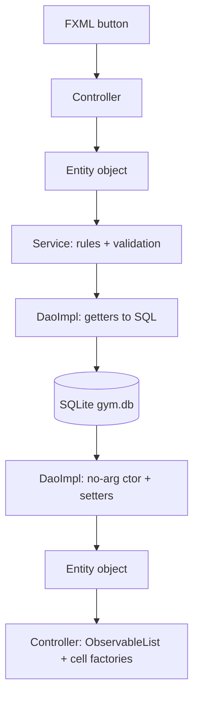

# `model` — Entity Classes (JavaFX branch)

> **Signature authority:** `docs/UML.md` §1 owns every name, type and signature in this folder.
> This README explains *why* each one exists and *how* to write it. Code here is an illustrative
> sketch, not the specification — if a sketch and `UML.md` disagree, `UML.md` wins.
>
> Supporting authority: `docs/DECISIONS.md` (31 money + ISO dates, 32 association not aggregation,
> 36 no generalization) and `docs/LEARNING_GUIDE.md` §3 (the OOP theory behind every entry below).

**Current state.** As of this revision `model/` contains only this README. `UML.md` still opens with
"design specification, not a description of shipped code", so *every* file in §5 is **planned**, and
`docs/COVERAGE.md` remains the place that says what is actually built.

## 1. Purpose — the problem this layer solves

`model` is the vocabulary of the application. Each of the 13 entity classes is the Java shape of one
row in `gym.db`, and the 11 enumerations are the closed sets of values those rows are allowed to hold.
Nothing else in the project may invent a second copy of a member, a payment or a session: the DAO
fills these objects from SQLite, the service validates and mutates them, the controller renders them
and the FXML table columns read them. One type, one definition, five users.

**What breaks if this layer is missing.** Without entities, every layer passes loose values around:
`CustomerDao.findById` would return a `Map<String, Object>`, `CustomerService` would read
`row.get("phone")`, and `CustomerProfileController` would cast the result. A column rename then breaks
the DAO, the service and the screen at the same time, and no compiler helps — `Map.get` returns
`Object`, so a typo becomes a `ClassCastException` in front of a user. Money would be summed as
`double` and stop reconciling (`DECISIONS.md` 31), and a misspelled status would be a perfectly valid
`String` that no `switch` statement recognises.

**What this layer deliberately does not do.** It holds no SQL and no JDBC types, imports no JavaFX, and
computes nothing. It does not validate — `CustomerService.validate`, the rule numbers in `UML.md` and
`Validators` own that, because two callers would otherwise validate differently and the DAO must still
be able to *load* a row that a strict setter would reject (`LEARNING_GUIDE.md` §3.2). It does not
inherit (`UML.md` §7, `DECISIONS.md` 36) and it does not hold object references to other entities
(`DECISIONS.md` 32).

### The entity contract

Preserved from the tracker version of this README, and still the rules every entity obeys:

> Every entity is a plain POJO with `toString`, `equals` and `hashCode`. `Payment` needs `equals`
> specifically because the XOR rule is defined over it and tests compare payments. Entities reference
> other entities **by id only** (`customerId`, `trainerId`, …) — there is no object graph, which is
> what keeps this layer free of JDBC and of lazy-loading concerns.

Two consequences of that contract are worth stating out loud. First, "plain POJO" means a **class with
a no-arg constructor and setters**, not a `record`: `UML.md` §1 lists two constructors per entity, and
the no-arg one is what lets the DAO build the object row by row (`DOCS_STANDARD.md` §3, code-sketch
policy). Second, `toString`/`equals`/`hashCode` are *part of the contract*, not extras — they exist so
a failing test can print a payment and so two payments for the same receipt can be compared.

### Conventions that apply to every entity (`docs/UML.md` header)

- Money is `BigDecimal`, never `double`.
- Boxed `Integer`/`Boolean` marks a nullable column; primitives mark NOT NULL.
- Dates are ISO-8601 strings: `yyyy-MM-dd` for dates, `HH:mm` for times, `yyyy-MM-dd HH:mm` for
  date-times. `DateUtils` owns every parse and format.
- `m3fx` is a UI dependency and must never be imported here.

### Enumerations at a glance

Preserved from the tracker version of this README:

> `CustomerStatus`, `MembershipStatus`, `PlanType`, `SessionStatus` (includes `NO_SHOW`),
> `SubscriptionStatus`, `AvailabilityStatus`, `StaffRole`, `PaymentMethod`, `EquipmentStatus`,
> `EquipmentCondition`, `ProgressMetric` (WEIGHT_KG, BODY_FAT_PCT — selects which measurement
> `ProgressService.series` returns).
>
> `AvailabilityStatus.FULL`, `MembershipStatus.EXPIRED` and `SubscriptionStatus.EXPIRED` are
> **derived** — recomputed on read, never set by hand. Only `OPEN`/`CLOSED`, `FROZEN`, and the
> `CANCELLED` literals are assigned explicitly.

`UML.md` → "Notes on scope" adds why they look the way they do: **enumerations are leaf types.** They
appear as attribute types and never own relationships, so §1 draws them as declared but unconnected
boxes. Each one is reachable from at least one service operation (`findByStatus`, `findByCondition`,
`findByMethod`, `findByRole`, `activeSubscription`, `series`).

## 2. What you learn here (OOP concepts)

This is the smallest layer in the project and the one where the object-oriented vocabulary is easiest
to see, because there is almost no machinery in the way — just fields, accessors and enums.

| Concept | Where in this folder | Why the project needs it | How to apply it (one line) |
|---|---|---|---|
| Encapsulation | The 113 `«get/set»` fields in `UML.md` §1 (`«get/set»` is project shorthand for "private field + public getter + public setter") | The public API of a class is a promise; the field is an implementation detail we may change | Write `private String phone;` and `public String getPhone()`; never a public field |
| Information hiding | `Administrator.passwordHash`, `MedicalProfile.*` | Only the service that needs a value should be able to reach it in code review terms; a public `hash` field invites printing it | Keep the field private and never add a getter "just for logging" |
| Class vs object | `Customer` is the class; the row reception loads is an object | A gym has hundreds of members — one *type*, many *instances* | Create two customers with different ids in a scratch `main` and print both |
| Fields = state, methods = behaviour | Entities store `startDate`/`endDate`; `MembershipService` decides what renewal means | Data stays where it belongs and computation stays where it can be tested | When a getter starts containing `if`, move the logic to the service |
| Constructor + overloading | `Customer()` **and** `Customer(int, String, …)` on all 13 entities | The no-arg constructor is required by DAO mapping and seeding code; the full one is convenient for tests | Write both, in that order, even when the no-arg one looks empty |
| `this` and field shadowing | Every setter: `this.fullName = fullName;` | Without `this` the parameter hides the field and you assign a value to itself | Type `this.` in every setter, then delete it once and explain the null field |
| Boxed vs primitive (nullability signalling) | `Customer.trainerId` is `Integer`; `Session.durationMin` is `int`; `ProgressRecord.targetWeightKg` is `Double` | The type *is* the schema: boxed = the column may be `NULL`, primitive = NOT NULL | Choose the type from the column, never from convenience |
| Value objects | `PlanType` (price + duration), the 10 pure enums, `BigDecimal` money | A plan's price belongs to the plan; a shared immutable value cannot drift between copies | Use an enum or `BigDecimal` for values; do **not** treat the 13 entities as value objects — they are mutable and carry identity |
| `equals`/`hashCode` contract | Every entity; `Payment` needs it most, because rule 12 (the XOR link rule) is defined over it and tests compare payments | Reference equality makes two rows that describe the same payment compare unequal, so a test passes or fails by accident | Write the pair together, keep them consistent, and never mix `equals` with `==` on money |
| `toString` for debugging | Every entity; `Administrator` and `MedicalProfile` are the careful ones | A failing test prints an object, and a debugger line should tell you *which* object without opening the DB | Print identity + the few fields a human needs, never a password hash or a medical list |
| Enums as types instead of magic strings | All 11 enums replace `String status` / `int role` | `"ADMNI"` compiles; `StaffRole.ADMNI` does not, and the IDE lists the legal values | Declare the enum, type the field with it, never compare `name()` to a literal |
| Enum with state and behaviour | `PlanType` — see its entry in §5 | The plan price and duration belong to the plan, not to a `switch` repeated in three screens | Give the enum fields, a private constructor and accessors; keep amounts out of the code until the team sets them |
| Derived vs stored state | Rule 13: `FULL` and both `EXPIRED` literals | A stored derived value goes stale the moment the underlying row changes — a renewed membership stays `EXPIRED` forever | Compute on read and let exactly one documented producer write it |
| Composition, FK-by-id (no object graph) | `Session.customerId`, `Membership.customerId`, `Payment.sessionId` | An entity reference would force lazy loading, drag JDBC into this layer and create ownership cycles (`DECISIONS.md` 32) | Store the id; if a screen needs the name, ask the service for both rows |
| Immutability and defensive copying | `BigDecimal` and enums are immutable, so sharing them is safe; no entity holds a collection | Nothing in this folder needs a defensive copy *today*, which is exactly why a `List` field must not be added casually | Keep scalar fields; if you ever add a collection, copy it in the getter and update `UML.md` §1 first |
| Inheritance — and why it is *absent* here | No entity extends anything: no `BaseEntity`, no `AbstractEntity`, no `abstract` modifier (`UML.md` §7, `DECISIONS.md` 36) | A base class holding `id` would put a field where `UML.md` §1 does not show one, hide which class owns which column, and buy nothing | Reject the base class; if you think one is needed, argue it in `DECISIONS.md` first |
| `switch` over enums (exhaustive) | Consumers live a layer up — `SchedulingService.canTransition`, `EquipmentService.changeStatus`, `ProgressService.series` | An exhaustive `switch` expression turns a forgotten case into a compile error instead of a silent `null` | When you add a literal, let the compiler list every `switch` you must handle |
| Static vs instance members | Entities have no static members at all; the only statics near them are `values()`/`valueOf(...)`, which Java supplies | Static mutable state in an entity is a global cache that outlives the screen that filled it | Nothing static in this folder except enum machinery Java generates |
| `Optional` — deliberately not used | Entity fields and their getters (`LEARNING_GUIDE.md` §3.6) | The project returns `null` for "not found" everywhere (`AdminService.authenticate` returns `null`); mixing the two styles makes every caller guess | Return the boxed type or `null`; do not introduce `Optional` in this layer |
| Single responsibility | One file per class, one class per concept, `PlanType` the only file here with behaviour | A change to "how a plan is priced" touches one file and no screen | Split a concept only after `UML.md` §1 grows a second class for it |

## 3. Design patterns in this layer

| Pattern | Where | Why this pattern | What goes wrong if used carelessly |
|---|---|---|---|
| Value Object | `PlanType` members, the 10 pure enums, every `BigDecimal` amount | The value is the identity: any `MONTHLY` plan is the same plan, and a shared immutable object cannot drift between two copies | Adding mutable state to an enum (a settable static field) turns a shared value into global state |
| Entity / DTO (plain POJO) | All 13 classes | The DAO and the service need one dumb carrier they both trust; behaviour in it would move business rules into the layer that must stay loadable from any row | Behaviour creeps in (a getter that computes, a setter that validates) and the DAO can no longer load legacy rows |
| Factory Method | `Payment.forMembership(...)`, `forSubscription(...)`, `forSession(...)` (`UML.md` §1) | Three adjacent `Integer` parameters swap silently and still compile; a named factory makes the intent the method name | A factory that also validates duplicates `PaymentService.validLink` (rule 12) and hides the XOR bug the service exists to catch |
| State machine over an enum | The `SessionStatus` set; the transitions are enforced by `SchedulingService.canTransition` (rule 18) | The legal states are a closed set the compiler knows; the *transitions* are a business rule and belong in the service | Letting `setStatus(...)` move a session from `NO_SHOW` to `CONFIRMED` in a controller — the enum will not stop you, so the single-authority rule must |
| Nullable FK with an explicit XOR link | `Payment.membershipId` / `subscriptionId` / `sessionId` (all boxed `Integer`) | `null` says "this payment is not about a membership", which an `int` cannot express without a sentinel that collides with real ids | Treating `0` as "no link" — the first real id that equals a sentinel turns into a wrong receipt |
| Derived value instead of stored value | Rule 13: `FULL`, `EXPIRED` | A stored derived value goes stale the moment the row it was derived from changes | Writing `EXPIRED` from a controller so the table "looks right": the renewed membership keeps the wrong status |
| Template Method / inheritance | **Rejected** — `UML.md` §7 and `DECISIONS.md` 36 | A `BaseEntity` would hold `id` for 13 classes that differ in fields, not in structure, and would hide the per-column ownership that §1 documents | One base class per layer becomes a base class per requirement, and the field list stops matching `UML.md` |
| Singleton | **Avoided** in this folder (`SessionContext` in `util` is the one documented exception, `DECISIONS.md` 34) | A cached `Customer` in a static field is a stale row the moment a service updates it | Two screens edit what they believe is the same object and the second save wins silently |
| Builder | **Not in this design** — `UML.md` §1 fixes the constructor list, and the three `Payment` factories cover the painful case | The full-argument constructors are verbose but explicit, and 13 builders would be 13 more classes to keep in sync with the diagram | Adding a builder without updating `UML.md` §1 creates a second, unversioned way to construct an entity |

## 4. Rules you must follow (and the bug each rule prevents)

1. **Fields are `private`; accessors are `public`.** `UML.md` §1 elides 226 accessors behind
   `«get/set»`. A public field makes the class's memory layout its API, so trimming a phone number or
   storing a hash later breaks every caller instead of one class.
2. **Every entity is a plain class, never a `record`.** `UML.md` §1 lists a no-arg constructor and a
   full one for all 13 entities; a record has neither a no-arg constructor nor setters, so the DAO
   could not build the object row by row (`DOCS_STANDARD.md` §3, code-sketch policy).
3. **Money is `BigDecimal`, and always from the `String` constructor.** `new BigDecimal("45.00")`,
   never `new BigDecimal(45.00)`. `double` cannot represent `0.1`, so summing receipts drifts and a
   revenue report stops reconciling (`DECISIONS.md` 31). The `double` constructor copies the
   binary-float error you were avoiding.
4. **Compare money with `compareTo`, never `equals` and never `==`.** `equals` compares scale too, so
   `new BigDecimal("45.0").equals(new BigDecimal("45.00"))` is `false` and a receipt lookup fails on a
   value a human calls identical.
5. **Dates and times are ISO-8601 `String`s, and no `java.time` type appears in this folder.**
   `yyyy-MM-dd`, `HH:mm`; `DateUtils` owns every parse and format (rule 9, `DECISIONS.md` 31). A
   `LocalDate` field forces a conversion inside this layer, two conversions disagree about leniency and
   time zones, and `findByDay`/`revenueBetween` can no longer compare text.
6. **Boxed `Integer`/`Long`/`Double`/`Boolean` marks a nullable column; a primitive marks NOT NULL**
   (`UML.md` header). An `int` FK forces a sentinel `0` for "no trainer", so the first real id of `0`
   becomes a valid assignment and every `WHERE trainerId = 0` query returns the wrong roster.
7. **A `String` field carries no nullability mark, so we keep one convention for "nothing to record".**
   `null` and `''` behave differently in `equals`, in `toString` and in a `LIKE` query, and a value you
   did not expect shows up as the text `null` in a table cell. **Open detail (decide + log in
   `DECISIONS.md`)**: pick one representation for absent text (`NULL` or `''`) and one neutral value
   for the non-boxed fields that are semantically absent before their event happens
   (`Payment.previousAmount`/`voidReason`/`voidedDate`, `Session.cancelReason`/`sessionNotes`,
   `Attendance.checkOut`, `Equipment.lastMaintenance`), then make every DAO and every `toString`
   agree. Nothing in `UML.md` chooses for us.
8. **`equals` and `hashCode` are written together and stay consistent.** The contract is reflexivity,
   symmetry, transitivity, consistency, and "equal objects share a hash code". Two `Payment` objects
   that describe the same receipt must compare equal or rule 12's tests become a coin flip.
   **Open detail (decide + log in `DECISIONS.md`)**: whether equality is the full field list or the
   `id` alone. Full-field equality is the useful default for tests and seeding; `id`-only equality
   would call two *unsaved* objects equal, because both have `id == 0`.
9. **`toString` serves the debugger and leaks nothing.** Print the class, the id and the two or three
   fields that make the object recognisable. `Administrator.toString` prints `username` and `role` and
   **never** `passwordHash`; `MedicalProfile.toString` prints the customer id and the updated date and
   **not** the conditions, allergies or medications — logs and screenshots get shared.
10. **Foreign keys are ids (`int`) or boxed ids (`Integer`), never entity-typed fields.** A
    `Customer customer` inside `Session` would need lazy loading or an object graph, drag JDBC and
    cycles into a layer that must stay a plain data carrier, and contradict `DECISIONS.md` 32 (every
    child is an association, not an aggregate) — the DAO would also have to decide how deep to load.
11. **No inheritance in this package.** `UML.md` §7 shows the only two generalizations in the project
    and both target Java platform types (`MainApp extends Application`, `DaoException extends
    RuntimeException`); `DECISIONS.md` 36 records why the three candidate hierarchies were rejected.
    A `BaseEntity` would put an undeclared field into 13 diagrams, hide which class owns which column,
    and make a subclass's field list impossible to read against §1.
12. **No validation and no decision-making in this folder.** `UML.md` rules 3–19 live in services
    (`LEARNING_GUIDE.md` §3.2), and the entity contract is "load anything the DAO finds, store
    anything the service sets". A validating setter throws halfway through loading a legacy row, and
    the user sees "save failed" for an edit they never made.
13. **No SQL, no JDBC, no JavaFX here.** One import of `java.sql` or `javafx.*` couples the layer to a
    database file and a UI toolkit, so an entity can no longer be constructed in a unit test, and the
    storage choice leaks upward past the DAO seam. The allowed imports are effectively
    `java.math.BigDecimal`, `java.util.Objects` and the sibling enums.
14. **Use the enum type, never a magic `String` or `int` code.** `"ACTVE"` compiles and fails at
    runtime; `CustomerStatus.ACTVE` does not compile at all (`LEARNING_GUIDE.md` §3.4). Every status,
    method, role and metric in this folder is typed by the matching enum.
15. **Derived literals are never assigned by hand** (rule 13). `AvailabilityStatus.FULL`,
    `MembershipStatus.EXPIRED` and `SubscriptionStatus.EXPIRED` are recomputed on read. Storing them
    means the value is wrong the moment an occupancy drops or a membership is renewed, and nobody
    knows which write was the last one. Write the derivation as a **pure helper** — inputs in, literal
    out — so the literal has exactly one producer and no caller can hand-pick it. **Open detail (decide
    + log in `DECISIONS.md`)**: the helper's name and home (a static method on the enum, beside it, or
    on the owning service); `UML.md` §1 draws enum literals only, so whoever adds the helper adds it
    to §1 as well.
16. **One producer per enum literal** (`UML.md` → "Enumerations" table names the owner of the
    behaviour: `CustomerService.changeStatus`, `MembershipService`, `MembershipService.sell`,
    `SchedulingService.canTransition`, `SchedulingService`, `TrainerService`, `SessionContext.requireRole`,
    `PaymentService.record`, `EquipmentService.changeStatus`, `EquipmentService.changeCondition`,
    `ProgressService.series`). Two writers is how "who set this to `NO_SHOW`?" becomes unanswerable.
17. **Persist an enum by `name()`, never by `ordinal()`** — and never by parsing display text in this
    layer. Inserting one literal in the middle re-numbers every stored value, so old rows silently
    change meaning; `name()` is stable, readable in the database and in a screenshot.
18. **No collection fields.** No entity in §1 holds a `List`, and that is why no getter here needs a
    defensive copy: `BigDecimal` and enums are immutable, so sharing them is safe. A `List` field
    would have to be copied in the getter (or the caller mutates the entity's internals through the
    list it was handed), and it is a change to `UML.md` §1 first — note that `WorkoutProgram.exercises`
    is a `String` and `Trainer.certifications` is a `String` precisely so this question does not arise.
19. **No `Optional` in entity fields or signatures** (`LEARNING_GUIDE.md` §3.6). Every lookup in this
    project returns `null` for "not found"; adding `Optional` to one entity forces every caller to
    remember which style each member uses.
20. **`m3fx` is never imported here.** It is the external theme/component library, so importing it
    would make a data class depend on the UI toolkit's presence; the existing convention in this
    README ("`m3fx` is a UI dependency and must never be imported here") still stands.

## 5. The files in this folder

One entry per planned file. **Write them in this order** — foundations first, so that no file needs a
type that does not exist yet:

1. The 11 enumerations, in the order they appear below. `CustomerStatus` and `MembershipStatus` come
   first because `Customer` and `Membership` declare them; `PlanType` is the one enum with state, so
   read its entry twice.
2. The 13 entities in this order: `Customer`, `Administrator`, `Trainer`, `Membership`,
   `WorkoutProgram`, `Session`, `Equipment`, `Attendance`, `Payment`, `ProgressRecord`,
   `MedicalProfile`, `TrainerSubscription`, `TrainerAvailability`.

Each entry follows `DOCS_STANDARD.md` §3: purpose, fields, why, how to write it, a 10–35 line sketch,
how to verify, and the mistakes we expect. Sketches are marked
`// Sketch — field list is authoritative in docs/UML.md §1`, and they compile *in spirit*: correct
types, no invented members.

### Files at a glance

| # | File | Kind | Owner | Status |
|---|---|---|---|---|
| 1 | `CustomerStatus.java` | enum | Abdelrhman | planned |
| 2 | `MembershipStatus.java` | enum (one derived literal) | Ziad | planned |
| 3 | `PlanType.java` | enum **with state** | Ziad | planned |
| 4 | `SessionStatus.java` | enum | Yousef | planned |
| 5 | `SubscriptionStatus.java` | enum (one derived literal) | Yousef | planned |
| 6 | `AvailabilityStatus.java` | enum (one derived literal) | Yousef | planned |
| 7 | `StaffRole.java` | enum | Abdel Raouf | planned |
| 8 | `PaymentMethod.java` | enum | Abdel Raouf | planned |
| 9 | `EquipmentStatus.java` | enum | Abdel Raouf | planned |
| 10 | `EquipmentCondition.java` | enum | Abdel Raouf | planned |
| 11 | `ProgressMetric.java` | enum (selector) | Abdel Raouf | planned |
| 12 | `Customer.java` | entity | Abdelrhman | planned |
| 13 | `Administrator.java` | entity | Abdelrhman | planned |
| 14 | `Trainer.java` | entity | Ziad | planned |
| 15 | `Membership.java` | entity | Ziad | planned |
| 16 | `WorkoutProgram.java` | entity | Yousef | planned |
| 17 | `Session.java` | entity | Yousef | planned |
| 18 | `Equipment.java` | entity (root aggregate) | Yousef | planned |
| 19 | `Attendance.java` | entity | Abdel Raouf | planned |
| 20 | `Payment.java` | entity (XOR link + factories) | Abdel Raouf | planned |
| 21 | `ProgressRecord.java` | entity | Abdel Raouf | planned |
| 22 | `MedicalProfile.java` | entity | Abdelrhman | planned |
| 23 | `TrainerSubscription.java` | entity | Yousef | planned |
| 24 | `TrainerAvailability.java` | entity | Yousef | planned |

Where the files go: `src/main/java/com/gym/model/`, package `com.gym.model`, one public class per file,
and the file name must equal the class name or nothing compiles.

---

## 5.1 The enumerations (write these first)

An enumeration is a class whose instances are a fixed, shared set. Here that set is the domain's
vocabulary: a status, a role, a method, a metric. Two facts from `UML.md` shape every entry below.
**Enumerations are leaf types** — they appear as attribute types and never own relationships, so §1
draws them declared but unconnected. And one literal has one owner: the `UML.md` → "Enumerations"
table names the service that produces each enum's behaviour.

`docs/UML_TEAM.md` adds the collaboration rule: shared enumerations (`CustomerStatus` with Abdelrhman,
`StaffRole`/`PaymentMethod`/`EquipmentStatus`/`EquipmentCondition` with Abdel Raouf) are owned by
whoever first needs them, and **a literal may be added only after telling the other three** — because
a new literal changes every exhaustive `switch` in the project.

Every enum entry below uses a literal table instead of a field table: an enum's data *is* its literal
list. `PlanType` is the exception and gets both tables, because it carries state.

### `CustomerStatus.java` — the lifecycle of a gym member (owner: Abdelrhman)

**Status:** planned.
**Canonical:** `docs/UML.md` §1 (literals) and `UML.md` → "Enumerations" (behaviour owner:
`CustomerService.changeStatus`). Rules 4, 5 and 14 are defined over this type.

**What it is.** Whether a member is currently allowed to use the gym, has left, or has been barred.
It is the first thing `CustomerService` checks before a check-in (rule 5) and the value rule 4 means
by "delete" — set `INACTIVE`, keep the row and the history.

**Literals.**

| Literal | Meaning in the domain | Who produces it | Derived? |
|---|---|---|---|
| `ACTIVE` | May check in and book; rule 5 requires this value | `CustomerService.changeStatus` (and the DAO on load) | no |
| `INACTIVE` | What "delete" means for a `Customer` (rule 4): the row stays, the history stays | `CustomerService.changeStatus` | no |
| `SUSPENDED` | Barred from the gym; implies the memberships are frozen (rule 14) | `CustomerService.changeStatus` | no |

**Why it is designed this way.** Three different meanings rule 4, 5 and 14 need cannot be expressed by
one `boolean active`: a boolean can say "not allowed" but not *why*, and rule 14 has to trigger
`MembershipService.freezeForSuspended(customerId)` for `SUSPENDED` only. An `int` code or a `String`
would compile with the wrong value and only fail in front of a user (`LEARNING_GUIDE.md` §3.4). None
of the three literals is derived, so unlike the next two enums this file has no derivation to explain.

**How to write it.**

1. Create `src/main/java/com/gym/model/CustomerStatus.java`, `package com.gym.model;`.
2. Declare `public enum CustomerStatus {` and list the three literals in the order §1 shows them —
   the order is part of the canonical doc, and readers compare the two side by side.
3. Put a Javadoc line on each literal naming its producer. That comment is the only place the "one
   owner per literal" rule is visible in the file itself.
4. Add nothing else. No fields, no constructor, no `label()`, no `isActive()` helper: a method here is
   a new member and `UML.md` §1 does not have it yet.
5. Import nothing. This file has no dependencies at all.

**Sketch.**

```java
package com.gym.model;

// Sketch — literal list is authoritative in docs/UML.md §1.
// Behaviour owner: CustomerService.changeStatus (UML.md -> "Enumerations").
public enum CustomerStatus {

    /** May check in (rule 5) and book sessions. */
    ACTIVE,

    /** What "delete" means for a Customer (rule 4): the row and its history stay. */
    INACTIVE,

    /** Barred; implies the memberships are frozen (rule 14, freezeForSuspended). */
    SUSPENDED
}
```

**How to know it is right.** Compile it with `javac` or the Gradle build: `CustomerStatus.values()`
must print exactly `[ACTIVE, INACTIVE, SUSPENDED]`, in that order, and `valueOf("INACTIVE")` must not
throw. Then re-read rule 4 and rule 14 and point at the literal each one needs — if you cannot, the
enum is missing a case and the design needs a decision, not a private literal.

**Common mistakes.**

- **Using `boolean active` instead of this enum.** You lose `SUSPENDED`, so rule 14's "suspended
  customer ⇒ frozen memberships" has no trigger and suspended members keep a usable membership.
- **Adding a literal such as `PENDING` alone.** Every exhaustive `switch` over `CustomerStatus` in the
  services stops compiling (that is the good outcome) or silently takes its `default` branch (that is
  the bad one) — and `UML.md` §1 no longer matches the code. Add literals in `UML.md` first, then tell
  the other three owners.
- **Comparing the name as text:** `customer.getStatus().name().equals("ACTIVE")` survives a rename of
  the literal and breaks at runtime. Use `customer.getStatus() == CustomerStatus.ACTIVE`, or a `switch`.
- **Building the value from a form label** with `CustomerStatus.valueOf("Active")` — that throws
  `IllegalArgumentException` for anything but the exact constant name. The DAO stores `name()`
  (rule 17); the controller owns the display text.

### `MembershipStatus.java` — where a membership stands today (owner: Ziad)

**Status:** planned.
**Canonical:** `docs/UML.md` §1 (literals), §1b note ("`FROZEN` is set by `freeze()`; `EXPIRED` is
derived from `endDate` and never set by hand"), `UML.md` → "Enumerations" (behaviour owner:
`MembershipService`). Rules 5, 7, 13 and 14 touch this type.

**What it is.** The state of one sold plan: paying and usable, paused, finished, or cancelled. It is
the value rule 5 reads before a check-in, the value rule 7 moves when a membership is frozen, and one
of the three **derived** literals in the project (rule 13).

**Literals.**

| Literal | Meaning in the domain | Who produces it | Derived? |
|---|---|---|---|
| `ACTIVE` | Paying and usable; rule 5 also needs `endDate >= today` | `MembershipService.sell`, `renew`, `unfreeze` (or the DAO on load) | no |
| `FROZEN` | Paused by `MembershipService.freeze`; `frozenDays` holds the period (rule 7) | `MembershipService.freeze`, `freezeForSuspended` (rule 14) | no |
| `EXPIRED` | The end date has passed | **Nobody.** Recomputed on read from `endDate` | **yes** (rule 13) |
| `CANCELLED` | The gym or the member ended it | `MembershipService.cancel` only | no |

**Why it is designed this way.** Rule 7 needs `FROZEN` to be a *state* with a counter (`frozenDays`)
rather than a date range, so `unfreeze` can shift `endDate` forward by exactly the paused period.
`EXPIRED` exists as a literal because screens and reminder lists need to show it — but the calendar,
not a human, decides it (rule 13). Storing it is the classic derived-state bug: a membership renewed
today keeps `EXPIRED` in the row forever, and `expiryReminders(withinDays)` keeps mailing the member.
`CANCELLED` is the opposite: it is a *decision* with a producer (`cancel`), and rule 7 refuses to renew
it, so it must never be conflated with `EXPIRED`.

**How to write it, including the derived literal.** This is the pattern all three derived-literal enums
(`MembershipStatus`, `SubscriptionStatus`, `AvailabilityStatus`) follow:

1. Write the four literals with a Javadoc line each; name the producer, and for `EXPIRED` write
   "derived — never set by hand (rule 13)" so nobody has to remember it.
2. Write the derivation as a **pure helper**: inputs in, literal out. A caller who must pass the
   literal in could hand-pick `EXPIRED`, which is exactly what rule 13 forbids; a caller who passes
   only data cannot.
3. Compare ISO date strings with `compareTo`, never with `DateUtils`/`java.time` here: `yyyy-MM-dd`
   sorts chronologically as text, which is why the whole project stores dates this way
   (`DECISIONS.md` 31). `DateUtils` still owns the *formatting* and *parsing* of anything a human types.
4. Leave the setter public. `Membership.setStatus(...)` exists because `«get/set»` says so, the DAO
   must be able to load any row, and `freeze`/`cancel` must write. The guarantee is a single documented
   producer plus a grep, not a private setter (`LEARNING_GUIDE.md` §3.2).
5. ⚠️ **Open detail (decide + log in `DECISIONS.md`)**: the helper's exact name and home (a static
   method on this enum, beside it, or a method on `MembershipService`). `UML.md` §1 draws the enum
   literals only, so **whoever adds the helper also adds it to `docs/UML.md` §1** — otherwise the next
   reader re-derives the design and the two documents disagree.

**Sketch.**

```java
package com.gym.model;

// Sketch — literal list is authoritative in docs/UML.md §1.
// Behaviour owner: MembershipService. FROZEN <- freeze() (rule 7); CANCELLED <- cancel().
public enum MembershipStatus {

    /** Paying and usable; rule 5 needs this plus endDate >= today to check in. */
    ACTIVE,

    /** Paused by MembershipService.freeze; frozenDays counts the pause (rule 7). */
    FROZEN,

    /** Derived from endDate, recomputed on read, NEVER assigned by hand (rule 13). */
    EXPIRED,

    /** Set by MembershipService.cancel; renewing a cancelled membership is refused (rule 7). */
    CANCELLED;

    // PROVISIONAL name/home: Open detail (decide + log in DECISIONS.md) -- and add it to UML.md §1.
    // Pure by design: it takes the stored state and returns the effective one, so no caller can
    // hand-pick EXPIRED. ISO-8601 sorts as text, so compareTo is a chronological test (DECISIONS.md 31).
    static MembershipStatus effective(MembershipStatus stored, String endDate, String today) {
        return endDate.compareTo(today) < 0 ? EXPIRED : stored;
    }
}
```

**How to know it is right.** Build, then write a scratch `main` that calls
`effective(ACTIVE, "2025-01-31", "2025-02-01")` and expect `EXPIRED`, and
`effective(ACTIVE, "2025-02-01", "2025-02-01")` and expect `ACTIVE` (the end date itself is still
valid — rule 5 allows `endDate >= today`). Then grep the whole `src/` tree for `EXPIRED`: every hit
must be inside this file, inside `MembershipService`'s derive/read path, or inside a label in a
controller. Any other hit is a rule 13 violation.

**Common mistakes.**

- **Setting `EXPIRED` by hand** when the list "looks out of date" (`membership.setStatus(EXPIRED)`).
  Nobody renews it, `expiryReminders` keeps firing, and the next read recomputes a different value
  anyway, so the row and the screen disagree.
- **Treating `FROZEN` as `EXPIRED`** because both stop check-ins. Rule 7 says `unfreeze` shifts
  `endDate` forward by `frozenDays`; an expired membership must not gain days from a freeze it never had.
- **A `frozenUntil` date instead of `frozenDays`.** Rule 7 fixes the counter: `unfreeze` needs the
  paused *duration*, and a date range also has to survive a second freeze.
- **Deriving expiry inside the getter** (`getStatus()` returning `EXPIRED` by itself). `UML.md` §1 says
  `status` is a field with a getter and a setter, the DAO loads what the column says, and a getter that
  computes cannot be round-tripped back to SQLite.
- **Adding `GRACE_PERIOD` or similar to make the UI easier.** New state means new rules, a new
  `UML.md` §1 entry and a `DECISIONS.md` note; a private literal in one file silently changes the
  behaviour for everyone.

### `PlanType.java` — the enum that carries state (owner: Ziad)

**Status:** planned.
**Canonical:** `docs/UML.md` §1 (literals `MONTHLY`, `QUARTERLY`, `YEARLY`), `UML.md` →
"Enumerations" (behaviour owner: `MembershipService.sell`), and this README's tracker table
("Enum: MONTHLY, QUARTERLY, YEARLY (**carries plan price + duration**)"),
`LEARNING_GUIDE.md` §3.4 ("Enum with state and behaviour").

**What it is.** The three period plans the gym sells. This is the **only enum in the project with
state**: each literal carries the plan's price and its duration, so the price belongs to the plan
instead of to a `switch` repeated in three screens.

**Literals and state.**

| Literal | Meaning in the domain | Who produces it | Derived? |
|---|---|---|---|
| `MONTHLY` | A one-month plan | `MembershipService.sell(int customerId, PlanType plan)` | no |
| `QUARTERLY` | A three-month plan (the shape, not the number — see the open detail) | `MembershipService.sell` | no |
| `YEARLY` | A twelve-month plan (same caveat) | `MembershipService.sell` | no |

Provisional state members — **read the open detail below before you type any of this**:

| Member | Provisional type | Why that type is the likely one | Decided? |
|---|---|---|---|
| plan price | `BigDecimal` | Money is `BigDecimal` everywhere (`DECISIONS.md` 31); a `double` price would reintroduce the drift rule 6's balance depends on | **no** |
| plan duration | `int` months | `DateUtils.addMonths(String date, int months)` is the membership-period maths (`UML.md` §6), so a month count is the value it needs | **no** |
| accessors for both | `getPlanPrice()`, `getDurationMonths()` | Names follow the field names; they are as provisional as the fields | **no** |

> ⚠️ **Open detail (decide + log in `DECISIONS.md`).** `docs/UML.md` §1 currently draws only the three
> literals and the member list is *not* recorded anywhere, so before you write real values: decide the
> member names, their types, and the amounts as a team, log them in `DECISIONS.md`, and **add the
> members to `docs/UML.md` §1 so the canonical document stays complete**. This README deliberately
> contains no prices — the amounts are the gym's commercial decision, not a documentation fact.

**Why it is designed this way.** `LEARNING_GUIDE.md` §3.4 states the reason: "the plan's price belongs
*to the plan*, not to a `switch` scattered in the controller." A `String` plan name would make
`"Yearly"`, `"yearly"` and `"YEARLY"` three different plans. A `switch` in `MembershipService.sell`
plus another in the renewal screen plus another in the price list gives three places to edit when a
price changes, and two ways to disagree. With state on the enum there is one table, and Java refuses to
create a fourth literal without a constructor argument. Note what stays on the row: `Membership.price`
is still a separate field, so a plan change does not rewrite what a member already paid, and rule 6's
balance can be computed from rows alone. Keep the enum as the *default* source of the amount for a new
sale; never compute `Membership.getPrice()` from it.

**How to write it.**

1. Create `src/main/java/com/gym/model/PlanType.java`, `package com.gym.model;`, and import
   `java.math.BigDecimal`.
2. Declare the constants first, each with its constructor arguments — Java requires the constant list
   before any member, and a missing argument is a compile error, which is the enforcement you want.
3. Declare `private final BigDecimal planPrice;` and `private final int durationMonths;`. `final` is not
   optional: enum constants are shared singletons, so a settable price would let one screen change the
   price for the whole application.
4. Write a `private PlanType(BigDecimal planPrice, int durationMonths)` constructor. It must be private
   — a public one would compile and then fail at runtime, because you cannot `new` an enum.
5. Write the two accessors. No setters: a setter is the mutable-shared-state bug above.
6. Add a Javadoc line per literal (the plan length in words) and a class Javadoc naming the producer
   and pointing at the `UML.md` §1 update this file still needs.
7. Keep the amounts out of the sketch until the team decides them, and use `new BigDecimal("…")` with a
   `String` when they arrive — never `new BigDecimal(0.00)`.

**Sketch.**

```java
package com.gym.model;

import java.math.BigDecimal;

// Sketch — the three literals are authoritative in docs/UML.md §1.
// The constructor arguments are an Open detail (decide + log in DECISIONS.md): the zeroes below are
// PLACEHOLDERS, not prices. Adding the members to UML.md §1 is part of the same change.
public enum PlanType {
    /** One month. */
    MONTHLY(new BigDecimal("0.00"), 0),
    /** Three months. */
    QUARTERLY(new BigDecimal("0.00"), 0),
    /** Twelve months. */
    YEARLY(new BigDecimal("0.00"), 0);
    // final: enum constants are shared singletons, so mutable state here is global state.
    private final BigDecimal planPrice;
    private final int durationMonths;
    // private: `new PlanType(...)` outside this file would not compile as an enum anyway.
    private PlanType(BigDecimal planPrice, int durationMonths) {
        this.planPrice = planPrice;
        this.durationMonths = durationMonths;
    }
    // Provisional names — log them with the amounts before anyone calls them.
    public BigDecimal getPlanPrice() { return planPrice; }   // immutable: no defensive copy needed
    public int getDurationMonths() { return durationMonths; }  // DateUtils.addMonths takes a month count
}
```

**How to know it is right.** Build, then print `PlanType.YEARLY.getPlanPrice().toPlainString()` and
`PlanType.values().length` (must be 3). Check that the amount matches the price the team agreed in
`DECISIONS.md` and that `getDurationMonths()` is the number `DateUtils.addMonths` needs for the same
plan. Then open `docs/UML.md` §1 and confirm the members you added are drawn there too — if they are
not, the canonical document is still incomplete.

**Common mistakes.**

- **Scattering the amounts in a `switch`** (`case MONTHLY -> new BigDecimal("45.00")`) instead of
  reading them from the plan. The price now lives in two places, and changing one leaves the other
  silently wrong.
- **Inventing the prices.** A number typed into code becomes policy: the price list, the receipt and
  rule 6's balance all follow it. The amounts are a team decision to log in `DECISIONS.md`.
- **Adding a setter, or a non-`final` field.** `PlanType.MONTHLY` is one object shared by every screen
  and every row; a setter lets one member's edit change the price for the whole gym.
- **Writing the members but leaving `docs/UML.md` §1 as literals-only.** The next reader (and the
  presentation) then describes a different design from the code.
- **Parsing a plan from the UI** with `PlanType.valueOf(comboBoxValue)` — the combo box shows a label,
  the enum needs the constant name, and the failure is a runtime `IllegalArgumentException`.
- **Forgetting `durationMonths` is months, not a `Period` or a day count.** `DateUtils.addMonths`
  already handles month-end arithmetic; a second arithmetic path here would disagree with it (rule 9:
  one owner for date maths).

### `SessionStatus.java` — the session state machine's states (owner: Yousef)

**Status:** planned.
**Canonical:** `docs/UML.md` §1 (literals), §1b note ("Legal transitions are enforced by
`SchedulingService.canTransition`"), `UML.md` → "Enumerations" (behaviour owner:
`SchedulingService.canTransition`). Rules 1, 2, 10, 17 and 18 are defined over this type.

**What it is.** Where a booked training session currently stands, from a request the trainer has not
answered to a finished, missed or cancelled appointment. The literals are the *states*; the legal moves
between them are a business rule that lives in `SchedulingService.canTransition` (rule 18), not in this
file.

**Literals.**

| Literal | Meaning in the domain | Who produces it | Derived? |
|---|---|---|---|
| `REQUESTED` | Booked outside published slots; the trainer has not confirmed (rule 1) | `SchedulingService.requestOutsideSlots` | no |
| `CONFIRMED` | A booked, agreed session; the only status that occupies slot capacity (rule 17) | `SchedulingService.bookOpenSlot`, `confirmSession` | no |
| `COMPLETED` | The session happened; `sessionNotes` records how it went | `SchedulingService.completeSession` (from `CONFIRMED` only, rule 18) | no |
| `NO_SHOW` | The customer did not turn up; exists for trainer statistics (rule 2) | `SchedulingService.markNoShow` (from `CONFIRMED` only) | no |
| `CANCELLED` | Called off; `cancelReason` records why (rule 10) | `SchedulingService.cancelSession` | no |

**Why it is designed this way.** `UML.md` rule 2 says `NO_SHOW` "exists and matters for trainer
statistics", so the set must be bigger than "booked / done". A `String` status would accept
`"NO-SHOW"`, `"noshow"` and `"No Show"` as three states, and rule 18's transition table would need a
`default` branch that silently permits everything it does not recognise. With an enum, `canTransition`
can be an exhaustive `switch` expression, and a forgotten case becomes a compile error
(`LEARNING_GUIDE.md` §3.4). The state *set* is data; the *transitions* are the rule — so this file
stays a list, and `canTransition` stays the single authority every transition operation calls.

Two honest gaps in `UML.md` you should raise with the owners before writing the services, not fix in
code:

- Rule 18 says "only `CONFIRMED` sessions may become `COMPLETED`, `NO_SHOW` or `CANCELLED`", read
  literally a `REQUESTED` session that the trainer declines has **no legal transition**. Decide the
  answer with Yousef and record it in `UML.md` rule 18 / `DECISIONS.md`.
- Rule 1 describes `adminReserve` as an admin override that ignores slot rules but does not state the
  status it writes. `CONFIRMED` and `REQUESTED` are both arguable; `UML.md` does not choose.

**How to write it.**

1. Create `SessionStatus.java`, `package com.gym.model;`, and list the five literals in §1's order.
2. Javadoc each literal with its producer and its precondition, e.g. "from `CONFIRMED` only (rule 18)".
3. Write no transitions here. `canTransition(SessionStatus from, SessionStatus to)` is a
   `SchedulingService` member (`UML.md` §4); duplicating it in the enum would create a second authority
   and rule 18 says there is one.
4. Import nothing. If you find yourself wanting `DateUtils` here to decide whether a cancellation is
   free, stop: rule 10's two-hour window is a service rule using `DateUtils.hoursUntil`.
5. State in the class Javadoc that this enum is a *state set*, and point at rule 18 for the moves.

**Sketch.**

```java
package com.gym.model;

// Sketch — literal list is authoritative in docs/UML.md §1.
// Behaviour owner: SchedulingService.canTransition (rule 18, the single transition authority).
public enum SessionStatus {

    /** Requested outside published slots; a trainer must confirm it (rule 1). */
    REQUESTED,

    /** Agreed and booked; the only status counted against a slot's cap (rule 17). */
    CONFIRMED,

    /** The session happened; sessionNotes holds the outcome. From CONFIRMED only (rule 18). */
    COMPLETED,

    /** The customer did not attend; kept for trainer statistics (rule 2). From CONFIRMED only. */
    NO_SHOW,

    /** Cancelled with a reason recorded (rule 10); CANCELLED is set explicitly (rule 13). */
    CANCELLED
}
```

**How to know it is right.** Print `SessionStatus.values()` and check the five names and their order
against `UML.md` §1. Then read rule 18 and, for each of the five literals, say which statuses may move
into it and out of it *from the text of the rule* — if a case is not covered by the text, that is the
gap listed above, and it needs a decision rather than a guess in `canTransition`.

**Common mistakes.**

- **Moving a status directly from a controller** (`session.setStatus(COMPLETED)` after a button click).
  Rule 18 makes `canTransition` the single authority, so a direct write can produce a `NO_SHOW` session
  that later becomes `CONFIRMED` — a state the rule forbids and no screen expects.
- **Reusing `CANCELLED` for a customer no-show.** Rule 2 exists because the two mean different things:
  a cancellation is a decision before the session, a `NO_SHOW` is an absence at it, and trainer
  statistics read only one of them.
- **Adding a literal such as `RESCHEDULED` in this file alone.** It changes every exhaustive `switch`,
  needs a `UML.md` §1 entry, `DECISIONS.md` for the transition table and a message to the other three
  owners.
- **Storing the ordinal.** `SessionDao.findByStatus` filters on the status; if the column holds `2`
  instead of `CONFIRMED`, inserting one literal in the middle renumbers every existing session
  (rule 17's capacity counts stop matching reality).
- **Putting the "2 hours before start is free" rule (rule 10) in the enum**, e.g. an
  `isFreeCancellation(String date, String time)`. It is a service rule and needs `DateUtils.hoursUntil`;
  the enum is a list of states.

### `SubscriptionStatus.java` — where a trainer engagement stands (owner: Yousef)

**Status:** planned.
**Canonical:** `docs/UML.md` §1 (literals), §1b note ("`EXPIRED` is derived from `endDate`;
`CANCELLED` is set by `cancelSubscription`"), `UML.md` → "Enumerations" (behaviour owner:
`SchedulingService`). Rules 11, 13 and 15 touch this type.

**What it is.** The state of a paid period with one trainer — the "I train with this coach until
March" record, not the customer's trainer assignment. Rule 15 keeps those two apart: `Customer.trainerId`
is authoritative for the roster and medical access, while `TrainerSubscription` "records only the paid
engagement period".

**Literals.**

| Literal | Meaning in the domain | Who produces it | Derived? |
|---|---|---|---|
| `ACTIVE` | The paid period is running; sessions inside it are covered (rule 11) | `SchedulingService.subscribe`, `renewSubscription` (or the DAO on load) | no |
| `EXPIRED` | The end date has passed | **Nobody.** Recomputed on read from `endDate` | **yes** (rule 13) |
| `CANCELLED` | Ended early by an explicit cancel | `SchedulingService.cancelSubscription` only | no |

**Why it is designed this way.** `EXPIRED` is derived for the same reason as `MembershipStatus.EXPIRED`:
the calendar changes the answer, and a stored value goes stale the moment `expireOverdueSubscriptions()`
or a renewal runs. Keeping `CANCELLED` separate preserves the difference between "the period ran out"
and "somebody stopped it" — `SchedulingService.activeSubscription(customerId, trainerId)` and
`TrainerSubscriptionDao.findActive(int, int, String)` must return `null` for both, but a report that
counts churn needs to tell them apart. The status is per engagement row, so a customer who changes
trainer has several rows and each one keeps its own history.

**How to write it.** Follow the pattern from `MembershipStatus`:

1. Three literals with producer Javadoc; mark `EXPIRED` as derived.
2. The same pure derivation helper over `endDate` — inputs in, literal out, `compareTo` on ISO strings.
3. ⚠️ **Open detail (decide + log in `DECISIONS.md`)**: helper name and home; add it to
   `docs/UML.md` §1 in the same change, because §1 draws literals only.
4. No `isCovered()`/`covers(Session)` method here: coverage is rule 11 and belongs to
   `SchedulingService.coveredBySubscription(Session)`, which also checks the session's `trainerId`
   and the zero price.
5. Import `BigDecimal`? No — this file has no money field; the rate lives on the entity.

**Sketch.**

```java
package com.gym.model;

// Sketch — literal list is authoritative in docs/UML.md §1.
// Behaviour owner: SchedulingService. CANCELLED <- cancelSubscription (rule 13).
public enum SubscriptionStatus {

    /** The paid period is running; covered sessions carry this trainer and price 0 (rule 11). */
    ACTIVE,

    /** Derived from endDate, recomputed on read, NEVER assigned by hand (rule 13). */
    EXPIRED,

    /** Ended early by an explicit cancel — a decision, not the calendar. */
    CANCELLED;

    // PROVISIONAL name/home: Open detail (decide + log in DECISIONS.md) -- add it to UML.md §1 too.
    // Pure: takes the stored state, returns the effective one, so EXPIRED cannot be hand-picked.
    static SubscriptionStatus effective(SubscriptionStatus stored, String endDate, String today) {
        return endDate.compareTo(today) < 0 ? EXPIRED : stored;
    }
}
```

**How to know it is right.** `effective(ACTIVE, "2025-03-31", "2025-04-01")` must be `EXPIRED` and
`effective(ACTIVE, "2025-04-01", "2025-04-01")` must stay `ACTIVE`. Then grep `src/` for `EXPIRED`:
the only hits may be this file, the `SchedulingService` derive/read path and controller labels. Finally
check with rule 15 that your screen shows the *assignment* from `Customer.trainerId` and not the
subscription status — the two are different facts.

**Common mistakes.**

- **Writing `EXPIRED` from a scheduled sweep that mutates rows.** The sweep may exist
  (`expireOverdueSubscriptions()` returns a count), but the value on screen must still come from the
  derivation; otherwise a renewed subscription keeps the stale literal.
- **Treating `CANCELLED` and `EXPIRED` as the same state** in a query or a report, which loses the
  difference between churn and normal end-of-period.
- **Using this type as the customer's trainer link.** Rule 15: `Customer.trainerId` decides the roster
  and medical access; a subscription that disagrees with it is a data bug, not an access grant.
- **Assuming an active subscription covers every session.** Rule 11 also requires the session to carry
  the same `trainerId` and a price of `0`; coverage is checked by `coveredBySubscription`, not by this
  literal alone.
- **Adding `PAUSED` or `PENDING` alone.** Same as any other enum: `UML.md` §1, `DECISIONS.md` and a
  message to the other three, or the literal exists only in one file's memory.

### `AvailabilityStatus.java` — whether a published slot can take bookings (owner: Yousef)

**Status:** planned.
**Canonical:** `docs/UML.md` §1 (literals), §1b note ("`FULL` is derived from
`bookedCount >= maxCustomers`; only `OPEN` and `CLOSED` are set by hand"), `UML.md` →
"Enumerations" (behaviour owner: `TrainerService`). Rules 1, 8, 13 and 17 are defined over this type.

**What it is.** The state of one published hourly slot a trainer offers. `TrainerAvailability` holds
one row per slot (rule 8), and this enum says whether the slot is bookable, full, or withdrawn.

**Literals.**

| Literal | Meaning in the domain | Who produces it | Derived? |
|---|---|---|---|
| `OPEN` | Published and bookable (`bookOpenSlot` books it, rule 1) | `TrainerService.publishSlot` (or the DAO on load) | no |
| `FULL` | Occupancy reached this slot's `maxCustomers` | **Nobody.** Recomputed on read from `bookedCount >= maxCustomers` | **yes** (rule 13) |
| `CLOSED` | Withdrawn from booking | `TrainerService.closeSlot` only | no |

**Why it is designed this way.** Rule 17 makes capacity move both ways: completing or cancelling a
session frees a place in its slot, because `bookedCount` counts `CONFIRMED` sessions only. A stored
`FULL` therefore becomes wrong the moment somebody cancels — the slot would stay unbootable with an
empty place. Deriving it keeps one source of truth (occupancy) and one producer (the read path).
`CLOSED` is different: it is an intention (the trainer withdrew the slot), so it *is* stored, and no
amount of occupancy changes it. This is the cleanest example in the project of the distinction rule 13
draws.

**How to write it.**

1. Three literals with producer Javadoc; `FULL` gets the "derived, never set by hand" line.
2. Write the derivation as a pure helper over the two numbers the caller already has — the occupancy
   count and the slot cap. **Count `CONFIRMED` only** (rule 17): the source is
   `SessionDao.countByAvailability(int availabilityId, SessionStatus status)`; never re-count rows here.
3. Keep `setStatus(...)` public and used by `publishSlot`/`closeSlot` only; the derived literal is
   never a legal argument to it.
4. ⚠️ **Open detail (decide + log in `DECISIONS.md`)**: the helper's name and home — plus the boundary
   case is yours to confirm with the owner: rule 13 states `FULL` is derived from
   `bookedCount >= maxCustomers`, so at exactly `maxCustomers` the slot is full and one more booking is
   refused. Add the helper to `docs/UML.md` §1 when you add it here.
5. Import nothing; the occupancy count arrives as an `int` from the service.

**Sketch.**

```java
package com.gym.model;

// Sketch — literal list is authoritative in docs/UML.md §1.
// Behaviour owner: TrainerService. OPEN <- publishSlot; CLOSED <- closeSlot.
public enum AvailabilityStatus {

    /** Published and bookable; rule 1 books an OPEN slot (maxCustomers is the per-slot cap, rule 8). */
    OPEN,

    /** Derived from bookedCount >= maxCustomers, recomputed on read (rule 13, rule 17). */
    FULL,

    /** Withdrawn by TrainerService.closeSlot — an intention, so it is stored. */
    CLOSED;

    // PROVISIONAL name/home: Open detail (decide + log in DECISIONS.md) -- add it to UML.md §1 too.
    // Pure: takes the numbers the caller already has. bookedCount must count CONFIRMED only (rule 17).
    static AvailabilityStatus effective(int bookedCount, int maxCustomers, AvailabilityStatus stored) {
        if (stored == CLOSED) {
            return CLOSED;                       // a withdrawn slot stays withdrawn at any occupancy
        }
        return bookedCount >= maxCustomers ? FULL : stored;
    }
}
```

**How to know it is right.** `effective(3, 3, OPEN)` must be `FULL`;
`effective(2, 3, OPEN)` must be `OPEN`; and after cancelling one of three `CONFIRMED` sessions in a
full slot of three, the next read must be `OPEN` again — that is rule 17 working. Grep for `FULL`
outside this file, the `TrainerService` read path and controller labels: any other hit breaks rule 13.

**Common mistakes.**

- **Storing `FULL` when the last place is taken.** A later cancellation cannot undo it, so the slot
  shows full with capacity free and `findOpenSlots(trainerId, date)` hides a bookable hour.
- **Counting every session instead of `CONFIRMED` ones.** Rule 17 counts `CONFIRMED` only, so a
  `REQUESTED` booking would block a place it does not hold, and a `CANCELLED` one would hold a place it
  gave back.
- **Using `CLOSED` and `FULL` interchangeably.** `CLOSED` is a decision that survives an empty slot;
  `FULL` is arithmetic that changes by itself. Merging them means the trainer can never reopen an hour
  that simply filled up.
- **Comparing `status == FULL` to decide whether to allow a booking** instead of calling
  `SchedulingService.isSlotFull(availabilityId)`. The stored column may legitimately be `OPEN` while
  the derived value is `FULL`, so the comparison silently allows one booking too many.
- **Adding `PARTIAL` or `WAITLIST` to make a screen nicer** without a `UML.md` §1 entry and the
  `DECISIONS.md` note — a new literal is a new state with new rules.

### `StaffRole.java` — what an operator is allowed to do (owner: Abdel Raouf)

**Status:** planned.
**Canonical:** `docs/UML.md` §1 (literals), §1b note ("`authenticate()` rejects `active == false`.
Role `ADMIN` may mutate every entity through `AdminService`"), `UML.md` → "Enumerations" (behaviour
owner: `SessionContext.requireRole`). Rule 16 is defined over this type.

**What it is.** The permission level of an `Administrator` account. `UML.md` rule 16 makes
`StaffRole.ADMIN` a requirement for every `AdminService` operation *and* every override, including
`SchedulingService.adminReserve`; `SessionContext.requireRole(StaffRole)` gates the UI, and
`AdminService.findByRole` / `AdminDao.findByRole` list accounts by it.

**Literals.**

| Literal | Meaning in the domain | Who produces it | Derived? |
|---|---|---|---|
| `ADMIN` | Full operator: every `AdminService` operation and every override (rule 16) | `AdminService.saveStaff` / `updateStaff`; read by `SessionContext.requireRole` | no |
| `MANAGER` | Day-to-day operator without the admin-only overrides and hard deletes | `AdminService.saveStaff` / `updateStaff` | no |
| `STAFF` | Front-desk operator | `AdminService.saveStaff` / `updateStaff` | no |

**Why it is designed this way.** A `boolean isAdmin` cannot express three levels, and the moment a
fourth appears every `if (isAdmin)` in the project is wrong. A `String` role makes `"admin"` and
`"ADMIN"` different permissions depending on which screen wrote the row — a privilege bug that no
compiler catches. With an enum, `requireRole(StaffRole.ADMIN)` is a single comparison against a shared
constant, and a `switch` over roles in a menu builder must handle every level or fail to compile.

**How to write it.**

1. `StaffRole.java`, `package com.gym.model;`, three literals in §1's order.
2. Javadoc each literal with the access it grants, citing rule 16 for `ADMIN`.
3. Add **no** permission methods (`isAdmin()`, `canDelete()`, `canOverride()`). Rule 16 is enforced by
   `SessionContext.requireRole` and `AdminService`; a helper here would become a second authority, and
   a UI-only check is not a rule — it is a hint.
4. No imports, no fields.
5. If you believe a fourth level is needed, that is a rule 16 conversation: `UML.md` §1 and
   `DECISIONS.md` first, then this file.

**Sketch.**

```java
package com.gym.model;

// Sketch — literal list is authoritative in docs/UML.md §1.
// Behaviour owner: SessionContext.requireRole (rule 16). No permission logic belongs in this file.
public enum StaffRole {

    /** Full operator: every AdminService operation and every override needs this (rule 16). */
    ADMIN,

    /** Day-to-day operator; admin-only overrides and hard deletes stay with ADMIN. */
    MANAGER,

    /** Front-desk operator. */
    STAFF
}
```

**How to know it is right.** Print `StaffRole.values()` and check three names against `UML.md` §1.
Then grep for `ADMIN` in the services: every hit must be a `requireRole[...]` gate or an explicit rule
16 check — not a string comparison and not a scattered `if (role != ADMIN) return;` that silently
duplicates the gate.

**Common mistakes.**

- **Comparing the name as text** (`admin.getRole().name().equalsIgnoreCase("admin")`). Case-insensitive
  matching turns a permission check into a spelling test, and a rename bypasses it silently.
- **Believing the enum enforces the rule.** The enum is data. Rule 16 is enforced by
  `SessionContext.requireRole` and by `AdminService`; a screen that simply does not render a button has
  not denied anything.
- **Displaying the raw constant** to a user (`role.toString()` giving `IN_MAINTENANCE`-style shouting in
  a combo box). The label belongs to the controller; keep the enum free of display text.
- **Adding `SUPER_ADMIN` locally** to solve one screen's problem, which makes the login gate and the
  database disagree about what levels exist.

### `PaymentMethod.java` — how the money arrived (owner: Abdel Raouf)

**Status:** planned.
**Canonical:** `docs/UML.md` §1 (literals), `UML.md` → "Enumerations" (behaviour owner:
`PaymentService.record`). Rules 6, 12 and 19 touch every `Payment` row this type appears on.

**What it is.** The tender used for one payment. It is stored on the row, printed on the receipt, and
used as a query key: `PaymentDao.findByMethod(PaymentMethod)` and `PaymentService.findByMethod(...)`
group takings by it.

**Literals.**

| Literal | Meaning in the domain | Who produces it | Derived? |
|---|---|---|---|
| `CASH` | Paid at the desk in cash | `PaymentService.record` (chosen by the operator) | no |
| `CARD` | Paid by card | `PaymentService.record` | no |
| `TRANSFER` | Paid by bank transfer | `PaymentService.record` | no |

**Why it is designed this way.** The three values exist so that a daily takings report can group rows
without string matching. Free text would produce `"card"`, `"Card"` and `"CARD "` as three methods, and
`findByMethod` — which takes the enum, not a `String` — could never be called with a typo at all. The
enum also documents the closed set for the payment dialog: adding `CHEQUE` later is a `UML.md` change,
not a new text value that quietly appears in the database.

**How to write it.**

1. `PaymentMethod.java`, `package com.gym.model;`, three literals in §1's order.
2. Javadoc each literal in one line, so the payment dialog's choices are described where they are
   defined.
3. No fields, no behaviour: nothing about a method affects the amount, and rule 6's balance treats all
   three the same.
4. No `BigDecimal` import — this file never touches money.
5. When a fourth method is genuinely needed, the change order is: `UML.md` §1, tell the other three
   owners, then the literal, then any `switch` the compiler lists.

**Sketch.**

```java
package com.gym.model;

// Sketch — literal list is authoritative in docs/UML.md §1.
// Behaviour owner: PaymentService.record. PaymentDao.findByMethod(PaymentMethod) queries by this type.
public enum PaymentMethod {

    /** Paid at the desk in cash. */
    CASH,

    /** Paid by card. */
    CARD,

    /** Paid by bank transfer. */
    TRANSFER
}
```

**How to know it is right.** Print `PaymentMethod.values()` and compare with `UML.md` §1. Then check
that `Payment.method` is declared as this type (not `String`) and that `PaymentDao.findByMethod` takes
this type — if either is a `String`, the enum exists but nothing uses it, and the report groups text.

**Common mistakes.**

- **Parsing the combo box value directly** with `PaymentMethod.valueOf(text)` and no handling: an
  unexpected case throws `IllegalArgumentException` at the moment of taking money. Map the label to the
  constant explicitly in the controller.
- **Storing `ordinal()`.** `PaymentMethod.CARD` is `1` today; a new literal inserted above it re-labels
  every historical payment and rule 6's takings report changes retroactively.
- **Adding `CHEQUE` (or `OTHER`) in the enum only.** `findByMethod` callers and any receipt `switch`
  keep compiling but stop covering the new case; the report silently omits it.
- **Treating the method as a validation rule** (for example refusing `TRANSFER` for a cash-only
  membership). No rule in `UML.md` says that; inventing one here would be a business rule hiding in an
  enum literal list.

### `EquipmentStatus.java` — what an inventory item is doing (owner: Abdel Raouf)

**Status:** planned.
**Canonical:** `docs/UML.md` §1 (literals), `UML.md` → "Enumerations" (behaviour owner:
`EquipmentService.changeStatus`), §3 (`EquipmentDao.findByStatus`), `DECISIONS.md` 30 (as part of the
standalone `Equipment` aggregate).

**What it is.** Whether a piece of equipment is usable, being serviced, or out of service for good.
`EquipmentService.changeStatus(int equipmentId, EquipmentStatus status)` is the single producer;
`EquipmentDao.findByStatus` and `EquipmentService.findByStatus` list by it.

**Literals.**

| Literal | Meaning in the domain | Who produces it | Derived? |
|---|---|---|---|
| `AVAILABLE` | Usable on the floor | `EquipmentService.changeStatus` (and the DAO on load) | no |
| `IN_MAINTENANCE` | Being serviced; `lastMaintenance` records the last service date | `EquipmentService.changeStatus`, `logMaintenance` | no |
| `RETIRED` | Out of service permanently, kept for history | `EquipmentService.changeStatus` | no |

**Why it is designed this way.** A `boolean available` cannot record *why* an item is unavailable, and
the maintenance date only makes sense next to the state it belongs to. `RETIRED` also matters because
hard `delete` exists on the same service: an item that is simply gone and an item that never existed
are different facts for a report, so the state set carries both. Note that `Equipment` is a **root
aggregate** with no foreign key (`DECISIONS.md` 30), so this enum is the only classification the item
carries besides `EquipmentCondition`.

**How to write it.**

1. `EquipmentStatus.java`, `package com.gym.model;`, three literals in §1's order.
2. Javadoc each literal, citing that `EquipmentService.changeStatus` is the only producer — status is
   never set from a table cell directly.
3. No helper such as `isUsable()`. The transition rules (which states may move to which) are
   `EquipmentService.changeStatus`'s job; if the service needs a legal-move table, that table is a
   service member to be added to `UML.md` §4, not a private method here.
4. No fields. The maintenance date lives on the entity, not on a literal.

**Sketch.**

```java
package com.gym.model;

// Sketch — literal list is authoritative in docs/UML.md §1.
// Behaviour owner: EquipmentService.changeStatus. EquipmentDao.findByStatus queries by this type.
public enum EquipmentStatus {

    /** Usable on the floor. */
    AVAILABLE,

    /** Being serviced; EquipmentService.logMaintenance records the date on the entity. */
    IN_MAINTENANCE,

    /** Permanently out of service, kept so the purchase record still reads correctly. */
    RETIRED
}
```

**How to know it is right.** Print `EquipmentStatus.values()`, compare with `UML.md` §1, and confirm
`Equipment.status` is typed with it. Then trace one status change end to end: the controller's handler
→ `EquipmentService.changeStatus(id, status)` → `EquipmentDao.update`. If a controller calls
`equipment.setStatus(...)` directly, the "single producer" rule is already broken.

**Common mistakes.**

- **`String status = "in maintenance"`** in a service or a table cell, which compiles, prints nicely and
  never matches `IN_MAINTENANCE` in a filter — the row disappears from every list that filters by status.
- **Setting the status to say "maintenance" while `lastMaintenance` is untouched**, so the two facts
  contradict each other. `logMaintenance` exists for the date; the two calls mean different things.
- **Using `RETIRED` as a soft delete for a mistake** (an item entered twice). `delete` exists on
  `EquipmentService`; `RETIRED` asserts a real-world fact about real equipment.
- **Adding `BROKEN` and `IN_MAINTENANCE`** as two literals when one of them is just the reason for the
  other — the extra literal needs a `UML.md` entry and a rule about which one wins.

### `EquipmentCondition.java` — how worn an item is (owner: Abdel Raouf)

**Status:** planned.
**Canonical:** `docs/UML.md` §1 (literals), `UML.md` → "Enumerations" (behaviour owner:
`EquipmentService.changeCondition`), §3 (`EquipmentDao.findByCondition`).

**What it is.** A human grading of the physical state of one inventory item: new, good, fair, poor.
`EquipmentService.changeCondition(int equipmentId, EquipmentCondition condition)` is the single
producer; `EquipmentDao.findByCondition` and `EquipmentService.findByCondition` list by it.

**Literals.**

| Literal | Meaning in the domain | Who produces it | Derived? |
|---|---|---|---|
| `NEW` | Recently bought, in original condition | `EquipmentService.changeCondition` (and the DAO on load) | no |
| `GOOD` | Used, no defect worth noting | `EquipmentService.changeCondition` | no |
| `FAIR` | Worn; works, but a replacement is coming | `EquipmentService.changeCondition` | no |
| `POOR` | Worn badly; an inspection or repair is due | `EquipmentService.changeCondition` | no |

**Why it is designed this way.** Four ordered grades are a judgement, not a computation: nothing in the
system can derive `FAIR` from a date, and no rule in `UML.md` makes `POOR` imply `IN_MAINTENANCE` — the
two axes are independent on purpose, so an item may be `POOR` and still `AVAILABLE`, or `GOOD` and in
maintenance for a scheduled service. An `int` grade of `1..4` would lose the names for anyone reading
the database, and a `String` would let `"Fair"` and `"fair"` become two grades.

**How to write it.**

1. `EquipmentCondition.java`, `package com.gym.model;`, four literals in §1's order — the order carries
   the gradient, and §1 draws it in that order.
2. Javadoc each literal in one line, so the grading is defined in one place.
3. No `isWorseThan(...)`, no scoring, no colour: nothing in `UML.md` orders the grades, and the moment
   code depends on the order, inserting a literal between `GOOD` and `FAIR` changes behaviour silently.
4. No imports, no fields.

**Sketch.**

```java
package com.gym.model;

// Sketch — literal list is authoritative in docs/UML.md §1.
// Behaviour owner: EquipmentService.changeCondition. Grading only: no rule links it to EquipmentStatus.
public enum EquipmentCondition {

    /** Recently bought, in original condition. */
    NEW,

    /** Used, no defect worth noting. */
    GOOD,

    /** Worn; works, but a replacement is coming. */
    FAIR,

    /** Worn badly; an inspection or repair is due. */
    POOR
}
```

**How to know it is right.** Print `EquipmentCondition.values()` and compare the four names and their
order with `UML.md` §1. Then check that nothing outside the enum compares the constants with `ordinal()`
or `<` on their index — grep for `ordinal` in `src/`; a hit here is the persistence bug below.

**Common mistakes.**

- **Persisting `ordinal()`** (or a hand-written `1..4` code). A new literal inserted in the middle
  re-grades every stored row and the maintenance report starts listing `GOOD` items as `FAIR`.
- **Deriving the condition from `lastMaintenance`** ("anything not serviced this year is `POOR`"). No
  rule says that; it would silently overwrite an operator's grading.
- **Confusing the axes:** showing `EquipmentStatus` in a "condition" column (or the reverse), so a
  filter for `POOR` equipment returns items that are merely in maintenance.
- **Adding `DAMAGED`** because a form needs it, without a `UML.md` §1 entry — and then finding that
  `EquipmentService.changeCondition` and the screen's `switch` disagree about it.

### `ProgressMetric.java` — which body measurement a chart shows (owner: Abdel Raouf)

**Status:** planned.
**Canonical:** `docs/UML.md` §1 (literals), §1b note ("Selects which `ProgressRecord` measurement
`ProgressService.series` returns"), `UML.md` → "Enumerations" (behaviour owner: `ProgressService.series`),
§6 (`ChartUtils.weightSeries(List<ProgressRecord>)`).

**What it is.** A selector, not a stored state: it tells `ProgressService.series(int customerId,
ProgressMetric metric)` which measurement of each `ProgressRecord` to collect into the `List<Double>`
a chart consumes. Neither literal is ever written to a column.

**Literals.**

| Literal | Meaning in the domain | Who produces it | Derived? |
|---|---|---|---|
| `WEIGHT_KG` | The weight trend in kilograms | `ProgressService.series` (reads `ProgressRecord.weightKg`) | no |
| `BODY_FAT_PCT` | The body-fat trend in percent | `ProgressService.series` (reads `ProgressRecord.bodyFatPct`) | no |

**Why it is designed this way.** One chart component, two series, and a `switch` that must be
exhaustive: `series` can be written as a `switch` expression over the metric, so a third measurement
added to `ProgressRecord` (after a `UML.md` change) becomes a compile error instead of a chart that
silently plots nothing. The names also carry the unit — `_KG`, `_PCT` — which is the cheapest way to
stop a kilograms series and a pounds series being mixed on one axis. A `String` argument such as
`"weight"` would need a `default` branch returning `null`, which a chart renders as an empty plot with
no error anywhere.

**How to write it.**

1. `ProgressMetric.java`, `package com.gym.model;`, two literals in §1's order.
2. Javadoc each literal with the `ProgressRecord` field it selects — that mapping is the whole meaning
   of this type, and it is currently only stated in `UML.md` §1b.
3. Do not add accessors or fields for the unit or the column name. The unit is in the literal name; the
   column name is the DAO's business, and this layer holds no SQL.
4. No helper that returns the value from a record (`extract(ProgressRecord)`); that is `series`, and
   `ProgressService` is also the only class allowed to need `ChartUtils`.
5. When a third metric is added to `ProgressRecord`, add the literal and the `switch` case in the same
   change, after the `UML.md` update.

**Sketch.**

```java
package com.gym.model;

// Sketch — literal list is authoritative in docs/UML.md §1.
// Selector only: never stored in a column. Consumer: ProgressService.series(customerId, metric).
public enum ProgressMetric {

    /** The weight trend in kilograms, read from ProgressRecord.weightKg. */
    WEIGHT_KG,

    /** The body-fat trend in percent, read from ProgressRecord.bodyFatPct. */
    BODY_FAT_PCT
}
```

**How to know it is right.** Print `ProgressMetric.values()` and check both names against `UML.md` §1.
Then read `ProgressService.series` in `UML.md` §4 and confirm each literal maps to a distinct
`ProgressRecord` field — if two literals would return the same series, one of them is a mistake.
Confirm too that no DAO signature in §3 takes a `ProgressMetric`: a selector that reaches SQL would
mean the metric is being stored.

**Common mistakes.**

- **Passing a display label** (`ProgressMetric.valueOf("Body fat")`) from a chart legend — the constant
  name and the legend text are different things; map them in the controller, and expect
  `IllegalArgumentException` if you do not.
- **Adding a third literal without handling it in `series`.** A `switch` expression without a `default`
  makes that a compile error (good); a `switch` statement with a `default` returning `null` makes it an
  empty chart (bad). Prefer the expression.
- **Storing the metric on `ProgressRecord`.** Nothing in `UML.md` §1 gives the entity such a field: one
  record holds both measurements, and the metric chooses between them at read time.
- **Using the enum to pick a database column inside the model layer.** Column names belong to
  `ProgressDao` and `ChartUtils`, and neither belongs in this folder (§4 rule 13).
- **Assuming the chart helper is generic.** `ChartUtils` in `UML.md` §6 exposes `weightSeries`, which
  reads weight only; a body-fat chart needs a `UML.md` decision, not an extra literal here.

---

## 5.2 The entities (write these after the enums)

Thirteen plain classes, one per row type. Three shorthands are used in every field table below:

- **Nullable column** — `no` for a primitive or a plain type (`UML.md` header: a primitive marks
  NOT NULL); **yes** for a boxed `Integer`/`Double`/`Boolean`, which marks a nullable column.
- **`text`** in that column means the field is a `String`. `String` carries no nullability mark in
  `UML.md` §1, so absent text follows the one convention you log under §4 rule 7.
- **Owner** is the name from `docs/UML_TEAM.md`; the tracker table in §9 repeats it.

### `Customer.java` — the gym member (owner: Abdelrhman)

**Status:** planned.
**Canonical:** `docs/UML.md` §1 (fields + both constructors), §1b ("Member: contact, status, links").
Rules 4, 5, 14 and 15 are defined over this class.

**What it is.** One member of the gym: who they are, how to reach them, who to call in an emergency,
whether they may train today, and which trainer is assigned to them. Almost every other entity either
belongs to a customer or is paid by one, so this is the first file to write and the one to get right.

**Fields.**

| Field | Type | Nullable? | Why this type/name |
|---|---|---|---|
| `id` | `int` | no | Primary key; `CustomerDao.findById(int)` returns by it |
| `fullName` | `String` | text | One field, not first/last: the gym's forms and receipts take one name |
| `phone` | `String` | text | Digits, `+` and spaces are text; `Validators.validPhone` checks the shape |
| `email` | `String` | text | `Validators.validEmail` validates it; no `InternetAddress` in this layer |
| `address` | `String` | text | Free text, newlines included — one column, one field |
| `dateOfBirth` | `String` | text | ISO-8601 `yyyy-MM-dd`; never `LocalDate` (rule 9, `DECISIONS.md` 31) |
| `gender` | `String` | text | `UML.md` §1 defines no `Gender` enum; adding one is a design change, not a convenience |
| `emergencyName` | `String` | text | Kept beside the phone; the model has no separate emergency-contact class |
| `emergencyPhone` | `String` | text | Same format and validator as `phone` |
| `status` | `CustomerStatus` | no | Enum type: rules 4, 5 and 14 read it; a `String` would let `"ACTIV"` compile |
| `joinDate` | `String` | text | ISO date used by reports; the "when did they join" fact |
| `trainerId` | `Integer` | **yes** | Nullable FK: a member may have no personal trainer (`0..1` in §1) |

**Why it is designed this way.** `trainerId` is boxed because the association is `Customer "0..*" -->
"0..1" Trainer`: "no trainer" is a real state and must not be faked with `0`. Rule 15 makes this field
the *authoritative* trainer link — the roster and the medical-access check both read it — which is why
moving a member to another trainer is one assignment rather than a new row. `status` is an enum
because rule 14 attaches a service call to one particular literal (`SUSPENDED` ⇒
`MembershipService.freezeForSuspended`); a `String` comparison that misses by one character quietly
skips the freeze. Every date is a `String` for the reason in `DECISIONS.md` 31: SQLite has no date type
and ISO-8601 text sorts chronologically, which is what `findByDay` and `revenueBetween` rely on.

**How to write it.**

1. Create `Customer.java` in `src/main/java/com/gym/model/`, `package com.gym.model;`, and import only
   `java.util.Objects` (needed by `equals`/`hashCode`).
2. Declare the 12 `private` fields in `UML.md` §1 order. The order is not decoration: you are about to
   write a 12-argument constructor and every reader compares the file with §1.
3. Add the no-arg constructor `public Customer() { }` first. The DAO builds a row field by field, so it
   needs one; the comment explaining that belongs above it.
4. Add the full constructor, assigning **every** parameter with `this.field = field;`. Use
   `Objects.requireNonNull` nowhere — a constructor must not validate (§4 rule 12).
5. Add the 12 accessor pairs (`getFullName`/`setFullName`, …). `UML.md` §1's `«get/set»` expands to
   `getX()`/`setX()`, so the getter for `status` is `getStatus()`.
6. Finish with `toString`, `equals` and `hashCode` (§4 rules 8 and 9). `toString` should identify the
   object (`id`, `fullName`, `status`), not dump every field.
7. Check the imports: `java.sql.*`, `javafx.*`, `com.gym.dao.*` and `m3fx` must not appear (§4 rule 13).

**Sketch.**

```java
package com.gym.model;

import java.util.Objects;

public class Customer {   // Sketch — field list is authoritative in docs/UML.md §1.
    private int id;                 // primitive: the primary key is NOT NULL
    private String fullName;
    private String phone;
    private String email;
    private String address;
    private String dateOfBirth;     // yyyy-MM-dd; DateUtils owns every parse (rule 9)
    private String gender;
    private String emergencyName;
    private String emergencyPhone;
    private CustomerStatus status;  // enum, never String: CustomerStatus.ACTIV must not compile
    private String joinDate;
    private Integer trainerId;      // boxed -> nullable: 0..1 Trainer, authoritative (rule 15)
    public Customer() { }           // required: the DAO fills the row field by field
    public Customer(int id, String fullName, String phone, String email, String address,
                    String dateOfBirth, String gender, String emergencyName, String emergencyPhone,
                    CustomerStatus status, String joinDate, Integer trainerId) {
        this.id = id;               // `this.` or the parameter hides the field
        this.fullName = fullName;   // ... the remaining assignments follow in UML.md §1 order
    }
    public Integer getTrainerId() { return trainerId; }   // ... 11 more accessor pairs
    @Override public String toString() {
        return "Customer#" + id + " " + fullName + " [" + status + "]";
    }
    @Override public boolean equals(Object o) {   // rule 8: written with hashCode, always
        return o instanceof Customer other && id == other.id && Objects.equals(phone, other.phone);
    }
    @Override public int hashCode() { return Objects.hash(id, phone); }
}
```

**How to know it is right.** Build the project, then build one customer with the full constructor and
print it: the `toString` must show the id, the name and the status, and nothing sensitive. Check that
`new Customer().getTrainerId()` is `null` (not `0`) and that `setStatus(CustomerStatus.SUSPENDED)`
followed by rule 14's `freezeForSuspended` path is what a fresh `CustomerService.changeStatus` would
trigger. Finally grep the file for `import` — one line, `java.util.Objects`.

**Common mistakes.**

- **`int trainerId` instead of `Integer`.** "No trainer" becomes `0`, which is a valid id in a table
  whose ids you do not control, and `CustomerDao.findByTrainer(0)` returns a roster of members nobody
  assigned. Rule 15's authoritative link now points at nothing.
- **Adding `private Trainer trainer;`** so a screen can show the trainer's name without a second call.
  That is an object graph: the DAO would have to decide how deep to load, `DECISIONS.md` 32 says every
  child is an association rather than an aggregate, and `toString` starts recursing.
- **Validating in a setter** (`if (phone.isBlank()) throw ...`). The DAO cannot load an existing row,
  and a user editing only the address sees "save failed" for a field they never touched — validation is
  `CustomerService.validate` returning `List<String>` for the form.
- **`LocalDate dateOfBirth`.** The DAO must now convert, and the second conversion path disagrees with
  `DateUtils` about leniency and time zones (rule 9), which is exactly what `DECISIONS.md` 31 avoids.
- **Forgetting `this.` once in the constructor.** `fullName = fullName;` compiles, assigns the parameter
  to itself, and the customer saves with an empty name — the single most common bug in this layer.
- **`String status` with `"SUSPENDED".equals(customer.getStatus())`.** Rule 14's freeze fires only when
  the text matches exactly, so `"suspended"` compiles, prints and skips the rule.

### `Administrator.java` — a system operator's login identity (owner: Abdelrhman)

**Status:** planned.
**Canonical:** `docs/UML.md` §1 (fields + both constructors), §1b ("`authenticate()` rejects
`active == false`. Role `ADMIN` may mutate every entity through `AdminService`"). Rule 16 is defined
over this class. This README's tracker adds: "Use primitive `boolean active`."

**What it is.** One staff account: who logs in, under which username, with which role, and whether the
account is still enabled. `AdminService.authenticate(username, password)` reads it, `PasswordUtils`
verifies the password against `passwordHash`, and `SessionContext` keeps the returned object for the
session.

**Fields.**

| Field | Type | Nullable? | Why this type/name |
|---|---|---|---|
| `id` | `int` | no | Primary key; `AdminDao.findById(int)` |
| `fullName` | `String` | text | Shown in the UI and on audit-style screens; not the login key |
| `username` | `String` | text | The login key; `AdminDao.findByUsername(String)` looks up by it |
| `passwordHash` | `String` | text | The **hash**, never a password; `PasswordUtils.hash`/`verify` own the algorithm |
| `role` | `StaffRole` | no | Enum type: rule 16 gates on `StaffRole.ADMIN`; a `String` makes `"admin"` a second role |
| `phone` | `String` | text | Contact detail; same format rule as `Customer.phone` |
| `email` | `String` | text | Contact detail; `Validators.validEmail` |
| `active` | `boolean` | no (primitive) | Enabled flag, deliberately **primitive** — see below |
| `createdDate` | `String` | text | ISO-8601 `yyyy-MM-dd`, when the account was created |

**Why it is designed this way.** `active` is a primitive on purpose. `UML.md` §1 draws `boolean`, and
the boxed form would allow `null`, which makes the rule 16 check ambiguous: `!admin.getActive()` throws
on `null`, and `Boolean.TRUE.equals(...)` silently treats "unknown" as disabled. A primitive has
exactly two values, so `authenticate`'s decision is total. The class stores a **hash**, not a password,
and it does not compute the hash: `UML.md` §4 wires `AdminService ..> PasswordUtils : hashes with`, so
the entity never imports a utility and never sees a plain password. That is also why `toString` must
skip `passwordHash` — an entity that prints its own secret ends up in logs and screenshots.

**How to write it.**

1. `Administrator.java`, `package com.gym.model;`, import `java.util.Objects`.
2. The nine `private` fields in §1 order; `private boolean active;` — no wrapper.
3. No-arg constructor, then the 9-argument constructor (`int, String, String, String, StaffRole,
   String, String, boolean, String`) with `this.` on every line.
4. Accessors. `«get/set»` expands to `getX()`/`setX()` in `UML.md`'s header, so write
   `getActive()`/`setActive(boolean)`. If the team prefers the JavaBeans `isActive()` for a boolean,
   that is a `UML.md` header change first, not a private preference in one file.
5. `toString` prints `username` and `role` and **never** `passwordHash` (§4 rule 9).
6. `equals`/`hashCode` over `id` and `username` — a login identity, so keep them consistent.
7. Do not import `com.gym.util.PasswordUtils`: hashing is `AdminService`'s step, and this layer stays
   free of behaviour.

**Sketch.**

```java
package com.gym.model;

import java.util.Objects;

public class Administrator {   // Sketch — field list is authoritative in docs/UML.md §1.
    private int id;
    private String fullName;
    private String username;        // login key: AdminDao.findByUsername(String)
    private String passwordHash;    // a PBKDF2 hash, never a password; AdminService hashes it
    private StaffRole role;         // rule 16 gates ADMIN-only operations on this
    private String phone;
    private String email;
    private boolean active;         // primitive on purpose: null would make rule 16's check ambiguous
    private String createdDate;     // yyyy-MM-dd
    public Administrator() { }
    public Administrator(int id, String fullName, String username, String passwordHash,
                         StaffRole role, String phone, String email, boolean active,
                         String createdDate) {
        this.id = id;               // ... the remaining assignments follow in UML.md §1 order
        this.username = username;
        this.active = active;
    }
    public boolean getActive() { return active; }   // «get/set» expansion: getX()/setX()
    public void setActive(boolean active) { this.active = active; }   // ... 7 more accessor pairs
    @Override public String toString() {            // never print passwordHash (§4 rule 9)
        return "Administrator#" + id + " " + username + " [" + role + "]";
    }
    @Override public boolean equals(Object o) {
        return o instanceof Administrator other && id == other.id
                && Objects.equals(username, other.username);
    }
    @Override public int hashCode() { return Objects.hash(id, username); }
}
```

**How to know it is right.** Build one administrator with the full constructor and print it: the output
must contain the username and the role and must **not** contain the hash string. Check `getActive()`
returns `false` for a disabled account so `AdminService.authenticate` can return `null` (rule 16), and
confirm the file has no `PasswordUtils` import and no `String password` field.

**Common mistakes.**

- **A `password` field next to `passwordHash`.** Even as a temporary convenience it ends up in
  `toString`, in a log line or in the database; rule 16's whole point is that only the hash is stored.
- **Hashing inside the entity** (`this.passwordHash = PasswordUtils.hash(plain)` in a setter). The
  entity now has behaviour, the DAO cannot load a legacy row, and the salt/iteration parameters become
  a property of the data class rather than of `AdminService`.
- **`Boolean active` (boxed).** `null` becomes a third state that `authenticate` must guess about; the
  tracker note "use primitive `boolean active`" exists for exactly this.
- **Comparing passwords or roles as text** (`getRole().toString().equals("ADMIN")`) — case and rename
  sensitivity in a permission check. Use `role == StaffRole.ADMIN` inside the rule 16 gate.
- **Letting the same username exist twice with different case.** `findByUsername` returns one row and
  the other account becomes unreachable; the comparison belongs to the service, but the entity must not
  normalise it silently in a getter.

### `Trainer.java` — the coach who delivers sessions (owner: Ziad)

**Status:** planned.
**Canonical:** `docs/UML.md` §1 (fields + both constructors), §1b ("Coach: specialization,
`hourlyRate`"; "May read the `MedicalProfile` of customers whose `trainerId` is this trainer, enforced
by `MedicalProfileService.getForTrainer`"). Rule 15 makes `Customer.trainerId` the authoritative link
to this class.

**What it is.** One trainer: contact details, what they specialise in, how long they have worked, what
they are certified for, and the rate the gym charges for their time. The trainer's *bookable hours* are
not here — they are rows of `TrainerAvailability` (rule 8).

**Fields.**

| Field | Type | Nullable? | Why this type/name |
|---|---|---|---|
| `id` | `int` | no | Primary key; referenced by `Customer.trainerId`, `Session.trainerId`, … |
| `fullName` | `String` | text | One name field, as on `Customer` |
| `phone` | `String` | text | `Validators.validPhone` |
| `email` | `String` | text | `Validators.validEmail` |
| `specialization` | `String` | text | Free text: `UML.md` §1 defines no specialization enum, so none may appear in code yet |
| `experienceYears` | `int` | no (primitive) | A whole number of years; NOT NULL in the schema |
| `certifications` | `String` | text | A **`String`**, not a `List`: no collection fields (§4 rule 18), and there is no `Certification` entity |
| `hireDate` | `String` | text | ISO date; the record the gym keeps, not a fresh calculation of experience |
| `hourlyRate` | `BigDecimal` | no | Money — `double` cannot represent `0.1` (`DECISIONS.md` 31); `TrainerService.setRate` writes it |

**Why it is designed this way.** `hourlyRate` is the project's second money field, and the same rule
applies: `BigDecimal`, built from a `String`, compared with `compareTo` (§4 rules 3 and 4) — the rate
feeds `Session.price` and therefore rule 6's balance. `experienceYears` and `hireDate` both exist on
purpose: the hire date is history that payroll screens read, while the years figure is what a roster
sorts by. Deriving one from the other in a getter would make the value change without a save and would
leave the row and the screen disagreeing. Nothing here holds the trainer's slots, because `UML.md` §1b
says slots "live in `TrainerAvailability`" — a `List` field would be the object graph `DECISIONS.md` 32
rules out and would need a defensive copy in the getter (§4 rule 18).

**How to write it.**

1. `Trainer.java`, `package com.gym.model;`; import `java.math.BigDecimal` and `java.util.Objects`.
2. Nine `private` fields in §1 order; `hourlyRate` declared `BigDecimal`.
3. No-arg constructor, then the 9-argument constructor in §1's exact order (`…, int experienceYears,
   …, BigDecimal hourlyRate` last, matching §1).
4. Accessor pairs. `setHourlyRate(BigDecimal hourlyRate)` stores what it is given: no rounding, no
   scale normalisation, no negativity check — `TrainerService.setRate` and `Validators` own that.
5. `toString` with `id`, `fullName` and `specialization`; rates and contact details are not needed in
   a debug line.
6. `equals`/`hashCode` over `id` plus a stable identifying field, written together (§4 rule 8).
7. No `TrainerAvailability` import and no `List` field; if a screen needs the slots, it asks
   `TrainerService.findOpenSlots(trainerId, date)`.

**Sketch.**

```java
package com.gym.model;

import java.math.BigDecimal;
import java.util.Objects;

public class Trainer {   // Sketch — field list is authoritative in docs/UML.md §1.
    private int id;
    private String fullName;
    private String phone;
    private String email;
    private String specialization;    // free text: no enum exists for this in UML.md §1
    private int experienceYears;      // primitive: NOT NULL
    private String certifications;    // String, not List — no collection fields (§4 rule 18)
    private String hireDate;          // yyyy-MM-dd
    private BigDecimal hourlyRate;    // money: BigDecimal, never double (DECISIONS.md 31)
    public Trainer() { }
    public Trainer(int id, String fullName, String phone, String email, String specialization,
                   int experienceYears, String certifications, String hireDate,
                   BigDecimal hourlyRate) {
        this.id = id;                 // ... the remaining assignments follow in UML.md §1 order
        this.hourlyRate = hourlyRate;
    }
    public BigDecimal getHourlyRate() { return hourlyRate; }   // ... 8 more accessor pairs
    public void setHourlyRate(BigDecimal hourlyRate) { this.hourlyRate = hourlyRate; }
    @Override public String toString() {
        return "Trainer#" + id + " " + fullName + " (" + specialization + ")";
    }
    @Override public boolean equals(Object o) {
        return o instanceof Trainer other && id == other.id && Objects.equals(fullName, other.fullName);
    }
    @Override public int hashCode() { return Objects.hash(id, fullName); }
}
```

**How to know it is right.** Build a trainer with `new BigDecimal("45.00")` and print
`getHourlyRate().toPlainString()` — it must read `45.00`, not `45.0` or `44.999999`. Confirm the file
compiles with `BigDecimal` and `Objects` as its only imports, and check `UML.md` §1 that the constructor
argument order matches what you wrote (the rate is last in both).

**Common mistakes.**

- **`double hourlyRate`.** Rates stop adding up to the session prices derived from them, and rule 6's
  balance inherits the drift — the same failure `DECISIONS.md` 31 documents for every money field.
- **`new BigDecimal(45.00)` from a double literal** in seeding code or a test. It carries the binary
  error you switched to `BigDecimal` to avoid; always the `String` constructor.
- **Adding `private List<TrainerAvailability> slots;`.** It is not in §1, it needs a defensive copy in
  the getter (§4 rule 18), and it makes the DAO decide whether to load slots with every trainer — the
  object graph `DECISIONS.md` 32 removed.
- **Rounding or validating the rate in the setter** (`setScale(2)`, `if (rate.signum() < 0) throw`).
  The DAO must be able to load an existing row, and `TrainerService.setRate` is the single place that
  decides what a legal rate is.
- **Computing `experienceYears` from `hireDate` in the getter.** The value changes with today's date
  without a save, and an edited figure can never be stored.

### `Membership.java` — one sold plan for one member (owner: Ziad)

**Status:** planned.
**Canonical:** `docs/UML.md` §1 (fields + both constructors). Rules 5, 6, 7, 13 and 14 are defined over
this class; rule 5 reads it on every check-in.

**What it is.** The record that a member bought a period of gym access: which plan, at what price, from
which date to which date, and whether it is running, paused, finished or cancelled. `PlanType` supplies
the plan's default price and duration; this row stores what was actually sold.

**Fields.**

| Field | Type | Nullable? | Why this type/name |
|---|---|---|---|
| `id` | `int` | no | Primary key; `Payment.membershipId` points at it (rule 12) |
| `customerId` | `int` | no | FK to the owner; `MembershipDao.findByCustomer(int)` |
| `plan` | `PlanType` | no | Enum **with state** — the plan's price and duration live on it (`PlanType.java`) |
| `price` | `BigDecimal` | no | What this member paid: the row value rule 6's balance counts |
| `startDate` | `String` | text | ISO `yyyy-MM-dd`; compared as text by `findExpiring` (rule 9) |
| `endDate` | `String` | text | ISO date; rule 5 requires `endDate >= today`, rule 7 shifts it on unfreeze |
| `status` | `MembershipStatus` | no | Enum; `EXPIRED` is derived from `endDate`, never stored by hand (rule 13) |
| `frozenDays` | `int` | no (primitive) | The counter rule 7 needs: `unfreeze` shifts `endDate` forward by it, then clears it |

**Why it is designed this way.** `frozenDays` is a *duration*, not a date range, because rule 7 defines
`unfreeze` as "shift `endDate` forward by that period and clear the counter" — a `frozenUntil` date
could not survive two pauses and would fight with `endDate`. `price` sits on the row even though
`PlanType` carries a price: the row is what this member actually paid, so a later plan change cannot
rewrite history, and rule 6 can compute the balance from rows alone. `status` is an enum with one
derived literal, which is why the stored column is never the last word — the effective status is
recomputed on read (rule 13, see `MembershipStatus.java`).

**How to write it.**

1. `Membership.java`, `package com.gym.model;`; import `java.math.BigDecimal` and `java.util.Objects`.
2. Eight `private` fields in §1 order; `plan` and `status` typed with the two enums.
3. No-arg constructor, then the 8-argument constructor
   (`int, int, PlanType, BigDecimal, String, String, MembershipStatus, int`) in that exact order.
4. Accessor pairs, including `getPrice()`/`setPrice(BigDecimal)`. **Do not** compute the price or the
   end date inside a getter: rule 7's shift happens in `unfreeze`, and a computed value cannot be saved.
5. `toString` with `id`, `customerId`, `plan` and the date range — the four things a support call needs.
6. `equals`/`hashCode` over `id` plus `customerId` and `startDate`, written together (§4 rule 8).
7. No `Customer` field and no `PlanType`-driven maths: durations are `DateUtils.addMonths(String, int)`'s
   job in `MembershipService`.

**Sketch.**

```java
package com.gym.model;

import java.math.BigDecimal;
import java.util.Objects;

public class Membership {   // Sketch — field list is authoritative in docs/UML.md §1.
    private int id;
    private int customerId;        // FK only, never a Customer object (keeps this layer JDBC-free)
    private PlanType plan;         // the plan carries the default price + duration (PlanType.java)
    private BigDecimal price;      // what this member paid; rule 6's balance counts this row
    private String startDate;      // yyyy-MM-dd
    private String endDate;        // yyyy-MM-dd; unfreeze shifts it by frozenDays (rule 7)
    private MembershipStatus status;  // EXPIRED is derived from endDate (rule 13)
    private int frozenDays;        // the pause counter rule 7 stores and unfreeze clears
    public Membership() { }
    public Membership(int id, int customerId, PlanType plan, BigDecimal price, String startDate,
                      String endDate, MembershipStatus status, int frozenDays) {
        this.id = id;              // ... the remaining assignments follow in UML.md §1 order
        this.customerId = customerId;
        this.frozenDays = frozenDays;
    }
    public int getFrozenDays() { return frozenDays; }   // ... 7 more accessor pairs
    public void setFrozenDays(int frozenDays) { this.frozenDays = frozenDays; }
    @Override public String toString() {
        return "Membership#" + id + " customer=" + customerId + " " + plan
                + " " + startDate + ".." + endDate + " [" + status + "]";
    }
    @Override public boolean equals(Object o) {
        return o instanceof Membership other && id == other.id && customerId == other.customerId
                && Objects.equals(startDate, other.startDate);
    }
    @Override public int hashCode() { return Objects.hash(id, customerId, startDate); }
}
```

**How to know it is right.** Build a membership with `new BigDecimal("120.00")` and print it: the
`toString` must show the plan and the date range. Then hand-test rule 7 on paper: with
`frozenDays = 10`, `unfreeze` must move `endDate` ten days later and set `frozenDays` back to `0` —
both writes are service work, so the only thing this file must allow is that `frozenDays` is settable
and `endDate` is settable. Confirm `status` is typed `MembershipStatus` and that nothing in the file
compares it to a `String`.

**Common mistakes.**

- **Replacing `frozenDays` with `frozenUntil`.** Rule 7 needs the *period*: `unfreeze` adds it back to
  `endDate`, and a second freeze would have to merge two date ranges that may overlap.
- **Setting `EXPIRED` by hand**, usually from a list refresh. The row then contradicts the read-time
  derivation, no renewal clears it, and `expiryReminders` keeps mailing the member (rule 13).
- **`double price`.** Rule 6 sums membership prices to compute a balance; binary floating point makes
  the sum drift and a receipt stop reconciling (`DECISIONS.md` 31).
- **`getPrice()` returning `plan.getPlanPrice()`.** The row's price is what the member paid; reading it
  from the enum rewrites history the next time a price changes, and rule 6's balance follows.
- **Computing `endDate` in the getter** (`DateUtils.addMonths(startDate, plan.getDurationMonths())`).
  It ignores `frozenDays`, so rule 7's unfreeze has nothing to shift and the value can never be stored.
- **Adding a `Customer` field** to avoid a second lookup in the profile screen — same object-graph
  problem as `Customer.trainerId`, and `DECISIONS.md` 32 removed exactly this shape from the diagram.

### `WorkoutProgram.java` — a planned training routine (owner: Yousef)

**Status:** planned.
**Canonical:** `docs/UML.md` §1 (fields + both constructors), §1b ("Exercise list, version, creator";
"version is unique per customer"), §3 (`WorkoutProgramDao.findLatestVersion(int)`), §4
(`WorkoutService.buildProgram`, `reassign`, `newVersion`).

**What it is.** A training plan written for one customer by one trainer: a name, the exercise list with
sets/reps/rest as text, and a version number so the history of a plan can be kept instead of overwritten.

**Fields.**

| Field | Type | Nullable? | Why this type/name |
|---|---|---|---|
| `id` | `int` | no | Primary key; `WorkoutProgramDao.findById(int)` |
| `customerId` | `int` | no | FK to the member who follows the program; `findByCustomer(int)` |
| `creatorTrainerId` | `int` | no | FK to the trainer who **wrote** it — not the member's current trainer (rule 15) |
| `name` | `String` | text | A label a human chose, e.g. "Upper/lower split" |
| `exercises` | `String` | text | Free text: the model has no `Exercise` entity, so there is no collection to copy (§4 rule 18) |
| `version` | `int` | no (primitive) | Unique **per customer** (§1b), so `newVersion` can stack revisions |
| `createdDate` | `String` | text | ISO date; when this revision was written |

**Why it is designed this way.** `version` is per customer, not global: `WorkoutProgramDao.
findLatestVersion(int customerId)` answers "what is this member's current plan?", and `newVersion`
produces the next number for that member. A global counter would let two members' plans interleave and
make "the latest plan" meaningless. `creatorTrainerId` records authorship rather than assignment, which
is why `WorkoutService.reassign(int programId, int customerId)` moves a program to another member
without touching it — the trainer who wrote it stays the creator, and rule 15 keeps the *current*
trainer link on `Customer.trainerId` only. `exercises` is a `String` because §1 declares no `Exercise`
class: the routine is text the trainer writes, and text needs no defensive copy in the getter. Turning
it into a `List<Exercise>` is a design change (new entity, new DAO, new table), not a convenience.

**How to write it.**

1. `WorkoutProgram.java`, `package com.gym.model;`, import `java.util.Objects` only.
2. Seven `private` fields in §1 order.
3. No-arg constructor, then the 7-argument constructor
   (`int, int, int, String, String, int, String`).
4. Accessor pairs; `getExercises()` returns the `String` it stored (no copy, nothing to copy).
5. `toString` with `id`, `customerId`, `name` and `version` — the four values a roster line shows.
   Leave `exercises` out: it is long, multi-line text.
6. `equals`/`hashCode` over `id`, `customerId` and `version`.
7. Do not compute the next version, and do not parse sets/reps. `WorkoutService.newVersion` and the
   controller's display code own those.

**Sketch.**

```java
package com.gym.model;

import java.util.Objects;

public class WorkoutProgram {   // Sketch — field list is authoritative in docs/UML.md §1.
    private int id;
    private int customerId;         // FK only
    private int creatorTrainerId;   // authorship; rule 15 keeps the current assignment on Customer
    private String name;
    private String exercises;       // free text: no Exercise entity exists, so no List field
    private int version;            // unique per customer (UML.md §1b)
    private String createdDate;     // yyyy-MM-dd
    public WorkoutProgram() { }
    public WorkoutProgram(int id, int customerId, int creatorTrainerId, String name,
                          String exercises, int version, String createdDate) {
        this.id = id;               // ... the remaining assignments follow in UML.md §1 order
        this.customerId = customerId;
        this.version = version;
    }
    public int getVersion() { return version; }     // ... 6 more accessor pairs
    public void setVersion(int version) { this.version = version; }
    @Override public String toString() {
        return "WorkoutProgram#" + id + " customer=" + customerId + " \"" + name + "\" v" + version;
    }
    @Override public boolean equals(Object o) {
        return o instanceof WorkoutProgram other && id == other.id
                && customerId == other.customerId && version == other.version;
    }
    @Override public int hashCode() { return Objects.hash(id, customerId, version); }
}
```

**How to know it is right.** Build two programs for one customer with versions `1` and `2` and check
that `equals` keeps them distinct (a version-blind `equals` would let a test "update" the wrong row).
Confirm `getExercises()` prints the same text you stored, including newlines — that is what
`WorkoutProgramDao` writes and reads back. Then read `UML.md` §1b and confirm your file has one
`version` field per row rather than any global "latest" flag.

**Common mistakes.**

- **A global `version` counter** (a static field, or `findLatestVersion()` called with no customer).
  §1b says the version is unique *per customer*; a global one lets one member's new plan outrank
  another's and the "current plan" lookup returns the wrong row.
- **`private List<Exercise> exercises;`** (or `List<String>`). There is no `Exercise` entity in
  `UML.md`; the field would need a defensive copy in the getter, a new table and a new DAO, and the
  diagram would stop matching the code (§4 rule 18).
- **Overwriting `creatorTrainerId` on reassignment.** `reassign` moves the *customer*, not the author;
  rewriting the creator destroys the only record of who wrote the plan (§4 rule 12: no decisions here).
- **Incrementing `version` inside the entity** (`setVersion(getVersion() + 1)` in a "save" method).
  The next number comes from `WorkoutProgramDao.findLatestVersion` inside `WorkoutService.newVersion`;
  a second counter here and the DAO's counter drift apart.
- **Parsing sets/reps into fields here.** No such fields exist in §1; if the app needs them the design
  changes first, and until then the text is what the trainer wrote.

### `Session.java` — one booked training appointment (owner: Yousef)

**Status:** planned.
**Canonical:** `docs/UML.md` §1 (fields + both constructors), §1b ("Booked slot with cancel reason and
notes. `price` must be 0 when `subscriptionId` is set"). Rules 1, 2, 10, 11, 13, 17 and 18 are defined
over this class.

**What it is.** A training appointment: which member, which trainer, which day and time, how long, how
it was booked, whether it is covered by a subscription, and — if it fell through — the reason and the
notes. It is the busiest entity in the project: three booking paths create it, five operations move its
status, and capacity in `TrainerAvailability` is counted from it.

**Fields.**

| Field | Type | Nullable? | Why this type/name |
|---|---|---|---|
| `id` | `int` | no | Primary key; `Payment.sessionId` may point at it (rule 12) |
| `customerId` | `int` | no | FK to the member; `SessionDao.findByCustomer(int)` |
| `trainerId` | `int` | no | FK to the coach; rule 11 requires it to match the covering subscription |
| `date` | `String` | text | ISO `yyyy-MM-dd`; `findByDay(String)` compares it as text (rule 9) |
| `startTime` | `String` | text | ISO `HH:mm` in the same day's calendar (rule 9); never `LocalTime` |
| `durationMin` | `int` | no (primitive) | Minutes; rule 1 sets the booking default of 60 |
| `status` | `SessionStatus` | no | Enum; rule 18 governs the moves, rule 17 counts `CONFIRMED` only |
| `availabilityId` | `Integer` | **yes** | Nullable FK: a session requested outside slots has no slot row (rule 1) |
| `subscriptionId` | `Integer` | **yes** | Nullable FK: set when the session is covered; then `price` must be 0 (rule 11) |
| `price` | `BigDecimal` | no | Money (rule 11, `DECISIONS.md` 31); `PaymentService` prices against it |
| `cancelReason` | `String` | text | Recorded by `cancelSession` (rule 10); empty until a cancellation happens (§4 rule 7) |
| `sessionNotes` | `String` | text | Written by `completeSession`; the trainer's note, not a log |

**Why it is designed this way.** The two boxed ids are the point of the class. `availabilityId` is
nullable because rule 1 gives the app three ways to create a session and only one of them fits a
published slot — `requestOutsideSlots` and `adminReserve` both produce sessions with no slot, which an
`int` could not express without a sentinel. `subscriptionId` is nullable for the same reason and adds a
pricing rule: when it is set, rule 11 requires `price == 0`, and `coveredBySubscription` is the guard
that stops double billing. `status` is the state, and rule 18 keeps the *moves* in
`SchedulingService.canTransition`, so this file must not contain a transition table. The ISO strings for
`date`/`startTime` are what let `DateUtils.hoursUntil(date, time)` answer rule 10's "is this
cancellation free?" question without a date type.

**How to write it.**

1. `Session.java`, `package com.gym.model;`; import `java.math.BigDecimal` and `java.util.Objects`.
2. Twelve `private` fields in §1 order; `availabilityId` and `subscriptionId` boxed `Integer`.
3. No-arg constructor, then the 12-argument constructor in §1's order.
4. Accessor pairs. Do not add `isCovered()`, `isCancelled()` or a default-`60` field initialiser: rule 11
   is `coveredBySubscription`'s job, rule 1's default belongs to the booking operation, and neither is a
   property of the row the DAO loaded.
5. `toString` with `id`, `date`, `startTime`, `status` and the two ids — enough to identify the
   appointment in a failing test without printing `sessionNotes`.
6. `equals`/`hashCode` over `id`, `trainerId`, `date` and `startTime`, written together (§4 rule 8).
   Rule 17's capacity counts depend on `status`, so a status-blind `equals` in a test can mask a
   transition bug.
7. No `TrainerAvailability`/`TrainerSubscription`/`Customer` fields, and no `DateUtils` import.

**Sketch.**

```java
package com.gym.model;

import java.math.BigDecimal;
import java.util.Objects;

public class Session {   // Sketch — field list is authoritative in docs/UML.md §1.
    private int id;
    private int customerId;            // FK only
    private int trainerId;             // rule 11: must match the covering subscription's trainer
    private String date;               // yyyy-MM-dd
    private String startTime;          // HH:mm
    private int durationMin;           // rule 1: the booking default is 60, set by the service
    private SessionStatus status;      // transitions only via canTransition (rule 18)
    private Integer availabilityId;    // boxed -> nullable: requestOutsideSlots has no slot (rule 1)
    private Integer subscriptionId;    // boxed -> nullable: when set, price must be 0 (rule 11)
    private BigDecimal price;          // money (DECISIONS.md 31)
    private String cancelReason;       // rule 10 records it; empty until cancelled
    private String sessionNotes;       // written by completeSession
    public Session() { }
    public Session(int id, int customerId, int trainerId, String date, String startTime,
                   int durationMin, SessionStatus status, Integer availabilityId,
                   Integer subscriptionId, BigDecimal price, String cancelReason,
                   String sessionNotes) {
        this.id = id;                  // ... the remaining assignments follow in UML.md §1 order
        this.customerId = customerId;
        this.trainerId = trainerId;
    }
    public Integer getAvailabilityId() { return availabilityId; }   // ... 11 more accessor pairs
    public void setAvailabilityId(Integer availabilityId) { this.availabilityId = availabilityId; }
    @Override public String toString() {
        return "Session#" + id + " " + date + " " + startTime + " trainer=" + trainerId
                + " [" + status + "]";
    }
    @Override public boolean equals(Object o) {
        return o instanceof Session other && id == other.id && trainerId == other.trainerId
                && Objects.equals(date, other.date) && Objects.equals(startTime, other.startTime);
    }
    @Override public int hashCode() { return Objects.hash(id, trainerId, date, startTime); }
}
```

**How to know it is right.** Build one session with `availabilityId = null` and a `price` of
`new BigDecimal("0.00")`, and confirm it round-trips: the two boxed ids accept `null`, the rest hold
their values, and `toString` identifies it. Then hand-check rule 11 with the object: a session whose
`subscriptionId` is set and whose `price` is not zero must be refusable by `coveredBySubscription` —
the entity allows the bad combination, and that is correct, because validation belongs to the service.

**Common mistakes.**

- **`int availabilityId`.** Rule 1's three booking paths no longer fit one type: an ad-hoc request would
  have to store `0`, and `SessionDao.countByAvailability(0, CONFIRMED)` would count every slot-less
  session as occupancy of a slot that does not exist.
- **A `setStatus` that validates transitions.** "Only `CONFIRMED` may become `COMPLETED`" (rule 18) is
  `canTransition`'s job, and the DAO must be able to load a row whose stored status the service would
  never have produced; a strict setter makes the load fail instead.
- **Charging a covered session.** Setting `price` from the trainer's rate while `subscriptionId` is set
  bills the member twice; rule 11 requires `0` and `coveredBySubscription` is the guard.
- **`LocalTime startTime` or `LocalDateTime` for the pair.** The DAO must convert on both directions,
  the conversion disagrees with `DateUtils` about format, and rule 10's `hoursUntil(date, time)` no
  longer has the strings it needs (rule 9, `DECISIONS.md` 31).
- **Reusing `cancelReason` for a no-show.** Rule 2 keeps `NO_SHOW` and `CANCELLED` apart because
  trainer statistics read one of them; a reason string on a `NO_SHOW` row makes the two indistinguishable
  in a report.
- **Adding an `isCovered()` convenience** that checks `subscriptionId != null`. Rule 11 also requires the
  subscription to be active and to carry the same `trainerId`; a null check is a partial rule that will
  be trusted as the whole one.

### `Equipment.java` — a standalone inventory item (owner: Yousef)

**Status:** planned.
**Canonical:** `docs/UML.md` §1 (fields + both constructors), §1b ("Inventory item, condition, status"),
§3 (`EquipmentDao.findByStatus`, `findByCondition`), §4 (`EquipmentService`), and `DECISIONS.md` 30 plus
`UML.md` → "Notes on scope" ("`Equipment` is a standalone aggregate").

**What it is.** One physical item the gym owns: its name, category, purchase date, physical condition,
operational status and the last date it was serviced. It is the only entity with **no foreign key to
anything** and — the other side of the same fact — nothing references it either.

**Fields.**

| Field | Type | Nullable? | Why this type/name |
|---|---|---|---|
| `id` | `int` | no | Primary key; `EquipmentService.changeStatus(int equipmentId, …)` targets it |
| `name` | `String` | text | What the item is called on the inventory list, e.g. "Treadmill 3" |
| `category` | `String` | text | Free text; §1 defines no category enum, so none may appear in code yet |
| `purchaseDate` | `String` | text | ISO date; the record behind warranty questions |
| `condition` | `EquipmentCondition` | no | Enum: NEW/GOOD/FAIR/POOR, a human grading (`EquipmentCondition.java`) |
| `status` | `EquipmentStatus` | no | Enum: AVAILABLE/IN_MAINTENANCE/RETIRED (`EquipmentStatus.java`) |
| `lastMaintenance` | `String` | text | ISO date written by `EquipmentService.logMaintenance`; empty until the first service (§4 rule 7) |

**Why it is designed this way.** `DECISIONS.md` 30 decided that `Equipment` is a **root aggregate**: its
DAO takes no foreign key, and §1 therefore draws it "as a declared, unconnected class rather than being
wired to something for appearance". That is why this file has no `customerId`, no `trainerId` and no
`sessionId` — not because nobody thought of it, but because per-item history would need a new
`MaintenanceRecord` entity, which `UML.md` → "Notes on scope" explicitly puts out of scope for T1. The
two enums are separate axes on purpose: an item can be `POOR` and still `AVAILABLE`, or `GOOD` and in
maintenance for a scheduled service, so neither may be derived from the other. `lastMaintenance` is a
date, not a history list: one date is what the inventory screen shows, and a list would be the
collection field §4 rule 18 rules out.

**How to write it.**

1. `Equipment.java`, `package com.gym.model;`, import `java.util.Objects` only — **no** `BigDecimal`,
   because nothing here is money (prices live on `Membership`, `Session`, `TrainerSubscription` and
   `Payment`; a purchase price is not in §1).
2. Seven `private` fields in §1 order, with the two enums typed.
3. No-arg constructor, then the 7-argument constructor
   (`int, String, String, String, EquipmentCondition, EquipmentStatus, String`).
4. Accessor pairs; `setStatus` and `setCondition` stay public — `EquipmentService.changeStatus` and
   `changeCondition` are the producers, and the DAO must be able to load.
5. `toString` with `id`, `name`, `status` and `condition` — the four values the inventory row shows.
6. `equals`/`hashCode` over `id` and `name`, written together (§4 rule 8). Two same-named items with
   different ids are different items.
7. No helper such as `isDueForMaintenance()`: the "is it due" threshold is not in `UML.md`, and inventing
   it here would create a rule nobody agreed to.

**Sketch.**

```java
package com.gym.model;

import java.util.Objects;

// Sketch — field list is authoritative in docs/UML.md §1.
// Standalone aggregate: no foreign key to any other entity (DECISIONS.md 30).
public class Equipment {
    private int id;
    private String name;
    private String category;          // free text: no category enum exists in UML.md §1
    private String purchaseDate;      // yyyy-MM-dd
    private EquipmentCondition condition;  // human grading; never derived from lastMaintenance
    private EquipmentStatus status;        // producer: EquipmentService.changeStatus
    private String lastMaintenance;   // yyyy-MM-dd; written by EquipmentService.logMaintenance
    public Equipment() { }
    public Equipment(int id, String name, String category, String purchaseDate,
                     EquipmentCondition condition, EquipmentStatus status, String lastMaintenance) {
        this.id = id;                 // ... the remaining assignments follow in UML.md §1 order
        this.name = name;
        this.status = status;
    }
    public EquipmentStatus getStatus() { return status; }   // ... 6 more accessor pairs
    public void setStatus(EquipmentStatus status) { this.status = status; }
    @Override public String toString() {
        return "Equipment#" + id + " " + name + " (" + condition + ", " + status + ")";
    }
    @Override public boolean equals(Object o) {
        return o instanceof Equipment other && id == other.id && Objects.equals(name, other.name);
    }
    @Override public int hashCode() { return Objects.hash(id, name); }
}
```

**How to know it is right.** Build one item and print it; then check the *absence* of fields: grep the
file for `Id` (other than `id`) and for `List` — there must be neither, because the aggregate is
standalone (`DECISIONS.md` 30) and this layer holds no collections (§4 rule 18). Confirm `condition` and
`status` are the two enum types, not `String`s.

**Common mistakes.**

- **Adding `customerId` or `sessionId`** so equipment can be "assigned". There is no such relationship in
  §1, `DECISIONS.md` 30 says the DAO takes no foreign key, and the extra column changes what the
  diagram means rather than extending it.
- **Merging the two enums** ("if it is `POOR`, make it `IN_MAINTENANCE`"). The axes are independent;
  a derivation here silently overwrites an operator's decision.
- **A `MaintenanceRecord` list field** (or a `notes` field acting as a history log). `UML.md` → "Notes on
  scope" puts that entity out of scope for T1; it arrives as a new entity, DAO and table, not as an
  extra field.
- **Storing the purchase price.** Money fields are a `UML.md` §1 change and must be `BigDecimal` when
  they arrive (`DECISIONS.md` 31); a `double purchasePrice` added "for the report" breaks the money rule
  in the one place nobody reviews.
- **Setting `status` from a table cell** (`equipment.setStatus(...)` in a controller). `EquipmentService.
  changeStatus` is the single producer, and a direct write skips whatever the service will later enforce.

### `Attendance.java` — one check-in record per member per day (owner: Abdel Raouf)

**Status:** planned.
**Canonical:** `docs/UML.md` §1 (fields + both constructors), §1b ("One check-in/out record per customer
per day, enforced by `AttendanceDao.findByCustomerAndDay`"), §3 (`AttendanceDao.findByDay`,
`findByCustomerAndDay`), §4 (`AttendanceService.checkIn`/`checkOut`/`correctRecord`). Rules 5 and 19 are
defined over this class.

**What it is.** The front desk's log: this member entered at this time, and left at that time (or is
still inside). One row per member per day, which is what makes "who is in the gym right now?" and the
daily report answerable from a single table.

**Fields.**

| Field | Type | Nullable? | Why this type/name |
|---|---|---|---|
| `id` | `int` | no | Primary key; `AttendanceService.correctRecord(int attendanceId, …)` targets it |
| `customerId` | `int` | no | FK to the member; `findByCustomer(int)` and `findByCustomerAndDay(int, String)` |
| `date` | `String` | text | ISO `yyyy-MM-dd`; the day the row belongs to and the `findByDay` key (rule 9) |
| `checkIn` | `String` | text | ISO `HH:mm`, the arrival time written by `AttendanceService.checkIn` |
| `checkOut` | `String` | text | ISO `HH:mm`; **empty until the member leaves** — the tracker README records it as nullable ("still inside") |

**Why it is designed this way.** The uniqueness of one row per member per day is a *rule* (rule 5) and
not a database constraint the entity can enforce, so it is enforced where the write happens:
`AttendanceDao.findByCustomerAndDay` returns the existing row and `checkIn` returns it instead of
inserting a second one. That is also why `checkOut` being empty is meaningful rather than sloppy: "still
inside" is the normal state for most of the day, and the daily report counts it. Rule 19 keeps history:
an attendance row is never deleted, and a mistake is fixed with `AttendanceService.correctRecord`, which
is why there is no "delete" path to write here. Note the deliberate absence of a duration field: the time
inside is `checkOut - checkIn`, computed by the report, not stored and left to go stale.

**How to write it.**

1. `Attendance.java`, `package com.gym.model;`, import `java.util.Objects` only.
2. Five `private` fields in §1 order — read them again: there is no `status`, no `durationMin` and no
   `trainerId`.
3. No-arg constructor, then the 5-argument constructor (`int, int, String, String, String`).
4. Accessor pairs, including `getCheckOut()`/`setCheckOut(String)`; the setter is how `checkOut` closes a
   row that was opened earlier in the day.
5. `toString` with `id`, `customerId`, `date` and both times — a daily-report line.
6. `equals`/`hashCode` over `id` plus `customerId` and `date`, written together (§4 rule 8).
7. No `DateUtils` import: formatting a time for a table cell is the controller's and `DateUtils`'s
   business, and no arithmetic belongs in this file.

**Sketch.**

```java
package com.gym.model;

import java.util.Objects;

public class Attendance {   // Sketch — field list is authoritative in docs/UML.md §1.
    private int id;
    private int customerId;   // FK only: one row per customer per day (rule 5)
    private String date;      // yyyy-MM-dd: the findByDay key
    private String checkIn;   // HH:mm, written by AttendanceService.checkIn
    private String checkOut;  // HH:mm, empty while the member is still inside
    public Attendance() { }
    public Attendance(int id, int customerId, String date, String checkIn, String checkOut) {
        this.id = id;         // ... the remaining assignments follow in UML.md §1 order
        this.customerId = customerId;
        this.checkOut = checkOut;
    }
    public String getCheckOut() { return checkOut; }   // ... 4 more accessor pairs
    public void setCheckOut(String checkOut) { this.checkOut = checkOut; }
    @Override public String toString() {
        return "Attendance#" + id + " customer=" + customerId + " " + date
                + " " + checkIn + "->" + checkOut;
    }
    @Override public boolean equals(Object o) {
        return o instanceof Attendance other && id == other.id && customerId == other.customerId
                && Objects.equals(date, other.date);
    }
    @Override public int hashCode() { return Objects.hash(id, customerId, date); }
}
```

**How to know it is right.** Build one row with an empty `checkOut` and print it; the `toString` must
show the arrival and an empty departure, which is the "still inside" state the daily report counts. Then
re-read rule 5 and confirm the file gives you everything `checkIn` needs to *decide* (nothing — the
decision is the service's) and everything it needs to *store* (`date`, `checkIn`). If your file contains
a `LocalDateTime`, the ISO convention has already been broken.

**Common mistakes.**

- **Creating a second row for the same member and day** instead of returning the existing one. Rule 5
  names `AttendanceDao.findByCustomerAndDay` as the enforcement point, and a duplicate makes the member
  look twice as present in every report.
- **`LocalDateTime checkIn`.** The DAO must convert in both directions, the conversion disagrees with
  `DateUtils` (rule 9), and `AttendanceDao.findByDay(String)` — which compares a text date — no longer
  matches what the entity holds.
- **Deleting a wrong row.** Rule 19: attendance is never deleted; the correction is
  `AttendanceService.correctRecord(attendanceId, checkIn, checkOut)`, and the history is the point of
  the table.
- **Adding a stored `durationMin`** (or `totalHours`). It goes stale the moment `checkOut` is corrected,
  and the daily report can subtract two ISO times whenever it needs the number.
- **Reusing the row for a second visit on the same day.** One row per day is the rule and the report's
  assumption; the schema-level "fix" (a second row) breaks the lookup that `checkIn` depends on.

### `Payment.java` — money received, linked to exactly one thing (owner: Abdel Raouf)

**Status:** planned.
**Canonical:** `docs/UML.md` §1 (fields, the 10-argument constructor and the three
`forMembership`/`forSubscription`/`forSession` factories), §1b ("Amount, method and date. `payer` is the
`Customer`; payee is the gym"). Rules 6, 12 and 19 are defined over this class, which is why it needs
`equals` in a way the other entities do not.

**What it is.** One receipt. It records who paid, how much, by which method and when, what the money was
for, and — if it was later voided or adjusted — what happened to it. The "what it was for" part is a link
to exactly one of three things: a membership, a trainer subscription, or a single session (rule 12).

**Fields.**

| Field | Type | Nullable? | Why this type/name |
|---|---|---|---|
| `id` | `int` | no | Primary key; `PaymentService.voidPayment(int paymentId, …)` targets it |
| `customerId` | `int` | no | FK to the payer; rule 12 requires it to equal the linked object's customer |
| `membershipId` | `Integer` | **yes** | XOR link #1: membership dues (rule 12) |
| `subscriptionId` | `Integer` | **yes** | XOR link #2: trainer subscription (rule 12) |
| `sessionId` | `Integer` | **yes** | XOR link #3: a single session (rule 12) |
| `amount` | `BigDecimal` | no | Money (rule 6, `DECISIONS.md` 31); `revenueBetween` sums these |
| `method` | `PaymentMethod` | no | Enum: CASH/CARD/TRANSFER (`PaymentMethod.java`), queried by `findByMethod` |
| `date` | `String` | text | ISO `yyyy-MM-dd`; `revenueBetween(String from, String to)` compares it as text |
| `receiptNo` | `String` | text | The human key on the printed receipt; `findByReceipt(String)` looks it up |
| `voided` | `boolean` | no (primitive) | The flag rule 19 uses: a mistake is voided, never deleted |
| `voidReason` | `String` | text | Written with `voidedDate` by `PaymentService.voidPayment` (§4 rule 7) |
| `voidedDate` | `String` | text | ISO date, so a voided receipt still has a place in time |
| `previousAmount` | `BigDecimal` | no | `AdminService.adjustPayment` stores the replaced amount so the receipt reconciles (rule 19) |

**Why it is designed this way.** Three things make this class different from the others. First, the
**XOR link**: exactly one of the three ids is set, and the three boxed `Integer`s are how "not this kind"
is expressed without a sentinel. Rule 12's `validLink` is the guard, and `PaymentService.record` calls it
— the entity allows all four illegal combinations (none set, two set, three set, wrong customer) because
it must be able to load whatever the database already holds. Second, **`equals` genuinely matters**:
rule 12 is defined over payments and the tests that prove it compare payment objects, so two payments for
the same receipt must compare equal and stay equal (the contract in §4 rule 8). Third, **money**:
`amount` and `previousAmount` are `BigDecimal`, and rule 6's balance subtracts voided rows, so a
`double` would leave a balance that never quite reaches zero.

`voidReason`, `voidedDate` and `previousAmount` are not in the 10-argument constructor. The constructor
in §1 stops at `voided`; the void and adjustment details are written afterwards by
`voidPayment`/`adjustPayment`, which is why `Payment` is also the class where you will use setters rather
than a constructor.

**How to write it.**

1. `Payment.java`, `package com.gym.model;`; import `java.math.BigDecimal` and `java.util.Objects`.
2. Thirteen `private` fields in §1 order; the three link fields boxed `Integer`; `voided` primitive.
3. No-arg constructor, then the 10-argument constructor exactly as §1 draws it (`…, String receiptNo,
   boolean voided`) — **not** the three void fields.
4. The three static factories:
   `forMembership(int customerId, int membershipId, BigDecimal amount, PaymentMethod method, String date,
   String receiptNo)`, then the same shape for `forSubscription` and `forSession`. Each sets its own link
   and passes `null` for the other two, and `voided` starts `false`.
5. Accessor pairs for all 13 fields.
6. `toString` with `id`, `receiptNo`, `amount.toPlainString()` and the link that is set. Never print
   more than one link as if it were meaningful; a XOR class with three "id=null" columns is unreadable.
7. `equals`/`hashCode` over `id` and `receiptNo` — the pair rule 12's tests use — and a comment saying
   so, because the next reader will wonder why this entity and not the others bothers.
8. No validation: `validLink`, the "amount must be positive" check and the customer match are
   `PaymentService`'s, and a strict constructor here would make a legacy row unloadable.

**Sketch.**

```java
package com.gym.model;

import java.math.BigDecimal;
import java.util.Objects;

public class Payment {   // Sketch — field list is authoritative in docs/UML.md §1.
    private int id;
    private int customerId;             // payer; must equal the linked object's customer (rule 12)
    private Integer membershipId;       // XOR: exactly one of these three is set (rule 12)
    private Integer subscriptionId;
    private Integer sessionId;
    private BigDecimal amount;          // money (DECISIONS.md 31)
    private PaymentMethod method;
    private String date;                // yyyy-MM-dd
    private String receiptNo;           // reconciliation key: PaymentDao.findByReceipt(String)
    private boolean voided;             // primitive: rule 19 voids a payment, it never deletes
    private String voidReason;          // set with voidedDate by PaymentService.voidPayment
    private String voidedDate;          // yyyy-MM-dd
    private BigDecimal previousAmount;  // AdminService.adjustPayment stores what it replaced
    public Payment() { }                // DAO mapping: the row is filled field by field
    public Payment(int id, int customerId, Integer membershipId, Integer subscriptionId,
                   Integer sessionId, BigDecimal amount, PaymentMethod method, String date,
                   String receiptNo, boolean voided) {   // §1 order; the void fields come later
        this.id = id;                   // ... the remaining assignments follow in UML.md §1 order
        this.customerId = customerId;
        this.voided = voided;
    }
    // Named factories: three adjacent Integer parameters swap silently, so name the intent.
    public static Payment forMembership(int customerId, int membershipId, BigDecimal amount,
            PaymentMethod method, String date, String receiptNo) {
        return new Payment(0, customerId, membershipId, null, null, amount, method, date, receiptNo, false);
    }   // forSubscription(...) and forSession(...) are the same body with the other two link ids.
    @Override public boolean equals(Object o) {   // rule 12 is defined over Payment: tests compare it
        return o instanceof Payment other && id == other.id && Objects.equals(receiptNo, other.receiptNo);
    }
    @Override public int hashCode() { return Objects.hash(id, receiptNo); }
}
```

**How to know it is right.** Build three payments through the three factories and print each one: exactly
one link field must be non-null in each, and `voided` must be `false`. Check the money with
`new BigDecimal("45.00").toPlainString()` so the scale survives. Then hand-test rule 12: a payment with
two links set, and one whose `customerId` differs from its linked membership's customer, must both be
refusable by `PaymentService.validLink` — the entity accepts them, deliberately. Finally, confirm that
`equals` is not inherited: `new Payment()` twice, set the same `receiptNo`, and the two must compare
equal and share a hash code.

**Common mistakes.**

- **Calling the positional constructor directly** and swapping `membershipId` and `subscriptionId`. Both
  are `Integer`, both are nullable, the code compiles, and the receipt silently charges the wrong
  product — which is exactly why §1 defines the three named factories.
- **Treating `null` as `0`** (`p.membershipId == 0` to mean "no membership"). The field is boxed for a
  reason; a plain `== 0` on an `Integer` unboxes to a `NullPointerException` the first time a real
  subscription payment arrives.
- **Skipping `equals`/`hashCode`** because "entities do not need them". Rule 12's tests compare payments;
  with reference equality they pass or fail by accident, and a receipt that was adjusted looks like a
  different payment.
- **`double amount`**, or `new BigDecimal(45.00)`. Rule 6's balance is a sum of these amounts; binary
  floating point makes the total drift and a reconciled receipt come out as `0.0000000001`
  (`DECISIONS.md` 31).
- **Deleting or editing a payment to fix a mistake.** Rule 19: void it (`voided`, `voidReason`,
  `voidedDate`) and record a new payment; `adjustPayment` exists so `previousAmount` keeps the old figure
  on the receipt.
- **Writing the void fields in the constructor** because it looked tidier. §1 draws the 10-argument
  constructor without them, and the DAO fills them from the row; adding parameters reorders every call
  site and the diagram stops matching the code.

### `ProgressRecord.java` — dated body measurements (owner: Abdel Raouf)

**Status:** planned.
**Canonical:** `docs/UML.md` §1 (fields + both constructors), §1b ("Dated body metrics and benchmarks",
"`targetWeightKg` is the nullable benchmark"), §3 (`ProgressDao.findByCustomer`), §4
(`ProgressService.series`, `targetWeight`), §6 (`ChartUtils.weightSeries`).

**What it is.** One dated measurement of a member's body: weight, body-fat percentage, free-text
measurements and notes, plus the target weight that the chart draws as a benchmark line.

**Fields.**

| Field | Type | Nullable? | Why this type/name |
|---|---|---|---|
| `id` | `int` | no | Primary key; `ProgressService.delete(int recordId)` targets it |
| `customerId` | `int` | no | FK to the member; `ProgressDao.findByCustomer(int)` |
| `date` | `String` | text | ISO `yyyy-MM-dd`; the x-axis of every chart and the sort key |
| `weightKg` | `double` | no (primitive) | A measurement, **not money**: `double` is correct here (`DECISIONS.md` 31 is about money) |
| `bodyFatPct` | `double` | no (primitive) | Same reasoning; `ProgressMetric.BODY_FAT_PCT` selects this series |
| `measurements` | `String` | text | Free text (chest/waist/arm…): no measurement entity exists, so no collection field |
| `targetWeightKg` | `Double` | **yes** | Boxed: the nullable benchmark (`UML.md` §1b). `null` = no target set |
| `notes` | `String` | text | The trainer's comment on the measurement |

**Why it is designed this way.** This is the one entity where `double` is right. `DECISIONS.md` 31 makes
money `BigDecimal` because sums of money must reconcile exactly; a scale reading is a measurement, not a
ledger entry, and `ProgressService.series` returns `List<Double>` and `ChartUtils.weightSeries` consumes
`List<Double>` (`UML.md` §4 and §6). Changing these fields to `BigDecimal` "for safety" would force a
conversion in every series and chart for no correctness gain. `targetWeightKg` is boxed because "no
target set" is a real state: with a primitive it would default to `0.0`, and a chart would draw a
benchmark line at zero kilograms — or `ProgressService.targetWeight` would return a number nobody entered.
`measurements` stays a single `String` because §1 declares no measurement entity; splitting it into
columns is a design change, and a `Map` field would be the collection §4 rule 18 rules out.

**How to write it.**

1. `ProgressRecord.java`, `package com.gym.model;`, import `java.util.Objects` only — **no**
   `BigDecimal`, and that is the teaching point of this file.
2. Eight `private` fields in §1 order; `weightKg`/`bodyFatPct` primitive, `targetWeightKg` boxed.
3. No-arg constructor, then the 8-argument constructor
   (`int, int, String, double, double, String, Double, String`).
4. Accessor pairs. `getTargetWeightKg()` may return `null`; do not "fix" that with `0.0`, and do not add
   `hasTarget()` — `ProgressService.targetWeight(int customerId)` returns the `Double` and the chart
   decides what to draw.
5. `toString` with `id`, `date`, `weightKg` and `bodyFatPct` — the values a chart tooltip shows. Keep
   `notes` out: it is free text that can be long.
6. `equals`/`hashCode` over `id`, `customerId` and `date`, written together (§4 rule 8). Comparing
   measured doubles directly is what `equals` does here; the service, not `equals`, decides what counts
   as a change.
7. No BMI helper, no unit conversion, no rounding. Neither field has a unit rule in `UML.md`, and a
   converter here would disagree with the labels the chart uses.

**Sketch.**

```java
package com.gym.model;

import java.util.Objects;

public class ProgressRecord {   // Sketch — field list is authoritative in docs/UML.md §1.
    private int id;
    private int customerId;        // FK only
    private String date;           // yyyy-MM-dd: the chart's x-axis
    private double weightKg;       // a measurement, not money: double is the design (DECISIONS.md 31)
    private double bodyFatPct;     // selected by ProgressMetric.BODY_FAT_PCT
    private String measurements;   // free text; no measurement entity exists, so no collection field
    private Double targetWeightKg; // boxed -> nullable benchmark: null means "no target set"
    private String notes;          // the trainer's comment
    public ProgressRecord() { }
    public ProgressRecord(int id, int customerId, String date, double weightKg, double bodyFatPct,
                          String measurements, Double targetWeightKg, String notes) {
        this.id = id;              // ... the remaining assignments follow in UML.md §1 order
        this.customerId = customerId;
        this.targetWeightKg = targetWeightKg;
    }
    public Double getTargetWeightKg() { return targetWeightKg; }   // ... 7 more accessor pairs
    public void setTargetWeightKg(Double targetWeightKg) { this.targetWeightKg = targetWeightKg; }
    @Override public String toString() {
        return "ProgressRecord#" + id + " " + date + " " + weightKg + "kg / " + bodyFatPct + "%";
    }
    @Override public boolean equals(Object o) {
        return o instanceof ProgressRecord other && id == other.id
                && customerId == other.customerId && Objects.equals(date, other.date);
    }
    @Override public int hashCode() { return Objects.hash(id, customerId, date); }
}
```

**How to know it is right.** Build two records for one customer — one with `targetWeightKg = null` and one
with `75.0` — and print `ProgressService`'s two outputs on paper: `targetWeight(customerId)` must be able
to return "nothing", and a `switch` over `ProgressMetric` must be able to read `weightKg` and
`bodyFatPct` without touching `measurements`. Confirm the file has one import (`Objects`) and no
`BigDecimal` — if you added one, re-read the first paragraph of "Why it is designed this way".

**Common mistakes.**

- **`BigDecimal weightKg` "to be consistent with money".** `DECISIONS.md` 31 is about money; here it
  forces conversions in `series` and `ChartUtils` and buys no accuracy for a bathroom scale.
- **`double targetWeightKg`.** The benchmark becomes `0.0` when nobody set one, so the chart draws a line
  at zero and `targetWeight` can no longer answer "not set" — which is exactly what the boxed `Double`
  is for.
- **Splitting `measurements` into columns** (chest, waist, arm) or into a `Map`. Neither is in §1, and
  the free-text field is what the trainer actually fills in today.
- **Computing BMI or a unit conversion in a getter.** No such member exists in §1; the number would
  change with a formula nobody agreed to, and a stored `0.0` would become indistinguishable from real
  data.
- **Sorting by `id` instead of `date`** when a chart needs chronology. `id` follows insertion order, and
  a record entered late for an earlier date would appear at the end of the series.

### `MedicalProfile.java` — health information a trainer must know (owner: Abdelrhman)

**Status:** planned.
**Canonical:** `docs/UML.md` §1 (fields + both constructors), §1b ("At most one per customer, created on
demand"), §3 (`MedicalProfileDao.findByCustomer(int)`), §4 (`MedicalProfileService.getByCustomer`,
`getForTrainer`). Rules 3 and 15 are defined over this class.

**What it is.** The medical sheet for one member: blood type, conditions, allergies, medications,
injuries, a doctor's contact and free notes, with the date it was last updated. It is the most sensitive
data in the project and the only entity whose read access is deliberately restricted.

**Fields.**

| Field | Type | Nullable? | Why this type/name |
|---|---|---|---|
| `id` | `int` | no | Primary key; `MedicalProfileService.delete(int profileId)` targets it |
| `customerId` | `int` | no | FK to the owner — **at most one row per customer** (rule 3) |
| `bloodType` | `String` | text | Text such as `A+`; §1 defines no blood-type enum, so none may appear in code yet |
| `conditions` | `String` | text | Free text: chronic conditions. No collection field (§4 rule 18) |
| `allergies` | `String` | text | Free text; a trainer reads it before a session |
| `medications` | `String` | text | Free text; kept beside conditions because the two are read together |
| `injuries` | `String` | text | Free text; what the program must work around |
| `doctorName` | `String` | text | Emergency contact, not a `Doctor` entity — §1 declares none |
| `doctorPhone` | `String` | text | Same format rule as `Customer.phone` |
| `notes` | `String` | text | Anything the trainer should know that has no field of its own |
| `updatedDate` | `String` | text | ISO date of the last edit; the sheet's freshness is part of its meaning |

**Why it is designed this way.** Rule 3 makes the profile **optional and created on demand**: a member
may have zero or one, so `MedicalProfileDao.findByCustomer` must be able to return `null` and no screen
may assume a profile exists. That is also why there is no medical field on `Customer` — a nullable
half-filled block on every member row would be harder to protect than a separate table that only exists
when it is needed. Access is a *rule*, not a column: rule 15 and `MedicalProfileService.getForTrainer`
decide that a trainer may read the profile of customers whose assigned `trainerId` is theirs. So this
class deliberately has **no** `visibleToTrainer` flag, no `sharedTrainerId` and no access logic — a
permission stored in a data field is one UPDATE away from being wrong, while the assignment it derives
from lives in exactly one place. `updatedDate` is a stored date rather than a timestamp on every field,
because the sheet is read as a whole.

**How to write it.**

1. `MedicalProfile.java`, `package com.gym.model;`, import `java.util.Objects` only.
2. Eleven `private` fields in §1 order. Every medical value is a `String`; resist `List<String>` for
   conditions and allergies (§4 rule 18) and resist inventing an enum for `bloodType`.
3. No-arg constructor, then the 11-argument constructor in §1's order (all but the first two are
   `String`s, which is why the parameter list is easy to scramble — check it against §1 twice).
4. Accessor pairs. Do not add `hasAllergies()`, `isCritical()` or any other judgement: nothing in
   `UML.md` grades a medical value.
5. `toString` prints `id`, `customerId` and `updatedDate` and **nothing medical** (§4 rule 9) — a debug
   line or a screenshot must not become a health-data leak.
6. `equals`/`hashCode` over `id` and `customerId`, written together (§4 rule 8). At most one row per
   customer, so the customer is a legitimate part of the identity.
7. No `CustomerService`/`MedicalProfileService` import and no access check in a getter; `getForTrainer`
   is the guard and it lives in the service layer.

**Sketch.**

```java
package com.gym.model;

import java.util.Objects;

// Sketch — field list is authoritative in docs/UML.md §1.
// At most one profile per customer, created on demand (rule 3). Access is rule 15 + getForTrainer.
public class MedicalProfile {
    private int id;
    private int customerId;     // FK only; no visibleToTrainer flag: the rule is the service's
    private String bloodType;
    private String conditions;  // free text, not a List (§4 rule 18)
    private String allergies;
    private String medications;
    private String injuries;
    private String doctorName;  // no Doctor entity exists in UML.md §1
    private String doctorPhone;
    private String notes;
    private String updatedDate; // yyyy-MM-dd of the last edit
    public MedicalProfile() { }   // the DAO creates one only when the row exists (rule 3)
    public MedicalProfile(int id, int customerId, String bloodType, String conditions,
                          String allergies, String medications, String injuries, String doctorName,
                          String doctorPhone, String notes, String updatedDate) {
        this.id = id;           // ... the remaining assignments follow in UML.md §1 order
        this.customerId = customerId;
        this.updatedDate = updatedDate;
    }
    public String getUpdatedDate() { return updatedDate; }   // ... 10 more accessor pairs
    public void setUpdatedDate(String updatedDate) { this.updatedDate = updatedDate; }
    @Override public String toString() {   // never print medical values (§4 rule 9)
        return "MedicalProfile#" + id + " customer=" + customerId + " updated=" + updatedDate;
    }
    @Override public boolean equals(Object o) {
        return o instanceof MedicalProfile other && id == other.id && customerId == other.customerId;
    }
    @Override public int hashCode() { return Objects.hash(id, customerId); }
}
```

**How to know it is right.** Print a profile and check that the output contains no medical value — that
is rule 9's test, and it is the one that matters most here. Then check rule 3 on paper: the DAO may
return `null` for a customer who has no profile, so `getByCustomer` must be ready for it and no screen
may call `profile.getConditions()` without checking. Finally, confirm the file contains no boolean field:
access is decided by `getForTrainer`, not stored.

**Common mistakes.**

- **Creating an empty profile at registration** so the screen always has something to bind. Rule 3 says
  it is created on demand; an empty sheet is indistinguishable from "no known conditions", which is
  exactly the wrong advice to give a trainer.
- **Adding `visibleToTrainer` (or a `trainerId`).** Rule 15 makes `Customer.trainerId` authoritative,
  and reassigning a trainer must move medical access with it; a copy of the link here goes stale on the
  next reassignment and grants or denies access to the wrong person.
- **Dumping the profile in `toString`.** It lands in a log, a console or a screenshot; the debug value is
  the id and the date, nothing more.
- **Turning `conditions` and `allergies` into `List<String>`.** There is no delimiter rule, no DAO
  column for a list, and the getter would need a defensive copy (§4 rule 18). Free text is what the
  design says.
- **Checking the trainer's right to read inside a getter** (`if (SessionContext...)`). The controller
  needs the FX thread and this layer must not know about sessions or JavaFX; the check lives in
  `MedicalProfileService.getForTrainer`.

### `TrainerSubscription.java` — a paid period with one trainer (owner: Yousef)

**Status:** planned.
**Canonical:** `docs/UML.md` §1 (fields + both constructors), §1b ("Period engagement at a flat rate"),
the tracker table ("Customer sticks with trainer for a period at a flat `ratePerPeriod`. `trainerId` must
equal the customer's assigned `trainerId` (rule 15), and every covered session must carry the same
trainer"), §3 (`TrainerSubscriptionDao.findActive`), §4 (`SchedulingService.subscribe`,
`activeSubscription`, `subscriptionPrice`, `renewSubscription`, `cancelSubscription`,
`coveredBySubscription`). Rules 11, 13 and 15 are defined over this class.

**What it is.** The commercial agreement behind subscription-covered sessions: this member pays this
trainer a flat rate for a start-to-end period. It is what makes `Session.price == 0` legitimate
(rule 11), and it is *not* the member's trainer assignment — rule 15 keeps that on `Customer.trainerId`.

**Fields.**

| Field | Type | Nullable? | Why this type/name |
|---|---|---|---|
| `id` | `int` | no | Primary key; `Payment.subscriptionId` may point at it (rule 12) |
| `customerId` | `int` | no | FK to the member; `findByCustomer(int)` |
| `trainerId` | `int` | no | FK to the coach; rule 11 requires it to equal the member's assigned trainer |
| `startDate` | `String` | text | ISO `yyyy-MM-dd`; the first covered day |
| `endDate` | `String` | text | ISO date; the last covered day, and what the derived `EXPIRED` reads |
| `ratePerPeriod` | `BigDecimal` | no | Money, flat for the whole period: `subscriptionPrice(trainerId)` supplies it |
| `status` | `SubscriptionStatus` | no | Enum with one derived literal: `EXPIRED` comes from `endDate` (rule 13) |

**Why it is designed this way.** "Flat rate per period" is the whole pricing model here: the member is
not billed per session, so there is no per-session amount on this row and rule 11 therefore requires the
covered sessions to carry `price == 0` — `coveredBySubscription` is the guard that stops the same
training being charged twice. `ratePerPeriod` is `BigDecimal` for the usual reason (`DECISIONS.md` 31):
it is money on a receipt. `status` is stored for `ACTIVE` and `CANCELLED` but **not** for `EXPIRED`,
which the read path recomputes from `endDate` (rule 13) — that is what lets `expireOverdueSubscriptions()`
report a count without a screen ever disagreeing with the calendar. And the class is deliberately not
the trainer link: rule 15 says `Customer.trainerId` is authoritative for the roster and medical access,
while this row "records only the paid engagement period". If the two disagree, that is a data problem for
the service, not a behaviour to code here.

**How to write it.**

1. `TrainerSubscription.java`, `package com.gym.model;`; import `java.math.BigDecimal` and
   `java.util.Objects`.
2. Seven `private` fields in §1 order; `status` typed `SubscriptionStatus`.
3. No-arg constructor, then the 7-argument constructor
   (`int, int, int, String, String, BigDecimal, SubscriptionStatus`).
4. Accessor pairs, including `setStatus(SubscriptionStatus)` — the DAO loads and
   `cancelSubscription` writes, and the derived `EXPIRED` is produced on read (`SubscriptionStatus.java`).
5. `toString` with `id`, `customerId`, `trainerId`, the date range and the status.
6. `equals`/`hashCode` over `id` plus `customerId` and `startDate`, written together (§4 rule 8).
7. No `Session` field, no `coveredSessionIds`, and no per-session price helper: coverage and pricing are
   `SchedulingService` members (`coveredBySubscription`, `subscriptionPrice`), and rule 11 is checked
   there, not here.

**Sketch.**

```java
package com.gym.model;

import java.math.BigDecimal;
import java.util.Objects;

// Sketch — field list is authoritative in docs/UML.md §1.
// Records the PAID period only (rule 15): Customer.trainerId stays authoritative for the roster.
public class TrainerSubscription {
    private int id;
    private int customerId;         // FK only
    private int trainerId;          // rule 11: must equal the customer's assigned trainerId
    private String startDate;       // yyyy-MM-dd
    private String endDate;         // yyyy-MM-dd; the derived EXPIRED reads this (rule 13)
    private BigDecimal ratePerPeriod;  // flat for the period; money (DECISIONS.md 31)
    private SubscriptionStatus status; // ACTIVE / CANCELLED stored; EXPIRED derived on read
    public TrainerSubscription() { }
    public TrainerSubscription(int id, int customerId, int trainerId, String startDate,
                               String endDate, BigDecimal ratePerPeriod,
                               SubscriptionStatus status) {
        this.id = id;               // ... the remaining assignments follow in UML.md §1 order
        this.customerId = customerId;
        this.trainerId = trainerId;
    }
    public SubscriptionStatus getStatus() { return status; }   // ... 6 more accessor pairs
    public void setStatus(SubscriptionStatus status) { this.status = status; }
    @Override public String toString() {
        return "TrainerSubscription#" + id + " customer=" + customerId + " trainer=" + trainerId
                + " " + startDate + ".." + endDate + " [" + status + "]";
    }
    @Override public boolean equals(Object o) {
        return o instanceof TrainerSubscription other && id == other.id
                && customerId == other.customerId && Objects.equals(startDate, other.startDate);
    }
    @Override public int hashCode() { return Objects.hash(id, customerId, startDate); }
}
```

**How to know it is right.** Build one subscription with `new BigDecimal("200.00")` and a
`SubscriptionStatus.ACTIVE`, then hand-check rule 11 with it: a session whose `trainerId` matches and
whose `price` is `0` is coverable; the same session with a non-zero price, or with a different trainer,
must be refused by `coveredBySubscription`. Confirm the file has no `Session` field and that `status` is
typed `SubscriptionStatus` — an `int` here would make rule 13's derivation impossible to read.

**Common mistakes.**

- **Using this row as the member's trainer link** (the roster reads `TrainerSubscription.trainerId`).
  Rule 15 puts the authoritative link on `Customer.trainerId`, and a subscription that ends would then
  silently un-assign the trainer — including medical access.
- **Writing `EXPIRED` during a sweep and leaving it there.** The literal is derived from `endDate`
  (rule 13); a stored copy survives a `renewSubscription` and the member's coverage is reported wrong.
- **`double ratePerPeriod`.** It is money on a receipt and rule 6's balance subtracts what was paid for
  it (`DECISIONS.md` 31).
- **Charging the covered sessions anyway** by pricing them from `subscriptionPrice(trainerId)` in a
  getter or a report. Rule 11 requires `price == 0` on covered sessions; the flat rate is already on this
  row, and double billing is exactly what the guard exists to prevent.
- **Allowing two overlapping rows for the same member and trainer without deciding what they mean.**
  `findActive(customerId, trainerId, date)` returns one row and `coveredBySubscription` reads it, so the
  second row is invisible to rule 11 — settle the case with `SchedulingService` and record it, do not
  guess in the entity.

### `TrainerAvailability.java` — one bookable hourly slot (owner: Yousef)

**Status:** planned.
**Canonical:** `docs/UML.md` §1 (fields + both constructors), §1b ("One hourly slot per row: open day,
time window, per-slot customer cap", "`FULL` is derived from `bookedCount >= maxCustomers`; only `OPEN`
and `CLOSED` are set by hand"), §3 (`TrainerAvailabilityDao.findOpenSlots`,
`findByTrainerAndDate`), §4 (`TrainerService.publishSlot`, `closeSlot`, `setDailyCap`, `setSlotCap`).
Rules 1, 8, 13 and 17 are defined over this class.

**What it is.** A published hour a trainer is willing to coach: the day, the start and end time, how many
customers that slot may take, and whether it is open, full, or withdrawn. Rule 8 fixes the shape: *one
slot per row*, and a trainer may publish several per day.

**Fields.**

| Field | Type | Nullable? | Why this type/name |
|---|---|---|---|
| `id` | `int` | no | Primary key; `Session.availabilityId` may point at it (rule 1) |
| `trainerId` | `int` | no | FK to the coach; `SessionDao.countByAvailability` counts this slot's bookings |
| `date` | `String` | text | ISO `yyyy-MM-dd`; `findByTrainerAndDate(int, String)` returns a **list** (rule 8) |
| `startTime` | `String` | text | ISO `HH:mm`; `publishSlot` rejects `startTime >= endTime` via `Validators.validTimeRange` |
| `endTime` | `String` | text | ISO `HH:mm`; the slot's end, compared as text like every other time (rule 9) |
| `maxCustomers` | `int` | no (primitive) | The cap **for this slot** (rule 8), not for the day; `setSlotCap` writes it |
| `status` | `AvailabilityStatus` | no | Enum: `OPEN`/`CLOSED` stored, `FULL` derived (rule 13) |

**Why it is designed this way.** Rule 8 replaced an earlier "one window per day" idea with one row per
hourly slot, and the consequences are all visible here. `maxCustomers` is per *slot*; the day-wide cap is
not a column at all — `TrainerService.setDailyCap` applies one value across a day's rows **and re-applies
it after any later publish**, so a daily cap can never be undone by publishing one more hour. That is why
`maxCustomers` must be an ordinary settable field with no defensive logic: the service rewrites it for
several rows in one operation. `FULL` is **not** stored (rule 13) because rule 17 makes capacity move in
both directions: `bookedCount` counts `CONFIRMED` sessions, so cancelling or completing one frees a
place. A stored `FULL` would leave a slot permanently unbootable. The time-range check lives in
`Validators.validTimeRange` (rule 8), not in a setter, because the DAO must be able to load what is
already in the table.

**How to write it.**

1. `TrainerAvailability.java`, `package com.gym.model;`, import `java.util.Objects` only.
2. Seven `private` fields in §1 order; note there is no `bookedCount`, no `sessionId` and no
   `customerId` — occupancy is derived from `Session` rows.
3. No-arg constructor, then the 7-argument constructor
   (`int, int, String, String, String, int, AvailabilityStatus`).
4. Accessor pairs. `setMaxCustomers(int)` and `setStatus(AvailabilityStatus)` stay plain setters:
   `setSlotCap` and `setDailyCap` rewrite the cap, and `publishSlot`/`closeSlot` write the status.
5. `toString` with `id`, `date`, the time range and `maxCustomers` — one calendar row.
6. `equals`/`hashCode` over `id` plus `trainerId`, `date` and `startTime`, written together (§4 rule 8).
   A slot is identified by *when it starts*, not by its cap.
7. No `isFull()` and no `bookedCount()`: rule 17's count is
   `SessionDao.countByAvailability(availabilityId, SessionStatus.CONFIRMED)` and the derivation is the
   read path's job (`AvailabilityStatus.java`).

**Sketch.**

```java
package com.gym.model;

import java.util.Objects;

// Sketch — field list is authoritative in docs/UML.md §1.
// One hourly slot per row (rule 8): maxCustomers is the cap for THIS slot, not for the day.
public class TrainerAvailability {
    private int id;
    private int trainerId;      // FK only; occupancy comes from Session rows, not from a field here
    private String date;        // yyyy-MM-dd: findByTrainerAndDate returns a LIST (rule 8)
    private String startTime;   // HH:mm; publishSlot rejects startTime >= endTime (Validators)
    private String endTime;     // HH:mm
    private int maxCustomers;   // per-slot cap; setSlotCap and setDailyCap rewrite it
    private AvailabilityStatus status;  // OPEN / CLOSED stored; FULL is derived on read (rule 13)
    public TrainerAvailability() { }
    public TrainerAvailability(int id, int trainerId, String date, String startTime,
                               String endTime, int maxCustomers, AvailabilityStatus status) {
        this.id = id;           // ... the remaining assignments follow in UML.md §1 order
        this.trainerId = trainerId;
        this.maxCustomers = maxCustomers;
    }
    public int getMaxCustomers() { return maxCustomers; }   // ... 6 more accessor pairs
    public void setMaxCustomers(int maxCustomers) { this.maxCustomers = maxCustomers; }
    @Override public String toString() {
        return "TrainerAvailability#" + id + " trainer=" + trainerId + " " + date
                + " " + startTime + "-" + endTime + " cap=" + maxCustomers + " [" + status + "]";
    }
    @Override public boolean equals(Object o) {
        return o instanceof TrainerAvailability other && id == other.id
                && trainerId == other.trainerId && Objects.equals(date, other.date)
                && Objects.equals(startTime, other.startTime);
    }
    @Override public int hashCode() { return Objects.hash(id, trainerId, date, startTime); }
}
```

**How to know it is right.** Publish two slots for one trainer on one day and confirm both survive a
round trip — that is rule 8's "several slots per day" and the reason `findByTrainerAndDate` returns a
list. Check the cap arithmetic on paper: with `maxCustomers = 3` and three `CONFIRMED` sessions,
`SessionDao.countByAvailability(id, CONFIRMED)` must reach the derived `FULL`; cancel one and the next
read must be `OPEN`. Confirm the file has no `bookedCount` field.

**Common mistakes.**

- **Modelling a day window** (one row with `09:00`–`17:00`) instead of hourly slots. Rule 8 and the
  controller's calendar both assume one row per slot, `Session.availabilityId` points at a single slot,
  and a day window makes the per-slot cap meaningless.
- **Storing `bookedCount`.** It goes stale on every booking, cancellation and completion (rule 17 counts
  `CONFIRMED` only), and two sources of truth for occupancy is how a slot ends up refusing a booking it
  could take.
- **Setting `FULL` by hand** when the last place is taken. Rule 13 derives it; a stored copy survives the
  cancellation that frees the place, and `findOpenSlots` hides the hour.
- **Validating the time range in a setter.** `publishSlot` rejects `startTime >= endTime` through
  `Validators.validTimeRange` (rule 8); a strict setter here would make an existing row unloadable and
  would put validation in the one layer that must not have it (§4 rule 12).
- **Reading the day-wide cap off `maxCustomers`.** Rule 8 makes this the *per-slot* cap; the daily value
  exists only as the effect of `setDailyCap`, which rewrites each row and must be re-applied after a
  later `publishSlot`.
- **Comparing times as `LocalTime`.** Every other time in the project is an ISO `HH:mm` string compared
  as text (rule 9); converting here would create a second, disagreeing time format inside one table.

---

## 6. How this layer connects to the others

### The round trip

1. A user acts on a screen: the FXML button handler calls `CustomerProfileController.onSave()`.
2. The controller reads its fields, builds or updates a `Customer` object — **this layer is the shape it
   writes into** — and calls `CustomerService.save(customer)` or `update(customer)`.
3. The service validates (`CustomerService.validate` returns a `List<String>` for the form) and applies
   the rule it owns (rules 4, 5, 14, 15 for a customer).
4. The service hands the same object to `CustomerDaoImpl.save(customer)` / `update(customer)`; the DAO
   reads each field through a getter and binds it to a `PreparedStatement`.
5. SQLite stores the row. On the way back, `CustomerDaoImpl` builds a **new** `Customer` — no-arg
   constructor, then setters, one column each — and returns it to the service.
6. The service returns it to the controller, which puts it in an `ObservableList`. The table columns call
   `getFullName()`, `getPhone()`, `getStatus()`.
7. Anything derived (`MembershipStatus.EXPIRED`, `AvailabilityStatus.FULL`) is recomputed on this read
   path, never written back by the screen (rule 13).



### Dependencies

| Direction | Classes | Why |
|---|---|---|
| **`model` depends on** | `java.math.BigDecimal`, `java.util.Objects`, and the sibling enums | Money, `equals`/`hashCode`, and the field types. Nothing else — no `java.sql`, no `javafx.*`, no `m3fx`, no `com.gym.dao/service/controller` |
| **This layer is used by** | `dao` (`CustomerDaoImpl` … build and read every entity), `service` (validate, mutate, decide), `controller` (bind to tables and forms), `util` (`DateUtils` works on the same ISO strings, `ChartUtils.weightSeries(List<ProgressRecord>)`, `SessionContext` holds an `Administrator`), `MainApp` only indirectly | The entities are the shared vocabulary; every layer speaks them |
| **The team owns it by vertical slice** | `UML_TEAM.md` → "Who does what" | One owner per file, so the field list and its rules move together |

### One honest note on the seam

This layer has **no interface**, and that is not an oversight. Its contract is the field list in
`UML.md` §1 plus the compiler: `CustomerDaoImpl` cannot return a `Map` without breaking 13 call sites,
and a service cannot read a column that has no accessor. The project's swappable seams are deliberately
one layer down — `DbConnection` for the database (`DECISIONS.md` 33) and the 13 DAO interfaces for
storage — so replacing SQLite never touches a single file in this folder. The price of that honesty is
that a change to a field is a change to `UML.md` §1 first: nothing here can absorb a signature change
quietly. The one piece of behaviour this layer *does* own is `PlanType`'s state (price + duration), and
that is why its entry is the longest one.

---

## 7. Common mistakes and review checklist

### Mistakes we expect (and the fix)

| Symptom | What actually happened | Fix |
|---|---|---|
| `NullPointerException` on a check-in for a member with no trainer | `int trainerId` was used, or `getTrainerId()` was unboxed without a null check | Use `Integer` for nullable columns and let the service branch on `null` (rule 15's "no trainer" is a state, not `0`) |
| A revenue report is off by a few cents, or a balance never reaches zero | A money field is `double`, or money was compared with `equals`/`==` | `BigDecimal` from the `String` constructor, compared with `compareTo` (`DECISIONS.md` 31, §4 rules 3 and 4) |
| "Save failed" for an edit the user never made | A setter validates, so the DAO cannot load an existing or legacy row | Keep setters dumb; validate in the service (`CustomerService.validate`) and let the DAO load anything (§4 rule 12) |
| A membership stays `EXPIRED` after a renewal, a full slot never reopens | A derived literal was stored (rule 13) | Recompute on read; grep for the literal and keep one producer |
| Two payments for the same receipt compare unequal in a test | `equals`/`hashCode` were not written, or written inconsistently | Write the pair together; `Payment` needs it because rule 12 is defined over it (§4 rule 8) |
| A table column shows `null` as the text `null` | A `String` field was left `null` while the rest of the app stores `''` | One convention, logged under §4 rule 7, applied in every `toString` and every DAO |
| The screens show a trainer's name that no longer matches the assignment | An entity-typed field (or a cached object) was added instead of an id | Store the FK, look the name up through the service (`DECISIONS.md` 32, §4 rule 10) |
| `NoSuchFieldError`-style surprises when a new status arrives, or a `switch` silently does nothing | A literal was added in one file, or a `switch` kept a `default` | Add literals in `UML.md` §1 first, tell the other three owners, prefer exhaustive `switch` expressions (§4 rules 14 and 16) |
| A renamed field breaks 13 files at once | The field list in `UML.md` §1 was not the source of truth | Change §1 first, then the entity, then whoever the compiler lists |
| A password hash, a medical list or a price history turns up in a log | `toString` dumps every field | Print identity only; `Administrator` and `MedicalProfile` are the two that matter most (§4 rule 9) |
| An entity cannot be constructed in a unit test | `java.sql`, `javafx.*` or `m3fx` was imported here | Delete the import; this layer is plain Java and must stay testable without a database or a toolkit (§4 rule 13) |
| A `List` field returns something the caller can mutate | A collection field was added | Revert it: §1 has no collection fields, and adding one means a defensive copy and a `UML.md` change (§4 rule 18) |

### Review checklist for a PR that touches `model/`

- [ ] Every field, type, constructor and enum literal matches `docs/UML.md` §1 exactly (names, order,
      boxing).
- [ ] No public fields; every `«get/set»` field has a `public getX()` and `public setX()` written out.
- [ ] No `java.sql`, `javafx`, `com.gym.dao/service/controller` or `m3fx` import anywhere in the folder.
- [ ] Money is `BigDecimal` and every money literal in tests/seeding uses the `String` constructor.
- [ ] Dates and times are `String`s in ISO-8601 form; no `java.time` type and no date arithmetic.
- [ ] Nullable columns are boxed (`Integer`/`Double`), and each one is actually handled by its reader.
- [ ] `equals` and `hashCode` are both present and consistent; `Payment`'s pair is commented with
      rule 12.
- [ ] Every entity has both constructors, and the full one assigns **every** parameter with `this.`.
- [ ] `toString` prints identity, never a password hash, a medical value or a long free-text field.
- [ ] No validation, no computation and no `switch` over rules in the entity; those live in services.
- [ ] Enum literals: one producer each, derived literals documented as derived, nothing added without a
      `UML.md` §1 entry.
- [ ] No inheritance, no interfaces, no `record`, no static mutable state, no collection field.
- [ ] The §9 tracker row for the file is updated, and `docs/UML.md` §1 was changed first if the design
      moved.

---

## 8. Learning exercises (with answers)

Work from the docs, not from a running app: every answer is verifiable against `UML.md`, `DECISIONS.md`
and the entries above.

1. **Read and answer.** In `Customer`, why is `trainerId` an `Integer` while `Membership.customerId` is
   an `int`? Name the rule and the decision that make both choices correct.
2. **Write the small piece.** Write `MembershipStatus` from memory, including the derived-literal Javadoc
   and a helper that derives `EXPIRED` from an `endDate` and today's date. Then compare it with the entry
   in §5.1 and list what you missed.
3. **Find the bug.**
   ```java
   public void setStatus(MembershipStatus status) {
       if (status == MembershipStatus.EXPIRED) {
           throw new IllegalStateException("EXPIRED is derived");
       }
       this.status = status;
   }
   ```
   What breaks the first time the DAO loads a row whose stored status is `EXPIRED`, and what should the
   guard be instead?
4. **Find the bug.**
   ```java
   private double amount;
   public boolean isPaid() { return amount > 0; }
   ```
   in `Payment`. Give two independent reasons why this fails the project's rules.
5. **Extend without breaking a rule.** Add a `ProgressMetric`-driven body-fat chart. Which classes may
   you change, which one must you not touch, and what has to be updated in `docs/UML.md`?
6. **Defend the design.** A teammate proposes `Session` holding a `Customer` object and a `Trainer`
   object "so the agenda screen does not need three lookups". Argue against it in four sentences using
   `DECISIONS.md` 32, rule 11 and the layering rules.

<details>
<summary>Answers</summary>

1. `Customer.trainerId` is drawn `Integer` because the association is `Customer "0..*" --> "0..1" Trainer`
   — a member may have no trainer, and `UML.md`'s header says boxed types mark nullable columns.
   `Membership.customerId` is `int` because `Membership "0..*" --> "1" Customer`: a membership without an
   owner is meaningless, so the column is NOT NULL. Using `int` for the trainer would force a sentinel
   `0` that collides with real ids; using `Integer` for the customer would let a rule 6 balance count a
   membership nobody owns.
2. Answer shape: `public enum MembershipStatus` with `ACTIVE`, `FROZEN`, `EXPIRED`, `CANCELLED`; Javadoc
   naming `MembershipService` as the behaviour owner; `FROZEN` ← `freeze()`, `CANCELLED` ← `cancel()`,
   `EXPIRED` marked derived (rule 13); and a pure helper such as
   `static MembershipStatus effective(MembershipStatus stored, String endDate, String today)` returning
   `EXPIRED` when `endDate.compareTo(today) < 0`. Common misses: no "derived" note, a helper that takes
   the status as an argument to hand-pick, or `LocalDate` instead of the ISO string comparison.
3. The DAO builds the object through the setters after the no-arg constructor, so a stored `EXPIRED` row
   throws during a plain read — and the user sees a failure for an action they did not take. Rule 13 is
   about *who writes the value*, not about what a setter accepts: keep the setter dumb and enforce the
   single producer by documentation, the derivation helper, and a grep in review (§4 rules 12 and 15).
4. (a) `amount` is money, so it must be `BigDecimal` (rule 6, `DECISIONS.md` 31), and `double` makes the
   balance drift. (b) `isPaid()` is a decision — whether a payment settles an item is rule 6's business
   in `PaymentService.balance`, which must also exclude `voided` rows; a boolean derived from the amount
   ignores rule 19's void flag and is wrong for every voided receipt.
5. You may add the chart in the controller (`ProgressController`) and, if the series needs a new shape,
   in `ProgressService.series` — both already take a `ProgressMetric`. You must not add fields to
   `ProgressRecord` (`UML.md` §1 owns them) and must not extend `ChartUtils` with a body-fat helper
   without a `UML.md` §6 change, because `UML.md` §6 lists `weightSeries` only. The `ProgressMetric`
   literal set already covers body fat, so no new literal is needed; if one were, it goes into `UML.md`
   §1 and `DECISIONS.md` first.
6. Model answer: `Session` holding `Customer`/`Trainer` objects is an object graph, and `DECISIONS.md` 32
   removed exactly that shape from the diagram; the DAO would then have to decide how deep to load, and a
   lazy load would put JDBC and caching into a layer that must stay a plain data carrier. Rule 11 also
   requires the session's `trainerId` to match the covering subscription and to be compared with
   `Customer.trainerId`, which is a comparison of ids — an embedded object makes "the same trainer" a
   question about object identity instead. Finally, the agenda screen's three lookups are the service's
   job (`SchedulingService.getTrainerSessions`, `CustomerService.findById`), and doing them there keeps
   the layer free of JavaFX and of the DAO, which is what the layering rules in `UML.md` §2 require.

</details>

---

## 9. Ownership and tasks

Per-class ownership, kept exactly as the tracker version of this README had it. The `Owner` column is the
same name each file's entry carries in §5.

### Contents (to be written)

| Class | Description | Owner |
|-------|-------------|-------|
| `Customer.java` | Personal info, contact, status, assigned trainer (nullable `trainerId`); links to membership, trainer, program | Abdelrhman |
| `Trainer.java` | Personal + professional info, specialization, experience, `hourlyRate`; bookable slots live in `TrainerAvailability` | Ziad |
| `Membership.java` | Plan (`PlanType`: monthly/quarterly/yearly), `price`, start/end dates, status, `frozenDays` (how long the plan is currently paused) | Ziad |
| `PlanType.java` | Enum: MONTHLY, QUARTERLY, YEARLY (carries plan price + duration) | Ziad |
| `WorkoutProgram.java` | Exercise list (sets/reps/rest), `version`, creator trainer | Yousef |
| `Session.java` | Scheduled session: customer, trainer, `date` + `startTime`, `durationMin`, slot link (`availabilityId`, nullable), subscription link (nullable), price, cancel reason, notes. `price` must be 0 when covered by a subscription. | Yousef |
| `Equipment.java` | Standalone inventory item + condition + status + last maintenance. No foreign key to any other entity. | Yousef |
| `Attendance.java` | One check-in/out record per customer per day. `checkOut` is nullable (still inside). | Abdel Raouf |
| `Payment.java` | `amount` (`BigDecimal`), method, date, `receiptNo`, `voided`; **exactly one** of membership / trainer subscription / session is set (XOR). Voiding also stores `voidReason` and `voidedDate`; `adjustPayment` stores `previousAmount` so a receipt stays reconcilable. Build it with the `forMembership` / `forSubscription` / `forSession` factories, not the positional constructor — three adjacent `Integer` params swap silently. | Abdel Raouf |
| `ProgressRecord.java` | Body metrics with date (weight, body fat, measurements, `targetWeightKg` benchmark, notes) | Abdel Raouf |
| `MedicalProfile.java` | Blood type, conditions, allergies, medications, injuries, doctor, notes. At most one per customer, created on demand. | Abdelrhman |
| `Administrator.java` | System operator: login identity, role (ADMIN/MANAGER/STAFF), `active` flag. Use primitive `boolean active`. | Abdelrhman |
| `TrainerSubscription.java` | Customer sticks with trainer for a period at a flat `ratePerPeriod`. `trainerId` must equal the customer's assigned `trainerId` (rule 15), and every covered session must carry the same trainer. | Yousef |
| `TrainerAvailability.java` | **One hourly slot per row**: date, start/end time, `maxCustomers` (cap for *this slot*), status. A trainer may publish several per day. | Yousef |

The **11 enumerations** (`CustomerStatus`, `MembershipStatus`, `PlanType`, `SessionStatus`,
`SubscriptionStatus`, `AvailabilityStatus`, `StaffRole`, `PaymentMethod`, `EquipmentStatus`,
`EquipmentCondition`, `ProgressMetric`) are listed in §1 and each one has an entry in §5.1, with the
owner names from `docs/UML_TEAM.md` (shared enums belong to whoever first needs them, and a new literal
requires telling the other three).

### Tasks

| Task | Owner | Status |
|------|-------|--------|
| Skeleton + this README created | Abdelrhman | Done |
| Write `Customer` | Abdelrhman | To Do |
| Write `Trainer`, `PlanType` | Ziad | To Do |
| Write `Membership` | Ziad | To Do |
| Write `WorkoutProgram`, `Session`, `Equipment` | Yousef | To Do |
| Write `Attendance`, `Payment`, `ProgressRecord` | Abdel Raouf | To Do |
| Write `MedicalProfile`, `Administrator` | Abdelrhman | To Do |
| Write `TrainerSubscription`, `TrainerAvailability` | Yousef | To Do |
| Write the 11 enumeration types | each owner, as needed | To Do |

Keep entities identical in the `swing` branch (copy, don't redesign). That branch has no Java files
yet, so the copy is still pending for every row above. (`docs/UML_TEAM.md` confirms the same fact: the
`swing` branch currently has **no `.java` files**, so the "keep entities identical" claim is still
untested.)

### Definition of done for a file in this folder

- [ ] The file exists at `src/main/java/com/gym/model/<ClassName>.java`, `package com.gym.model;`, and
      the public type name equals the file name.
- [ ] The fields, their types, their order and both constructors match `docs/UML.md` §1 exactly.
- [ ] `private` fields, a public getter and setter for every `«get/set»` field, and no public field.
- [ ] `toString`, `equals` and `hashCode` are implemented; `equals`/`hashCode` are consistent; `Payment`'s
      pair is documented as rule 12's test identity.
- [ ] No import of `java.sql`, `javafx.*`, `com.gym.dao`, `com.gym.service`, `com.gym.controller` or
      `m3fx`; no `record`, no `extends`, no collection field, no static mutable state.
- [ ] No validation, no computation and no rule `switch` inside the class — those live in the service
      named in the entry.
- [ ] Money is `BigDecimal` (built from `String` where a constant is needed); dates and times are ISO
      strings.
- [ ] If the file is an enum: each literal's producer is named in its Javadoc, derived literals say so,
      and any helper is pure (inputs in, literal out).
- [ ] The class's entry in §5 still matches what you wrote — if it does not, fix `docs/UML.md` §1 first,
      then the entry, then the code.
- [ ] The §9 tracker row for the file is updated.
